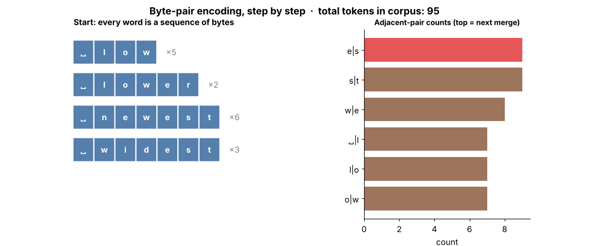

# Tier 6 — Tokenization & Embeddings

> **Phase 2 · Transformers & Foundation Models** · Author: ChatGPT/Claude draft (see `CHAPTER_STATUS.md`) · Status: `AUTHOR_DRAFT` (Critic / Code-review / Final-review pending)
> Prerequisites: Tier 1 (vectors, matrices, dot product), Tier 3 (embeddings as learned layers). Leads to: Tier 7 Attention, Tier 8 Transformers.

**Tier goal.** After this tier you can turn raw text into integer IDs, explain *why* subword tokenization won, train a byte-level BPE from scratch, explain what the embedding matrix is, and explain *three* different ways a Transformer is told about word order (learned, sinusoidal, RoPE/ALiBi).

---

## 0 · How to use this tier (theory → see → play → code)

| Step | What | Where |
|---|---|---|
| 1. Read | Intuition + mechanics | this file |
| 2. **See** | Static figures and animated GIFs (labelled) | [`figures/`](figures) — embedded below |
| 3. **Play** | Interactive pages with sliders (open in a browser) | [`interactive/`](interactive) |
| 4. **Build** | Mini byte-level BPE + positional-encoding library, with tests | [`lab/`](lab) |
| 5. **Regenerate** | All figures come from one script | `python scripts/make_figures.py` |

**Interactive explorers** (download the repo and double-click the HTML file; they are self-contained, no internet, no install):

| Explorer | Adjustable controls | Teaches |
|---|---|---|
| [`bpe_trainer.html`](interactive/bpe_trainer.html) | training text, #merges, probe text | 6.5, 6.12, 6.27, 6.31 |
| [`positional_encoding.html`](interactive/positional_encoding.html) | d_model, #positions, base, query position | 6.20, 6.22 |
| [`rope_explorer.html`](interactive/rope_explorer.html) | m, n, base θ, head dim, shift | 6.24, 6.23 |
| [`vocab_tradeoff.html`](interactive/vocab_tradeoff.html) | V, d_model, doc length, tied embeddings | 6.19, 6.28, 6.32 |

> **Note on animation tooling.** The GIFs are rendered with Matplotlib (`PillowWriter`) so they regenerate with `pip install matplotlib pillow`. Manim could not be installed in the authoring sandbox (it needs system Cairo/Pango builds); the figure scripts are written so a Manim scene can replace any GIF later without changing this text.

---

## 1 · The big picture

```
 raw text ──► normalize ──► pre-tokenize ──► tokenizer ──► token IDs ──► embedding lookup ──► + position info ──► Transformer
 "Héllo!"      NFC          words/bytes      BPE/WP/SP     [812, 90, 3]    E[ids]  (V×d)         PE / RoPE / ALiBi       (Tier 7-8)
```

A neural network only multiplies numbers. Tokenization is the **lossy-or-lossless bridge** from text to integers; embeddings are the bridge from integers to vectors; position information repairs the fact that attention by itself is order-blind.


*Figure 1 — The same word at four granularities. Fewer tokens ⇒ shorter sequences (cheaper attention) but a larger vocabulary to store and learn.*

---

## 2 · Concept map (every roadmap item → where it is taught)

| Roadmap | Section | Roadmap | Section |
|---|---|---|---|
| 6.1 Text preprocessing | §3 | 6.17 Token embedding | §8 |
| 6.2 Character tokenization | §4 | 6.18 Embedding matrix | §8 |
| 6.3 Word tokenization | §4 | 6.19 Embedding dimensions | §8 |
| 6.4 Byte tokenization | §4 | 6.20 Positional information | §9 |
| 6.5 Subword tokenization | §5 | 6.21 Learned positional emb. | §9.1 |
| 6.6 Vocabulary | §6 | 6.22 Sinusoidal encoding | §9.2 |
| 6.7 Token IDs | §6 | 6.23 Relative positional enc. | §9.3 |
| 6.8–6.11 UNK/PAD/BOS/EOS | §7 | 6.24 RoPE | §9.4 |
| 6.12 BPE | §5.1 | 6.25 ALiBi | §9.5 |
| 6.13 WordPiece | §5.2 | 6.26 Token vs semantic emb. | §8.3 |
| 6.14 SentencePiece | §5.3 | 6.27 Tokenizer training | §5.4 |
| 6.15 Unigram LM | §5.4 | 6.28 Vocab-size trade-offs | §10 |
| 6.16 Attention masks | §7.2 | 6.29 Byte fallback | §4.3 |
| 6.30 Unicode normalization | §3 | 6.31–6.32 Efficiency / compression | §10 |

---

## 3 · Text preprocessing & Unicode normalization (6.1, 6.30)

**What.** Everything done to a string *before* the tokenizer's vocabulary is applied: Unicode normalization, optional lower-casing, whitespace handling, and **pre-tokenization** (splitting into word-like chunks so merges do not cross word boundaries).

**Why.** The same visible text can have different byte sequences. `é` can be one code point (U+00E9, NFC) or `e` + combining accent (U+0065 U+0301, NFD). Without normalization these map to different token IDs and the model treats them as unrelated.

```python
import unicodedata
a, b = "café", "café"
print(a == b, len(a), len(b))                       # False 4 5
print(unicodedata.normalize("NFC", b) == a)         # True
```

| Form | Meaning | Typical use |
|---|---|---|
| NFC | compose where possible | default for most LLM tokenizers' inputs |
| NFD | decompose | linguistic analysis |
| NFKC | also folds *compatibility* chars (`fi`→`fi`, full-width→ASCII) | search / BERT-style cleanup; **lossy** |

**Common mistakes.** (1) Lower-casing for a model that must preserve case (code, names). (2) NFKC on code or math, which silently changes characters. (3) Normalizing at training time but not at inference time (train/serve skew).
**Security.** Visually identical Unicode (homoglyphs, zero-width characters) is a classic prompt-filter bypass: normalize *before* any keyword/guardrail check, and know that normalization differs between your filter and the model's tokenizer.
**Memory hook.** *"Same pixels, different bytes — normalize before you count."*

---

## 4 · Character, word and byte tokenization (6.2, 6.3, 6.4, 6.29)

### 4.1 Character

Each Unicode character is a token. Vocabulary is small (hundreds to ~150k code points), **no out-of-vocabulary** problem, but sequences are long (≈ 1 token per char) so attention cost (O(n²), Tier 7) and latency rise, and the model must learn spelling→meaning from scratch.

### 4.2 Word

Split on whitespace/punctuation. Short sequences, but vocabulary explodes (every inflection, typo, name, URL is a new entry), and anything unseen becomes `<UNK>`. `"unhappiness"` and `"unhappy"` share no parameters.

### 4.3 Byte (and byte fallback)

Operate on the 256 UTF-8 byte values. **Any** string is representable — no UNK ever. Cost: non-Latin scripts take 2–4 bytes per character, so sequences get long. **Byte fallback** (used by SentencePiece-based models such as Llama-family tokenizers — verify per model, `REVIEW_REQUIRED`) keeps a normal subword vocabulary but encodes unseen characters as raw bytes instead of `<UNK>`.

| | Vocab | Seq. length | UNK? | Failure mode |
|---|---|---|---|---|
| Character | ~10²–10⁵ | longest-ish | rare | long sequences, slow |
| Word | 10⁵–10⁶ | shortest | **common** | OOV, huge embedding table |
| Byte | 256 | very long | never | 2–4× length for non-Latin |
| Subword | 10⁴–2·10⁵ | medium | never (with byte base) | splits rare words oddly |

---

## 5 · Subword tokenization (6.5, 6.12–6.15, 6.27)

**Core idea.** Keep frequent words whole; split rare words into reusable pieces: `unhappiness → un | happi | ness`. You get a bounded vocabulary, short-ish sequences and no UNK.

### 5.1 BPE — Byte-Pair Encoding (6.12) — *major concept*

**Training algorithm** (greedy, frequency-based):

1. Start with base symbols (bytes or characters). Each pre-tokenized word is a sequence of symbols.
2. Count every adjacent pair across the corpus (weighted by word frequency).
3. Merge the most frequent pair into a new symbol; record the merge.
4. Repeat until the vocabulary reaches the target size.

**Encoding** applies the learned merges **in the order learned** (earlier merge = higher priority). Decoding concatenates bytes — lossless.



*Figure 2 — Left: each row is a word (×frequency); red = the symbol just created. Right: pair counts; the top bar is merged next. Watch "total tokens" fall every step. Try it yourself with different text: [`bpe_trainer.html`](interactive/bpe_trainer.html).*

**Input → Process → Output**

```
"low lower lowest"
   │ pre-tokenize        ["low", " lower", " lowest"]
   │ bytes               [l,o,w] [␣,l,o,w,e,r] [␣,l,o,w,e,s,t]
   │ apply merges o+w, l+ow, ␣+low, ...
   ▼
tokens: [low] [␣low][er] [␣low][est]   →  ids [260, 263, 270, ...]
```

**Code — manual → minimal → library.** The authoritative implementation is [`lab/mini_bpe.py`](lab/mini_bpe.py) (≈100 lines, byte-level, round-trips any Unicode string). The core loop:

```python
for k in range(num_merges):
    counts = pair_counts(seqs, weights)                 # 1. count pairs
    best = max(counts.items(), key=lambda kv: (kv[1], -kv[0][0], -kv[0][1]))[0]   # 2. most frequent (deterministic ties)
    seqs = [merge_pair(s, best, new_id) for s in seqs]  # 3. merge everywhere
```

*Framework equivalent* (verify API against current docs — `REVIEW_REQUIRED`): Hugging Face `tokenizers` (`BPE`, `ByteLevel` pre-tokenizer, `BpeTrainer`) or OpenAI's `tiktoken` for *using* published vocabularies. Do not train production tokenizers with the toy code.

**Advantages.** No UNK (byte base); tunable vocab size; good compression on training-like text.
**Limitations.** Greedy and frequency-driven, not linguistically aware; numbers and rare scripts may fragment unevenly (e.g. `1234` may split as `123|4`, hurting arithmetic); tokenizer is **frozen** once the model is trained.
**Trade-offs.** More merges → shorter sequences + bigger embedding/softmax (§10).
**Common mistakes.** Training the tokenizer on data unlike deployment data; changing the tokenizer without retraining the model; forgetting that a leading space is part of the token (`"low"` ≠ `" low"`); comparing "token counts" between different tokenizers as if they were equal units.
**Performance / cost.** Providers bill per token, so tokenizer efficiency on *your* language/domain is a direct cost multiplier (§10).
**Security.** Adversarial strings can exploit glitch tokens (rarely trained tokens → unstable behavior); never use token counts as a security boundary; untrusted text can inflate token counts (cost-DoS) — cap input *tokens*, not characters.
**Interview (30–60 s).** *"BPE builds a vocabulary bottom-up: start from bytes, repeatedly merge the most frequent adjacent pair until you hit the vocab size. That gives frequent words as single tokens and rare words as pieces, with no unknown tokens. The trade-off is vocabulary size versus sequence length, and the tokenizer is fixed after training, so it has to match the model."*
**Rapid-fire.** Greedy frequency-based merges of adjacent symbols → subword vocab.
**Questions.** *Basic:* What does BPE merge? *Intermediate:* Why byte-level instead of character-level BPE? *Advanced:* Why do merges have to be applied in learned order at inference? *Scenario:* Your Hindi users are billed 3× more per message than English users — diagnose and propose options.
**Hands-on.** Run `lab/mini_bpe.py`; plot bytes/token vs #merges on a 1 MB text; find where returns diminish.
**Memory hook.** *"Merge the most common pair, again and again."*

### 5.2 WordPiece (6.13)

Used by BERT-family models. Like BPE it builds up from characters, but chooses merges that maximize **training-data likelihood** (commonly described as `score = freq(ab) / (freq(a)·freq(b))`) rather than raw pair frequency, and marks continuation pieces with `##` (`un ##happi ##ness`). Encoding is **greedy longest-match-first** against the vocabulary. *(Exact scoring details vary across implementations — `REVIEW_REQUIRED` before quoting formulas externally.)*

### 5.3 SentencePiece (6.14)

A **library/framework**, not a single algorithm: it implements BPE *and* Unigram directly on raw text, treating whitespace as a normal symbol (`▁`). Benefits: language-agnostic (no pre-tokenizer assumption of spaces — good for Japanese/Chinese), fully reversible, optional byte fallback, normalization built in.

### 5.4 Unigram LM tokenizer (6.15) and tokenizer training (6.27)

**Unigram** works top-down: start with a large candidate vocabulary, fit a probabilistic model where each token has a probability, and **prune** tokens whose removal hurts corpus likelihood least. It can output several segmentations with probabilities (*subword regularization*, a training-time augmentation).

**Training a tokenizer (any type) — checklist**

1. Choose a corpus *representative of production* (languages, code, domain terms).
2. Normalize (§3), choose pre-tokenization rules (digits? whitespace? code indentation?).
3. Choose algorithm and target vocab size (§10); reserve special tokens (§7).
4. Train; **measure** compression per language/domain, fragmentation of numbers, URLs, code.
5. Freeze + version it (tokenizer files are part of the model artifact).

| | BPE | WordPiece | Unigram |
|---|---|---|---|
| Direction | bottom-up merges | bottom-up (likelihood) | top-down pruning |
| Encoding | apply merges in order | greedy longest match | Viterbi best segmentation |
| Multiple segmentations | no (deterministic) | no | yes (sampling) |
| Typical users | GPT-style, many open LLMs | BERT-family | T5-family via SentencePiece |

---

## 6 · Vocabulary and token IDs (6.6, 6.7)

The **vocabulary** is the ordered table `token string/bytes → integer ID`. **Token IDs** are just row indices into the embedding matrix; they carry **no meaning or ordering** (ID 500 is not "close" to ID 501). Because IDs index parameter rows, *vocabulary and model checkpoint are inseparable*: a different tokenizer means every ID points to the wrong row.

**Common mistake.** Mixing a tokenizer from one model with weights from another, or resizing the vocabulary (adding special tokens) without resizing and training the new embedding rows.

---

## 7 · Special tokens and masks (6.8–6.11, 6.16)

### 7.1 UNK, PAD, BOS, EOS

| Token | Role | Gotcha |
|---|---|---|
| `<UNK>` | stands for unseen input | byte-level/byte-fallback tokenizers rarely or never emit it |
| `<PAD>` | fills short sequences so a batch is a rectangle | must be **masked**, not attended to |
| `<BOS>` | marks sequence start; gives position 0 a consistent anchor | some models omit it; follow the model card |
| `<EOS>` | marks end; teaches the model **when to stop generating** | missing EOS in fine-tuning data ⇒ model never stops (Tier 10) |

Special-token **strings in user input** (e.g. a user typing `<EOS>` or chat-template markers) must be treated as plain text, not as control tokens — otherwise you have a prompt-injection channel.

### 7.2 Attention masks (6.16)

A mask is a 0/1 (or 0/−∞) array telling attention which positions are real. The **padding mask** hides `<PAD>`; the **causal mask** hides the future (full mathematics in Tier 7 — authoritative location). The figure (right panel) shows the padding mask for a batch of two sequences with lengths 5 and 8.


*Figure 3 — Left: ALiBi bias (§9.5). Middle: causal mask. Right: padding mask for a batch of 2.*

```python
from positional import padding_mask
padding_mask([5, 8])   # [[1,1,1,1,1,0,0,0],[1,1,1,1,1,1,1,1]]
```

---

## 8 · Embeddings (6.17, 6.18, 6.19, 6.26)

### 8.1 Token embedding & the embedding matrix (6.17, 6.18)

An **embedding matrix** `E ∈ ℝ^{V×d}` holds one learnable vector per token. Looking up token ID *i* returns row *i*. This is mathematically identical to `one_hot(i) @ E`, but implemented as indexing because multiplying a one-hot vector by a V×d matrix wastes compute.


*Figure 4 — A token ID selects one row. The same ID always returns the same vector at this stage (no context yet).*

```python
import torch, torch.nn as nn
emb = nn.Embedding(num_embeddings=8, embedding_dim=4)    # E: 8 × 4
ids = torch.tensor([2, 5, 2])
x = emb(ids)                                             # shape (3, 4); rows 0 and 2 identical
assert torch.equal(x[0], x[2])
```

Embeddings are **learned by backpropagation** like any weight (Tier 4); gradients touch only the rows used in the batch. **Weight tying** (shared input embedding / output projection) halves this parameter block (Tier 8.22).

### 8.2 Embedding dimension (6.19)

`d_model` is the width of the residual stream — the width every layer reads/writes. It sets parameter count (`V·d` for the table), memory and capacity. Typical sizes: hundreds (small encoders) to several thousand (large LLMs); the table can be a sizable fraction of a small model, and negligible for a very large one. Try the sliders in [`vocab_tradeoff.html`](interactive/vocab_tradeoff.html).

### 8.3 Token embeddings vs semantic embeddings (6.26)

| | Token (input) embedding | Semantic (sentence/document) embedding |
|---|---|---|
| What | row of `E`, one per token | one vector for a whole text from a trained encoder |
| Context-aware | **no** (static at input) | **yes** (encodes the full text) |
| Used for | first layer of an LLM | search, clustering, RAG retrieval (Tier 20) |
| Produced by | table lookup | forward pass of a model, then pooling |

Do not confuse the two: "embedding" in a vector database refers to the right column.

---

## 9 · Positional information (6.20–6.25)

**Why it exists.** Self-attention (Tier 7) treats its input as a *set*: shuffle the tokens and — without position information — the per-token outputs shuffle identically. "dog bites man" ≠ "man bites dog", so order must be injected.

### 9.1 Learned absolute positions (6.21)

A second table `P ∈ ℝ^{L_max×d}`; input = `E[token] + P[position]`. Simple and flexible (GPT-2, BERT). **Limit:** positions beyond `L_max` have no vector; no built-in extrapolation.

### 9.2 Sinusoidal encoding (6.22)

Fixed, parameter-free (original Transformer):

```
PE[pos, 2i]   = sin(pos / 10000^(2i/d))
PE[pos, 2i+1] = cos(pos / 10000^(2i/d))
```

Each dimension pair is a wave with its own wavelength (from 2π up to 10000·2π): fast pairs resolve neighbouring positions, slow pairs distinguish far ones — like the digits of a clock. A shift by *k* is a **linear map** (a rotation) of the encoding, which was the motivation for the design.


*Figure 5 — Left: heatmap (position × dimension). Middle: single dimensions are sine waves of different periods. Right: similarity between positions falls with distance. Explore with sliders: [`positional_encoding.html`](interactive/positional_encoding.html).*

### 9.3 Relative positional information (6.23)

Instead of "I am token #57", encode "that token is 3 steps behind me". It generalizes better to unseen lengths and matches linguistic intuition (nearby words matter). Implementations: learned relative biases (T5-style), **RoPE**, **ALiBi**.

### 9.4 RoPE — Rotary Position Embedding (6.24) — *major concept*

**Idea.** Instead of *adding* a position vector, **rotate** the query and key vectors. Split a head's vector into 2-D pairs; rotate pair *i* at position *m* by angle `m·θᵢ`, with `θᵢ = base^(−2i/d)` (base 10000 in the original paper; some newer models use larger bases for long context — `REVIEW_REQUIRED` per model).

**Key property.** For rotations `R`, `(R_m q)·(R_n k) = q·R_{n−m}·k` — the attention score depends on content **and only the relative offset** `m−n`. No extra parameters, applied to Q and K (not V, not the residual stream).


*Figure 6 — Position m rotates each 2-D pair by m·θ. The left pair has a large θ and spins fast; the right pairs barely move. Verify relative-position invariance interactively in [`rope_explorer.html`](interactive/rope_explorer.html): slide "shift both by" and the score stays fixed.*

```python
from positional import apply_rope
q = apply_rope(q_matrix)      # q_matrix: (n_pos, d_head), d_head even
k = apply_rope(k_matrix)
scores = q @ k.T              # relative-position-aware attention logits
```

The test `test_rope_preserves_norm_and_is_relative` in [`lab/test_tier06.py`](lab/test_tier06.py) proves both properties numerically.

**Advantages.** Relative information with no learned table; norm-preserving; widely adopted in open LLM families (Llama-style; see Tier 12 case studies).
**Limitations.** Quality can degrade beyond trained length; extending context needs scaling tricks (position interpolation, base changes, YaRN-style methods — Tier 12.8 is authoritative for variants).
**Common mistakes.** Odd head dim; applying RoPE to V; mismatched pairing convention (interleaved vs half-split) between a checkpoint and your code — silently wrong results when loading weights.
**Interview (30–60 s).** *"RoPE encodes position by rotating query and key vectors in 2-D subspaces by an angle proportional to position. Because dot products of rotations depend only on the angle difference, attention automatically sees relative distance. It has no parameters and works well, but extending beyond the trained context needs rescaling the frequencies."*
**Rapid-fire.** Rotate Q and K by position-dependent angles so scores depend on relative offset.
**Memory hook.** *"Position is an angle; distance is the angle between."*

### 9.5 ALiBi (6.25)

No position vectors at all: add a **linear penalty to attention logits** proportional to distance, `score(i,j) = q_i·k_j − m_h·(i−j)`, with a different fixed slope `m_h` per head (geometric sequence). Distant tokens are softly down-weighted; good length extrapolation in the original work; used by some open models (e.g. BLOOM, MPT). See the left panel of Figure 3.

| Method | Learned params | Relative? | Extrapolates | Where applied |
|---|---|---|---|---|
| Learned absolute | yes (`L_max×d`) | no | no | input embedding |
| Sinusoidal | none | implicitly | weakly | input embedding |
| RoPE | none | **yes** | with scaling | Q and K |
| ALiBi | none | **yes** | good | attention logits |

---

## 10 · Vocabulary-size trade-offs, efficiency & compression (6.28, 6.31, 6.32)

**Bigger vocabulary** ⇒ more characters per token (shorter sequences ⇒ cheaper attention, lower latency, more text per context window, lower per-character API cost) **but** a larger embedding table and output softmax (`V×d` each), and rarer tokens that get few training updates.


*Figure 7 — Illustrative curve (assumed compression law, not measured). Use [`vocab_tradeoff.html`](interactive/vocab_tradeoff.html) to move V, d and document length and read off tokens, parameters and memory.*

**Measuring efficiency (6.31/6.32):** report **bytes per token** (or tokens per character, or **fertility** = tokens per word) *per language and domain*. English prose is often around 3.5–4.5 chars/token on modern tokenizers (`REVIEW_REQUIRED` — varies by tokenizer); many non-Latin scripts and code with unusual formatting can be several times worse, which is a **fairness and cost issue**: the same message costs more and fits less in the context window.

```python
from mini_bpe import ByteBPE, compression_ratio
tok = ByteBPE.train(corpus, num_merges=200)
print(compression_ratio(tok, corpus))   # UTF-8 bytes per token
```

**Enterprise use case.** A multilingual support product measures fertility per language on 1,000 real tickets before choosing a model; a Thai/Hindi cost gap becomes a pricing and context-budget decision.
**AI-engineering connection.** Context windows, rate limits, chunk sizes in RAG (Tier 20), prompt budgets (Tier 17) and cost dashboards (Tier 36) are all in *tokens* — always count with the **target model's** tokenizer.
**Interview.** *"Why not just use a huge vocabulary?"* → bigger softmax/embedding, rare-token undertraining, diminishing compression gains, and more memory; *why not bytes?* → sequences 3–4× longer for non-ASCII and quadratic attention cost.

---

## 11 · Build: miniature BPE tokenizer + positional lab

| File | What it is |
|---|---|
| [`lab/mini_bpe.py`](lab/mini_bpe.py) | byte-level BPE: `train`, `encode`, `decode`, `tokens`, `compression_ratio` |
| [`lab/positional.py`](lab/positional.py) | sinusoidal table, RoPE, ALiBi, embedding lookup, padding mask |
| [`lab/test_tier06.py`](lab/test_tier06.py) | 10 pytest tests: round-trip on Unicode/emoji, determinism, RoPE relative property, ALiBi values, masks |
| [`scripts/make_figures.py`](scripts/make_figures.py) | regenerates every figure/GIF |

```bash
cd lab && python -m pytest -q      # 10 passed
python mini_bpe.py                 # demo
```

**Exercises**

1. Train on 3 different corpora (English prose, Python code, a non-English text). Plot bytes/token vs #merges for each. *Which corpus compresses best and why?*
2. Add a regex pre-tokenizer that isolates digits one by one. Compare tokenization of `"1234567"`. *What changes for arithmetic?*
3. Break it: encode a string containing `"<EOS>"`. Is it one control token or 5 ordinary tokens? Which is safe for user input?
4. In `rope_explorer.html` set base θ to 100 vs 100000. Which pairs stop rotating? Predict what that does to long-range resolution.
5. Extend `lab/positional.py` with learned-absolute positions in PyTorch and compare to sinusoidal on a toy "reverse the sequence" task. *(stretch)*

---

## 12 · Interview kit (whole tier)

**Basic.** What is a token? What is `<PAD>` for? What does an embedding matrix look like?
**Intermediate.** Compare BPE, WordPiece and Unigram. Why add position information? Learned vs sinusoidal?
**Advanced.** Derive why RoPE gives relative-position attention. Why does ALiBi extrapolate? How does byte fallback differ from byte-level BPE?
**Scenario.** *Your RAG chunker splits by 500 *characters* but the LLM rejects some chunks as too long.* (Tokens ≠ characters; count with the model's tokenizer, set budgets in tokens.)

**60-second tier summary.** *"Models don't read text; they read integer IDs from a frozen tokenizer — usually byte-level BPE or Unigram — then look each ID up in an embedding matrix. Attention is order-blind, so we add position: learned vectors, sinusoids, or—in modern models—rotations (RoPE) or distance biases (ALiBi). Vocabulary size trades sequence length against embedding size, and tokenizer efficiency per language is a real cost and fairness lever."*

## 13 · Revision questions

1. Why is `unhappiness → un|happi|ness` better than word-level? Than character-level?
2. Why must a tokenizer be shipped with the model weights?
3. What breaks if you apply merges in a different order than they were learned?
4. Show `one_hot(i) @ E == E[i]`. Why do we index instead?
5. Why can ID 500 and 501 be unrelated words?
6. State RoPE's key property in one sentence, and test it numerically.
7. Give two reasons a bigger vocabulary can hurt.

## 14 · Related concepts & forward references

Attention masks in full → Tier 7. Weight tying, parameter counting → Tier 8. RoPE extensions, long-context → Tier 12. Semantic embeddings for retrieval → Tier 20. Chat-template special tokens → Tier 10. Token-based cost control → Tier 36.

## 15 · Review status

| Item | State |
|---|---|
| Code (`lab/`) | **TESTED** — `pytest`: 10 passed (Python 3.13, NumPy) |
| Interactive pages | **TESTED** in headless Chromium: no JS errors, sliders exercised; RoPE shift-invariance checked numerically |
| Figures | regenerated by script; visually spot-checked |
| Numeric claims about specific model vocab sizes / chars-per-token | `REVIEW_REQUIRED` (marked inline) |
| Critic / Code-review / Final-review | pending per `CHAPTER_STATUS.md` |
