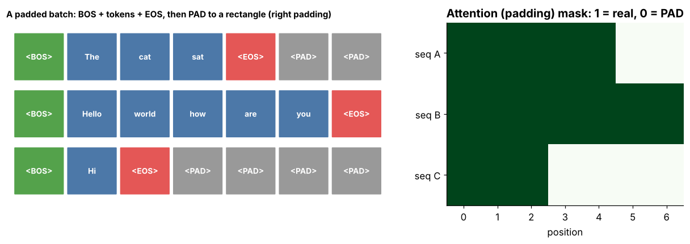

## 6.9 PAD

Metadata:

- Tier: 6 — Tokenization & Embeddings
- Phase: 2 — Transformers & Foundation Models
- Priority: High
- Difficulty: Beginner
- Interview Importance: High
- Hands-on Importance: High
- Prerequisites: [6.7 Token IDs](06.07-token-ids.md)
- Leads To: [6.16 Attention masks](06.16-attention-masks.md)

---

### 1. WHAT IS IT?

`<PAD>` is the filler token appended (or prepended) to shorter sequences so that a batch of sequences forms a rectangular tensor.

### 2. WHY DOES IT EXIST?

GPUs process tensors of fixed shape; sequences in a batch have different lengths.

### 3. DETAILED EXPLANATION

PAD carries no information and must not influence the result: the **attention mask** ([6.16 Attention masks](06.16-attention-masks.md)) hides PAD positions from attention, and the **loss** must ignore PAD targets (e.g. `ignore_index` in cross-entropy). Padding side matters: right padding is the training default; left padding is typical for batched *generation* so that the last real token is aligned at the end (`REVIEW_REQUIRED` per framework).

Cost: padding wastes compute proportional to the pad fraction; bucketing sequences by length reduces it.

### 4. HOW DOES IT WORK?

`max_len = max(len(s))`; fill every row to `max_len` with the PAD ID; build a 0/1 mask.



*Figure 9 - A padded batch with BOS/EOS and the matching attention mask; grey PAD cells are masked.*

### 5. SIMPLE EXAMPLE

Putting blank sheets into folders so that all folders have the same thickness; the blank sheets are ignored when reading.

### 6. TECHNICAL EXAMPLE

A batch of 3 prompts with lengths 5, 9 and 3 becomes a 3x9 tensor; 27 slots, 17 real tokens, 37% padding waste.

### 7. CODE

```python
# run inside lab/
from tokenizer_extras import batch_pad
ids, mask = batch_pad([[7, 8], [9]], bos=1, eos=2, pad=0)
print(ids)    # [[1 7 8 2] [1 9 2 0]]
print(mask)   # [[1 1 1 1] [1 1 1 0]]
```
Code: [`lab/tokenizer_extras.py`](../lab/tokenizer_extras.py) | [explore: `special_tokens_batching.html`](../interactive/special_tokens_batching.html)

### 8. INPUT → PROCESS → OUTPUT

```
[[a b c], [d e]] ──pad──► [[a b c], [d e PAD]] ──mask──► [[1 1 1], [1 1 0]]
```

### 9. ENTERPRISE USE CASE

Inference servers use length bucketing or continuous batching to cut padding waste (see Tier 11).

### 10. AI ENGINEERING CONNECTION

Source of subtle bugs: forgetting the mask leaks PAD into attention; forgetting `ignore_index` trains the model to predict PAD.

### 11. ADVANTAGES

Enables dense batched computation.

### 12. LIMITATIONS

Wasted compute and memory; must be masked in both attention and loss.

### 13. TRADE-OFFS

Simplicity of rectangular batches versus wasted FLOPs; packing and bucketing trade code complexity for efficiency.

### 14. COMMON MISTAKES

- Attending to PAD (no mask).
- Including PAD in the loss.
- Left/right padding mismatch at generation time.
- Using the EOS ID as PAD without handling the mask carefully (common in some models; follow the model card).

### 15. PERFORMANCE / COST CONSIDERATIONS

Padding fraction = wasted FLOPs. Sorting by length or packing multiple sequences per row can recover most of it.

### 16. SECURITY CONSIDERATIONS

Differences in padding behaviour between batch sizes can change outputs slightly and cause non-determinism; do not treat PAD handling as security-neutral in multi-tenant batching (cross-request leakage if masks are wrong).

### 17. INTERVIEW EXPLANATION

*"PAD fills short sequences so a batch is rectangular. It carries no information, so it is masked out of attention and ignored by the loss, and we reduce its cost by bucketing by length."*

### 18. RAPID-FIRE ANSWER

Filler to make batches rectangular; always masked.

### 19. INTERVIEW QUESTIONS

- **Basic:** What is PAD for?
- **Intermediate:** Why left-pad for batched generation?
- **Advanced:** Where must PAD be ignored besides attention?
- **Scenario:** Throughput is half what you expect with mixed-length requests; what do you check?

### 20. HANDS-ON EXERCISE

Use the interactive page to find the padding waste for lengths [3, 9, 5]; then sort by length into two buckets and recompute.

### 21. REVISION QUESTIONS

1. Two places PAD must be ignored?
2. Right vs left padding: when each?

### 22. RELATED CONCEPTS

[6.16 Attention masks](06.16-attention-masks.md), [6.10 BOS](06.10-bos.md), [6.11 EOS](06.11-eos.md)

### 23. ONE-LINE MEMORY HOOK

*Pad to fit the tensor, mask to forget the pad.*
