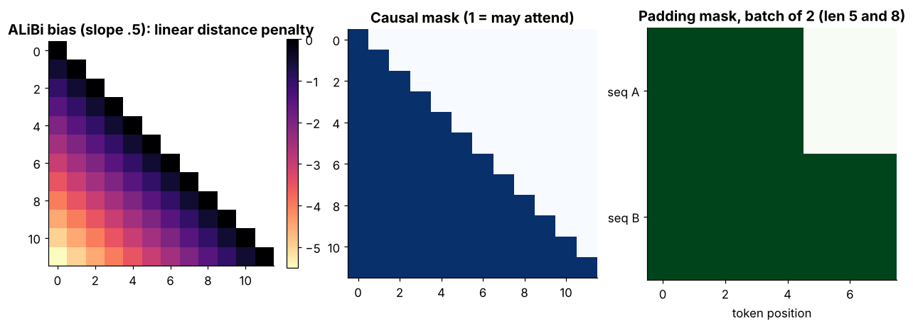

## 6.16 Attention masks

Metadata:

- Tier: 6 — Tokenization & Embeddings
- Phase: 2 — Transformers & Foundation Models
- Priority: Critical
- Difficulty: Intermediate
- Interview Importance: Very high
- Hands-on Importance: High
- Prerequisites: [6.9 PAD](06.09-pad.md), [6.7 Token IDs](06.07-token-ids.md)
- Leads To: [Tier 7](../../tier-07-attention/README.md) (attention math), [Tier 8](../../tier-08-transformer-architecture/README.md)

---

### 1. WHAT IS IT?

An attention mask is a 0/1 (or 0/-infinity) array telling the attention layer which positions may be attended to. The **padding mask** hides `<PAD>` positions; the **causal mask** hides future positions.

### 2. WHY DOES IT EXIST?

Padding carries no information and the future must be invisible during next-token training; masks enforce both without changing tensor shapes.

### 3. DETAILED EXPLANATION

Masking is applied to attention *scores* before softmax: allowed positions keep their score, forbidden ones are set to `-inf`, so softmax gives them exactly zero weight. Full attention mathematics is owned by [Tier 7](../../tier-07-attention/README.md); this file covers only what the *tokenization* side must provide: the PAD mask.

Combining: `allowed = causal AND key_is_real`. A row with **no** allowed key (possible with left padding and a padded query) produces NaN in softmax; frameworks avoid or patch that case (`REVIEW_REQUIRED` per framework).

### 4. HOW DOES IT WORK?



*Figure 3 - Left: ALiBi bias. Middle: causal mask. Right: padding mask for a batch of 2 (lengths 5 and 8).*

### 5. SIMPLE EXAMPLE

Covering the blank lines of an exam sheet so that nobody can read answers into them, and covering the future pages so nobody peeks ahead.

### 6. TECHNICAL EXAMPLE

In a batch with lengths 5 and 8, sequence A's three last key positions are masked for every query.

### 7. CODE

```python
# run inside lab/
import numpy as np
from positional import padding_mask
pm = padding_mask([3, 5])                       # (batch, seq)  1 = real, 0 = PAD
causal = np.tril(np.ones((5, 5), dtype=int))    # (seq, seq)
allowed = causal[None] * pm[:, None, :]         # (batch, query, key)
scores = np.zeros((2, 5, 5))                    # pretend raw attention scores
scores = np.where(allowed == 1, scores, -np.inf)
w = np.exp(scores - scores.max(-1, keepdims=True)); w /= w.sum(-1, keepdims=True)
print(w[0, 4].round(2))                         # [0.33 0.33 0.33 0. 0.] -> PAD keys get zero weight
```
Code: [`lab/positional.py`](../lab/positional.py) | [explore: `special_tokens_batching.html`](../interactive/special_tokens_batching.html)

### 8. INPUT → PROCESS → OUTPUT

```
tokens + lengths ──► padding mask ──AND causal──► mask on scores ──softmax──► weights (0 on masked)
```

### 9. ENTERPRISE USE CASE

Serving stacks build masks per batch; wrong masks are a data-leakage bug across requests in shared batches.

### 10. AI ENGINEERING CONNECTION

Foundation of correct batched training/inference for every transformer; mask bugs produce subtly wrong results without errors.

### 11. ADVANTAGES

Fixed shapes; GPU-friendly; exact.

### 12. LIMITATIONS

O(n^2) mask memory if materialized (fused kernels avoid it); all-masked rows give NaN.

### 13. TRADE-OFFS

Explicit masks are simple but wasteful; fused/flash kernels trade flexibility for memory ([Tier 7](../../tier-07-attention/README.md)).

### 14. COMMON MISTAKES

- Forgetting the padding mask.
- Using 0 instead of -inf (or a large negative) on *scores*.
- Mask dtype/broadcast shape errors.
- Left-padding with absolute positions not shifted.

### 15. PERFORMANCE / COST CONSIDERATIONS

Mask construction is cheap; materialized masks cost O(batch x seq^2) memory.

### 16. SECURITY CONSIDERATIONS

Incorrect masks can leak one request's tokens into another's attention in multi-tenant batching; test with canary inputs.

### 17. INTERVIEW EXPLANATION

*"A padding mask hides PAD tokens so they get zero attention weight; a causal mask hides future tokens. Both are applied to the attention scores before softmax by setting forbidden entries to minus infinity."*

### 18. RAPID-FIRE ANSWER

Mask entries set to -inf on scores before softmax (padding + causal).

### 19. INTERVIEW QUESTIONS

- **Basic:** What does a padding mask do?
- **Intermediate:** Why -inf instead of 0 on the scores?
- **Advanced:** Why can a fully-masked row be a problem?
- **Scenario:** Outputs change when batch composition changes; what do you suspect?

### 20. HANDS-ON EXERCISE

Reproduce the snippet; then flip to left-padding and recheck which rows are fully masked.

### 21. REVISION QUESTIONS

1. Where is the mask applied?
2. Difference between causal and padding masks?

### 22. RELATED CONCEPTS

[6.9 PAD](06.09-pad.md), [6.25 ALiBi](06.25-alibi.md), [Tier 7](../../tier-07-attention/README.md)

### 23. ONE-LINE MEMORY HOOK

*Mask the pad, mask the future, set scores to minus infinity.*
