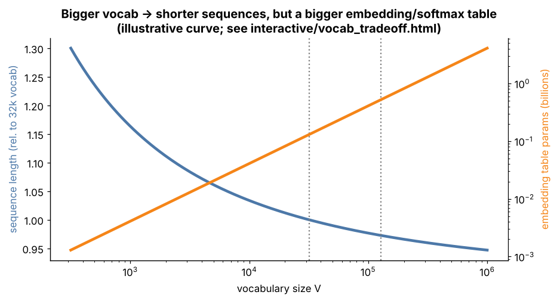

## 6.28 Vocabulary-size trade-offs

Metadata:

- Tier: 6 — Tokenization & Embeddings
- Phase: 2 — Transformers & Foundation Models
- Priority: Critical
- Difficulty: Intermediate
- Interview Importance: Very high
- Hands-on Importance: High
- Prerequisites: [6.18 Embedding matrix](06.18-embedding-matrix.md), [6.19 Embedding dimensions](06.19-embedding-dimensions.md), [6.5 Subword tokenization](06.05-subword-tokenization.md)
- Leads To: [6.31 Tokenization efficiency](06.31-tokenization-efficiency.md), [6.32 Tokens-per-character / compression intuition](06.32-tokens-per-character-compression-intuition.md)

---

### 1. WHAT IS IT?

Vocabulary-size trade-offs are the balance between a larger vocabulary (shorter token sequences) and a larger embedding table and output softmax, plus less training signal per rare token.

### 2. WHY DOES IT EXIST?

Vocabulary size V is the main design knob of a tokenizer; it moves cost between sequence length and parameters.

### 3. DETAILED EXPLANATION

**Larger V:** more characters per token (shorter sequences, cheaper attention, lower latency, more text per context window, lower per-character API cost), **but** a bigger embedding table and output projection (`V*d` each, unless tied), a bigger softmax per step, and rarer tokens that get few training updates.

**Smaller V:** longer sequences, smaller layers, better coverage per token. Compression gains show **diminishing returns** as V grows (each extra merge helps less than the previous one). Multilingual models need more V to avoid overpaying in non-English languages ([6.31 Tokenization efficiency](06.31-tokenization-efficiency.md)). Typical ranges (`REVIEW_REQUIRED`): ~30k (BERT/Llama 2/T5-class) to >100k (recent large models).

### 4. HOW DOES IT WORK?



*Figure 7 - Illustrative curve (assumed compression law, not measured): tokens for the same text fall as V grows while embedding parameters grow linearly.*

Move V, d and document length in [explore: `vocab_tradeoff.html`](../interactive/vocab_tradeoff.html).

### 5. SIMPLE EXAMPLE

A phrasebook: more phrases make sentences shorter to say, but the book is heavier and the rare phrases are rarely practised.

### 6. TECHNICAL EXAMPLE

V = 128,000, d = 4,096: 524 M embedding parameters (and the same again if the output head is untied) - versus 131 M at V = 32,000.

### 7. CODE

```python
# run inside lab/ : measured diminishing returns of merges on a tiny corpus
from mini_bpe import ByteBPE, compression_ratio
text = ("the quick brown fox jumps over the lazy dog while the cat and the dog watch the fox run " * 20)
for m in [0, 5, 10, 20, 40, 80]:
    tok = ByteBPE.train(text, m)
    print(f"merges={m:3d} vocab={tok.vocab_size:4d} bytes/token={compression_ratio(tok, text):.2f}")
# params for the table at d=4096:
for V in (32_000, 128_000):
    print(V, f"{V*4096/1e6:.0f}M embedding params")
```

### 8. INPUT → PROCESS → OUTPUT

```
choose V ──► sequence length ↓ (V↑)   embedding+softmax params ↑ (V↑)   rare-token undertraining ↑ (V↑)
```

### 9. ENTERPRISE USE CASE

A multilingual assistant measures cost per language across candidate tokenizers; moving from 32k to 128k+ vocabularies is often justified by non-English savings (`REVIEW_REQUIRED` for specific numbers).

### 10. AI ENGINEERING CONNECTION

Affects softmax cost per generated token, KV-cache length per document, and training data coverage per token.

### 11. ADVANTAGES

Tuning V can cut sequence length (cost) at modest parameter cost.

### 12. LIMITATIONS

Gains saturate; large V undertrains rare tokens; changing V later is expensive.

### 13. TRADE-OFFS

Sequence length versus parameter/softmax cost and rare-token quality.

### 14. COMMON MISTAKES

- Maximizing V without checking undertrained tokens.
- Ignoring the untied output head in parameter counts.
- Comparing V across models without considering d.

### 15. PERFORMANCE / COST CONSIDERATIONS

Output softmax is `O(V*d)` per generated token; embedding memory `V*d` bytes-per-param.

### 16. SECURITY CONSIDERATIONS

Rare/undertrained tokens are associated with glitch behaviours; audit low-frequency tokens.

### 17. INTERVIEW EXPLANATION

*"Why not a huge vocabulary? A bigger vocabulary compresses text and shortens sequences, but the embedding table and softmax grow linearly, rare tokens are undertrained, and returns diminish. Why not bytes only? Sequences get 3-4x longer for non-ASCII text and attention cost is quadratic."*

### 18. RAPID-FIRE ANSWER

Bigger V: shorter sequences but larger embedding/softmax and rarer tokens.

### 19. INTERVIEW QUESTIONS

- **Basic:** What does V control?
- **Intermediate:** What are diminishing returns here?
- **Advanced:** How do you pick V for a multilingual model?
- **Scenario:** Latency per token rose after moving to a 256k vocabulary; why?

### 20. HANDS-ON EXERCISE

Run the snippet and plot bytes/token vs merges; then use the page to find where the table exceeds 1 GB in fp16 at d=4096.

### 21. REVISION QUESTIONS

1. Two costs of a larger V?
2. Why do gains diminish?

### 22. RELATED CONCEPTS

[6.18 Embedding matrix](06.18-embedding-matrix.md), [6.27 Tokenizer training](06.27-tokenizer-training.md), [6.31 Tokenization efficiency](06.31-tokenization-efficiency.md), [6.32 Tokens-per-character / compression intuition](06.32-tokens-per-character-compression-intuition.md)

### 23. ONE-LINE MEMORY HOOK

*Bigger vocab, shorter text, heavier table.*
