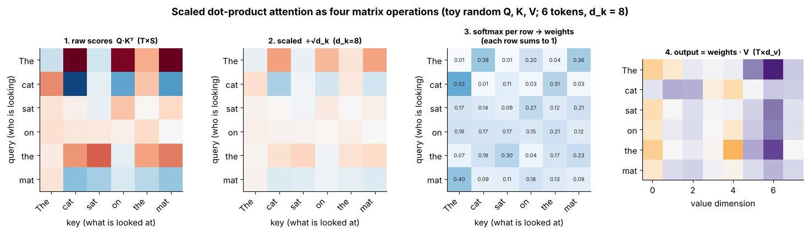
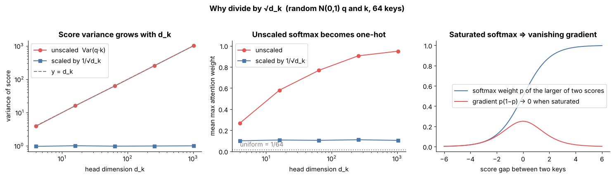
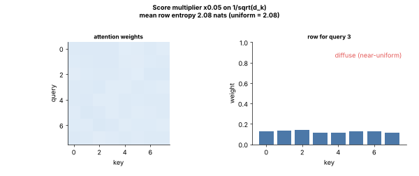
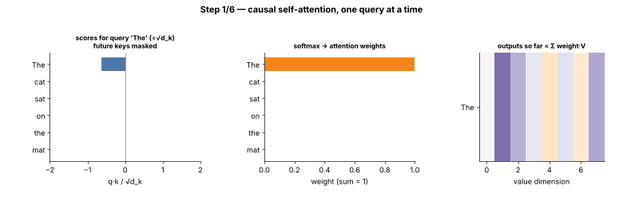
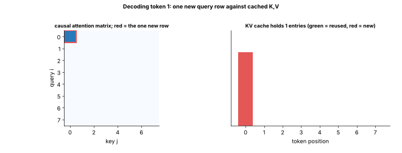
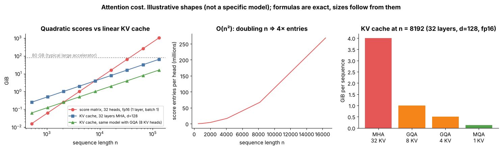
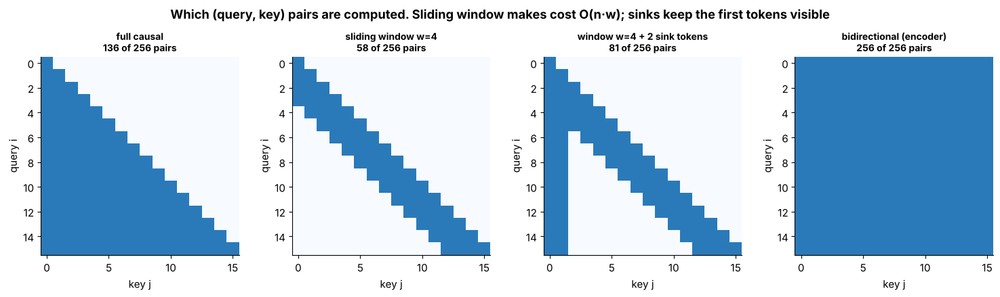

# Tier 7 — Attention

> **Phase 2 · Transformers & Foundation Models** · Author: ChatGPT/Claude draft (see `CHAPTER_STATUS.md`) · Status: `AUTHOR_DRAFT` (Critic / Code-review / Final-review pending)
> Prerequisites: Tier 1 (matrix multiply, dot product, softmax), Tier 3 (linear layers), Tier 6 (embeddings, positional information, mask basics). Leads to: Tier 8 Transformers (blocks, residuals, norms), Tier 12 (long context, serving).

**Tier goal.** After this tier you can write scaled dot-product attention from four matrix operations, explain every factor in `softmax(QKᵀ/√d_k + mask)V`, extend it to multi-head, MQA and GQA, compute its time and memory cost, explain what FlashAttention changes (and what it does not), and verify your own implementation against `torch.nn.functional.scaled_dot_product_attention`.

**Scope.** Tier 7 owns the **attention math**. Tier 8 owns how attention sits inside encoder/decoder blocks (residuals, LayerNorm/RMSNorm, FFN). Positional methods (RoPE, ALiBi) are taught in Tier 6; here we only show where they plug in. Serving-time KV-cache engineering belongs to Tier 12; we teach only the cache *size formula* (7.24) because it follows directly from MQA/GQA.

---

## 0 · How to use this tier (read → see → play → build)

| Step | What | Where |
|---|---|---|
| 1. Read | Intuition, mechanics, math | this file |
| 2. **See** | 7 labelled figures + 3 animated GIFs | [`figures/`](figures) — embedded below |
| 3. **Play** | 4 self-contained interactive pages (open in a browser, no internet) | [`interactive/`](interactive) |
| 4. **Build** | NumPy attention → MHA/GQA; PyTorch MHA; tests vs PyTorch SDPA | [`lab/`](lab) |
| 5. **Regenerate** | `python scripts/make_figures.py` | [`scripts/`](scripts) |

| Explorer | Adjustable controls | Teaches |
|---|---|---|
| [`attention_heatmap.html`](interactive/attention_heatmap.html) | sentence, d_k, scaling mode (1/√d_k, none, custom), temperature, causal mask, query row, seed | 7.6–7.11, 7.14, 7.26 |
| [`mask_explorer.html`](interactive/mask_explorer.html) | T, S (cross-attention), #real keys, causal, padding, window w, sink tokens | 7.12–7.17, 7.28, 7.30 |
| [`multihead_gqa.html`](interactive/multihead_gqa.html) | d_model, H, H_kv, layers, context, dtype | 7.18–7.22, 7.24 |
| [`memory_calculator.html`](interactive/memory_calculator.html) | n, H, H_kv, d_h, layers, batch, dtype, window, device memory | 7.23–7.25, 7.29, 7.30 |

---

## 1 · The big picture

```
 token IDs ─► embeddings (+ position info, Tier 6) ─► X  (T × d_model)
                                                      │
              ┌───────────────────────────────────────┤  three learned projections
              ▼                  ▼                    ▼
        Q = X·W_q          K = X·W_k            V = X·W_v
              └────── scores = Q·Kᵀ / √d_k  (+ mask) ─┐
                                     softmax per row ─┤  weights  (T × S, rows sum to 1)
                                     output = weights·V ┘  (T × d_v)  →  W_o  →  next layer (Tier 8)
```

An RNN (Tier 5) passes information through a fixed-size state one step at a time, so distant tokens interact only through a long chain. Attention lets **every position read every other position directly in one step**, with data-dependent weights. The price is that the number of query–key pairs is n², which drives almost every engineering topic in 7.23–7.30.



*Figure 1 — Four matrix operations on 6 tokens (random toy Q, K, V). Look at panel 3: every row sums to 1; panel 4 rows are weighted mixtures of V rows.*

---

## 2 · Concept map (every roadmap item → where it is taught)

| Roadmap | Section | Roadmap | Section |
|---|---|---|---|
| 7.1 Why attention | §3 | 7.16 Attention masks | §8 |
| 7.2 Query | §4 | 7.17 Padding masks | §8.3 |
| 7.3 Key | §4 | 7.18 Multi-head attention | §9 |
| 7.4 Value | §4 | 7.19 Head dimensions | §9.2 |
| 7.5 Q/K/V projections | §4.2 | 7.20 Projection matrices | §9.3 |
| 7.6 Dot-product similarity | §5.1 | 7.21 MQA | §10.1 |
| 7.7 Attention scores | §5.1 | 7.22 GQA | §10.2 |
| 7.8 Scaling by √d_k | §5.2 | 7.23 Attention complexity | §11.1 |
| 7.9 Softmax | §5.3 | 7.24 Attention memory requirements | §11.2 |
| 7.10 Weighted values | §5.4 | 7.25 FlashAttention | §11.3 |
| 7.11 Scaled dot-product attention | §5.5 | 7.26 Attention visualization | §12 |
| 7.12 Self-attention | §6.1 | 7.27 Attention patterns | §12.2 |
| 7.13 Cross-attention | §6.2 | 7.28 Attention sinks | §13.1 |
| 7.14 Causal attention | §7.1 | 7.29 Long-context limitations | §13.2 |
| 7.15 Bidirectional attention | §7.2 | 7.30 Sliding-window attention (intro only) | §13.3 |

---

## 3 · Why attention (7.1) — *medium concept*

**What.** A mechanism that builds each output as a **weighted average of value vectors**, where the weights come from comparing a *query* with all *keys*.

**Why it exists.** Early seq2seq models squeezed a whole source sentence into one fixed vector; long sentences lost information. Attention (introduced for translation by Bahdanau et al., 2014 — `REVIEW_REQUIRED` for citation details) let the decoder look back at all encoder states and choose which matter *for this output step*. "Attention Is All You Need" (Vaswani et al., 2017) then showed attention alone — with no recurrence — suffices, which also made training parallel across positions (Tier 8).

**Everyday analogy.** A soft dictionary lookup. A hash-map lookup returns the value whose key *equals* the query. Attention returns a blend of *all* values, each weighted by how well its key *matches* the query.

**Input → Process → Output.** `X (T×d)` → project to Q, K, V → compare → softmax → blend → `(T×d)`.

**AI-engineering connection.** Every LLM, embedding model, vision transformer and many diffusion models use attention. In RAG and agents (Tiers 17, 20, 25) "context" works because tokens in the prompt are attended to; context-window length, latency and cost all trace back to attention cost (§11).

**Trade-offs.** Global, content-based mixing and parallel training vs. O(n²) pairwise cost and no inherent notion of order (Tier 6 adds position).
**Common mistake.** Describing attention weights as "what the model is thinking". They are one intermediate quantity; see §12.3.
**Interview (30–60 s).** *"Attention lets each token build its representation as a weighted average of other tokens' values, with weights from query–key similarity. It replaced the recurrent bottleneck: any two tokens interact in one step, and it parallelises across the sequence. The cost is quadratic in sequence length."*
**Rapid-fire.** Content-based soft lookup: weights from query·key, output = weighted values.
**Memory hook.** *"Ask with a query, match on keys, take the values."*

---

## 4 · Query, Key, Value and the projections (7.2, 7.3, 7.4, 7.5) — *major concept*

### 4.1 Three roles

| Role | Intuition | Shape (one sequence) |
|---|---|---|
| **Query** `q_i` | "what am I looking for?" (token *i* as the reader) | `T × d_k` |
| **Key** `k_j` | "what do I advertise?" (token *j* as something to be matched) | `S × d_k` |
| **Value** `v_j` | "what do I hand over if selected?" | `S × d_v` |

Keys and values come from the same token but are **separate** vectors: *how to be found* and *what to contribute* are different jobs. Queries and keys must share a dimension `d_k` (they are dotted); `d_v` may differ, although in practice `d_v = d_k = d_model / H`.

### 4.2 Projections (7.5)

Starting from the same input `X ∈ ℝ^{T×d_model}` (self-attention):

```
Q = X·W_q   W_q ∈ ℝ^{d_model × d_k}
K = X·W_k   W_k ∈ ℝ^{d_model × d_k}
V = X·W_v   W_v ∈ ℝ^{d_model × d_v}
```

These are ordinary learned linear layers (Tier 3), trained by backprop. Without them the score would be `x_i·x_j`, which is symmetric and ties "similar tokens" to "attends strongly" — projections let `i` attend to `j` for *asymmetric* reasons (a verb looking for its subject). Many LLMs drop the bias terms (follow the model card, `REVIEW_REQUIRED` per model).

**Code (manual).** [`lab/attention_np.py`](lab/attention_np.py) holds the core; the projections live in `MultiHeadAttention.__call__`.

**Common mistakes.** (1) Transposing `W` conventions: `nn.Linear` stores weight as `(out, in)`, so NumPy `W` equals `linear.weight.T` — the lab test copies weights with `.T` to compare the two. (2) Forgetting that K and V of a *cross*-attention come from a different tensor than Q (§6.2).
**Memory hook.** *"Q asks, K answers 'am I relevant', V is the payload."*

---

## 5 · Scaled dot-product attention (7.6–7.11) — *core concept*

### 5.1 Dot-product similarity and scores (7.6, 7.7)

For query `q_i` and key `k_j`, the raw score is the dot product `s_ij = q_i · k_j = ‖q‖‖k‖cos θ`. It is large when the vectors point the same way (and when they are long). Stacking all pairs: `S = Q Kᵀ ∈ ℝ^{T×S}` — one matrix multiply, which is why attention maps so well to GPUs/accelerators.

### 5.2 Scaling by √d_k (7.8)

If the components of `q` and `k` are independent with mean 0 and variance 1, then `q·k` is a sum of `d_k` products each with variance 1, so **`Var(q·k) = d_k`** and its standard deviation is `√d_k`. As `d_k` grows the raw scores spread out, and softmax (next section) turns a wide spread into an almost one-hot distribution. Dividing by `√d_k` restores unit variance. (This is the argument given in the original paper; real trained activations are not exactly unit-variance, so treat it as the design motivation rather than an exact guarantee.)



*Figure 2 — Left: unscaled score variance equals d_k; scaling flattens it to 1. Middle: with 64 keys, unscaled attention approaches one-hot (mean max weight → 1) as d_k grows. Right: when the softmax is saturated its gradient p(1−p) vanishes, so learning stalls.*

The test `test_sqrt_dk_scaling_keeps_score_variance_near_one` in [`lab/test_tier07.py`](lab/test_tier07.py) checks the variance claim numerically.

### 5.3 Softmax (7.9)

`w_ij = exp(s_ij) / Σ_j' exp(s_ij')` turns each row of scores into a probability distribution: non-negative, sums to 1, monotone in the score. Practical points:

* **Stable form:** subtract the row max before `exp` (`softmax(x) = softmax(x − max x)`); otherwise large scores overflow. See `softmax` in `lab/attention_np.py`.
* **Temperature:** dividing scores by `T`: `T → 0` approaches argmax (one-hot), `T → ∞` approaches uniform. The `1/√d_k` factor is a fixed temperature chosen for stability.
* **Low precision:** softmax is usually computed in higher precision (fp32 accumulation) even when the matmuls are fp16/bf16 — a common source of NaNs when forgotten.



*Figure 3 — Animation: the multiplier on the score scale sweeps from tiny (rows become uniform, entropy near log 8) to large (rows become one-hot, entropy near 0). Reproduce it with sliders in [`attention_heatmap.html`](interactive/attention_heatmap.html): set "score scale" to "no scaling" and raise d_k.*

### 5.4 Weighted values (7.10)

`out_i = Σ_j w_ij v_j`, i.e. `Out = W V`. Each output row is a convex combination of value rows, so it lies in their convex hull. Sparse weights ⇒ "copy that token's value"; flat weights ⇒ "average the context".

### 5.5 The full formula (7.11)

```
Attention(Q, K, V) = softmax( Q Kᵀ / √d_k  +  M ) V        M_ij = 0 if allowed, −∞ if masked
```



*Figure 4 — Animation: one query at a time. Left: scores (future keys masked); middle: softmax weights; right: the outputs accumulated so far. Notice weights only exist for keys at or before the query.*

**Manual → minimal → library** (all in the lab):

```python
# 1. manual math, NumPy (lab/attention_np.py)
def scaled_dot_product_attention(q, k, v, mask=None, scale=None):
    scores = (q @ np.swapaxes(k, -1, -2)) / np.sqrt(q.shape[-1])
    if mask is not None: scores = np.where(mask, scores, NEG)
    w = softmax(scores, axis=-1);  return w @ v, w

# 2. raw PyTorch (lab/attention_torch.py: sdpa_manual) — same, with masked_fill(-inf)
# 3. framework equivalent (verify signature against your installed version — REVIEW_REQUIRED)
out = torch.nn.functional.scaled_dot_product_attention(q, k, v, attn_mask=None, is_causal=False)
```

`test_numpy_sdpa_matches_torch_sdpa` and `test_sdpa_manual_matches_functional_incl_float_mask_and_scale` compare these numerically.

**Enterprise use case.** Attention is the hot loop of LLM inference; teams profile it because it dominates latency at long context. Understanding the formula lets you read a profiler trace, decide when to swap in an optimised kernel (§11.3) and debug NaNs.
**Advantages.** Direct token-to-token paths; parallel; interpretable-ish intermediate; one primitive reused everywhere.
**Limitations.** n² time/memory; no order information alone; weights ≠ explanation.
**Common mistakes.** Scaling by `1/d_k` instead of `1/√d_k`; softmax over the wrong axis (must be over **keys**, the last axis); applying a boolean mask with the wrong polarity (True = *keep* in this book and in PyTorch's SDPA boolean `attn_mask`; some other libraries invert it); adding `−inf` to a row that is fully masked (NaN).
**Performance / cost.** Two matmuls `QKᵀ` and `WV`: ≈ `4·B·H·n²·d_h` FLOPs per layer (§11.1).
**Security.** Untrusted text in the prompt is attended to exactly like trusted text — attention has no privilege levels, which is why prompt injection works at the architecture level (Tiers 17, 33).
**Interview (30–60 s).** *"Scores are dot products of queries and keys, divided by √d_k so their variance stays about one regardless of head size, otherwise softmax saturates and gradients vanish. Softmax turns each row into weights; the output is those weights times the values. It's two matrix multiplies and a softmax."*
**Rapid-fire.** `softmax(QKᵀ/√d_k)V`.
**Questions.** *Basic:* What do Q, K, V stand for? *Intermediate:* Why √d_k and not d_k? *Advanced:* Show that scaling does not change which key has the largest weight but changes how peaked it is; what happens to gradients when saturated? *Scenario:* Training loss becomes NaN after switching to fp16 — which attention step do you suspect first, and how do you fix it?
**Hands-on.** In `attention_heatmap.html` find the d_k at which "no scaling" gives mean max weight > 0.9 with 10 tokens.
**Memory hook.** *"Dot, divide by root, softmax, blend."*

---

## 6 · Self-attention and cross-attention (7.12, 7.13)

### 6.1 Self-attention (7.12)

Q, K and V all come from **the same sequence** `X`. Each token updates itself using the others (including itself). **Without position information, self-attention is permutation-equivariant**: shuffle the input tokens and the outputs shuffle identically (`test_head_symmetry_permutation_equivariance`). That is why Tier 6 injected positions.

### 6.2 Cross-attention (7.13)

Q comes from one sequence (e.g. decoder states), K and V from **another** (e.g. encoder output, or image features, or retrieved memory). The score matrix is `T × S` and need not be square; output length equals the query length `T`. Used in the original encoder–decoder Transformer, in many speech/translation models, and in text-to-image conditioning. Decoder-only LLMs use **self**-attention only; "RAG" retrieval in decoder-only LLMs works by putting retrieved text *into the prompt*, not by cross-attention (Tier 20).

```python
mha = MultiHeadAttention(d_model=16, n_heads=2)
y = mha(decoder_states, context=encoder_states)     # (B, T_dec, 16); K,V built from encoder_states
```

| | Q from | K, V from | Score shape | Typical use |
|---|---|---|---|---|
| Self | X | X | T × T | all Transformer blocks |
| Cross | decoder X | encoder/other C | T × S | enc–dec translation, conditioning |

**Common mistake.** Using the *decoder* length for the padding mask of the *encoder* keys — the key-side mask has length `S`.
**Memory hook.** *"Self: ask yourself. Cross: ask someone else."*

---

## 7 · Causal and bidirectional attention (7.14, 7.15)

### 7.1 Causal attention (7.14)

For next-token prediction, position *i* must not see tokens *j > i* (that would leak the answer). Add a mask `M_ij = −∞` for `j > i` before softmax, so those weights are exactly 0 (`exp(−∞) = 0`). One forward pass then trains all T next-token predictions in parallel (teacher forcing). Decoder-only LLMs are causal.

```python
mask = np.tril(np.ones((T, T), dtype=bool))     # True = may attend  (causal_mask in the lab)
```

`test_causal_matches_torch_and_no_future_leak` proves the property by perturbing the **last** token's value and checking earlier outputs are unchanged.



*Figure 5 — Animation of autoregressive decoding. Each step adds one new query row (red); keys/values of earlier tokens are reused from the cache (green). This is why causal inference needs a KV cache (sized in §11.2).*

### 7.2 Bidirectional attention (7.15)

No causal mask: every token sees every other (BERT-style encoders, the encoder half of T5, vision transformers). Best for *understanding* tasks (classification, embeddings, retrieval encoders — Tier 20) because each token's representation uses both left and right context. It cannot generate left-to-right directly.

| | Causal | Bidirectional |
|---|---|---|
| Mask | lower-triangular | none (except padding) |
| Pairs computed | ≈ n²/2 | n² |
| Typical models | GPT/Llama-style LLMs | BERT-style encoders, embedding models |
| Generation | natural | not natively |

**Trade-off.** Bidirectional gives richer per-token context; causal gives cheap training signal on every token and supports KV caching.
**Interview (30–60 s).** *"Causal attention masks the upper triangle with −∞ before softmax so each token only sees the past; that makes next-token training parallel and inference cacheable. Bidirectional attention has no such mask, so encoders get full context but can't generate autoregressively."*
**Memory hook.** *"Causal: the past only. Bidirectional: everyone talks to everyone."*

---

## 8 · Attention masks and padding masks (7.16, 7.17)

### 8.1 What a mask is (7.16)

A mask says which (query, key) pairs are allowed. It is applied to the **scores before softmax**: forbidden entries become `−∞` (a large negative number in practice), so their weight is exactly 0 and the remaining weights renormalise.

* **Boolean mask**: `True = keep` (PyTorch SDPA boolean `attn_mask` convention — verify in the docs for your version, `REVIEW_REQUIRED`).
* **Additive mask**: floats added to scores (`0` or `−inf`); this is also how ALiBi-style biases (Tier 6) or relative-position biases enter.

### 8.2 Combining masks

Masks combine with logical AND (or by adding additive masks). A decoder batch needs **causal AND padding**.


*Figure 6 — From left: causal, padding (a sequence of length 5 padded to 8), their AND, and a sliding window. Green = allowed. Explore any combination, including cross-attention shapes, in [`mask_explorer.html`](interactive/mask_explorer.html).*

### 8.3 Padding masks (7.17)

Batches are rectangular, so short sequences are padded with `<PAD>` (Tier 6). PAD tokens carry no information; if attended to they leak noise and make results depend on batch composition. The padding mask is a **key-side** mask of shape `(B, 1, 1, S)` broadcast over heads and queries: `padding_mask([5, 8])`. `test_padding_mask_ignores_pad_tokens` writes garbage into PAD value rows and shows the output does not change.

**Edge case — fully masked rows.** A query whose every key is masked produces `softmax([−∞,…])` = NaN with true `−inf`. Left-padded sequences or windows that exclude everything can trigger this; defences: use a large finite negative (as `lab/attention_np.py` does), or zero the output of rows you will discard anyway. `test_fully_masked_row_is_finite_in_numpy`.

**Common mistakes.** (1) Masking after softmax instead of before (rows no longer sum to 1). (2) Forgetting the padding mask at inference when batching requests. (3) Boolean polarity inverted. (4) Padding mask built from lengths but the batch is *left*-padded. (5) Position IDs not accounting for padding (Tier 6).
**Security.** A missing or wrong mask is a **data-leak** bug: in a batched server, if padding/ordering is wrong, one request's tokens can influence another's output; in training, a missing causal mask silently produces a model that "cheats" and collapses at generation time.
**Interview (30–60 s).** *"Masks are applied to the scores before the softmax, setting disallowed pairs to minus infinity so their weight is exactly zero. The causal mask hides the future; the padding mask hides pad tokens. They combine with AND, and you have to watch out for rows that end up fully masked."*
**Memory hook.** *"Mask before softmax, never after."*

---

## 9 · Multi-head attention (7.18, 7.19, 7.20) — *major concept*

### 9.1 What and why (7.18)

One attention computes **one** weighting per query. Multi-head attention (MHA) runs `H` attentions in parallel on **lower-dimensional subspaces**, then concatenates and mixes them:

```
head_h = Attention(X W_q^h, X W_k^h, X W_v^h)          h = 1..H, each with d_h = d_model / H
MHA(X) = Concat(head_1, …, head_H) · W_o
```

Different heads can learn different relations (previous token, nearby words, syntactic partners…) at no extra parameter cost versus one big head — the total FLOPs and parameters are about the same as a single head of width `d_model`.


*Figure 7 — What heads **can** specialise in. These four patterns are hand-built illustrations, **not** learned weights; trained models show messier versions (§12.2).*

### 9.2 Head dimensions (7.19)

`d_h = d_model / H`. Example: `d_model = 4096`, `H = 32` ⇒ `d_h = 128`. Implementation = reshape, not a loop: `(B, T, E) → (B, T, H, d_h) → (B, H, T, d_h)` (`split_heads`), run attention batched over `H`, then `merge_heads` (transpose back and reshape). `d_model` must be divisible by `H` (assert!). Increasing `H` at fixed `d_model` shrinks `d_h`: more diverse patterns, but each head's dot product has fewer dimensions to work with. Common head sizes in published models are 64–128 (`REVIEW_REQUIRED` per model).

### 9.3 Projection matrices (7.20)

Four learned matrices: `W_q, W_k, W_v ∈ ℝ^{d_model × (H·d_h)}` (fused or separate) and the **output projection** `W_o ∈ ℝ^{(H·d_h) × d_model}` that mixes information across heads. Parameters: `4·d_model²` per MHA layer (with bias-free linears and `H·d_h = d_model`).

```python
# lab/attention_torch.py (excerpt)
q = self.wq(x).view(b, t, self.h, self.d).transpose(1, 2)    # (B,H,T,D)
...
o = sdpa_manual(q, k, v, attn_mask=attn_mask, is_causal=is_causal)
return self.wo(o.transpose(1, 2).reshape(b, t, self.h * self.d))
```

**Verified equivalence.** `test_numpy_mha_matches_torch_module` copies NumPy weights into the PyTorch module and checks outputs agree for MHA, GQA and MQA; `test_manual_equals_sdpa_backend` checks the module with the hand-written core equals the module that calls `F.scaled_dot_product_attention`.

**Enterprise use case.** Head count and head dim determine KV-cache size and kernel efficiency; they are architecture decisions taken at pre-training time and cannot be changed in deployment.
**Limitations.** Many heads in trained models are redundant or prunable (reported in the literature — `REVIEW_REQUIRED`); not every head is interpretable.
**Common mistakes.** Reshaping `(B,T,E)` straight to `(B,H,T,d_h)` without the transpose (silently mixes tokens and heads — shapes still match!); forgetting `W_o`; scaling by `√d_model` instead of `√d_h`.
**Performance.** Same FLOPs as one wide head; throughput depends on `d_h` (kernels favour multiples of 8/16, `REVIEW_REQUIRED`).
**Interview (30–60 s).** *"Multi-head attention splits d_model into H smaller heads, runs scaled dot-product attention in each in parallel with its own Q/K/V projections, concatenates, and applies an output projection. It lets the model attend to different relations at once at the same cost as one big head."*
**Rapid-fire.** H parallel attentions on d_model/H slices, concatenated and mixed by W_o.
**Questions.** *Basic:* What is d_h? *Intermediate:* Why an output projection? *Advanced:* Count parameters of an MHA layer; what changes under GQA? *Scenario:* A checkpoint loads but outputs are garbage — list shape-compatible bugs in head reshaping.
**Hands-on.** `multihead_gqa.html`: set `d_model = 4096`, `H = 32`, `H_kv = 32` and read off `d_h` and parameters.
**Memory hook.** *"Many small attentions, one output mix."*

---

## 10 · MQA and GQA (7.21, 7.22)

**Why they exist.** During autoregressive decoding the K and V of all past tokens are cached (§11.2). With MHA the cache has `H` K/V heads per layer; at long context or large batch it is large, and **reading it from memory every step** limits decoding speed (memory-bandwidth bound). Sharing K/V across query heads shrinks the cache and the bytes read.


*Figure 8 — The three variants differ only in how many K/V heads exist. Query heads stay independent (each still has its own W_q slice and softmax). Move H and H_kv in [`multihead_gqa.html`](interactive/multihead_gqa.html).*

### 10.1 MQA — Multi-Query Attention (7.21)

All query heads share **one** K head and **one** V head (`H_kv = 1`). Proposed by Shazeer (2019, `REVIEW_REQUIRED` citation details). KV cache shrinks by `H×`; the K/V projections shrink too. Quality can drop slightly versus MHA and training can be less stable (`REVIEW_REQUIRED` — reported in the GQA paper).

### 10.2 GQA — Grouped-Query Attention (7.22)

Query heads are partitioned into `G = H_kv` groups; each group shares one K/V head. `H_kv = H` ⇒ MHA; `H_kv = 1` ⇒ MQA; in between is a tunable middle ground (Ainslie et al., 2023, `REVIEW_REQUIRED`). Several open LLM families use GQA (e.g. Llama-2-70B and Llama-3, Mistral-7B per their reports — `REVIEW_REQUIRED` per model; check the model card for the actual `num_key_value_heads`).

```python
# lab/attention_torch.py — the whole trick is: project fewer K/V heads, then repeat them
k = self.wk(context).view(b, s, self.hk, self.d).transpose(1, 2)   # (B, Hk, S, D)
k = k.repeat_interleave(self.h // self.hk, dim=1)                  # query head i → KV head i // group
```

(Production kernels avoid materialising the repeat by indexing the shared head; the maths is identical.)

| Variant | H_kv | KV cache vs MHA | Quality | Used when |
|---|---|---|---|---|
| MHA | H | 1× | best baseline | small models, encoders |
| GQA | 1 < H_kv < H | H_kv/H | near MHA | most recent large LLMs |
| MQA | 1 | 1/H | slight drop possible | maximum cache/bandwidth savings |

**Converting a trained MHA checkpoint to GQA.** The GQA paper proposes mean-pooling the K/V head weights within each group and then briefly continuing training ("uptraining", `REVIEW_REQUIRED`).
**Common mistakes.** `n_heads % n_kv_heads != 0`; repeating KV heads with `repeat` instead of `repeat_interleave` (assigns the wrong groups — wrong results with no shape error); sizing the cache with `H` instead of `H_kv` (over-provisioning memory).
**Cost.** Cache bytes = `2·L·H_kv·d_h·n·B·bytes`; at `n = 8192`, 32 layers, `d_h = 128`, fp16: MHA (32 KV heads) = 4 GiB per sequence, 8 KV heads = 1 GiB, MQA = 0.125 GiB (exact arithmetic for these illustrative shapes).
**Interview (30–60 s).** *"MQA and GQA reduce KV-cache size by sharing key/value heads across groups of query heads. MQA uses a single shared KV head; GQA uses a few groups as a quality-versus-memory compromise. It matters for decoding because the cache has to be read from memory each token, so serving throughput and maximum batch size improve."*
**Rapid-fire.** Fewer KV heads than query heads: smaller KV cache, little quality loss.
**Questions.** *Intermediate:* How does GQA interpolate between MHA and MQA? *Advanced:* Why does GQA help decode latency more than prefill? *Scenario:* Your server runs out of memory at batch 32 and 16k context — compute the cache for H_kv = 32 vs 8 and decide.
**Memory hook.** *"Many askers, few answer-books."*

---

## 11 · Complexity, memory and FlashAttention (7.23, 7.24, 7.25) — *major concept*

### 11.1 Attention complexity (7.23)

For sequence length `n`, head dim `d_h`, `H` heads, batch `B`, per layer:

* `QKᵀ`: `B·H·n²·d_h` multiply-adds; `WV`: the same ⇒ ≈ **`4·B·H·n²·d_h` FLOPs** (2 FLOPs per multiply-add), quadratic in `n`.
* Q/K/V/O projections: `O(n·d_model²)`, linear in `n`.
* For short sequences the projections and FFN (Tier 8) dominate; at long context the `n²` term takes over (crossover around `n ≈ d_model`-scale, `REVIEW_REQUIRED` as a rule of thumb).

**Prefill vs decode.** Prefill processes all prompt tokens at once (n² work, compute-bound). Each decode step has **one** query against `n` cached keys: `O(n)` work per generated token, but dominated by reading the KV cache (memory-bound).



*Figure 9 — Left (log–log): the naive score matrix grows with slope 2, the KV cache with slope 1; GQA shifts the KV line down. Right: bar chart of KV cache at n = 8192 for different `H_kv`. Dotted line = 80 GB, a *typical* accelerator size used only for scale (`REVIEW_REQUIRED` per device).*

### 11.2 Attention memory requirements (7.24)

Two different things to size:

1. **Score matrix (activations).** Naively materialised: `B·H·n²·bytes` per layer. At `n = 4096`, `H = 32`, fp16: 32·4096²·2 B = **1 GiB per layer per sequence**; at `n = 32768` it is 64× larger (**64 GiB**). Nobody should materialise this at long context.
2. **KV cache (inference).** `2·L·H_kv·d_h·n·B·bytes`. Grows *linearly* in `n` and `B`, and is usually what limits concurrent users in serving.

```python
from attention_np import kv_cache_bytes, score_matrix_bytes
kv_cache_bytes(layers=32, n_kv_heads=8, head_dim=128, seq_len=8192, batch=1)   # 1.0 GiB (fp16)
score_matrix_bytes(seq_len=4096, n_heads=32)                                   # 1.0 GiB
```

Test: `test_mqa_gqa_parameter_and_cache_savings`. Try your own numbers in [`memory_calculator.html`](interactive/memory_calculator.html) (sliders: n, H, H_kv, d_h, layers, batch, dtype, window, device memory).

**Cost levers** (each attacks a different term):

| Lever | Attacks | Effect |
|---|---|---|
| GQA/MQA | KV-cache size & bandwidth | cache ÷ (H/H_kv) |
| FlashAttention | score-matrix **memory traffic** | no n×n matrix stored; same exact result |
| Sliding window | pairs computed and cached | O(n·w) instead of O(n²) |
| Lower-precision KV cache (int8/fp8) | cache bytes | ÷2 or ÷4 at some quality risk (`REVIEW_REQUIRED`) |
| Shorter prompts / retrieval (Tiers 17, 20) | n itself | quadratic savings |

### 11.3 FlashAttention (7.25) — *concept; implementation internals out of scope*

**Problem.** On modern accelerators attention is often limited not by arithmetic but by **memory traffic**: the naive version writes the `n×n` score matrix to slow high-bandwidth memory, reads it back for softmax, writes weights, reads them again for `WV`.

**Idea (Dao et al., 2022 — `REVIEW_REQUIRED` for details).** Compute **exact** attention in **tiles** that fit in fast on-chip memory, using an **online softmax** (keep a running max and running sum per row, rescale partial results as new tiles arrive) so the full score matrix is never stored. In the backward pass the needed pieces are recomputed rather than saved. Result: identical outputs (up to floating-point rounding), activation memory linear in `n`, and substantially fewer slow-memory reads/writes, hence typically large speed-ups at long sequences (magnitude depends on hardware and version — `REVIEW_REQUIRED`).

What it is **not**: it is not an approximation, and it does not change the O(n²) FLOP count. Later versions and variants exist (`REVIEW_REQUIRED`; fast-moving — check the current library docs).

**In practice.** `torch.nn.functional.scaled_dot_product_attention` can dispatch to a fused/flash-style kernel when the device, dtype, mask type and shapes allow, and otherwise falls back to a plain "math" path — which kernel runs is hardware/version dependent (`REVIEW_REQUIRED`). The lab runs on CPU, where it uses a reference path; its tests therefore verify **numerical equivalence of the math**, not flash performance.

**Online-softmax intuition (the key trick).** For a row split into two chunks with maxima `m₁, m₂` and partial sums `ℓ₁ = Σexp(x−m₁)`, `ℓ₂ = Σexp(x−m₂)`: with `m = max(m₁, m₂)` the full denominator is `ℓ = ℓ₁·exp(m₁−m) + ℓ₂·exp(m₂−m)`. Partial numerators combine the same way, so tiles can be processed one at a time.

**Interview (30–60 s).** *"FlashAttention computes exact attention without ever materialising the n-by-n score matrix: it processes the sequence in tiles in on-chip memory with an online softmax, and recomputes in the backward pass. It cuts memory from quadratic to linear and cuts memory traffic, which is the real bottleneck, but the FLOPs are still quadratic."*
**Rapid-fire.** Exact, tiled, IO-aware attention: O(n) extra memory, O(n²) compute.
**Questions.** *Basic:* Is FlashAttention an approximation? *Intermediate:* Why is attention memory-bound? *Advanced:* Derive how to merge two partial softmaxes. *Scenario:* Your 64k-context fine-tune OOMs inside attention at the score matrix — what are your options?
**Memory hook.** *"Same answer, never write the big matrix."*

---

## 12 · Attention visualization and patterns (7.26, 7.27)

### 12.1 Visualization (7.26)

The standard plot is the **heatmap** of `W` (rows = queries, columns = keys), per layer and head, often annotated with token strings. Play with it in [`attention_heatmap.html`](interactive/attention_heatmap.html).

```python
_, w = scaled_dot_product_attention(q, k, v, causal_mask(T))    # w: (T, T) — plot with imshow
```

### 12.2 Common patterns (7.27)

Trained Transformers are reported to show recurring patterns (see Figure 7): attending to the previous token, to nearby tokens, to the first/special token, to delimiters, "induction"-style copying heads that continue a repeated sequence, and diffuse averaging heads (`REVIEW_REQUIRED` — specific findings vary by model and paper; Tier 14 interpretability, if present, is authoritative for circuits).



*Figure 10 — Which (query, key) pairs are computed under full-causal, sliding-window, window + sinks, and bidirectional patterns. Count of pairs is printed in each title.*

### 12.3 Caveats about interpretation

Attention weights show where **values were read from at one layer and head**; the output then passes through `W_o`, residuals, MLPs and later layers. Research has debated whether attention weights are explanations (`REVIEW_REQUIRED`: see "Attention is not explanation" and replies). Use heatmaps to **debug** (is the model attending to the padding? to the wrong document?) and not as proof of reasoning.

**Common mistakes.** Averaging heads before plotting; comparing heatmaps across layers as if on the same scale; reading causal heatmaps without noticing the triangle; presenting weights to a client as "why the model decided".
**Security / governance.** Do not present attention maps as audit evidence of model reasoning in regulated settings.
**Memory hook.** *"A heatmap of where it looked, not why it answered."*

---

## 13 · Attention sinks, long-context limits, sliding windows (7.28, 7.29, 7.30)

### 13.1 Attention sinks (7.28)

Softmax weights must sum to 1, so a query with nothing relevant to read still has to put its mass **somewhere**. Empirically, many trained LLMs put a large share of attention on the first token(s) regardless of content — "attention sinks" (Xiao et al., StreamingLLM, 2023 — `REVIEW_REQUIRED`). Consequence: if you evict the first tokens from the KV cache (e.g. with a naive sliding window), quality can collapse; keeping a few initial "sink" tokens plus a recent window (the *window + sinks* panel of Figure 10) restores stable behaviour for streaming. Some work adds explicit sink tokens or per-head learnable sink logits (`REVIEW_REQUIRED`).

`sliding_window_mask(t, window, sinks)` in the lab implements the pattern; `test_sliding_window_and_sinks` checks it.

### 13.2 Long-context limitations (7.29)

* **Cost:** n² compute, linear-in-n cache and bandwidth per decode step (§11).
* **Position generalisation:** models trained on short contexts degrade beyond the trained length unless positional methods are adapted (Tier 6 §9.4; Tier 12.8 owns the variants).
* **Usage quality:** longer *capacity* ≠ better *use*. Retrieval accuracy can depend on where in the prompt the evidence sits (e.g. "lost in the middle", Liu et al., 2023 — `REVIEW_REQUIRED`).
* **Dilution:** with many irrelevant tokens, softmax spreads mass thinly over noise.
* **Security:** long contexts widen the prompt-injection surface and enable "needle in a haystack" style attacks (Tier 33).
* **Cost model:** billing and latency scale with prompt tokens; stuffing 100k tokens "just in case" is rarely the right design — prefer retrieval and context budgeting (Tiers 17, 20).

### 13.3 Sliding-window attention — introduction only (7.30)

Each query attends only to the previous `w` tokens (and itself). Pairs drop from ≈ n²/2 to ≈ n·w, and the KV cache needed per layer is bounded by `w`. Information can still travel farther than `w` because stacking `L` layers gives a receptive field of roughly `L·w` (indirectly). Used in Longformer-style models and some LLMs (e.g. Mistral-7B reported a window mechanism — `REVIEW_REQUIRED`). Variants (dilated, global tokens, interleaving local and global layers) and the full architectures are covered later (Tier 12), not here.

**Trade-offs.** Cheaper and bounded memory vs. direct long-range access lost; needs sinks for streaming; the receptive-field argument is about information flow through layers, not about equal ability to retrieve a distant fact.
**Interview (30–60 s).** *"Because softmax forces weights to sum to one, models learn to park spare attention on the first token — an attention sink. If you slide the window and drop it, quality collapses, so streaming approaches keep a few initial tokens plus the recent window."*
**Rapid-fire.** Sinks: first tokens absorb surplus attention mass; keep them when evicting. Sliding window: attend only to the last w tokens → O(n·w).
**Questions.** *Intermediate:* Why are long contexts not automatically better? *Advanced:* Why does a windowed model still see beyond w tokens? Why does evicting the first token break it? *Scenario:* A chatbot must run for hours on a fixed cache budget — design the KV eviction policy.
**Memory hook.** *"Park the spare attention on token zero — don't evict it."*

---

## 14 · Build: attention from matrix operations → MHA (tier build item)

| File | What it is |
|---|---|
| [`lab/attention_np.py`](lab/attention_np.py) | NumPy: stable `softmax`, `causal_mask`, `padding_mask`, `sliding_window_mask`, `scaled_dot_product_attention`, `split_heads`/`merge_heads`, `MultiHeadAttention` (MHA/GQA/MQA, self- and cross-attention), `kv_cache_bytes`, `score_matrix_bytes` |
| [`lab/attention_torch.py`](lab/attention_torch.py) | PyTorch: `sdpa_manual` (raw math) and `MultiHeadAttention` nn.Module (`use_sdpa` switch to the framework kernel) |
| [`lab/test_tier07.py`](lab/test_tier07.py) | 19 pytest tests (below) |
| [`scripts/make_figures.py`](scripts/make_figures.py) | regenerates all figures/GIFs |

```bash
cd lab && python -m pytest -q          # 19 passed
python attention_np.py                 # tiny demo: causal MHA weights
```

**What the tests prove** (all compare against PyTorch `F.scaled_dot_product_attention` where relevant): softmax stability; Var(q·k) ≈ d_k and ≈ 1 after scaling; unscaled softmax is more peaked; NumPy SDPA == PyTorch SDPA (no mask, causal, padding mask, additive float mask, custom scale); no future leakage; PAD values do not influence output; fully-masked rows stay finite; split/merge roundtrip; sliding-window/sink masks; NumPy MHA == PyTorch module for MHA, GQA and MQA with copied weights; hand-written core == framework SDPA backend inside the module; cross-attention shapes; permutation equivariance; KV-cache and parameter savings arithmetic.

**Progression** (as the book's code rule asks): *manual math* (`attention_np.scaled_dot_product_attention`) → *minimal Python module* (`attention_np.MultiHeadAttention`) → *PyTorch from scratch* (`attention_torch.MultiHeadAttention`, `use_sdpa=False`) → *framework equivalent* (`use_sdpa=True`, i.e. `F.scaled_dot_product_attention`).

**Not production-ready — and why.** No KV cache, no positional encoding (RoPE/ALiBi — Tier 6), no dropout, no fused QKV projection, no flash/paged kernels, no mixed-precision handling, no input validation beyond asserts, no batched-inference isolation checks. Tier 8 composes this into a full block; Tier 12 covers serving.

**Exercises**

1. Add RoPE (from Tier 6's `positional.py`) to Q and K before the score computation; test that shifting all positions by *k* leaves the weights unchanged.
2. Add an incremental decode path with a KV cache; test that token-by-token outputs equal the full causal forward pass.
3. Implement **online softmax** over key tiles of size 4 and test equality with `softmax` (a FlashAttention-style forward in 20 lines).
4. Add an ALiBi additive bias via the `attn_mask` float path in `sdpa_manual` and compare with `F.scaled_dot_product_attention(attn_mask=bias)`.
5. Time naive vs `F.scaled_dot_product_attention` for n = 256…4096 on your machine; plot and explain (your numbers are yours — do not generalise across hardware).
6. *Break it:* remove the `√d_k` and train a tiny model on a copy task with d_k = 256. What happens to the loss and why?

---

## 15 · Whole-tier interview kit

**Basic.** What are Q, K and V? What does softmax do here? Why is attention order-blind?
**Intermediate.** Why divide by √d_k? Compare self-, cross-, causal and bidirectional attention. Why multiple heads? What does `W_o` do?
**Advanced.** Derive `Var(q·k) = d_k`. Count parameters and KV-cache bytes for MHA vs GQA. Explain FlashAttention's online softmax and why it is exact. Why does GQA help decoding more than prefill? Explain attention sinks.
**Scenario.** *Your service hits GPU OOM only on long prompts and only inside attention.* (Score matrix n² → use fused/flash kernel, cap prompt tokens, check KV cache vs batch, consider GQA/window — and verify which term is actually the culprit by profiling.)
**Scenario.** *A new checkpoint produces fluent text for single requests but wrong answers when batched.* (Padding mask/position IDs/left-vs-right padding; a leak across the batch dimension.)
**Scenario.** *Product wants a 1M-token context "because it's available".* (Cost/latency scale with tokens; usage quality; injection surface; compare with retrieval.)

**60-second tier summary.** *"Attention computes, for each token, a weighted average of value vectors, with weights from softmax of query–key dot products scaled by √d_k so softmax doesn't saturate. Masks set forbidden pairs to −∞ before the softmax: causal for generation, padding for batches. Multi-head splits the width into parallel attentions; MQA/GQA share K/V heads to shrink the KV cache. Cost is quadratic in sequence length, FlashAttention keeps it exact but avoids storing the n×n matrix, and sliding windows with sinks trade global reach for bounded cost."*

## 16 · Revision questions

1. Write `Attention(Q,K,V)` and give the shape of every tensor for batch B, heads H, T queries, S keys.
2. Show `Var(q·k) = d_k` for unit-variance independent components. What fails if the components are correlated?
3. Why does the max-subtraction trick not change softmax output?
4. Why must the mask be applied before softmax? What if a whole row is masked?
5. Why is self-attention permutation-equivariant, and what restores order?
6. How do cross-attention shapes differ from self-attention?
7. For `d_model=4096`, `H=32`: `d_h`? Parameters of one MHA layer? With `H_kv=8`?
8. KV cache bytes for `L=32`, `H_kv=8`, `d_h=128`, `n=8192`, fp16? (Answer: 1 GiB.)
9. What does FlashAttention change, and what does it leave unchanged?
10. Why does evicting the first token from a sliding KV cache hurt?
11. Name two reasons a larger context window does not guarantee better answers.

## 17 · Related concepts & forward references

Position methods (RoPE, ALiBi), mask basics → Tier 6. Residuals, LayerNorm/RMSNorm, FFN, encoder/decoder blocks → Tier 8. Long-context extensions, serving/KV cache, sliding-window architectures → Tier 12. Context budgeting → Tier 17. Retrieval → Tier 20. Prompt injection → Tier 33. Cost dashboards → Tier 36. Gradient flow through softmax → Tier 4.

## 18 · Review status

| Item | State |
|---|---|
| Code (`lab/`) | **TESTED** — `pytest`: 19 passed (Python 3.13, NumPy, PyTorch CPU) |
| Interactive pages | **TESTED** with `tools/check_interactive.py` (headless Chromium: no JS errors with sliders/controls exercised); screenshots visually checked |
| Figures / GIFs | regenerated by `scripts/make_figures.py`; visually spot-checked; Figure 7 patterns are hand-built, not learned |
| Citations (Bahdanau 2014, Vaswani 2017, Shazeer 2019, Ainslie 2023, Dao 2022, Xiao 2023, Liu 2023) | `REVIEW_REQUIRED` (names/years from memory; verify before FINAL) |
| Which models use GQA / sliding window; flash kernel dispatch in PyTorch; hardware sizes | `REVIEW_REQUIRED` (fast-moving; marked inline) |
| FlashAttention performance claims | `NOT_TESTED` (CPU-only lab; no GPU benchmarks run) |
| Critic / Code-review / Final-review | pending per `CHAPTER_STATUS.md` |
