# Tier 8 — Transformer Architecture

> **Phase 2 · Transformers & Foundation Models** · Author: Claude draft (see `CHAPTER_STATUS.md`) · Status: `AUTHOR_DRAFT` (Critic / Code-review / Final-review pending)
> This README is the **tier overview**. Each of the 30 roadmap concepts has its own file in [`concepts/`](concepts) following the 23-section Standard Concept Format.

**Tier goal.** After this tier you can draw one Transformer block from memory with every tensor shape, explain why residual connections and normalisation placement decide whether deep stacks train, compute the parameter count of a model on paper (and predict where the parameters live), choose between encoder-only, decoder-only and encoder-decoder for a product requirement, and you will have built and trained a working **Mini-GPT** whose parameter count matches your formula.

**Prerequisites.** Tier 3 (MLPs, residual idea), Tier 4 (training loop, normalisation basics), [Tier 6](../tier-06-tokenization-embeddings/README.md) (tokens, embeddings, positions, masks), **[Tier 7](../tier-07-attention/README.md) (attention maths — authoritative)**.
**Leads to.** [Tier 9](../tier-09-foundation-model-pretraining/README.md) pre-training, [Tier 11](../tier-11-llm-inference-optimization/README.md) inference, [Tier 12](../tier-12-modern-architectures/) modern architectures.

**Ownership of ideas.** Tier 7 owns the *mathematics of attention* (Q/K/V, softmax, masks, multi-head). This tier owns **how attention and the feed-forward network are wired into blocks, stacked, normalised, sized and trained**. Attention appears here only as "a layer inside the block".

---

## 1 · How to use this tier (read → see → play → build)

| Step | What | Where |
|---|---|---|
| 1. Read | One file per concept (23 sections each) | [concept index](#4--concept-index) |
| 2. **See** | 12 labelled figures and animated GIFs | [`figures/`](figures) — gallery below |
| 3. **Play** | Six interactive explorers with sliders (open the HTML; no internet) | [`interactive/`](interactive) |
| 4. **Build** | **Mini-GPT** in PyTorch + CPU training + 44 tests | [`lab/`](lab) |
| 5. **Regenerate** | Every figure from one script | `python scripts/make_figures.py` |

Suggested path: 8.5 block → 8.10 residuals → 8.12/8.13 norm placement → 8.8 FFN → 8.21 parameter counting → 8.25/8.29 decoder-only and causal objective → 8.23/8.27 the other families → build the lab.

## 2 · The big picture

```
 token IDs ──► embedding (+ position) ──► [ Block 1 ] ──► [ Block 2 ] ──► … ──► [ Block L ] ──► final norm ──► output head ──► logits
 (B,T)          x₀ : (B,T,d)               x₁ = x₀ + attn(…) + ffn(…)               x_L          (B,T,d)         (d → V)        (B,T,V)
                                           └────────── the *residual stream* keeps shape (B,T,d) everywhere ──────────┘
```

A Transformer is **one idea repeated L times**: keep a stream of vectors (one per token); each block *reads* the stream, computes a correction with **attention** (mixing information *between* tokens) and a **feed-forward network** (processing each token *separately*), and **adds** the correction back. Everything else — normalisation, activations, widths, depth, tying — is engineering that makes this loop train stably and cheaply.

## 3 · Visual gallery

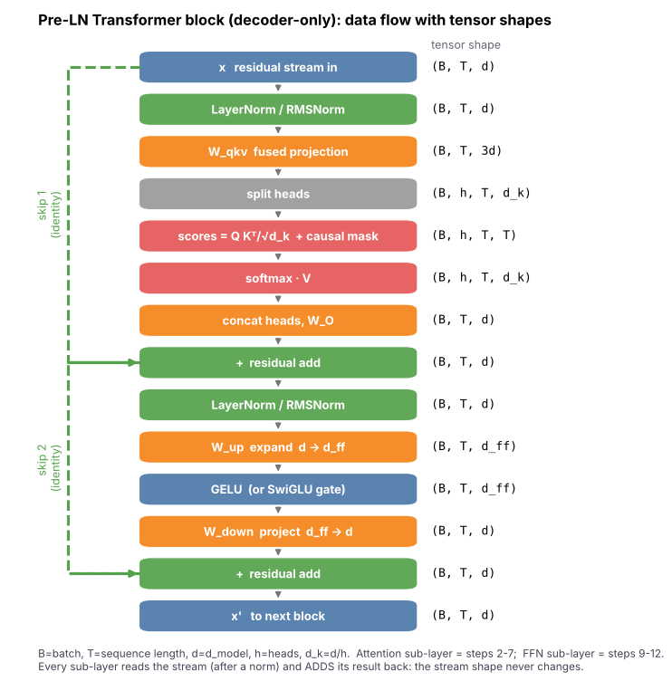

*Figure 1 — One Pre-LN decoder block with tensor shapes. Look at the two dashed skip connections and that the shape is `(B, T, d)` after every `+`. Concepts: [8.5](concepts/08.05-transformer-block.md), [8.6](concepts/08.06-self-attention-layer.md), [8.8](concepts/08.08-feed-forward-network.md).*


*Figure 2 — The three attention patterns: encoder full square, decoder lower-triangular, cross-attention full rectangle. Concepts: [8.2](concepts/08.02-transformer-encoder.md), [8.3](concepts/08.03-transformer-decoder.md), [8.4](concepts/08.04-encoder-decoder-architecture.md), [8.7](concepts/08.07-cross-attention-layer.md), [8.23](concepts/08.23-encoder-only-architecture.md)–[8.30](concepts/08.30-masked-objective.md).*

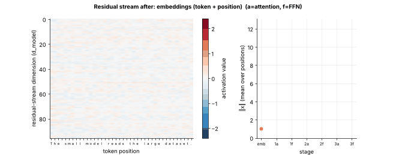

*Figure 3 — Residual stream of the trained Mini-GPT for one sentence (activations after each sub-layer; mean vector norm on the right). Concepts: [8.10](concepts/08.10-residual-connections.md), [8.17](concepts/08.17-layer-stacking.md).*

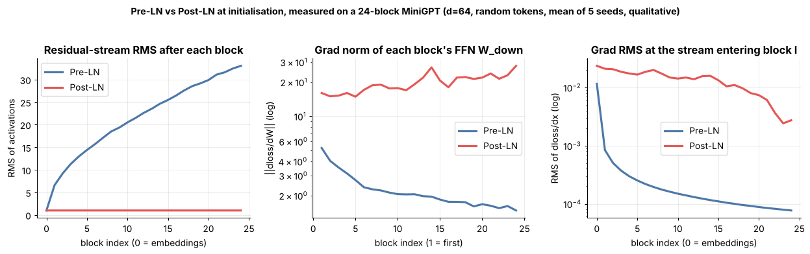

*Figure 4 — Pre-LN vs Post-LN measured on a 24-block MiniGPT at initialisation (single toy batch, 5 seeds, qualitative). Concepts: [8.12](concepts/08.12-pre-ln.md), [8.13](concepts/08.13-post-ln.md).*

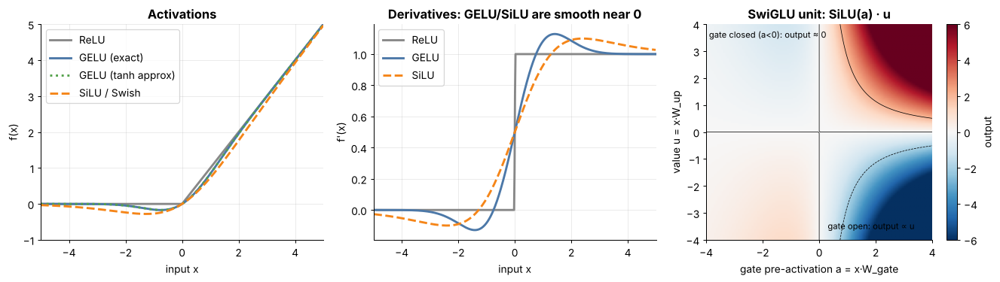

*Figure 5 — ReLU/GELU/SiLU, their derivatives, and one SwiGLU unit. Concepts: [8.15](concepts/08.15-gelu.md), [8.16](concepts/08.16-swiglu.md).*

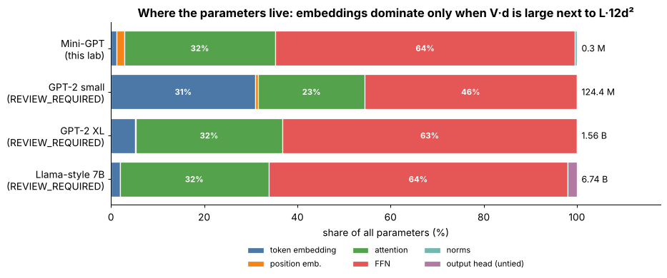

*Figure 6 — Where parameters live; the FFN is about two thirds of every block. Presets other than Mini-GPT are `REVIEW_REQUIRED`. Concepts: [8.8](concepts/08.08-feed-forward-network.md), [8.21](concepts/08.21-parameter-counting.md).*

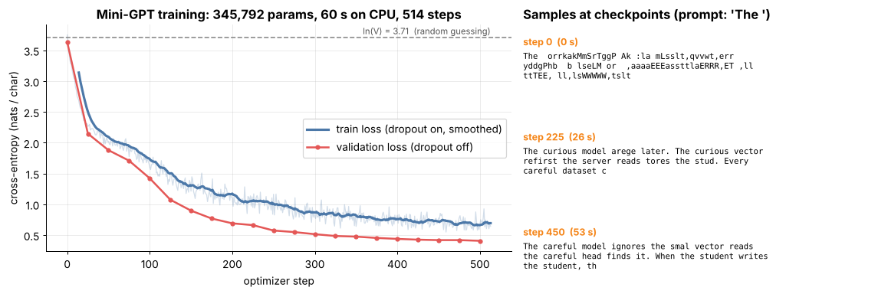

*Figure 7 — Mini-GPT train/validation loss and samples at three checkpoints from the prompt `The `. Concepts: [8.25](concepts/08.25-decoder-only-architecture.md), [8.29](concepts/08.29-causal-objective.md).*

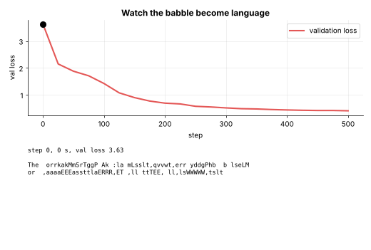

*Figure 8 — The same samples as an animation; the dot moves along the validation curve while the text improves.*

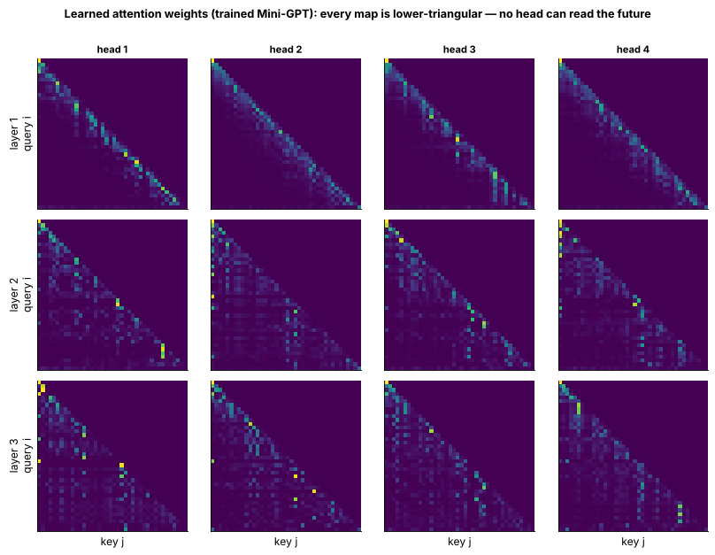

*Figure 9 — Learned attention weights of the trained model (3 layers × 4 heads); every map is lower-triangular. Concepts: [8.6](concepts/08.06-self-attention-layer.md), [8.26](concepts/08.26-gpt.md).*

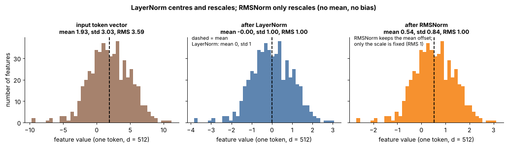

*Figure 10 — One token vector before and after LayerNorm and RMSNorm: LayerNorm removes the mean, RMSNorm only rescales. Concepts: [8.11](concepts/08.11-layernorm.md), [8.14](concepts/08.14-rmsnorm.md).*

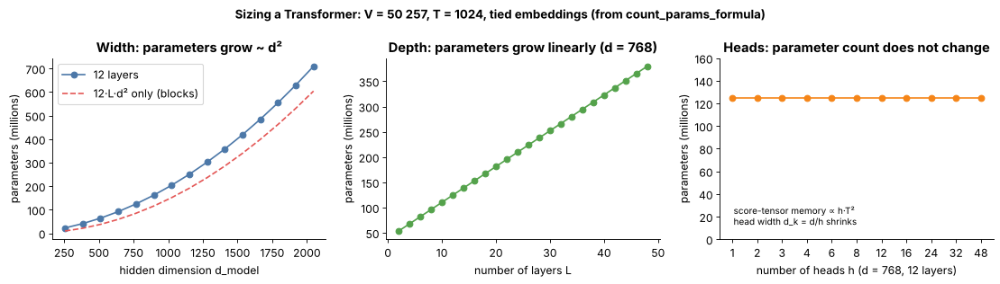

*Figure 11 — Parameters versus width (quadratic), depth (linear) and heads (flat) for `V = 50 257, T = 1024`. Concepts: [8.18](concepts/08.18-hidden-dimension.md), [8.19](concepts/08.19-number-of-heads.md), [8.20](concepts/08.20-number-of-layers.md).*

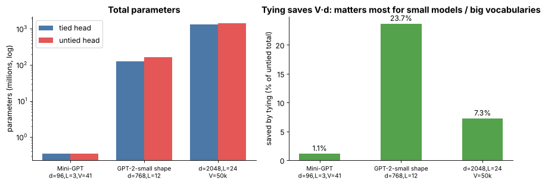

*Figure 12 — Weight tying: totals and percentage saved for Mini-GPT, a GPT-2-small shape, and a `d = 2048` model. Concept: [8.22](concepts/08.22-weight-tying.md).*

### Interactive explorers

| Explorer | Adjustable controls | Concepts |
|---|---|---|
| [`block_dataflow.html`](interactive/block_dataflow.html) | batch B, sequence T, d_model, heads, d_ff multiplier, Pre-LN/Post-LN, GELU/SwiGLU | 8.5–8.9, 8.12–8.13, 8.15–8.16, 8.18–8.19 |
| [`param_calculator.html`](interactive/param_calculator.html) | layers, d_model, heads, vocab, context, d_ff, activation, norm, position type, tied embeddings, biases, **presets (REVIEW_REQUIRED)** | 8.17–8.22 |
| [`prenorm_postnorm.html`](interactive/prenorm_postnorm.html) | layers, width, sub-layer gain, random seed | 8.10–8.13 |
| [`activations.html`](interactive/activations.html) | x-range, Swish β, function/derivative, SwiGLU gate & value, d_model | 8.8, 8.15, 8.16 |
| [`attention_masks.html`](interactive/attention_masks.html) | architecture, source/target length, query position, objective, mask rate | 8.2–8.4, 8.23–8.30 |
| [`norms.html`](interactive/norms.html) | dimension d, mean offset, std, outlier features and size, seed, epsilon | 8.11, 8.14 |

> **Animation tooling.** GIFs are Matplotlib `FuncAnimation` + `PillowWriter` (no Manim), same as Tier 6.

## 4 · Concept index

| # | Concept (link) | One-line summary |
|---|---|---|
| 8.1 | [Original Transformer](concepts/08.01-original-transformer.md) | 2017 encoder-decoder model; base config; what changed since |
| 8.2 | [Transformer encoder](concepts/08.02-transformer-encoder.md) | Stack of bidirectional blocks; padding mask only |
| 8.3 | [Transformer decoder](concepts/08.03-transformer-decoder.md) | Causal self-attention (+ cross-attention) generator stack |
| 8.4 | [Encoder-decoder architecture](concepts/08.04-encoder-decoder-architecture.md) | How the two stacks are wired; cross-attention; parameter delta |
| 8.5 | [Transformer block](concepts/08.05-transformer-block.md) | The repeating unit: attention + FFN with norms and residuals |
| 8.6 | [Self-attention layer](concepts/08.06-self-attention-layer.md) | Q/K/V from one sequence as a layer in the block |
| 8.7 | [Cross-attention layer](concepts/08.07-cross-attention-layer.md) | Queries from decoder, K/V from encoder; rectangular scores |
| 8.8 | [Feed-forward network](concepts/08.08-feed-forward-network.md) | `d -> d_ff -> d` MLP; two-thirds of block parameters |
| 8.9 | [Position-wise MLP](concepts/08.09-position-wise-mlp.md) | Same MLP on every token independently |
| 8.10 | [Residual connections](concepts/08.10-residual-connections.md) | `x + F(x)`: gradient highway and residual stream |
| 8.11 | [LayerNorm](concepts/08.11-layernorm.md) | Per-token standardisation with learned scale/shift |
| 8.12 | [Pre-LN](concepts/08.12-pre-ln.md) | `x + F(Norm(x))`: clean identity path, final norm |
| 8.13 | [Post-LN](concepts/08.13-post-ln.md) | `Norm(x + F(x))`: the original layout, needs warm-up |
| 8.14 | [RMSNorm](concepts/08.14-rmsnorm.md) | Scale-only normalisation; no mean, no bias |
| 8.15 | [GELU](concepts/08.15-gelu.md) | Smooth `x*Phi(x)` activation |
| 8.16 | [SwiGLU](concepts/08.16-swiglu.md) | Gated FFN with SiLU gate; `d_ff ~ 8d/3` |
| 8.17 | [Layer stacking](concepts/08.17-layer-stacking.md) | Sequential composition of independent blocks |
| 8.18 | [Hidden dimension](concepts/08.18-hidden-dimension.md) | `d_model`: stream width, `d^2` scaling |
| 8.19 | [Number of heads](concepts/08.19-number-of-heads.md) | Heads split width; parameter-neutral |
| 8.20 | [Number of layers](concepts/08.20-number-of-layers.md) | Depth: linear parameters and latency |
| 8.21 | [Parameter counting](concepts/08.21-parameter-counting.md) | `12 L d^2 + V d`; memory and FLOPs rules |
| 8.22 | [Weight tying](concepts/08.22-weight-tying.md) | Share embedding and output head; saves `V*d` |
| 8.23 | [Encoder-only architecture](concepts/08.23-encoder-only-architecture.md) | Bidirectional family for labels/embeddings |
| 8.24 | [BERT](concepts/08.24-bert.md) | Masked-LM encoder; 80/10/10 recipe |
| 8.25 | [Decoder-only architecture](concepts/08.25-decoder-only-architecture.md) | Causal family; autoregressive generation |
| 8.26 | [GPT](concepts/08.26-gpt.md) | GPT-2-style decoder; 124 M check |
| 8.27 | [Encoder-decoder architecture](concepts/08.27-encoder-decoder-architecture.md) | Family view: when to choose encoder-decoder |
| 8.28 | [T5/BART](concepts/08.28-t5-bart.md) | Span corruption and denoising seq2seq |
| 8.29 | [Causal objective](concepts/08.29-causal-objective.md) | Next-token prediction with causal mask |
| 8.30 | [Masked objective](concepts/08.30-masked-objective.md) | Predict hidden tokens from both sides |

*(8.4 and 8.27 share a roadmap title: 8.4 teaches the structure — wiring and cross-attention; 8.27 teaches the family — when to choose it.)*

## 5 · Build: Mini-GPT (major build)

A complete decoder-only Transformer in ~150 lines, trained on a tiny character-level corpus on CPU.

| File | What it is |
|---|---|
| [`lab/mini_gpt.py`](lab/mini_gpt.py) | `GPTConfig`, `RMSNorm`, `CausalSelfAttention`, `MLP` (GELU or SwiGLU), `Block` (Pre/Post-LN), `MiniGPT`, `generate`, `count_params_formula` |
| [`lab/corpus.py`](lab/corpus.py) | ~27 KB original corpus (hand-written paragraph + seeded templated sentences; 41 distinct characters) |
| [`lab/train_mini_gpt.py`](lab/train_mini_gpt.py) | time-budgeted AdamW loop (warm-up + cosine), validation split, sampling, writes `lab/outputs/` |
| [`lab/test_tier08.py`](lab/test_tier08.py) | 44 pytest cases (shapes, causality, loss decreases, overfit one batch, 32-way formula check, closed form `12Ld²`, weight tying, norms, error handling, generation) |
| [`scripts/make_figures.py`](scripts/make_figures.py) | regenerates all figures from the lab outputs |

```bash
cd lab
python -m pytest -q                          # 44 passed
python train_mini_gpt.py --seconds 60        # train for ~60 s on CPU, print samples, save outputs/
```

**Design choices (each one is a concept file).** Learned absolute positions ([Tier 6](../tier-06-tokenization-embeddings/README.md)) → the `T·d` term in [8.21](concepts/08.21-parameter-counting.md); Pre-LN + final norm ([8.12](concepts/08.12-pre-ln.md)); GELU 4× FFN ([8.15](concepts/08.15-gelu.md)); tied embeddings ([8.22](concepts/08.22-weight-tying.md)); fused QKV ([8.6](concepts/08.06-self-attention-layer.md)); GPT-2-style `1/√(2L)` residual-projection init ([8.10](concepts/08.10-residual-connections.md)). Flags `prenorm`, `norm`, `act`, `tie_weights`, `bias` flip each choice so you can A/B them.

**Result of the recorded run** (`TESTED`: executed here, CPU, 2 threads, seed 0, 60 s; numbers vary a little by machine): `345,792` parameters (3 blocks, `d=96`, 4 heads, context 64, dropout 0.1), 514 optimizer steps (batch 32), **validation loss ≈3.6 (step 0) → 0.41 nats/char** (random guessing is `ln 41 = 3.71`), train loss ≈ 0.70 (higher than validation because dropout is on while training). Samples and curves: Figures 7–9. The training run was **not repeated** for the concept-file conversion; the new figures 10–12 are computed from the formula and synthetic vectors, not from training.

Final sample (temperature 0.8, top-k 8; `lab/outputs/sample.txt`):

> The curious vector reads the simple vector ignores later. A patient student copies a simple student rains a a tired stayers a token ignores twice. When the mien vector writes the server, the bright vector checks it. …

**Honest limitations of the lab.** (1) The corpus is partly templated, so low loss partly reflects a small, regular grammar — a *mechanics* demo, not evidence about real-language scaling. (2) The validation split is the tail of the same generator, so it measures generalisation across sentences, not across distributions. (3) 60 s of CPU time cannot show Pre-LN vs Post-LN differences in trained quality; only the initialisation-time measurements (Figure 4) do. (4) The saved checkpoint is an `fp16` `state_dict` (~0.7 MB) loaded with `weights_only=True`.

**Exercises**

1. **Predict, then check.** Using [8.21](concepts/08.21-parameter-counting.md), predict the parameter count for `d=128, L=4, V=41, T=64`, with and without tying, then verify with `count_params`.
2. **Break the mask.** Delete the `masked_fill` line, retrain 60 s, compare validation loss and samples ([8.29](concepts/08.29-causal-objective.md)). Why does *training* loss look great? Re-run `test_causal_mask_no_future_leak`.
3. **Pre-LN vs Post-LN.** Train both (`prenorm=False`) with `lr=3e-3` and no warm-up for 24 layers; add warm-up and compare ([8.12](concepts/08.12-pre-ln.md), [8.13](concepts/08.13-post-ln.md)). Report what *you* see.
4. **GELU vs SwiGLU at equal parameters.** `act="swiglu"`, `d_ff=256` (≈ 8/3·96); compare parameters and validation loss over 3 seeds ([8.16](concepts/08.16-swiglu.md)).
5. **Heads at fixed width.** `n_head ∈ {1, 2, 4, 8, 16}`: parameters constant; what changes in speed and loss ([8.19](concepts/08.19-number-of-heads.md))?
6. *(stretch)* Add RoPE (Tier 6) in place of learned positions and update the formula; or add a cross-attention block ([8.7](concepts/08.07-cross-attention-layer.md)) and make it encoder-decoder.

## 6 · Interview kit (whole tier)

**Basic.** What is in a Transformer block? What does the FFN do? What is a residual connection for? What is LayerNorm normalising over?
**Intermediate.** Pre-LN vs Post-LN — what changes and why do modern LLMs use Pre-LN? GELU vs SwiGLU? Why must `d_model` be divisible by the number of heads? Compare encoder-only, decoder-only, encoder-decoder with one use case each.
**Advanced.** Derive ≈ `12 L d²` and say what you ignored. Why does weight tying save `V·d`, and what is the pitfall when counting parameters in PyTorch? Why does one causal forward pass give T training signals, and how would you *test* that a mask doesn't leak? Why does the stream norm grow in Pre-LN, and why do we need a final norm?
**Scenario.** *You must classify 10 M support tickets per day cheaply.* (Encoder-only fine-tune: cost, latency, determinism vs an LLM.) *A teammate's model "has 7 B parameters" but doesn't fit on your GPU.* (Weights ≈ 2 bytes/param = 14 GB plus KV cache/activations; quantisation — Tier 11.) *A loaded checkpoint produces garbage but no error.* (Norm placement / gate-up order / RoPE pairing / tied-head mismatch.)

**60-second tier summary.** *"A Transformer keeps a residual stream of one vector per token. Each block normalises it, lets attention move information between tokens, adds the result back, then normalises again and lets a feed-forward network process each token, adding that back too. Pre-LN keeps the skip path clean, which is why deep models train; RMSNorm and SwiGLU are the modern cheap/better variants. Parameters are about 12d² per layer plus the vocabulary table, and tying the head to the embedding saves V·d. Encoder-only models read bidirectionally for embeddings and classification, decoder-only models use a causal mask to generate, and encoder-decoder models add cross-attention for sequence-to-sequence tasks."*

## 7 · Tier revision questions

1. Write the shapes of every tensor in one block for `B=4, T=128, d=512, h=8, d_ff=2048`.
2. Why does the residual connection make deep networks trainable? Write `∂x_out/∂x`.
3. Show `d_ff = 4d` makes the FFN twice the size of attention (in weights).
4. Why does Pre-LN need a final norm?
5. What `d_ff` keeps SwiGLU parameter-equal to a 4× GELU FFN?
6. Does changing the number of heads change the parameter count? The score-tensor memory?
7. Compute the parameter count of a 24-layer, `d=1024`, `V=50k`, `T=1024` tied GPT and the memory of its fp16 weights.
8. Explain why a leaking causal mask gives a *lower* training loss and a *worse* model.
9. Which family for (a) semantic search, (b) a coding assistant, (c) translation? Why?
10. "Total parameters" vs "parameters in `model.parameters()`" under weight tying?

## 8 · Related tiers

Attention maths, masks, multi-head → [Tier 7](../tier-07-attention/README.md). Tokenizers, positional encodings → [Tier 6](../tier-06-tokenization-embeddings/README.md). Pre-training data, objectives at scale, scaling laws → [Tier 9](../tier-09-foundation-model-pretraining/README.md). Fine-tuning/LoRA → [Tier 10](../tier-10-fine-tuning-alignment/README.md). KV cache, decoding, quantisation → [Tier 11](../tier-11-llm-inference-optimization/README.md). MQA/GQA, long context, MoE, SSMs → [Tier 12](../tier-12-modern-architectures/). Residual/ViT ideas → Tier 13. Encoder models for retrieval → Tier 20.

## 9 · Review status

| Item | State |
|---|---|
| Concept files (`concepts/`) | 30 files, 23 sections each, validated by `python tools/check_concepts.py` (filenames, headings, links) |
| Code in concept files | every Python block was executed from `lab/` and passes (assertions included); keep in sync with `lab/mini_gpt.py` |
| Code (`lab/`) | **TESTED** — `python -m pytest -q` in `lab/`: 44 passed (Python 3.13, PyTorch CPU) |
| Training run | **TESTED** — 60 s CPU run executed; parameter count asserted equal to formula; metrics from `lab/outputs/train_log.json` (not re-run for this conversion) |
| Interactive pages | **TESTED** with `tools/check_interactive.py` (headless Chromium, no JS errors, sliders exercised) for all six; calculator outputs cross-checked against the Python formula (Mini-GPT 345,792; GPT-2-small-shaped 124,439,808) |
| Figures / GIFs | regenerated by `scripts/make_figures.py`; new figures 10–12 visually checked |
| Pre-/Post-LN measurements | single-architecture, few-seed, initialisation-only — qualitative (stated in captions) |
| Published model sizes and configs (original Transformer ~65 M, BERT, GPT-2/3, Llama-style, T5/BART objectives, SwiGLU/RMSNorm adoption claims) | `REVIEW_REQUIRED` (marked inline in concept files) |
| Critic / Code-review / Final-review | pending per `CHAPTER_STATUS.md` |
