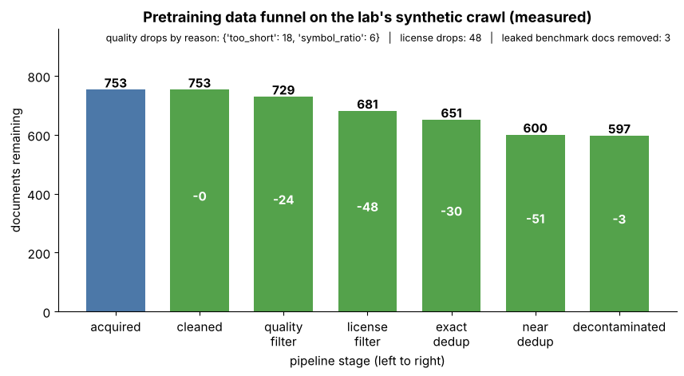
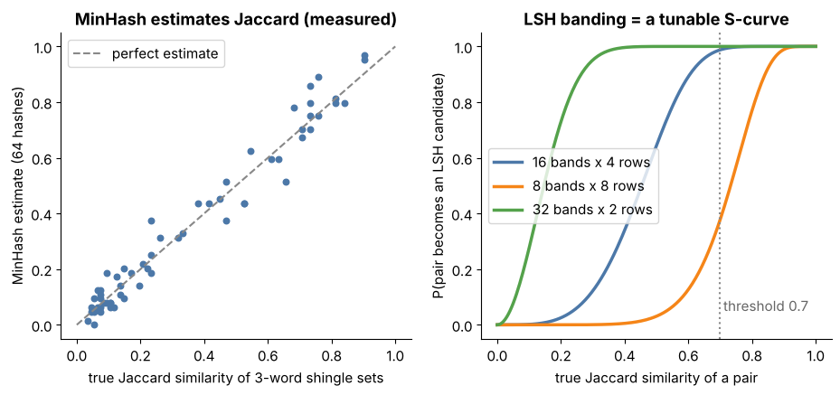
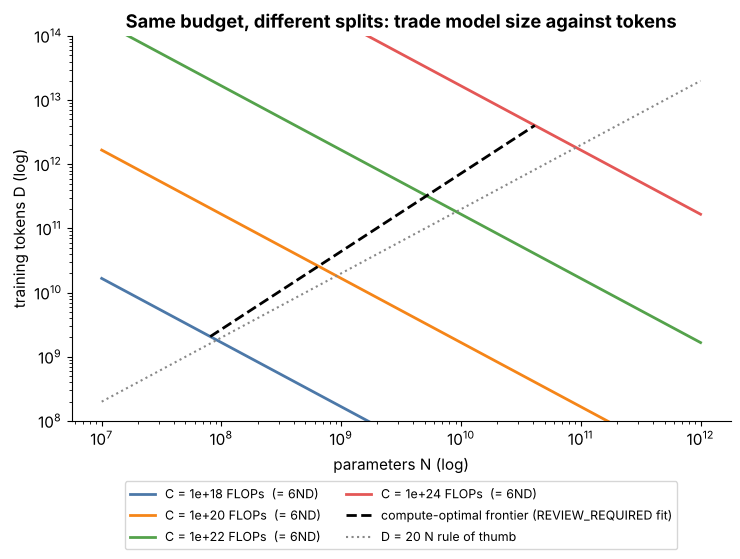
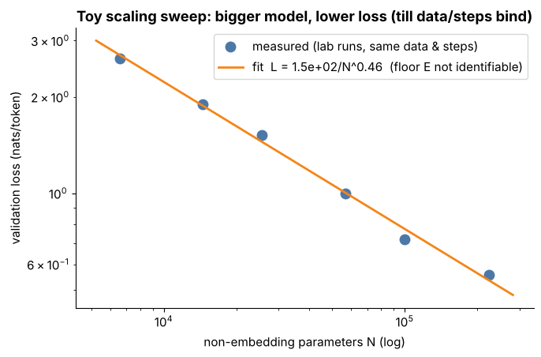
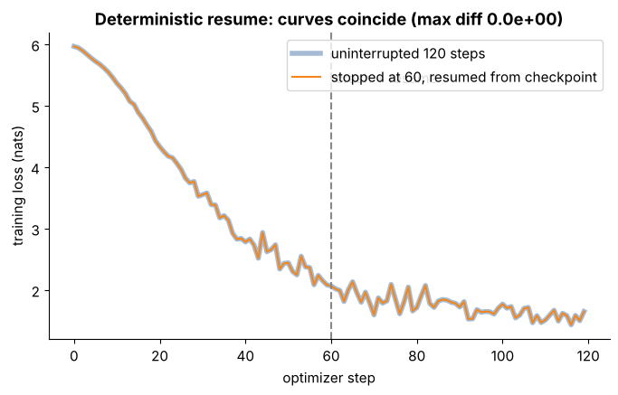
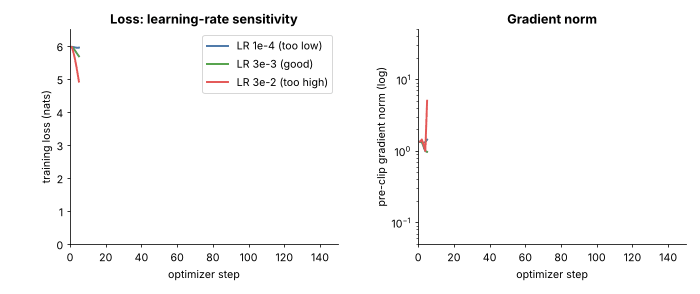

# Tier 9 — Foundation Model Pretraining

> **Phase 2 · Transformers & Foundation Models** · Author: Claude draft (see `CHAPTER_STATUS.md`) · Status: `AUTHOR_DRAFT` (Critic / Code-review / Final-review pending)
> Prerequisites: Tier 4 (training loops, optimizers, LR schedules), Tier 6 (tokenizers), Tier 7 (attention), Tier 8 (Transformer blocks, causal/masked objectives). Leads to: Tier 10 fine-tuning & alignment, Tier 11 inference, Tier 12 modern architectures.

**Tier goal.** After this tier you can describe the whole path from "a pile of crawled text" to "a checkpoint that predicts the next token": build and defend a data pipeline (clean → filter → dedup → decontaminate → mix), budget tokens and compute with `C ≈ 6ND`, reason with scaling laws, explain what a pretraining run needs to survive (checkpoints, determinism, stability monitoring, distributed memory), explain how Mixture-of-Experts routing and its load-balancing loss work, and run a miniature but *complete* pretraining lab on a laptop CPU in seconds.

> **Scope rule.** Attention math is Tier 7, the Transformer block and the causal/masked objective *definitions* are Tier 8, MoE as an *architecture family* is Tier 12. This tier owns the **data, scale, optimization and operations** around them, and the *pretraining-specific* side of MoE (routing, balancing, instability).

---

## 0 · How to use this tier (theory → see → play → code)

| Step | What | Where |
|---|---|---|
| 1. Read | Intuition + mechanics | this file |
| 2. **See** | Labelled figures and two animated GIFs | [`figures/`](figures) — embedded below |
| 3. **Play** | Five interactive explorers (open in a browser, no internet) | [`interactive/`](interactive) |
| 4. **Build** | Miniature pretraining lab (PyTorch, CPU), 22 pytest tests | [`lab/`](lab) |
| 5. **Regenerate** | Every figure comes from one script (~1 min) | `python scripts/make_figures.py` |

| Explorer | Adjustable controls | Teaches |
|---|---|---|
| [`data_funnel.html`](interactive/data_funnel.html) | raw docs, tokens/doc, drop % at each of 6 stages | 9.2–9.5, 9.12, 9.14 |
| [`minhash_dedup.html`](interactive/minhash_dedup.html) | two editable documents, shingle size k, #hashes, LSH bands, threshold | 9.5 |
| [`mixture_explorer.html`](interactive/mixture_explorer.html) | per-source available tokens and weights, token budget, epoch threshold, language sampling exponent α | 9.6–9.8, 9.14 |
| [`scaling_law_explorer.html`](interactive/scaling_law_explorer.html) | log-compute, model size, loss-law constants (REVIEW_REQUIRED), GPU TFLOP/s, MFU, #GPUs, $/GPU-h | 9.15, 9.20, 9.21 |
| [`moe_router.html`](interactive/moe_router.html) | top-k, balancing-loss weight, initial skew, capacity factor, router LR (step / run / reset) | 9.25–9.27 |

---

## 1 · The big picture

```
 acquire ──► clean ──► quality ──► license/PII ──► dedup ──► decontaminate ──► mix ──► tokenize ──► shard
 (9.2)       (9.3)     (9.4)       (9.9, 9.10)     (9.5)     (9.11, 9.12)      (9.6-9.8) (Tier 6)
                                                                                  │
   budgets (9.14, 9.15, 9.20) ──► model size N, tokens D, FLOPs ≈ 6·N·D            ▼
                                                              ┌──────────── training run ────────────┐
   objective (9.16-9.19) ──────────────────────────────────►  │ next-token loss · AdamW · warmup+cos │
   dense (9.24) / MoE (9.25-9.27) ─────────────────────────►  │ checkpoints (9.22) · stability (9.28)│
   distributed (9.23) ─────────────────────────────────────►  │ eval every k steps (9.31)            │
                                                              └──────────────┬───────────────────────┘
                                                                             ▼
                                              base model ──► continued / domain-adaptive pretraining (9.29, 9.30) ──► Tier 10
```

A *foundation model* is trained once, expensively, on broad data with a **self-supervised** objective (the labels come from the text itself), then adapted many times cheaply. Three things decide its quality, in roughly this order of leverage: **the data**, **the amount of compute spent sensibly** (N and D together), and **keeping a very long run alive and reproducible**.



*Figure 1 — The lab's data pipeline run on its synthetic crawl (a real measurement, produced by `lab/data_prep.py`). Look at how each stage removes a different kind of junk (too-short/symbol soup, restricted license, mirrors, near-copies, a leaked benchmark item). [`data_funnel.html`](interactive/data_funnel.html) lets you change the rates.*

---

## 2 · Concept map (every roadmap item → where it is taught)

| Roadmap | Section | Roadmap | Section |
|---|---|---|---|
| 9.1 Pretraining overview | §1, §3 | 9.17 Next-token prediction | §3.2 |
| 9.2 Data acquisition | §4.1 | 9.18 Masked-language modeling | §3.3 |
| 9.3 Data cleaning | §5.1 | 9.19 Pretraining objectives | §3.4 |
| 9.4 Quality filtering | §5.2 | 9.20 Scaling laws | §9.3 |
| 9.5 Deduplication strategies | §6 | 9.21 Compute/data/model trade-offs | §9.4 |
| 9.6 Data mixture design | §7.1 | 9.22 Training checkpoints | §10.1 |
| 9.7 Language balancing | §7.2 | 9.23 Distributed pretraining | §11.1 |
| 9.8 Domain balancing | §7.3 | 9.24 Dense-model pretraining | §11.2 |
| 9.9 Data provenance | §4.2 | 9.25 Mixture-of-Experts pretraining | §12.1 |
| 9.10 Data licensing | §4.3 | 9.26 Expert routing | §12.2 |
| 9.11 Data contamination | §8.1 | 9.27 Load balancing | §12.3 |
| 9.12 Benchmark contamination | §8.2 | 9.28 Training stability | §10.2 |
| 9.13 Data curriculum | §7.4 | 9.29 Continued pretraining | §13.1 |
| 9.14 Token budgets | §9.1 | 9.30 Domain-adaptive pretraining | §13.2 |
| 9.15 Compute budgets | §9.2 | 9.31 Pretraining evaluation | §14 |
| 9.16 Self-supervised learning | §3.1 | | |

---

## 3 · Objectives: what the model is trained to do (9.1, 9.16–9.19)

### 3.1 Pretraining overview and self-supervised learning (9.1, 9.16)

**What.** *Pretraining* fits a large model on huge unlabeled text. *Self-supervised learning* (SSL) means the supervision signal is manufactured from the data: hide part of the input and predict it. No human labels, so the dataset can be as large as the internet.

**Why.** Labels are expensive and task-specific; raw text is abundant and teaches grammar, facts, code and reasoning patterns *as a side effect* of predicting well. The result is a general-purpose starting point (the **base model**) that later tiers specialise (Tier 10) and serve (Tier 11).

**Input → Process → Output.** `text corpus → tokenize → windows of ctx tokens → forward pass → loss on predicted tokens → backprop → update → … → checkpoint`.

**Enterprise.** Almost no company pretrains a frontier model; most *select, adapt and serve* one. You still need this tier to read a model card, judge data/licensing risk, estimate what a custom pretraining or continued-pretraining project would cost, and reason about why a model behaves as it does.
**Memory hook.** *"The text is its own teacher."*

### 3.2 Next-token prediction — the causal objective (9.17)

Given tokens `x₁…x_T`, the model outputs a distribution at each position over the *next* token, and the loss is the average negative log-likelihood (cross-entropy):

`L = −(1/T) Σₜ log p_θ(xₜ₊₁ | x₁…xₜ)`

Position *t* may only see positions ≤ *t* (the causal mask, Tier 7/8). Every position in every sequence is a training example, which is why it is so data-efficient per token. In the lab the shift is done in `get_batch`: `y = data[i+1 : i+1+ctx]`, so the model at position *t* is graded on token *t+1*.

```python
# lab/model.py (the heart of the objective)
loss = F.cross_entropy(logits.reshape(-1, V), targets.reshape(-1))   # targets are inputs shifted by one
```

*Sanity checks you should always run:* an untrained model's loss ≈ `ln V` (uniform guess; tested in `test_model_shapes_and_initial_loss`), and changing a future token must not change earlier logits (`test_causality_future_tokens_do_not_change_past_logits`).
**Loss units.** Cross-entropy in nats; **perplexity** = `exp(loss)` ("effective branching factor"). Loss is only comparable between runs that use the *same tokenizer and eval set* — see bits-per-byte in §14.
**Interview (30–60 s).** *"Next-token prediction trains a decoder to maximise the likelihood of each token given the ones before it. It's self-supervised, every position gives a gradient signal, and generation is just sampling from the same distribution — so the pretraining objective and the inference procedure match, which is a big reason decoder-only models dominate."*
**Rapid-fire.** Minimise cross-entropy of token *t+1* given tokens ≤ *t*.
**Memory hook.** *"Shift by one, score every position."*

### 3.3 Masked-language modeling (9.18)

**Definition owner: Tier 8 (8.30).** In MLM a random subset of tokens (BERT used 15%, of which 80% become a mask token, 10% a random token, 10% unchanged — `REVIEW_REQUIRED`, verify on the BERT paper) is hidden and the model predicts them using context from **both** sides. Attention is bidirectional, so representations are excellent for classification/retrieval (encoders), but only the masked ~15% of positions give a loss signal per sequence and there is no natural left-to-right generation.

| | Causal (next-token) | Masked (MLM) |
|---|---|---|
| Context seen | left only | both sides |
| Loss positions | all | masked subset only |
| Generation | natural | awkward |
| Typical use | decoder LLMs | encoders (embeddings, classifiers) |

**Common mistake.** Comparing an MLM loss to a causal loss; they measure different tasks.

### 3.4 Pretraining objectives, in general (9.19)

Other objectives appear as variants or add-ons: **span corruption / denoising** (T5/BART style, Tier 8), **prefix-LM** (bidirectional prefix, causal suffix), **fill-in-the-middle** (code models rearrange a document so the model learns to infill; `REVIEW_REQUIRED` for exact recipes), **multi-token prediction** (extra heads predict several future tokens — active research, `REVIEW_REQUIRED`), and **auxiliary losses** such as the MoE balancing loss (§12.3) or router z-loss. Choosing the objective chooses the model family; the data pipeline and scaling reasoning in this tier are the same for all of them.

---

## 4 · Acquisition, provenance and licensing (9.2, 9.9, 9.10)

### 4.1 Data acquisition (9.2)

**What.** Collecting raw text: web crawls (Common Crawl-style snapshots and own crawlers), code hosting, books, papers, encyclopedias, forums, curated/licensed corpora, and increasingly **synthetic data** produced by other models (Tier 10.7). Mix of *breadth* (web) and *density* (books, code, math, encyclopedias).

**How it works.** A crawler fetches pages → HTML is parsed → main-content text is extracted (boilerplate removal) → language is identified → each record keeps metadata: `url, crawl date, source, license, language`. The lab's `make_synthetic_crawl` generates exactly such records, deliberately salted with junk so every later stage has work to do.

**Trade-offs.** Crawl breadth vs. quality; freshness vs. reproducibility (freeze and *version* the snapshot); owning data vs. renting it.
**Common mistakes.** No metadata kept (cannot later filter by license/source); ignoring `robots.txt`/terms of service; training on whatever is easiest to scrape.
**Security.** Public web text is **attacker-controlled input to your model**: *data poisoning* (a small number of planted documents can implant a trigger behaviour — `REVIEW_REQUIRED` for quantified claims) and prompt-injection text that will later be memorised. Keep provenance so you can trace and purge.

### 4.2 Data provenance (9.9)

**Provenance** = a durable record of where each document came from and what was done to it: source, URL/ID, retrieval date, license, processing-pipeline version, filter decisions. It is what lets you answer "which documents taught the model X?", honour a deletion/opt-out request, reproduce a dataset, and debug a regression ("the new crawl made code worse").

In the lab each document dict carries `source`, `license`, `url`; the pipeline `report` records per-stage counts and drop reasons; training stores `train_fingerprint` (SHA-256 of the token stream) in `metrics.json`, so a metrics file is tied to the exact data.
**Enterprise.** Data lineage tooling, immutable dataset versions, a dataset card/datasheet per release, and a manifest linking *model checkpoint → dataset version → pipeline commit*.
**Memory hook.** *"If you can't trace it, you can't remove it."*

### 4.3 Data licensing (9.10)

Text is usually copyrighted and often carries a license (permissive, share-alike, non-commercial, "all rights reserved", or none stated). Whether training on it is permitted, and under what conditions, **depends on jurisdiction, license terms, and ongoing legal developments** — this chapter is engineering guidance, **not legal advice** (`REVIEW_REQUIRED` by counsel before any policy is adopted).

Engineering consequences: keep license metadata per record; maintain an **allowlist** (the lab's `ALLOWED_LICENSES`), honour opt-outs and takedowns, separate **PII/secrets** scrubbing from licensing, and record the policy version used. The lab's `license_filter` stage drops the "all-rights-reserved" and "unknown" records (see Figure 1).
**Common mistakes.** Treating "publicly accessible" as "free to use"; dropping license metadata during cleaning; no process for takedown requests.
**Security.** Secrets (API keys, credentials) and personal data in code/web dumps are memorised and can be regurgitated: scan and remove before training.
**Interview.** *"How would you reduce legal risk in a pretraining set?"* → provenance + license allowlist + opt-out handling + PII/secret scrubbing + dataset card + counsel-approved policy.

---

## 5 · Cleaning and quality filtering (9.3, 9.4)

### 5.1 Data cleaning (9.3)

**What.** Deterministic repair/removal of artefacts: extract main text from HTML, strip scripts and navigation/cookie boilerplate, Unicode-normalise (Tier 6 §3), remove control and zero-width characters, collapse runaway whitespace, fix mojibake, remove obviously truncated documents.

```python
# lab/data_prep.py — clean_text: NFC, strip tags/scripts, drop control + zero-width chars, keep code newlines
clean_text("<p>Café ​ok</p><script>x=1</script>") == "Café ok"     # tested
```

**Common mistakes.** Over-cleaning **code** (collapsing indentation destroys Python); cleaning that differs between training and serving; throwing away non-English text because the cleaner assumed ASCII.
**Memory hook.** *"Clean the artefacts, keep the signal."*

### 5.2 Quality filtering (9.4)

**What.** Deciding which documents are *worth training on*. Three families, usually combined:

| Family | Example | Cost | Failure mode |
|---|---|---|---|
| Heuristic rules | min words, symbol/alpha ratio, repeated-line ratio, mean word length, stop-word presence | cheap | brittle; biased against dialects, code, tables |
| Classifier-based | train a small model to separate "reference-like" text (e.g. curated sources) from random crawl; keep high scorers | moderate | inherits the bias of the "good" seed set |
| Model-/perplexity-based | score documents with a small LM; drop extreme perplexity | moderate | removes unusual-but-valuable text |

The lab implements family 1 (`quality_filter` returns `(keep, reason)` so every drop is explainable). Thresholds there are illustrative; in real work you **tune on a labelled sample** and look at what each rule removes.
**Why it matters.** Quality-filtered data lets a smaller model match a larger one trained on raw crawl (a recurring finding in the open-data literature — `REVIEW_REQUIRED` for specific claims). It also shifts the token count (§9.1): filtering *reduces* D, so quality-vs-quantity is itself a budget decision.
**Common mistakes.** Filtering on a single proxy (e.g. "looks like Wikipedia") and thereby deleting whole dialects/domains; never inspecting dropped samples; applying thresholds tuned on English to every language.
**Interview.** *"A filter removes 60% of your crawl. How do you know it helped?"* → train small proxy models on filtered vs unfiltered data at equal token counts, compare held-out loss **and** downstream evals; inspect dropped samples by language/domain.

---

## 6 · Deduplication (9.5) — *major concept*

**What / why.** Web data is full of copies: mirrors, boilerplate, quoted articles, licence headers, forked repositories. Duplicates (a) waste compute, (b) bias the model toward repeated text, (c) increase **memorisation** and verbatim regurgitation (published dedup studies report large reductions in memorised sequences — `REVIEW_REQUIRED` for numbers), and (d) leak evaluation data into training (§8).

**Three levels**

| Level | Method | Catches | Scale |
|---|---|---|---|
| Exact | hash of normalised text (lab: SHA-256 of lower-cased, whitespace-collapsed text) | byte-identical mirrors | trivial |
| Near-duplicate | **MinHash + LSH** over word shingles | copies with small edits, same article on different sites | standard at web scale |
| Substring | suffix-array / n-gram window matching | shared long passages inside different documents (licences, quoted blocks) | heavier |

**MinHash in one paragraph.** Turn a document into a *set of k-word shingles*. The **Jaccard similarity** of two sets is `|A∩B| / |A∪B|`. Apply `n` random hash functions; for each keep the *minimum* hash over the set. For one hash function, `P[min(A) = min(B)] = Jaccard(A,B)` — so the fraction of agreeing slots between two *signatures* is an unbiased estimate of similarity, using `n` numbers per document instead of thousands of shingles.

**LSH banding.** Comparing all pairs is O(n²). Split each signature into `b` bands of `r` rows (`n = b·r`); hash each band; two documents that collide in **any** band become a *candidate pair*. Probability of being a candidate at similarity `s` is `1 − (1 − sʳ)ᵇ`, an S-curve whose steep part you place at your threshold by choosing `b` and `r` (Figure 2, right).



*Figure 2 — Left: MinHash estimate vs true Jaccard for 60 document pairs (measured with `lab/data_prep.py`); points hug the diagonal. Right: the LSH candidate probability for three (bands × rows) settings; more rows per band = sharper, higher threshold. Play with it in [`minhash_dedup.html`](interactive/minhash_dedup.html) — edit the two documents and watch the estimate move.*

```python
from data_prep import shingles, minhash_signature, estimated_jaccard, near_dedup
sa, sb = shingles(doc_a), shingles(doc_b)
estimated_jaccard(minhash_signature(sa, 64), minhash_signature(sb, 64))   # ≈ jaccard(sa, sb)
kept, n_dropped = near_dedup(docs, threshold=0.7, num_perm=64, bands=16)  # keep first of each cluster
```

**Design decisions.** Shingle size (too small ⇒ everything similar; too large ⇒ one edit breaks all shingles), signature length, thresholds, *which copy to keep* (the lab keeps the first; production often keeps the highest-quality or most-recent), dedup **within** and **across** sources, and whether to dedup at document or paragraph level.
**Trade-offs.** Aggressive dedup removes genuinely-repeated-but-useful text (licences are fine to lose; a famous poem quoted legitimately is not). Some repetition of high-quality data is acceptable (§9.1, §7.1).
**Common mistakes.** Deduplicating only exact copies; deduplicating train but not against eval sets; unstable hashing — Python's built-in `hash()` is randomised per process, so use a stable hash (lab uses `blake2b`); splitting train/validation *before* dedup so near-copies straddle the split and the validation loss looks too good.
**Performance.** Signature building is embarrassingly parallel (map); candidate grouping is a shuffle by band key. At web scale this is a distributed job (Spark/Ray-style), not a Python loop.
**Interview (30–60 s).** *"For near-duplicate removal I shingle each document, compute MinHash signatures so the signature agreement estimates Jaccard similarity, and use LSH banding to find candidate pairs without all-pairs comparison. Band and row counts set where the S-curve threshold sits. It matters because duplicates waste compute, increase memorisation and contaminate evals."*
**Rapid-fire.** MinHash approximates Jaccard cheaply; LSH finds likely-similar pairs without O(n²).
**Questions.** *Basic:* exact vs near duplicate? *Intermediate:* why do bands/rows control the threshold? *Advanced:* why is `P[min equal] = Jaccard`? *Scenario:* validation loss is far lower than expected — what do you check first? (dedup/leakage across the split).
**Exercise.** In `minhash_dedup.html` find the (k, bands) that flags a one-word edit but not two unrelated docs; then change one word in every sentence and see when it breaks.
**Memory hook.** *"Sketch the set, bucket the sketch, compare only the bucket-mates."*

---

## 7 · Mixture, balancing and curriculum (9.6, 9.7, 9.8, 9.13)

### 7.1 Data mixture design (9.6)

**What.** The **mixture** specifies what *fraction of training tokens* comes from each source (web, books, code, math, encyclopedia, …). It is a hyper-parameter as important as learning rate and is often found by training many small **proxy** models on candidate mixtures and extrapolating — mixture-optimisation methods exist but are research-grade (`REVIEW_REQUIRED`).

**Mechanics.** Each source has a limited number of unique tokens. If the mixture asks for more tokens from a source than it has, that source is **repeated** (multiple epochs). A little repetition of high-quality data is usually harmless; a lot is not (published repeated-data studies suggest returns diminish after a few epochs — "~4 epochs" is a commonly quoted rule of thumb, `REVIEW_REQUIRED`, and depends on model and data).


*Figure 3 — Left: three candidate mixtures. Right: how many times each source must be repeated to fill the same budget, computed on the lab's deduplicated corpus. Wiki-heavy and code-heavy mixtures force the small sources to repeat many times. [`mixture_explorer.html`](interactive/mixture_explorer.html) has sliders for every source weight and the budget.*

```python
from data_prep import mix_sources
mixed = mix_sources(docs, {"wiki": .4, "web": .2, "code": .2, "chat": .2}, total_docs=len(docs), seed=0)
```

(The lab mixes by *document count* for simplicity; real mixtures are specified in **tokens**.)
**Trade-offs.** Breadth (general ability) vs. density (reasoning/code ability); more of the good source vs. repeating it.
**Common mistakes.** Setting weights by *size of source* rather than by desired capability; never checking epochs per source; changing the mixture and the model at the same time (no clean ablation).
**Interview.** *"How would you choose a data mixture?"* → define target capabilities and evals; run proxy-model ablations at small scale; check epochs per source; verify the ranking holds at larger scale before committing.

### 7.2 Language balancing (9.7)

Raw crawls are dominated by a few languages. **Temperature sampling** samples language *i* with probability ∝ `nᵢ^α`: `α = 1` follows the data (high-resource languages dominate), `α → 0` is uniform (low-resource languages are repeated heavily and may overfit). Typical practice picks an intermediate α (`REVIEW_REQUIRED` for specific values in named models). The bottom half of `mixture_explorer.html` shows the shares change as you move α. Also remember the tokenizer (Tier 6 §10): a language that tokenizes poorly consumes more *tokens* per sentence, so equal *token* share is *less* text.
**Common mistakes.** Balancing by documents instead of tokens; not building the tokenizer on the same balanced mix; reporting one average metric that hides a collapsing low-resource language.

### 7.3 Domain balancing (9.8)

The same idea along the *topic/genre* axis: web prose vs code vs math vs dialogue vs scientific text vs legal/medical. Domain mix shapes what the model is good at (more code ⇒ better code *and*, empirically, often better structured reasoning — a widely reported effect, `REVIEW_REQUIRED`). Always monitor **per-domain validation loss** (§14): an improving average can hide one domain getting worse.

### 7.4 Data curriculum (9.13)

A **curriculum** controls the *order* in which data is seen rather than only the proportions: e.g. broad/noisy data first, then a final phase **annealed** onto higher-quality/more specialised data (code, math, instruction-like text) with a decaying learning rate; or increasing context length late in training. Evidence for the benefit of ordering is mixed and recipe-specific (`REVIEW_REQUIRED`). Engineering requirement: the data loader must be able to report and resume *exactly* where in the curriculum it is — the lab achieves this by making each batch a pure function of `(seed, step)`.
**Pitfall.** A curriculum change mid-run confounds loss curves (the loss will jump because the *data* changed, not because training broke) — log the phase boundary.

---

## 8 · Contamination (9.11, 9.12)

### 8.1 Data contamination (9.11)

Any unwanted overlap between training data and data that should be **held out**: validation sets, test sets, or user data that must not be memorised. Also includes training on your own model's earlier outputs unintentionally. Consequences: inflated metrics, hidden memorisation, privacy leakage.

### 8.2 Benchmark contamination (9.12)

A specific case: **benchmark questions (or answers) appear in the pretraining corpus**, so a high score may measure memory, not capability. Because benchmarks are published on the web they are *likely* to be crawled.

**Detection and mitigation**

| Technique | How | Weakness |
|---|---|---|
| n-gram overlap | flag/drop training docs sharing an n-gram (n ≈ 8–13 words; the choice is a trade-off, `REVIEW_REQUIRED` for any specific published value) with any benchmark item | misses paraphrases and translations |
| Decontaminate before training | remove matched docs (lab: `decontaminate`) | requires knowing the benchmarks up front |
| Canary strings / private held-out sets | evaluate on data created after the training cutoff or never published | costly to maintain |
| Report both | publish results on "clean" vs "possibly contaminated" subsets | still partial |

```python
from data_prep import contamination_rate, decontaminate
contamination_rate(train_docs, bench_texts, n=8)     # fraction of benchmark items found in training data
clean, removed = decontaminate(train_docs, bench_texts)
```

In the lab a benchmark sentence is deliberately leaked into the crawl; the pipeline measures `contamination_before = 1.0` and `contamination_after = 0.0` (`test_pipeline_funnel_monotonic_and_removes_leak`). The roadmap's "benchmark" suite for *using* evals lives in Tier 15 (and Tier 30); this section only covers keeping them honest.
**Common mistakes.** Decontaminating only exact matches; decontaminating *after* choosing hyper-parameters on the same benchmark (test-set tuning); forgetting that the benchmark may be re-posted in blogs, forums and GitHub.
**Interview.** *"The model scores 90% on a public benchmark — can you trust it?"* → ask about decontamination method, check performance on a fresh/paraphrased held-out variant, compare clean vs contaminated subsets.

---

## 9 · Budgets and scaling (9.14, 9.15, 9.20, 9.21)

### 9.1 Token budgets (9.14)

**D = number of training tokens** (counting repeats: `steps × batch × context`). It is bounded by **unique tokens after the whole pipeline** — a funnel that keeps 16% of the raw crawl (the default in `data_funnel.html`) means you need ~6× more raw data than final tokens. Token budget, tokenizer (Tier 6) and epochs are coupled: a different tokenizer changes how many tokens the same text is.
**Lab:** `tokens_seen = steps × batch_size × ctx = 200 × 16 × 64 = 204,800` — about 3.6 passes over the ~57k-token training stream. That is *far* too many epochs for a real run; it is fine for a toy whose purpose is to exercise the machinery.

### 9.2 Compute budgets (9.15)

**The 6ND rule.** Training FLOPs for a dense Transformer ≈ **`6 · N · D`**: ≈ `2ND` for the forward pass (one multiply-add per parameter per token) plus ≈ `4ND` for the backward pass. It ignores attention's sequence-length term, embeddings and overheads, so treat it as a first-order estimate (`lab/pretrain.py: flops_6nd`, tested).

**From FLOPs to time and money.** `GPU-seconds = 6ND / (peak FLOP/s × MFU)` where **MFU** (model-FLOPs utilisation) is the fraction of hardware peak you really get — large-scale runs commonly land well below 100% (figures like 30–50% are often quoted; `REVIEW_REQUIRED`). Cost = GPU-hours × price per GPU-hour, **plus** failed runs, restarts, ablations, data processing, storage, evaluation and people — often a multiple of the headline number. `scaling_law_explorer.html` has the GPU calculator.



*Figure 9 — Each coloured line is one compute budget `C = 6ND`: moving along it trades parameters for tokens at constant cost. The dashed line is the compute-optimal frontier from the (REVIEW_REQUIRED) fit of §9.3; the dotted line is the "20 tokens per parameter" rule of thumb. Notice the frontier is not parallel to the dotted line.*

### 9.3 Scaling laws (9.20) — *major concept*

**Observation.** Across many orders of magnitude, a language model's test loss falls as a **smooth power law** in model size, data and compute (Kaplan et al. 2020), when the other factors are not the bottleneck. This makes loss *predictable*: you can train small models, fit a curve and forecast a large run before paying for it.

**The Chinchilla parametric form (Hoffmann et al. 2022):**

`L(N, D) = E + A / N^α + B / D^β`

`E` is the irreducible loss (entropy of the text under this setup), the other two terms are the penalty for finite model size and finite data. Minimising `L` subject to `6ND = C` (Lagrange multipliers, implemented as `scaling.compute_optimal` and proved to be a minimum by a test) gives `N_opt ∝ C^{β/(α+β)}` and `D_opt ∝ C^{α/(α+β)}`: **scale parameters and tokens together.**

**Constants.** `scaling.py` uses `E=1.69, A=406.4, B=410.7, α=0.34, β=0.28`, which are the values I recall from that paper's fit — **`REVIEW_REQUIRED`: verify against the paper; they describe *that* paper's data, tokenizer and architecture and will not transfer to yours.** Replication work has questioned details of that fit (`REVIEW_REQUIRED`), so use the *shape* of the argument, not the digits. Also note: with these constants the optimal tokens-per-parameter ratio **grows with compute** (≈26 at 10¹⁸ FLOPs, ≈98 at 10²⁴ in this code), whereas the popular "≈20 tokens per parameter" comes from the paper's other approaches — another reason not to quote a single magic ratio.


*Figure 4 — Left: for each fixed compute budget, loss vs model size is a bowl; the dot is the compute-optimal size. Larger budgets have deeper bowls and bigger optimal models. Right: the optimal model size and token count both grow as power laws of compute. (Constants REVIEW_REQUIRED.)*



*Figure 5 — A **real, tiny** sweep from this lab: six model widths trained on the same data for the same steps; validation loss vs non-embedding parameters on log–log axes, with a fitted power law (`scaling.fit_power_law`). Loss falls roughly linearly in log–log, the signature of a power law. Caveats: one seed, a tiny templated dataset, and the larger models are close to being data-limited, so the fitted exponent and the (unidentifiable) floor `E` mean nothing beyond the demonstration.*

**Why it matters for engineering.** (1) Decide N and D before launch. (2) Fit your **own** curve on small runs to choose among architectures/mixtures. (3) Predict the loss of the big run to detect that something is wrong (a run above the predicted curve is suspicious). (4) Remember limits: loss is not capability; scaling laws describe loss on the training distribution, fit within a range, and break down when data is repeated heavily or quality changes.
**Common mistakes.** Extrapolating far beyond the fitted range; mixing tokenizers across points; fitting with too few points or ignoring seed noise; treating the recalled constants as universal.
**Interview (30–60 s).** *"Scaling laws say loss falls as a power law in parameters and in tokens, so for a fixed compute budget there's a best split. Chinchilla showed many earlier models were too big and under-trained: scale N and D together, roughly tens of tokens per parameter. I'd still fit my own curve, and if the model will be served at huge volume I'd deliberately over-train a smaller model, because inference cost depends on N."*
**Rapid-fire.** `L = E + A/N^α + B/D^β`; for fixed compute, grow model and data together.

### 9.4 Compute / data / model scaling trade-offs (9.21)

| Choice | Effect | When |
|---|---|---|
| Bigger N, fewer tokens (under-trained) | best loss *per training FLOP* is **not** achieved; expensive to serve | rarely right |
| Compute-optimal N, D | lowest loss for a given *training* budget | research budgets, one-off models |
| Smaller N, many more tokens ("over-trained") | higher training cost for the same loss, but **cheaper inference and fine-tuning** | models served at scale |
| More epochs on same data | diminishing/negative returns past a few epochs | data-limited regimes |
| Better data (quality, dedup) | shifts the whole curve down | almost always first lever |

Total lifetime cost = training + (inference per token × tokens served) — for popular models inference dominates, which is why deliberately over-training smaller models is common practice (`REVIEW_REQUIRED` for specific model examples). The **data wall** (running out of unique high-quality tokens) pushes toward synthetic data, repetition and multimodal data.
**Memory hook.** *"Bigger brain or longer school? Both, in proportion — then check who pays for inference."*

---

## 10 · Checkpoints, reproducibility and stability (9.22, 9.28)

### 10.1 Training checkpoints (9.22)

**What.** A periodic snapshot from which training can restart *exactly*: model weights, **optimizer state** (AdamW moments — weights alone are not enough), step counter, LR-schedule position, **data-loader position / RNG state**, and the config. Long runs *will* crash (hardware faults, preemption, divergence); checkpoints bound the lost work to one interval.

**Practices** (all implemented in `lab/pretrain.py` at toy scale):
- **Atomic writes**: write `tmp`, then `os.replace` — a crash mid-write never corrupts `latest.pt`.
- **Exact resume**: batches are a pure function of `(seed, step)` (`get_batch`), so no sampler state is needed and resumed == uninterrupted. `test_resume_matches_uninterrupted_run` verifies identical loss and weights; Figure 8 shows the curves coinciding.
- **Keep several**: rolling `latest` plus periodic permanent snapshots (`step_000200.pt`) so you can roll back past a bad region.
- **Metrics + provenance** in `metrics.json` next to the weights: config, parameter count, tokens seen, 6ND FLOPs, data fingerprint, torch/python versions, tokens/sec, full loss/LR/grad-norm history.
- At scale: **sharded/async** checkpoints (each rank writes its shard; training continues while the write completes), checkpoint size ≈ 12–16 bytes per parameter with fp32 optimizer state (§11.1), and tested *restore* (a checkpoint you never restored is a hope, not a backup).



*Figure 8 — A 120-step run (thick blue) and a run stopped at step 60 and resumed from its checkpoint (thin orange) overlap exactly; the title reports the maximum difference measured in this lab.*

**Reproducibility checklist.** Seed everything (`seed_everything`), pin library versions (recorded in metrics), deterministic algorithms (`torch.use_deterministic_algorithms`), log the dataset fingerprint, never depend on dict/set ordering or Python's randomised `hash()`. Bit-exact reproducibility across *different hardware or GPU counts* is generally **not** achievable; aim for statistical reproducibility there (`REVIEW_REQUIRED`).
**Security.** Loading a checkpoint with `pickle` (`torch.load(weights_only=False)`) can **execute arbitrary code** — only load checkpoints you created or trust; prefer safe tensor formats (e.g. safetensors) for sharing, and sign/verify artefacts.
**Interview.** *"What goes in a pretraining checkpoint and why?"* → weights + optimizer state + step/schedule + data position + RNG + config; otherwise resume silently changes the optimisation.
**Memory hook.** *"A checkpoint is a save-game, not just a save-file of the weights."*

### 10.2 Training stability (9.28)

**Symptoms.** *Loss spikes* (sudden jumps, sometimes recovering, sometimes not), *divergence* (NaN/inf), a rising gradient-norm, slow drift away from the predicted scaling curve, MoE expert collapse (§12.3).

**Usual causes and defences** (the exact recipes vary by lab — `REVIEW_REQUIRED` for attributions):

| Cause | Defence |
|---|---|
| LR too high / no warmup | warmup then cosine/linear decay (`lr_at`), lower peak LR |
| Exploding gradients | gradient clipping by global norm (lab: 1.0) |
| Bad data batch (garbage, huge repeats) | data filtering; skip or replay-with-different-order after rolling back |
| Numerical precision (fp16 overflow) | bf16 / loss scaling; fp32 for sensitive ops (softmax, norms, router) |
| Attention/logit growth | QK-normalisation, z-loss on output logits (techniques reported in the literature) |
| Adam ε / β₂ interactions | β₂ ≈ 0.95 for large-batch LM training (lab uses it); tune ε |
| Hardware faults / silent data corruption | health checks, replay verification, auto-restart from checkpoint |



*Figure 6 (animated) — Three real runs of the lab model that differ only in peak learning rate. Left: loss; right: pre-clip gradient norm (log scale). The too-low LR barely moves; the too-high LR shows gradient-norm spikes early (clipped to 1.0 before the update) and settles at a much worse loss; the middle run is the sweet spot. Watch how the instability shows in the grad-norm panel first.*

**In the lab.** `train` keeps an exponential moving average of the loss and logs a `loss_spike` event when the current loss exceeds `3×` the EMA (after warmup), and aborts with `non_finite_loss_abort` on NaN/inf — both land in `metrics.json → history.events`. Good habit: **alert on grad-norm and loss-vs-EMA, not just loss.**
**Common mistakes.** Restarting from the *last* checkpoint when the bad region began earlier; changing several knobs after a spike so the cause is lost; watching only the average loss.
**Interview.** *"Loss spiked at step 40k — what do you do?"* → stop and inspect (grad-norm, data batch, precision events), roll back to a checkpoint before the onset, lower LR or skip the offending data window, add clipping/norm safeguards, change one thing at a time.

---

## 11 · Distributed and dense pretraining (9.23, 9.24)

### 11.1 Distributed pretraining (9.23)

**Why.** A frontier-scale model cannot fit on one accelerator, and one accelerator would take decades. Mixed-precision AdamW needs about **16 bytes per parameter** of persistent state (bf16 weights 2 + bf16 grads 2 + fp32 master weights 4 + two fp32 Adam moments 8 — the accounting popularised by the ZeRO paper) *before* activations: a 7B-parameter model needs ≈ 112 GB of state alone. Back-of-envelope: `bytes ≈ 16 × N` (`REVIEW_REQUIRED` for your exact precision recipe).

| Parallelism | Splits | Communication | Note |
|---|---|---|---|
| Data parallel (DP) | batch across replicas | all-reduce gradients each step | simplest; each replica holds a full copy |
| Sharded DP (ZeRO / FSDP) | optimizer state, gradients, then parameters across DP ranks | all-gather / reduce-scatter | trades communication for memory |
| Tensor parallel (TP) | each weight matrix across GPUs | all-reduce inside every layer | needs fast links (same node) |
| Pipeline parallel (PP) | layers across stages, micro-batches | point-to-point activations | "bubble" idle time |
| Sequence/context parallel | tokens of one sequence | attention-related collectives | long contexts |
| Expert parallel (EP) | MoE experts across GPUs | all-to-all token dispatch | §12 |

Real systems combine them ("3D/4D parallelism") and overlap communication with compute. Efficiency is reported as MFU (§9.2). Interconnect (intra-node vs inter-node bandwidth) and failures dominate engineering effort: at thousands of GPUs *something fails every few hours* (`REVIEW_REQUIRED` for specific rates), so **automatic restart from checkpoint** is a requirement, not a nicety.
**Enterprise.** If you rent a cluster: reserved vs on-demand, topology-aware placement, job scheduler preemption, observability of per-rank throughput, cost per token trained.
**Scope note.** The lab is single-process CPU; it does not implement distributed training, it implements the *properties* (determinism, resumability, metrics) a distributed run needs.
**Interview.** *"Why shard optimizer state?"* → Adam keeps two extra fp32 tensors per parameter, ~12 of the 16 bytes/param; sharding them across DP ranks cuts per-GPU memory roughly by the DP degree at the cost of extra communication.

### 11.2 Dense-model pretraining (9.24)

A **dense** model uses *all* its parameters for every token, so training FLOPs/token ≈ `6N`; parameter count, compute per token and memory move together. It is the baseline against which sparse (MoE) models are compared and what scaling laws in §9 describe. Simpler to train and to serve, more predictable; the cost is that capacity only grows with compute per token. The lab model (`TinyLM`, pre-norm, tied embeddings) is dense by default (`moe_experts=0`): **128,512 parameters**, ~1.6×10¹¹ training FLOPs for the 200-step run (`6ND`, printed by `run_lab.py`).

---

## 12 · Mixture-of-Experts pretraining (9.25–9.27)

*Architecture of MoE blocks is taught in Tier 12 (12.13–12.16). Here: what changes during pretraining.*

### 12.1 MoE pretraining (9.25)

An MoE layer replaces the feed-forward block with **E expert FFNs plus a router**; each token is processed by only its **top-k** experts. Total parameters grow with E but compute per token stays ≈ that of **k** experts — so **total vs active parameters** differ and the `6ND` rule uses the *active* parameter count for FLOPs. Sparse models can reach lower loss at the same training compute, at the price of larger memory footprint, all-to-all communication and a trickier optimisation (`REVIEW_REQUIRED` for quantitative claims).
Lab: `model.MoEFFN` (token-choice, top-k, 4 experts in the demo); `python run_lab.py --moe 4` trains it end to end (327,552 total params vs 128,512 dense; the extra are inactive-per-token expert weights).

### 12.2 Expert routing (9.26)

`logits = x·W_r → softmax → top-k experts → gate weights renormalised → output = Σ gate_i · expert_i(x)`. Variants: *token-choice* (each token picks experts — the lab and Switch-style layers), *expert-choice* (each expert picks tokens, balances by construction but changes the causal-training story), shared + routed experts, auxiliary-loss-free balancing (`REVIEW_REQUIRED` for details of specific papers). Router computation is usually kept in higher precision because it is numerically sensitive.

### 12.3 Load balancing (9.27)

**Problem.** Left alone, a router tends to **collapse**: a few experts get most tokens, get trained more, get better, and attract still more tokens (rich-get-richer); the others become dead parameters. Hardware also suffers — a hot expert is a straggler; a **capacity factor** caps tokens per expert and **overflow tokens are dropped** (skip the layer via the residual) or re-routed.

**Switch-style auxiliary loss:** `L_aux = E · Σᵢ fᵢ · Pᵢ`, where `fᵢ` = fraction of tokens whose *top-1* expert is *i* (hard, non-differentiable) and `Pᵢ` = mean router *probability* for expert *i* (differentiable). By Cauchy–Schwarz-type reasoning it is ≥ 1 and equals 1 for a perfectly uniform load; added to the task loss with a small weight (lab default 0.01). The gradient flows through `Pᵢ`, pushing probability mass away from over-used experts.


*Figure 7 (animated) — Same tiny MoE layer, same start (router biased toward experts 0 and 1), trained on 4 clusters of tokens. Left: no balancing loss — experts 2 and 3 receive almost nothing (collapse to a 50/50 split of two experts). Right: with the balancing loss the load spreads towards the ideal 25% each. Produced with the real `MoEFFN` from the lab.*

[`moe_router.html`](interactive/moe_router.html) lets you set top-k, loss weight, initial skew and capacity factor and see the dropped-token percentage when the router is skewed; `test_moe_router_topk_and_balance_loss` checks that top-2 routing assigns 2 slots/token, that `L_aux ≥ 1`, and that a collapsed router scores worse.
**Trade-offs.** Large balancing weight ⇒ uniform but possibly worse routing quality (experts forced to share tokens they should not); small weight ⇒ collapse. Capacity factor ↑ ⇒ fewer drops but more padding/compute.
**Common mistakes.** Judging MoE only by loss and never logging per-expert load; comparing an MoE and a dense model at equal *total* parameters instead of equal *active* parameters or equal FLOPs; ignoring that MoE inference needs all experts in memory.
**Interview (30–60 s).** *"A router picks top-k experts per token so compute stays low while parameters grow. Without a counterweight it collapses onto a few experts, so we add an auxiliary loss — fraction of tokens times mean router probability, summed over experts — that is minimal when load is uniform, and a capacity factor to bound the hottest expert. I'd monitor per-expert load and drop rate throughout the run."*
**Rapid-fire.** MoE = many experts, few active per token; the aux loss keeps the router from collapsing.
**Memory hook.** *"Sparse compute, dense worries: balance the load or lose the experts."*

---

## 13 · Continued and domain-adaptive pretraining (9.29, 9.30)

### 13.1 Continued pretraining (9.29)

Resume the *same* next-token objective from an existing base checkpoint on new data — more tokens, a new language, longer context, fresher knowledge. Key engineering points: restart with a **short warmup and a lower peak LR** than the original (re-warming to the original peak can cause a loss bump), **mix in replay data** from the original distribution to limit **catastrophic forgetting** (Tier 10.28), keep the tokenizer fixed (changing it needs embedding surgery and retraining), and evaluate old *and* new capabilities. Exact recipes (LR re-warming, replay fractions) are empirical (`REVIEW_REQUIRED`).
In the lab: `train(..., resume=True)` with a larger `cfg.steps` continues from `latest.pt`; for true continued pretraining you would start a *new* run from the weights with a new, shorter schedule on a new corpus (Exercise 4).

### 13.2 Domain-adaptive pretraining (9.30)

Continued pretraining on a **domain corpus** (legal, biomedical, code, an enterprise's own documents) before task-specific fine-tuning. Benefit: vocabulary, style and facts of the domain are absorbed with far more tokens than a fine-tune would use. Costs: compute, curation effort, forgetting general skills, **data-governance risk** (private documents baked into weights — cannot be selectively deleted), and often *RAG (Tier 20) or fine-tuning (Tier 10) is cheaper and safer*. Decision rule of thumb: use RAG for **knowledge that changes or must be cited/deleted**, fine-tune for **behaviour/format**, domain-adaptive pretraining when the **language of the domain itself** is far from web text *and* you have lots of clean in-domain text (`REVIEW_REQUIRED` as guidance, not law).
**Security.** Anything in the adaptation corpus can be memorised and regurgitated: apply access-control-aware filtering, PII/secret scrubbing and membership-inference review before training.
**Interview.** *"When would you do domain-adaptive pretraining instead of RAG?"* → when the domain's text distribution is genuinely different (notation, jargon, code dialect), you have a large clean corpus, knowledge needn't be deletable/auditable per document, and you can afford the compute; otherwise RAG.

---

## 14 · Pretraining evaluation (9.31)

What to measure while the run is alive and when it ends:

| Signal | What it tells you | Watch out |
|---|---|---|
| Training loss | optimisation health | not generalisation |
| **Held-out validation loss / perplexity** | generalisation on the *training distribution* (`evaluate` in lab; `val_ppl` in metrics) | must be deduped against train (§6) |
| **Per-domain / per-language loss** | hidden regressions (§7.3) | needs domain-tagged val sets |
| **Bits per byte** (`loss_nats × tokens / (bytes × ln 2)`) | tokenizer-independent, so comparable across tokenizers | compute on the same text |
| Downstream benchmark suites (few-shot) | capability proxies | contamination (§8); noisy at small scale |
| Gradient norm, LR, throughput (MFU), MoE load | run health | alert thresholds |
| Memorisation / regurgitation probes | privacy and copyright risk | needs designed probes |

Early in training, loss is a better and less noisy signal than benchmark accuracy; small models often score at chance on hard benchmarks, so use loss and "emergence-friendly" metrics (`REVIEW_REQUIRED`). Note **evaluation as a discipline** (datasets, LLM-as-judge, metrics) is owned by later tiers; here only the pretraining-specific signals.
**Lab check.** `metrics.json → history.eval` contains `val_loss` and `val_ppl` at every `eval_every` steps; the validation split is chosen by *document hash* so a document can never be on both sides (`test_split_is_stable_and_disjoint`). The toy validation set is templated text, so a perplexity near 2–3 says nothing about real language modelling.
**Interview.** *"How do you know pretraining is going well before the end?"* → smooth, scaling-law-consistent validation loss on a clean held-out set, per-domain breakdown, healthy grad-norm/MFU, and periodic probes — not just one benchmark number.

---

## 15 · Build: miniature pretraining laboratory

Everything below runs on CPU in seconds (the full `run_lab.py` takes ≈ 7–10 s; pytest ≈ 5 s on the authoring machine; timing depends on the host — the training loop pins torch to 1 thread because for this tiny model extra threads only add synchronisation overhead).

| File | What it is |
|---|---|
| [`lab/data_prep.py`](lab/data_prep.py) | synthetic crawl with realistic junk; `clean_text`, `quality_filter`, `exact_dedup`, MinHash/LSH `near_dedup`, n-gram contamination + `decontaminate`, license allowlist, `mix_sources`, hash-based train/val split, token-stream builder, `run_pipeline` with per-stage report |
| [`lab/tok_bpe.py`](lab/tok_bpe.py) | **minimal copy** of Tier 6's byte-level BPE (`../tier-06-tokenization-embeddings/lab/mini_bpe.py`) plus a per-word cache for speed — Tier 6 stays the authoritative teaching location |
| [`lab/model.py`](lab/model.py) | `TinyLM`: pre-norm decoder, tied embeddings, optional `MoEFFN` (top-k router + Switch aux loss) |
| [`lab/pretrain.py`](lab/pretrain.py) | `TrainConfig`, `seed_everything`, warmup+cosine `lr_at`, deterministic `get_batch`, `train` with atomic checkpoints, exact resume, loss-spike/NaN events, `evaluate`, `flops_6nd`, `metrics.json` |
| [`lab/scaling.py`](lab/scaling.py) | Chinchilla-form `loss`, `compute_optimal` (Lagrange), `fit_power_law` |
| [`lab/run_lab.py`](lab/run_lab.py) | end-to-end driver: crawl → pipeline → mix → tokenizer → stream → pretrain → metrics → sample |
| [`lab/test_tier09.py`](lab/test_tier09.py) | 22 pytest tests |
| [`scripts/make_figures.py`](scripts/make_figures.py) | regenerates every figure/GIF (also runs the lab sweep) |

```bash
cd lab
python -m pytest -q                       # 22 passed
python run_lab.py --out runs/demo         # dense; ~10 s;   writes runs/demo/{latest.pt, metrics.json, tokenizer.json}
python run_lab.py --out runs/moe --moe 4  # sparse variant
python run_lab.py --out runs/demo --resume --steps 300   # continue the same run to 300 steps
```

**What a run prints (authoring machine, seed 1337, dense):** pipeline funnel `753 → 753 → 729 → 681 → 651 → 600 → 597` documents; ~57k training tokens; vocabulary 380 (4 specials + 256 bytes + 120 merges); 128,512 parameters; 204,800 tokens seen; validation loss ≈ 0.96 (perplexity ≈ 2.6) at step 200. A 4-expert MoE run got validation loss ≈ 0.82 (perplexity ≈ 2.3) in the same steps (single seed, tiny templated data — **not** evidence that MoE is better). Numbers vary slightly if library versions change.

**What the tests prove** (read them — each is a lesson): cleaning/quality/dedup/contamination behaviours; MinHash estimates Jaccard within tolerance; near-dup keeps distinct docs; funnel is monotone and the leaked benchmark is removed (contamination 1.0 → 0.0); mixture counts follow weights; split is stable and disjoint; tokenizer round-trips; model shapes, initial loss ≈ ln V, tied weights; **causality**; MoE routes 2 slots/token and `L_aux ≥ 1`; LR schedule; **batches are a pure function of (seed, step)**; loss decreases; metrics JSON contents and 6ND consistency; same seed ⇒ identical loss, different seed ⇒ different; **resume == uninterrupted** (loss and weights); MoE model trains; compute-optimal split respects the budget and beats other splits; power-law fit recovers parameters.

**Exercises**

1. Add a **repetition filter** (fraction of duplicate lines/n-grams) to `quality_filter`, add a unit test, and report how many extra documents it removes.
2. In `minhash_dedup.html` and in `near_dedup`, find a threshold/band setting that removes the injected "near" documents but keeps all distinct ones; plot precision/recall against `num_perm`.
3. Change `run_pipeline` so contamination is checked **before** dedup; construct a case where order matters and explain it.
4. **Continued pretraining:** train 100 steps on wiki+web only, then start a *new* run from that checkpoint on code-heavy data with warmup 5 and LR ×0.3, with and without 20% replay. Measure forgetting on the old validation set.
5. **Stability lab:** set `lr=3e-2`, `grad_clip=1e9`, and read `history.events`; then restore clipping and compare. Plot grad-norm.
6. Fit your own scaling curve with 6 widths × 2 seeds; report the seed spread and say whether the exponent is trustworthy.
7. *(stretch)* Add a **capacity factor** with token dropping to `MoEFFN` and log drop-rate per layer; compare with the `moe_router.html` prediction.

---

## 16 · Interview kit (whole tier)

**Basic.** What is self-supervised learning? What is the pretraining objective of a decoder LLM? What is a checkpoint?
**Intermediate.** Why deduplicate? How does MinHash/LSH work? Explain `6ND`. Why does the optimizer state matter for memory?
**Advanced.** Derive the compute-optimal N and D for `L = E + A/N^α + B/D^β` under `C = 6ND`. Why can MoE have more parameters but similar FLOPs per token? Why does a router collapse and how does the aux loss fix it?
**Scenario 1.** *Your validation loss is suspiciously low and a benchmark score jumped 15 points after a data refresh.* (Dedup/contamination across splits and benchmarks; check n-gram overlap; evaluate on fresh data.)
**Scenario 2.** *A 3-week run spikes at day 9.* (Inspect grad-norm and data window, roll back before onset, lower LR/skip data, keep one-change-at-a-time discipline, confirm restore from checkpoint is exact.)
**Scenario 3.** *Leadership wants a model that "knows our company documents".* (RAG first; fine-tune for behaviour; domain-adaptive pretraining only with justification: governance, deletion, cost, evals.)

**60-second tier summary.** *"Pretraining turns a massive, carefully cleaned, deduplicated, decontaminated and mixed corpus into a base model by minimising next-token loss. The budget is tokens times parameters, with compute about 6ND, and scaling laws tell you to grow both together while inference cost may push you to over-train a smaller model. A run is only as good as its operations: deterministic data order, checkpoints that restore exactly, stability monitoring, and for sparse models a router kept balanced. Everything downstream — fine-tuning, serving, evaluation — inherits the strengths, biases and legal risks of that data."*

## 17 · Revision questions

1. Why is next-token prediction "free" supervision, and what does the loss of a random model equal?
2. Give two ways an exact-hash dedup can miss duplicates that MinHash catches.
3. For two sets with Jaccard 0.8, what fraction of MinHash slots should agree on average? What does LSH banding do with them?
4. Why must train/validation splitting be done by document hash *after* dedup?
5. A source has 5B unique tokens and the mixture asks for 40B tokens from it. What are the consequences and options?
6. Compute `6ND` for 7B parameters and 1T tokens, and the GPU-days at 400 TFLOP/s peak, 40% MFU, 2,048 GPUs. *(≈ 4.2×10²² FLOPs; ≈ 1.5 days of pure compute — check with the explorer.)*
7. Why does Chinchilla say many earlier models were "under-trained", and why might you still over-train a small model?
8. List five things a checkpoint must contain to make resume exact.
9. What is the evidence in `metrics.json` of a loss spike? What would you do next?
10. Why does an MoE with 8 experts and top-2 routing have ≈ 2 experts' worth of FFN compute per token but 8 experts' worth of memory?
11. What does the balancing loss equal for a perfectly uniform router, and why is it ≥ 1?
12. When is domain-adaptive pretraining a worse choice than RAG?

## 18 · Related concepts & forward references

Tokenizer training and vocab size → Tier 6. Attention, causal mask → Tier 7. Transformer blocks, causal/masked/denoising objectives → Tier 8. SFT, instruction data, synthetic data, forgetting, merging → Tier 10. Serving cost, KV cache, quantization → Tier 11. MoE/long-context/SSM architectures → Tier 12. RAG as the alternative to injecting knowledge → Tier 20. Evaluation methodology and benchmark use → Tier 15 and Tier 30. Cost and governance → Tier 36 and later enterprise tiers.

## 19 · Review status

| Item | State |
|---|---|
| Code (`lab/`) | **TESTED** — `pytest`: 22 passed (Python 3.13, PyTorch 2.14 CPU); `run_lab.py` dense and `--moe 4` executed |
| Interactive pages (5) | **TESTED** with `tools/check_interactive.py` in headless Chromium: loads, sliders/checkboxes exercised, no JS errors; screenshots inspected. Scaling-explorer formulas not independently cross-checked beyond `lab/scaling.py` agreement of the optimum |
| Figures (7 PNG, 2 GIF) | regenerated by `scripts/make_figures.py`; visually inspected; Figs 1, 2, 5, 6, 7, 8 are measured from lab code |
| Chinchilla constants, ZeRO 16 B/param accounting, BERT 15%/80-10-10, "~4 epochs", "~20 tokens/param", MFU ranges, n-gram sizes, dedup/memorisation numbers, MoE variants, loss-spike remedies | `REVIEW_REQUIRED` (marked inline) |
| Licensing/legal statements | `REVIEW_REQUIRED` by counsel — not legal advice |
| Toy results (val loss, MoE vs dense, scaling fit) | single seed, templated synthetic data: demonstrations of machinery, not findings |
| Critic / Code-review / Final-review | pending per `CHAPTER_STATUS.md` |
