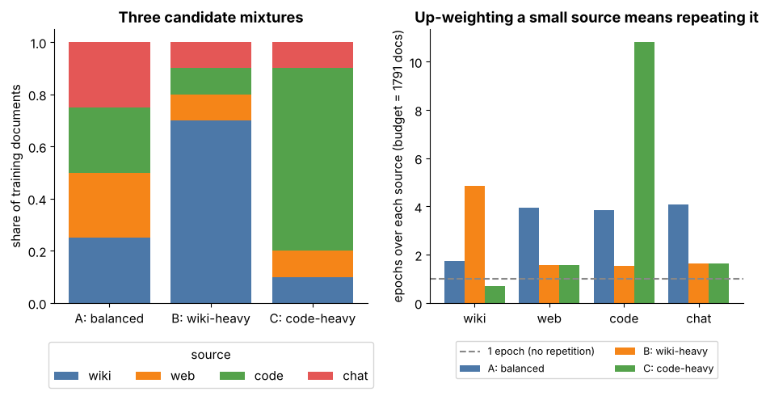

## 9.6 Data mixture design

Metadata:

- Tier: 9 — Foundation Model Pretraining
- Phase: 2 — Transformers & Foundation Models
- Priority: Core
- Difficulty: Intermediate
- Interview Importance: High
- Hands-on Importance: Medium–High
- Prerequisites: [9.4 Quality filtering](09.04-quality-filtering.md), [9.5 Deduplication](09.05-deduplication-strategies.md)
- Leads To: [9.7 Language balancing](09.07-language-balancing.md), [9.8 Domain balancing](09.08-domain-balancing.md), [9.13 Data curriculum](09.13-data-curriculum.md), [9.14 Token budgets](09.14-token-budgets.md)

---

### 1. WHAT IS IT?

The **mixture** specifies what *fraction of training tokens* comes from each source (web, books, code, math, encyclopedia, chat, ...).

### 2. WHY DOES IT EXIST?

Sources differ in size and in what they teach. Without an explicit mixture the model sees whatever is biggest (web), regardless of the capabilities you want.

### 3. DETAILED EXPLANATION

The mixture is a hyper-parameter as important as learning rate. It is usually chosen with small **proxy models** trained on candidate mixtures and extrapolated to the big run; automated mixture-optimisation methods exist but are research-grade (`REVIEW_REQUIRED`).

Each source has a limited number of **unique tokens**. If the mixture asks for more tokens from a source than it has, that source is **repeated** (multiple epochs). A little repetition of high-quality data is usually harmless; a lot is not. Published repeated-data studies suggest returns diminish after a few epochs; "about 4 epochs" is a commonly quoted rule of thumb (`REVIEW_REQUIRED`, depends on model and data).



*Figure 3 — Left: three candidate mixtures. Right: how many times each source must be repeated to fill the same budget, computed on the lab's deduplicated corpus. Wiki-heavy and code-heavy mixtures force the small sources to repeat many times. [mixture_explorer.html](../interactive/mixture_explorer.html) has sliders for every source weight and the budget.*

### 4. HOW DOES IT WORK?

1. List sources with unique token counts after the full pipeline. 2. Pick target weights per source. 3. Compute requested tokens = weight x budget. 4. Epochs per source = requested / unique. 5. If epochs are too high, lower the weight, find more data, or accept repetition. 6. Sample documents to hit the weights, shuffle, tokenise, shard.

### 5. SIMPLE EXAMPLE

A diet plan: 40% vegetables, 20% grains, ... If the pantry has only one day's worth of vegetables, you eat the same vegetables repeatedly.

### 6. TECHNICAL EXAMPLE

A 1T-token budget with 8% code weight needs 80B code tokens. If only 40B unique code tokens exist after dedup, code is seen for 2 epochs. Raising code to 30% would need 7.5 epochs, past the usual rule of thumb.

### 7. CODE

```python
# Run from lab/: mix by document share, then verify the realised shares (lab mixes by documents; real mixtures are in tokens).
from collections import Counter
import data_prep as dp

docs = dp.make_synthetic_crawl(0, 400)
mixed = dp.mix_sources(docs, {"wiki": .4, "web": .2, "code": .2, "chat": .2}, total_docs=len(docs), seed=0)
c = Counter(d["source"] for d in mixed)
print({k: round(v / len(mixed), 2) for k, v in c.items()})
```

Source: [`../lab/data_prep.py`](../lab/data_prep.py) (`mix_sources`).

### 8. INPUT → PROCESS → OUTPUT

```
per-source unique tokens + target weights + token budget -> requested tokens -> epochs per source -> sampled, shuffled stream
```

### 9. ENTERPRISE USE CASE

For a domain-adaptive run ([9.30](09.30-domain-adaptive-pretraining.md)) an enterprise mixes its in-domain corpus with a slice of general data (replay) so the model gains domain skill without forgetting basics.

### 10. AI ENGINEERING CONNECTION

Mixture largely determines which benchmarks a base model is good at. When reading a model card, the stated mixture (if any) is the best predictor of strengths: code share, multilingual share, math share.

### 11. ADVANTAGES

- Directly steers capabilities without changing the model.
- Cheap to ablate at small scale.

### 12. LIMITATIONS

- Optimal mixtures at small scale may not hold at large scale.
- Interactions between sources are hard to predict.

### 13. TRADE-OFFS

Breadth (general ability) vs density (reasoning/code); more of the good source vs repeating it too much.

### 14. COMMON MISTAKES

- Setting weights by *size of source* rather than by desired capability.
- Never checking epochs per source.
- Changing the mixture and the model at the same time (no clean ablation).
- Specifying mixtures in documents rather than tokens.

### 15. PERFORMANCE / COST CONSIDERATIONS

Mixture ablations require many small training runs; budget them explicitly. Sampling at the dataloader should be deterministic and resumable ([9.13](09.13-data-curriculum.md)).

### 16. SECURITY CONSIDERATIONS

Up-weighting a small source amplifies anything poisoned in it. Track provenance per source so a bad source can be down-weighted or removed.

### 17. INTERVIEW EXPLANATION

"The mixture decides what fraction of tokens comes from each source. I'd define target capabilities and evals, run proxy-model ablations at small scale, check epochs per source so small high-quality sources aren't repeated too much, and verify the ranking holds at a larger scale before committing. It's as important as learning rate and should be changed independently of the model for clean ablations."

### 18. RAPID-FIRE ANSWER

The per-source share of training tokens; chosen by proxy ablations while watching epochs per source.

### 19. INTERVIEW QUESTIONS

- **Basic:** What is a data mixture?
- **Intermediate:** Why does repetition matter when a source is small?
- **Advanced:** How would you search for a good mixture cheaply?
- **Scenario:** A source has 5B unique tokens and the mixture asks for 40B from it. What are the consequences and options?

### 20. HANDS-ON EXERCISE

In [mixture_explorer.html](../interactive/mixture_explorer.html), set a 100B-token budget and find a mixture where no source exceeds 4 epochs while code is at least 15%.

### 21. REVISION QUESTIONS

1. How do you compute epochs per source? 2. Why use proxy models? 3. Why is "weight by source size" a mistake?

### 22. RELATED CONCEPTS

[9.7 Language balancing](09.07-language-balancing.md) · [9.8 Domain balancing](09.08-domain-balancing.md) · [9.13 Data curriculum](09.13-data-curriculum.md) · [9.14 Token budgets](09.14-token-budgets.md)

### 23. ONE-LINE MEMORY HOOK

*"What the model eats decides what it becomes; check how many times it re-eats the same dish."*
