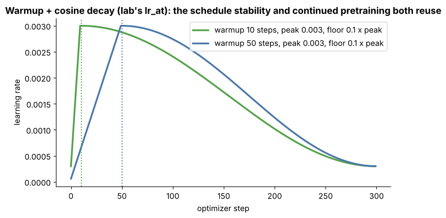

## 9.13 Data curriculum

Metadata:

- Tier: 9 — Foundation Model Pretraining
- Phase: 2 — Transformers & Foundation Models
- Priority: Important
- Difficulty: Intermediate–Advanced
- Interview Importance: Medium
- Hands-on Importance: Medium
- Prerequisites: [9.6 Data mixture design](09.06-data-mixture-design.md), [9.8 Domain balancing](09.08-domain-balancing.md)
- Leads To: [9.22 Training checkpoints](09.22-training-checkpoints.md), [9.28 Training stability](09.28-training-stability.md), [9.29 Continued pretraining](09.29-continued-pretraining.md)

---

### 1. WHAT IS IT?

Controlling the **order** in which data is seen, not only the proportions: for example broad/noisy data first, then a final phase **annealed** onto higher-quality or more specialised data with a decaying learning rate, or increasing context length late in training.

### 2. WHY DOES IT EXIST?

The model's last steps influence its final weights strongly (low LR, fresh data). Putting the best data and target-style data late can raise final quality at no extra token cost. Evidence for ordering benefits is mixed and recipe-specific (`REVIEW_REQUIRED`).

### 3. DETAILED EXPLANATION

Typical shape: phase 1 (most of the budget) with the main mixture and high-to-mid LR; phase 2 (final few percent to tens of percent of tokens) with a shifted mixture (more code/math/clean data) while the LR decays to its floor; optionally a context-length extension phase. The learning-rate schedule and the data schedule are coupled.

Engineering requirements: the data loader must report and resume **exactly** where it is in the curriculum. The lab achieves this by making each batch a pure function of `(seed, step)`, so any phase boundary is just a function of the step number.



*Figure 12 — The lab's warmup + cosine schedule. A curriculum's "annealing" phase sits in the decaying tail of such a schedule; the data mixture shift is aligned with it.*

### 4. HOW DOES IT WORK?

1. Define phases as ranges of the step counter. 2. For each phase, define mixture weights (and optionally context length). 3. Choose the batch's source by `(seed, step)` deterministically. 4. Log the phase boundary in metrics. 5. Evaluate per-domain loss across the boundary.

### 5. SIMPLE EXAMPLE

A student studies broad survey texts for months, then spends the last weeks on past exam papers.

### 6. TECHNICAL EXAMPLE

A 1T-token run uses a general mixture for the first 90% of tokens and a code/math-heavier mixture for the last 10% with LR decayed to 10% of peak. The loss curve jumps at the boundary because the *data* changed, not because training broke.

### 7. CODE

```python
# Phase-aware mixture weights as a pure function of the step (resumable by construction).
def mixture_at(step: int, total: int) -> dict[str, float]:
    if step < 0.9 * total:                                   # phase 1: general mixture
        return {"wiki": 0.4, "web": 0.2, "code": 0.2, "chat": 0.2}
    return {"wiki": 0.2, "web": 0.1, "code": 0.5, "chat": 0.2}   # phase 2: anneal onto code-heavy data

for s in (0, 89, 90, 99):
    print(s, mixture_at(s, 100))
```

Related lab code: `get_batch` and `lr_at` in [`../lab/pretrain.py`](../lab/pretrain.py).

### 8. INPUT → PROCESS → OUTPUT

```
step counter -> phase lookup -> mixture + LR for that phase -> deterministic batch -> loss (log phase boundary)
```

### 9. ENTERPRISE USE CASE

For continued pretraining on enterprise text, end the run with a short phase over the cleanest, most representative internal documents, and record the boundary in the experiment tracker.

### 10. AI ENGINEERING CONNECTION

Model cards that mention "annealing" or "long-context extension" phases refer to this. Understanding it explains why a base model's behaviour can differ from what the main mixture alone would predict.

### 11. ADVANTAGES

- Can improve final quality without extra tokens.
- Natural place for context-length extension.

### 12. LIMITATIONS

- Benefit is recipe-specific and hard to ablate at small scale.
- Adds moving parts that complicate reproducibility.

### 13. TRADE-OFFS

Late specialised data boosts target skills but risks over-specialising or forgetting; a pure stationary mixture is simpler and safer.

### 14. COMMON MISTAKES

- Changing the curriculum mid-run without logging the boundary (loss jumps are misread as instability).
- Non-resumable data loaders that restart the curriculum from the beginning after a crash.
- Aligning the data switch badly with the LR schedule.

### 15. PERFORMANCE / COST CONSIDERATIONS

No extra FLOPs, but late-phase experiments are expensive to repeat (you must rerun the tail of the schedule from a checkpoint).

### 16. SECURITY CONSIDERATIONS

Late data has outsized influence on final weights; a poisoned late-phase source is more dangerous than the same amount early. Gate the final-phase sources with extra review.

### 17. INTERVIEW EXPLANATION

"A curriculum controls the order of data, not just proportions — typically broad data first, then an annealing phase on higher-quality or specialised data as the learning rate decays. The engineering requirement is a deterministic, resumable loader so the phase is a pure function of the step, and logging the boundary so a loss jump isn't mistaken for instability."

### 18. RAPID-FIRE ANSWER

Ordering of data across training, often ending with an annealing phase on high-quality data.

### 19. INTERVIEW QUESTIONS

- **Basic:** What is a data curriculum?
- **Intermediate:** Why log the phase boundary?
- **Advanced:** How are the LR schedule and annealing data phase coupled?
- **Scenario:** The loss jumps at 90% of training. Is it instability?

### 20. HANDS-ON EXERCISE

Extend `get_batch` usage so that after step 150 of a 200-step lab run the batches come from a code-only stream; plot loss and mark the boundary.

### 21. REVISION QUESTIONS

1. What is annealing here? 2. Why does determinism matter? 3. What confounds a loss jump?

### 22. RELATED CONCEPTS

[9.6 Mixture](09.06-data-mixture-design.md) · [9.22 Checkpoints](09.22-training-checkpoints.md) · [9.28 Training stability](09.28-training-stability.md) · [9.29 Continued pretraining](09.29-continued-pretraining.md)

### 23. ONE-LINE MEMORY HOOK

*"End the run on the best data, and write down when you switched."*
