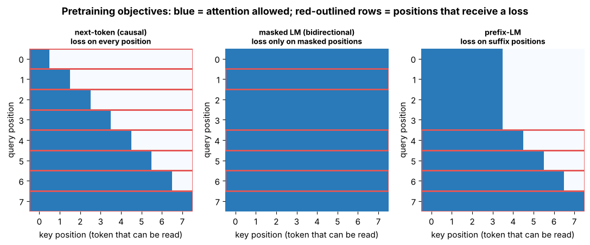

## 9.17 Next-token prediction

Metadata:

- Tier: 9 — Foundation Model Pretraining
- Phase: 2 — Transformers & Foundation Models
- Priority: Core
- Difficulty: Intermediate
- Interview Importance: High
- Hands-on Importance: High
- Prerequisites: [9.16 Self-supervised learning](09.16-self-supervised-learning-for-foundation-models.md), [Tier 7 causal attention](../../tier-07-attention/README.md), [Tier 8 decoder blocks](../../tier-08-transformer-architecture/README.md)
- Leads To: [9.19 Pretraining objectives](09.19-pretraining-objectives.md), [9.24 Dense-model pretraining](09.24-dense-model-pretraining.md), [9.31 Pretraining evaluation](09.31-pretraining-evaluation.md)

---

### 1. WHAT IS IT?

The causal language-modeling objective: given tokens `x₁…x_T`, the model outputs at each position a distribution over the *next* token, and the loss is the average negative log-likelihood (cross-entropy):

`L = −(1/T) Σₜ log p_θ(xₜ₊₁ | x₁…xₜ)`

(The objective *definition* belongs to Tier 8; this file covers how it is used in pretraining.)

### 2. WHY DOES IT EXIST?

It needs no labels, uses every position of every sequence as a training example, and matches generation: sampling from the learned distribution one token at a time. Training objective and inference procedure agree, a big reason decoder-only models dominate.

### 3. DETAILED EXPLANATION

Position *t* may only see positions ≤ *t* (the causal mask, [Tier 7](../../tier-07-attention/README.md)). In the lab the shift is done in `get_batch`: `y = data[i+1 : i+1+ctx]`, so the model at position *t* is graded on token *t+1*.

**Loss units.** Cross-entropy is in nats; **perplexity** = `exp(loss)` (an "effective branching factor"). Loss is only comparable between runs that use the *same tokenizer and eval set*; use bits-per-byte across tokenizers ([9.31](09.31-pretraining-evaluation.md)).

**Sanity checks to always run:** an untrained model's loss ≈ `ln V` (uniform guess; `test_model_shapes_and_initial_loss`), and changing a future token must not change earlier logits (`test_causality_future_tokens_do_not_change_past_logits`).



*Figure 10, left panel — the causal mask: each query row reads only keys at or before it, and **every** row is outlined in red because every position receives a loss.*

### 4. HOW DOES IT WORK?

1. Tokenize and concatenate documents with an end-of-text token. 2. Sample windows `x` of length `ctx` and targets `y = x` shifted by one. 3. Forward pass gives logits `(B, T, V)`. 4. Cross-entropy between logits and `y`, averaged over `B·T`. 5. Backprop, clip, AdamW step ([9.28](09.28-training-stability.md)).

### 5. SIMPLE EXAMPLE

Predictive text on a phone: after "see you", guess "soon". Training does this billions of times and penalises confident wrong guesses.

### 6. TECHNICAL EXAMPLE

With vocabulary 380, a random-init lab model starts near `ln 380 ≈ 5.94` nats; after 200 steps validation loss is about 0.96 (perplexity ≈ 2.6) on the templated toy data. That says nothing about real language (the data is simple).

### 7. CODE

```python
# Run from lab/: the whole objective in three lines, plus the ln(V) sanity check.
import math, torch
import torch.nn.functional as F
from model import ModelConfig, TinyLM

cfg = ModelConfig(vocab_size=380)
model = TinyLM(cfg)
x = torch.randint(0, 380, (4, 64))
y = torch.roll(x, -1, dims=1)                         # stand-in targets: "next token" (random data)
logits, loss = model(x, y)
print(loss.item(), math.log(380))                     # close to ln V at init
manual = F.cross_entropy(logits.reshape(-1, 380), y.reshape(-1))
print(abs(manual.item() - loss.item()) < 1e-5)
```

Source: [`../lab/model.py`](../lab/model.py), [`../lab/pretrain.py`](../lab/pretrain.py).

### 8. INPUT → PROCESS → OUTPUT

```
tokens x1..xT -> causal Transformer -> logits per position -> cross-entropy vs shifted tokens -> scalar loss -> gradients
```

### 9. ENTERPRISE USE CASE

Continued pretraining on internal documents ([9.29](09.29-continued-pretraining.md)) uses exactly this loss; perplexity on a held-out slice of the corpus is the first acceptance metric.

### 10. AI ENGINEERING CONNECTION

Every decoder LLM is trained with this objective before alignment. Log-probabilities from the same distribution power sampling, scoring, reranking, perplexity-based data filters ([9.4](09.04-quality-filtering.md)) and membership-inference probes.

### 11. ADVANTAGES

- Dense signal: every position is a training example.
- Pretraining and generation use the same distribution.
- Scales cleanly (scaling laws were measured on it).

### 12. LIMITATIONS

- Sees only left context (weaker for pure understanding tasks than bidirectional encoders at small scale).
- Rewards plausible continuations, not truth; the "reversal curse" and exposure bias are known weaknesses (`REVIEW_REQUIRED` for details).

### 13. TRADE-OFFS

Causal LM for generation vs masked LM for encoders ([9.18](09.18-masked-language-modeling.md)); simplicity vs extras such as fill-in-the-middle or multi-token prediction ([9.19](09.19-pretraining-objectives.md)).

### 14. COMMON MISTAKES

- Off-by-one shifts (training on identity mapping gives suspiciously low loss).
- Comparing losses across tokenizers or eval sets.
- Forgetting document boundaries (end-of-text token) so the model learns to continue across unrelated documents.

### 15. PERFORMANCE / COST CONSIDERATIONS

Cost per token ≈ `6N` FLOPs; the final softmax over vocabulary `V` is a significant share for small models. Large `V` increases memory for logits (B·T·V), which is why chunked loss computation is used at scale (`REVIEW_REQUIRED`).

### 16. SECURITY CONSIDERATIONS

Maximum-likelihood training memorises repeated sequences, so secrets and PII can be regurgitated by prefix prompting. Dedup ([9.5](09.05-deduplication-strategies.md)) and scrubbing reduce, but do not eliminate, the risk.

### 17. INTERVIEW EXPLANATION

"Next-token prediction trains a decoder to maximise the likelihood of each token given the ones before it. It's self-supervised, every position gives a gradient signal, and generation is just sampling from the same distribution — so the pretraining objective and the inference procedure match, which is a big reason decoder-only models dominate. The cost is only left context and that it rewards plausibility over truth."

### 18. RAPID-FIRE ANSWER

Minimise cross-entropy of token t+1 given tokens up to t; perplexity = exp(loss).

### 19. INTERVIEW QUESTIONS

- **Basic:** What is the loss for next-token prediction?
- **Intermediate:** What should the loss of an untrained model be, and why?
- **Advanced:** Why is loss not comparable across tokenizers, and what do you use instead?
- **Scenario:** A new model shows near-zero loss in a few steps. What bug do you suspect?

### 20. HANDS-ON EXERCISE

Break the shift in a copy of `get_batch` (use `y = x`) and train 50 steps; observe the loss collapsing and explain why. Then re-run `test_causality_future_tokens_do_not_change_past_logits`.

### 21. REVISION QUESTIONS

1. Write the loss formula. 2. Why `ln V` at init? 3. What does the causal mask guarantee?

### 22. RELATED CONCEPTS

[9.16 Self-supervised learning](09.16-self-supervised-learning-for-foundation-models.md) · [9.18 Masked-language modeling](09.18-masked-language-modeling.md) · [9.19 Objectives](09.19-pretraining-objectives.md) · [Tier 7](../../tier-07-attention/README.md) · [Tier 8](../../tier-08-transformer-architecture/README.md)

### 23. ONE-LINE MEMORY HOOK

*"Shift by one, score every position."*
