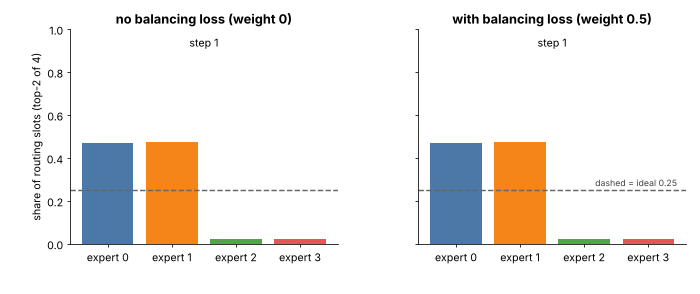

## 9.26 Expert routing

Metadata:

- Tier: 9 — Foundation Model Pretraining
- Phase: 2 — Transformers & Foundation Models
- Priority: Important
- Difficulty: Advanced
- Interview Importance: Medium–High
- Hands-on Importance: Medium
- Prerequisites: [9.25 Mixture-of-Experts pretraining](09.25-mixture-of-experts-pretraining.md), [Tier 12 MoE blocks](../../tier-12-modern-architectures/README.md)
- Leads To: [9.27 Load balancing](09.27-load-balancing.md), [9.28 Training stability](09.28-training-stability.md)

---

### 1. WHAT IS IT?

The mechanism that decides which experts process each token: `logits = x·W_r -> softmax -> top-k experts -> gate weights renormalised -> output = Σ gate_i · expert_i(x)`.

### 2. WHY DOES IT EXIST?

Sparse compute requires a learned, differentiable-enough selection of which parameters to use per token; the router is that selector and is trained jointly with the experts.

### 3. DETAILED EXPLANATION

Variants: **token-choice** (each token picks experts; the lab and Switch-style layers), **expert-choice** (each expert picks tokens, balancing by construction but changing the causal-training story: tokens' routing depends on other tokens in the batch), **shared + routed experts** (always-on experts plus routed ones), and **auxiliary-loss-free balancing** (`REVIEW_REQUIRED` for the details of specific papers). Router computation is usually kept in higher precision because it is numerically sensitive. Top-k choice itself is not differentiable; gradients flow through the gate probabilities of the selected experts.



*Figure 7 (animated) — Routing changes during training: the bars are the share of routing slots per expert. Try top-k, initial skew and capacity factor in [moe_router.html](../interactive/moe_router.html).*

### 4. HOW DOES IT WORK?

1. `probs = softmax(x W_r)` over E experts. 2. `top_p, top_i = topk(probs, k)`. 3. Renormalise `top_p` to sum to 1. 4. Dispatch each token to experts `top_i`. 5. `y = Σ top_p[j] · expert_{top_i[j]}(x)`. 6. Combine, continue through the network.

### 5. SIMPLE EXAMPLE

A receptionist who sends each visitor to the two most relevant departments and asks them to weigh in proportionally to how relevant each is.

### 6. TECHNICAL EXAMPLE

With E = 4, k = 2 and router probabilities `[0.5, 0.3, 0.15, 0.05]` for a token, experts 0 and 1 are chosen with renormalised gates `0.625` and `0.375`.

### 7. CODE

```python
# Run from lab/: route a batch through the lab's MoE layer and look at the dispatch statistics.
import torch
from model import MoEFFN

torch.manual_seed(0)
moe = MoEFFN(d=16, n_exp=4, top_k=2)
x = torch.randn(2, 8, 16)
y = moe(x)
print(y.shape, "load share per expert:", moe.last_load / moe.top_k, "aux loss:", float(moe.aux_loss))

probs = torch.tensor([0.5, 0.3, 0.15, 0.05])
p, i = probs.topk(2); print(i.tolist(), (p / p.sum()).tolist())      # [0, 1] [0.625, 0.375]
```

Source: [`../lab/model.py`](../lab/model.py) (`MoEFFN`).

### 8. INPUT → PROCESS → OUTPUT

```
x (tokens) -> router logits -> softmax -> top-k + renormalise -> dispatch to experts -> gate-weighted sum -> y
```

### 9. ENTERPRISE USE CASE

Operators monitor per-expert load, drop rate and router entropy as production health signals for MoE models, and plan expert placement across GPUs to match traffic.

### 10. AI ENGINEERING CONNECTION

Routing determines which experts a prompt activates, which matters for latency variance, caching and expert-parallel serving ([Tier 11](../../tier-11-llm-inference-optimization/README.md)).

### 11. ADVANTAGES

- Per-token specialisation without paying for all parameters.
- Simple to implement (top-k over a linear layer).

### 12. LIMITATIONS

- Hard top-k is non-differentiable; routing can be noisy and unstable early in training.
- Token-choice causes load imbalance; expert-choice complicates autoregressive use.

### 13. TRADE-OFFS

Larger k: smoother, more compute and communication. Smaller k: cheaper, more brittle routing. Token-choice (simple, imbalance) vs expert-choice (balanced, awkward for causal decoding).

### 14. COMMON MISTAKES

- Computing the router in low precision.
- Forgetting to renormalise gate weights.
- Not logging router entropy or per-expert load.

### 15. PERFORMANCE / COST CONSIDERATIONS

Dispatch requires gather/scatter or all-to-all; implementation efficiency (grouped GEMMs) dominates real throughput. A naive Python loop over experts, as in the lab, is for clarity only.

### 16. SECURITY CONSIDERATIONS

Because routing depends on token content, crafted inputs can target specific experts; in batched serving, one tenant's tokens can influence another's capacity-limited routing (`REVIEW_REQUIRED`).

### 17. INTERVIEW EXPLANATION

"A router is a small linear layer that scores experts for each token; we softmax, take the top-k, renormalise the gates, and sum the experts' outputs weighted by those gates. Variants include expert-choice routing and shared experts. The key concerns are keeping it numerically stable, differentiable through the gates, and balanced."

### 18. RAPID-FIRE ANSWER

Softmax scores per expert, pick top-k, renormalise, and combine expert outputs by gate weight.

### 19. INTERVIEW QUESTIONS

- **Basic:** What does the router do?
- **Intermediate:** Why renormalise the top-k gate weights?
- **Advanced:** Why is expert-choice routing awkward for autoregressive training?
- **Scenario:** One expert gets 70% of tokens. What are the symptoms and fixes?

### 20. HANDS-ON EXERCISE

Change `top_k` from 1 to 2 to 4 in the snippet and record `aux_loss` and per-expert shares; explain what top-k = E means.

### 21. REVISION QUESTIONS

1. What are the router's inputs and outputs? 2. How do gradients reach the router? 3. What is expert-choice routing?

### 22. RELATED CONCEPTS

[9.25 MoE pretraining](09.25-mixture-of-experts-pretraining.md) · [9.27 Load balancing](09.27-load-balancing.md) · [9.28 Training stability](09.28-training-stability.md) · [Tier 12](../../tier-12-modern-architectures/README.md)

### 23. ONE-LINE MEMORY HOOK

*"Score, pick top-k, renormalise, blend."*
