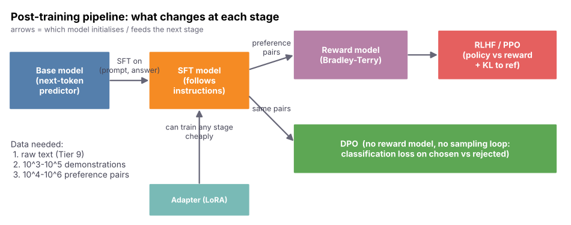
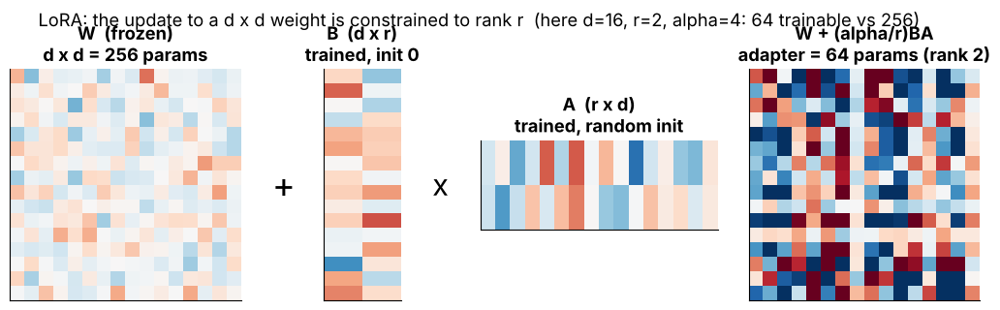
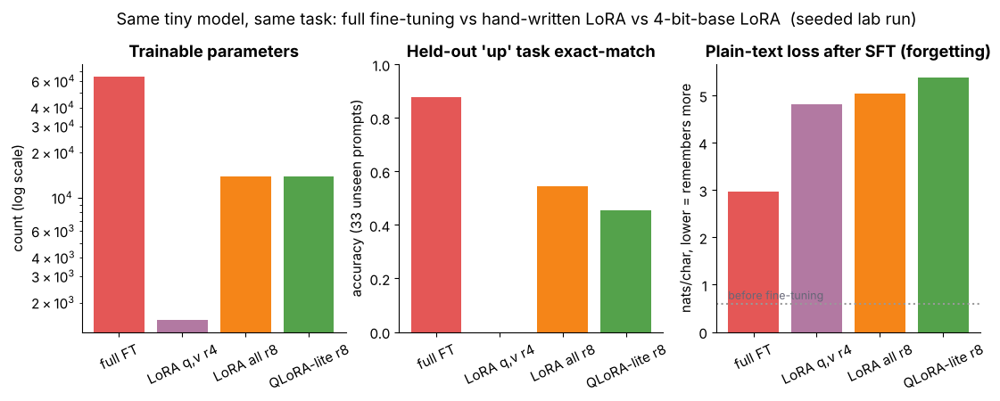
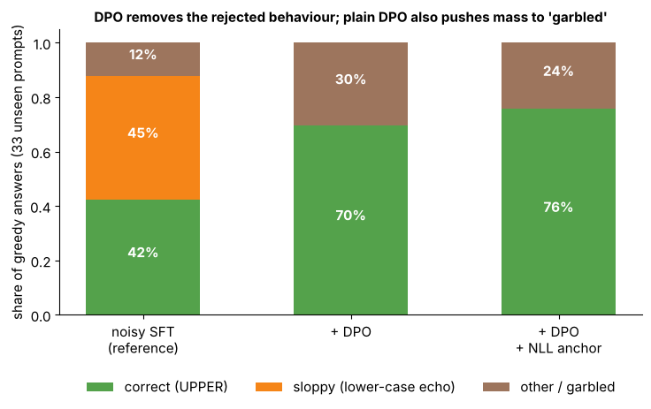
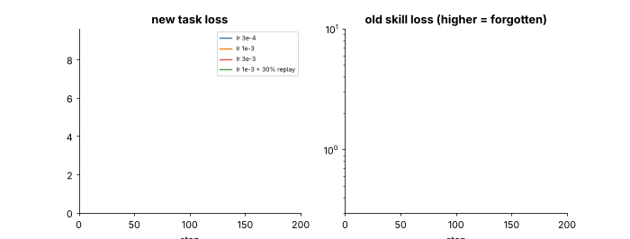
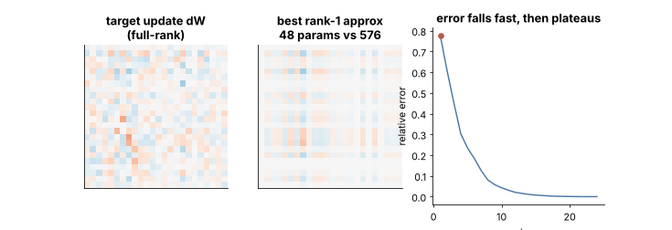
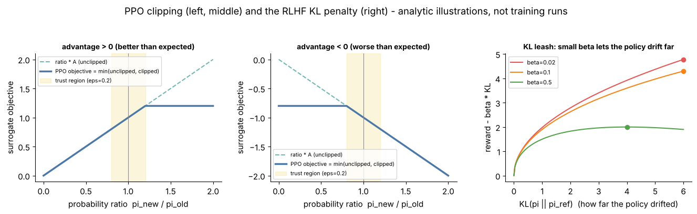
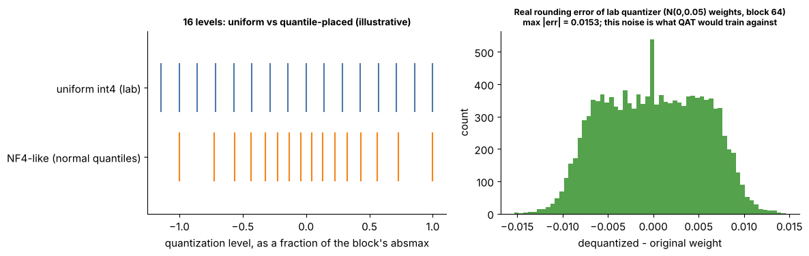

# Tier 10 — Fine-Tuning & Alignment

> **Phase 2 · Transformers & Foundation Models** · Author: Claude draft (see `CHAPTER_STATUS.md`) · Status: `AUTHOR_DRAFT` (Critic / Code-review / Final-review pending)
> This file is the **tier overview and index**. Each of the 35 roadmap concepts is taught in its own file under [`concepts/`](concepts) in the Standard Concept Format (23 sections).

**Tier goal.** After this tier you can explain how a *base* model becomes an *assistant*, write LoRA from scratch and prove it is an identity at initialisation and exactly mergeable, estimate fine-tuning memory for full / LoRA / QLoRA, explain the preference-learning stack (reward model, RLHF/PPO, DPO), and recognise the failure modes (forgetting, likelihood displacement, data leakage, template mismatch).

**Prerequisites.** Tier 4 (optimizers, learning rate), [Tier 8](../tier-08-transformer-architecture/README.md) (Transformer blocks), [Tier 9](../tier-09-foundation-model-pretraining/README.md) (pretraining, next-token loss).
**Leads to.** [Tier 11](../tier-11-llm-inference-optimization/README.md) (inference/quantization), Tier 15 (evaluation & safety), Tier 32 (security).

---

## 0 · How to use this tier (read, see, play, build)

| Step | What | Where |
|---|---|---|
| 1. Read | One concept file per roadmap item | [`concepts/`](concepts) (index below) |
| 2. **See** | 10 labelled figures + 3 animated GIFs | [`figures/`](figures), gallery below |
| 3. **Play** | 5 interactive pages with sliders (open in a browser) | [`interactive/`](interactive) |
| 4. **Build** | Tiny char-transformer: pretrain, full FT vs LoRA vs QLoRA-lite, SFT then DPO, merging | [`lab/`](lab) |
| 5. **Regenerate** | All figures come from one script | `python scripts/make_figures.py` (about 2 min; `--new` rebuilds only figs 12-13) |

> **Honesty note.** Every number marked "measured" comes from `lab/run_lab.py` or `scripts/make_figures.py` on a **64,512-parameter** char-level model, seed-fixed, on CPU. It teaches *mechanics*. It does **not** show how real 7B-class models behave; where the toy contradicts folklore (for example LoRA forgetting less) the concept file says so. Figures 12 and 13 and the interactive 2-D landscapes are analytic illustrations, not training runs.

---

## 1 · The big picture

```
 raw text --> BASE model --> SFT (demonstrations) --> preference data --> RLHF (reward model + PPO)   -+
 (Tier 9)     predicts       "follow instructions"     chosen vs rejected   or DPO (direct loss)      +--> ASSISTANT
              next token     chat template + loss mask                      + safety / format tuning  -+
                               ^ any stage can be trained with FULL fine-tuning or a cheap ADAPTER (LoRA/QLoRA)
                               v results can be COMBINED by weight-space merging, or COMPRESSED by distillation
```

---

## 2 · Visual gallery



*Figure 1 — Post-training pipeline. Blue = Tier 9 output; orange = first chat model; purple/red/green = alignment stages; teal = the adapter trick. Both RLHF and DPO consume the same preference pairs.* Taught in [10.1](concepts/10.01-base-models-vs-instruction-tuned-models.md), [10.2](concepts/10.02-post-training-overview.md).



*Figure 2 — A 16x16 weight (256 params) gets a rank-2 update with only 64 trainable parameters.* See [10.11](concepts/10.11-lora.md).


*Figure 3 — Left: trainable share of one d x d matrix = 200 r/d percent. Right: analytic memory for full FT vs LoRA vs QLoRA.* See [10.12](concepts/10.12-lora-rank.md), [10.9](concepts/10.09-full-fine-tuning.md), [10.35](concepts/10.35-fine-tuning-cost-and-deployment-trade-offs.md).


*Figure 4 — Left: DPO loss vs margin for several beta (all pass through log 2). Right: gradient weight, large when the pair is wrong.* See [10.25](concepts/10.25-direct-preference-optimization-dpo.md).



*Figure 5 — Measured, one seed: trainable parameters (log), held-out accuracy, plain-text loss after SFT. The ordering is not a claim about large models.* See [10.10](concepts/10.10-parameter-efficient-fine-tuning-peft.md), [10.14](concepts/10.14-lora-target-modules.md).



*Figure 6 — Measured: after noisy SFT 42 % correct; DPO removes the sloppy answers but grows the garbled share (likelihood displacement); an NLL anchor helps.* See [10.25](concepts/10.25-direct-preference-optimization-dpo.md).


*Figure 7 — Measured: plain-text loss ("old skill") rises with learning rate; 30 % replay keeps it near baseline.* See [10.28](concepts/10.28-catastrophic-forgetting.md).


*Figure 8 — Measured: base-to-finetuned interpolation; accuracy is 0 until t about 0.7.* See [10.31](concepts/10.31-model-merging.md).


*Figure 9 (GIF) — A real DPO run: loss falls from log 2, margin grows, pair accuracy jumps to 1 within about 20 steps.*



*Figure 10 (GIF) — The four forgetting runs step by step; the red/orange old-skill curves take off long before the new-task loss finishes falling.*



*Figure 11 (GIF) — Best rank-r approximation of a decaying-spectrum update: error drops fast then plateaus (Eckart-Young; illustrative).*



*Figure 12 (new, analytic) — Left/middle: PPO clipped objective for positive/negative advantage with the eps=0.2 trust region. Right: reward minus beta times KL; small beta lets the policy drift far.* See [10.22](concepts/10.22-rlhf.md), [10.23](concepts/10.23-ppo-intuition-for-alignment.md).



*Figure 13 (new) — Left: uniform 16 levels (lab) vs an NF4-like quantile placement (illustrative construction, not the published NF4 table). Right: real rounding error of the lab quantizer.* See [10.15](concepts/10.15-qlora.md), [10.18](concepts/10.18-quantization-aware-fine-tuning-concepts.md).

---

## 3 · Interactive explorers

Self-contained pages, no internet, no install; open in a browser.

| Explorer | Adjustable controls | Teaches |
|---|---|---|
| [`lora_explorer.html`](interactive/lora_explorer.html) | d, layers, rank r, alpha, which matrices, B=0 toggle | 10.11-10.14 |
| [`qlora_memory.html`](interactive/qlora_memory.html) | model size, adapter %, block size, optimizer | 10.9, 10.15, 10.35 |
| [`dpo_bt.html`](interactive/dpo_bt.html) | A: learning rate, steps (fit Bradley-Terry rewards); B: beta, log-ratios of chosen/rejected | 10.19-10.21, 10.25 |
| [`forgetting_merge.html`](interactive/forgetting_merge.html) | learning rate, steps, replay weight, merge t, landscape | 10.27-10.32 |
| [`chat_template.html`](interactive/chat_template.html) | template style, messages, generation prompt, mask-prompt toggle | 10.3, 10.5 |

---

## 4 · Concept index (35 concepts, one file each)

| # | Concept file | Visuals / lab used |
|---|---|---|
| 10.1 | [Base models vs instruction-tuned models](concepts/10.01-base-models-vs-instruction-tuned-models.md) | pipeline fig 1 |
| 10.2 | [Post-training overview](concepts/10.02-post-training-overview.md) | pipeline fig 1 |
| 10.3 | [Supervised fine-tuning (SFT)](concepts/10.03-supervised-fine-tuning-sft.md) | [chat_template](interactive/chat_template.html) |
| 10.4 | [Instruction datasets](concepts/10.04-instruction-datasets.md) | ASCII flow in section 8 |
| 10.5 | [Chat templates](concepts/10.05-chat-templates.md) | [chat_template](interactive/chat_template.html) |
| 10.6 | [SFT data curation](concepts/10.06-sft-data-curation.md) | ASCII flow in section 8 |
| 10.7 | [Synthetic training data](concepts/10.07-synthetic-training-data.md) | ASCII flow in section 8 |
| 10.8 | [Reasoning-data construction](concepts/10.08-reasoning-data-construction.md) | ASCII flow in section 8 |
| 10.9 | [Full fine-tuning](concepts/10.09-full-fine-tuning.md) | fig 3, [qlora_memory](interactive/qlora_memory.html) |
| 10.10 | [Parameter-efficient fine-tuning (PEFT)](concepts/10.10-parameter-efficient-fine-tuning-peft.md) | fig 5 |
| 10.11 | [LoRA](concepts/10.11-lora.md) | fig 2, GIF 11, [lora_explorer](interactive/lora_explorer.html) |
| 10.12 | [LoRA rank](concepts/10.12-lora-rank.md) | fig 3, [lora_explorer](interactive/lora_explorer.html) |
| 10.13 | [LoRA alpha](concepts/10.13-lora-alpha.md) | [lora_explorer](interactive/lora_explorer.html) |
| 10.14 | [LoRA target modules](concepts/10.14-lora-target-modules.md) | fig 5, [lora_explorer](interactive/lora_explorer.html) |
| 10.15 | [QLoRA](concepts/10.15-qlora.md) | fig 13, [qlora_memory](interactive/qlora_memory.html) |
| 10.16 | [Adapters](concepts/10.16-adapters.md) | ASCII flow in section 8 |
| 10.17 | [Prompt tuning](concepts/10.17-prompt-tuning.md) | ASCII flow in section 8 |
| 10.18 | [Quantization-aware fine-tuning concepts](concepts/10.18-quantization-aware-fine-tuning-concepts.md) | fig 13 |
| 10.19 | [Preference data](concepts/10.19-preference-data.md) | ASCII flow in section 8 |
| 10.20 | [Preference optimization](concepts/10.20-preference-optimization.md) | fig 1 |
| 10.21 | [Reward models](concepts/10.21-reward-models.md) | [dpo_bt](interactive/dpo_bt.html) |
| 10.22 | [RLHF](concepts/10.22-rlhf.md) | fig 12 |
| 10.23 | [PPO intuition for alignment](concepts/10.23-ppo-intuition-for-alignment.md) | fig 12 |
| 10.24 | [On-policy vs off-policy alignment intuition](concepts/10.24-on-policy-vs-off-policy-alignment-intuition.md) | ASCII flow in section 8 |
| 10.25 | [Direct Preference Optimization (DPO)](concepts/10.25-direct-preference-optimization-dpo.md) | figs 4, 6, GIF 9, [dpo_bt](interactive/dpo_bt.html) |
| 10.26 | [Distillation](concepts/10.26-distillation.md) | ASCII flow in section 8 |
| 10.27 | [Continued fine-tuning](concepts/10.27-continued-fine-tuning.md) | [forgetting_merge](interactive/forgetting_merge.html) |
| 10.28 | [Catastrophic forgetting](concepts/10.28-catastrophic-forgetting.md) | fig 7, GIF 10, [forgetting_merge](interactive/forgetting_merge.html) |
| 10.29 | [Catastrophic-forgetting evaluation](concepts/10.29-catastrophic-forgetting-evaluation.md) | fig 5 |
| 10.30 | [Adapter merging](concepts/10.30-adapter-merging.md) | [forgetting_merge](interactive/forgetting_merge.html) |
| 10.31 | [Model merging](concepts/10.31-model-merging.md) | fig 8, [forgetting_merge](interactive/forgetting_merge.html) |
| 10.32 | [Checkpoint merging](concepts/10.32-checkpoint-merging.md) | ASCII flow in section 8 |
| 10.33 | [Fine-tuning evaluation](concepts/10.33-fine-tuning-evaluation.md) | figs 5, 6 |
| 10.34 | [Fine-tuning data/security considerations](concepts/10.34-fine-tuning-data-security-considerations.md) | ASCII flow in section 8 |
| 10.35 | [Fine-tuning cost and deployment trade-offs](concepts/10.35-fine-tuning-cost-and-deployment-trade-offs.md) | fig 3, [qlora_memory](interactive/qlora_memory.html) |

---

## 5 · Build: compare full FT, LoRA/QLoRA, DPO and merging on a tiny model

| File | What it is |
|---|---|
| [`lab/data.py`](lab/data.py) | char vocab + special tokens, chat template renderer, SFT loss-mask builder, synthetic tasks (`up`, `rv`) |
| [`lab/tiny_lm.py`](lab/tiny_lm.py) | 64,512-param decoder-only char transformer; `seq_logprob`, `generate` |
| [`lab/lora.py`](lab/lora.py) | `LoRALinear`, `apply_lora`, merge/unmerge, param-count formula, 4-bit blockwise quantizer, memory calculator |
| [`lab/alignment.py`](lab/alignment.py) | Bradley-Terry loss, **DPO loss**, distillation KL |
| [`lab/merge.py`](lab/merge.py) | lerp, task vectors, task arithmetic, averaging |
| [`lab/run_lab.py`](lab/run_lab.py) | the experiment (about 50 s on the authoring sandbox's CPU) |
| [`lab/test_tier10.py`](lab/test_tier10.py) | 21 pytest tests |
| [`scripts/make_figures.py`](scripts/make_figures.py) | regenerates every figure/GIF |

```bash
cd lab && python -m pytest -q      # 21 passed
python run_lab.py                  # about 50 s; prints the table below
```

**Measured output of `run_lab.py` (seeded; the timing line will differ on your machine).** Task: `up` (upper-case the words). 33 unseen prompts. "Plain-text loss" = next-token loss on base-style text (0.59 before fine-tuning).

| Run | Trainable | Up-task acc. | Plain-text loss |
|---|---|---|---|
| base model (no FT) | - | 0.00 | 0.59 |
| full FT (150 steps) | 64,512 (100 %) | **0.88** | 2.96 |
| full FT + 30 % replay | 64,512 | 0.36 | 0.62 |
| LoRA q,v, r=4 (200 steps) | 1,536 (2.3 %) | 0.00 | 4.82 |
| LoRA all 6 matrices, r=8 | 13,824 (17.6 %) | 0.55 | 5.04 |
| LoRA all, r=8 + replay | 13,824 | 0.82 | 0.65 |
| QLoRA-lite (4-bit base) r=8 | 13,824 | 0.45 | 5.39 |

| Preference stage (greedy, correct / sloppy / other) | Result |
|---|---|
| noisy SFT (50 % sloppy answers) | 0.42 / 0.45 / 0.12 |
| + DPO | 0.70 / 0.00 / 0.30 |
| + DPO + NLL anchor | 0.76 / 0.00 / 0.24 |

**Caveats (be honest in interviews).** Single seed; replay changes the training mix so "full + replay" at equal steps learns less (0.36); LoRA accuracy at 200 steps varies a lot between seeds (0.45-0.85 in my runs); "QLoRA-lite" is uniform int4, not NF4; LoRA did not forget less than full FT here (high LR, fully rewritten behaviour); the adapter-merge negative result (summing independent `up` and `rv` adapters gives 0 % on both) is exploratory and **not** in the committed lab.

**Exercises**

1. Run the lab with LoRA ranks 1, 2, 4, 8, 16 (all matrices, 250 steps, 3 seeds). Plot accuracy and trainable params vs r. *Where does it stop helping?*
2. Vary `alpha` at fixed `r=8` (4, 8, 16, 32) and LR. *Is alpha just another learning rate?*
3. Sweep DPO beta in {0.01, 0.1, 1} and LR; track the "garbled" share and chosen log-prob. *When does likelihood displacement appear?*
4. Reproduce the adapter-merge negative result: train LoRA adapters for `up` and `rv`, `merge_all`, add task vectors with `merge.add_task_vectors`, evaluate both tasks. Then train one adapter on a 50/50 mix. *Which works?*
5. Replace `generate`-based accuracy by a **log-likelihood-ratio** score. *Does it rank methods the same way?* (stretch)
6. Add a Bradley-Terry reward head to `TinyLM`, train it on the (correct, sloppy) pairs, then do best-of-8 sampling with it. *Compare with DPO.* (stretch)

---

## 6 · Tier interview kit

**Basic.** Base vs instruct model? What is a chat template and why does it matter? What does the loss mask do in SFT?
**Intermediate.** Derive LoRA's trainable-parameter count. Why is B initialised to zero? What changes between LoRA and QLoRA? Reward model vs DPO?
**Advanced.** Derive DPO from the KL-regularised RLHF objective. What is likelihood displacement and how do you mitigate it? When does model merging fail? Why can LoRA forget as much as full FT?
**Scenario.** *Your fine-tuned support bot became unsafe on unrelated prompts and ignores the system prompt.* (Safety erosion + template mismatch: re-run the safety suite, check the template, replay safety data, lower LR/steps, compare against the pre-tune checkpoint.)
**Scenario.** *You must serve 200 customers each with a custom tone on one GPU.* (One base + LoRA adapters; hot-swap or batch with adapter routing; adapter per tenant versioned with the base hash.)

**60-second tier summary.** *"A base model predicts text; post-training turns it into an assistant. SFT teaches format and skills from demonstrations (loss on answers only, via the exact chat template). Preference methods, reward model + PPO or direct DPO, teach 'better vs worse'. LoRA/QLoRA make every stage cheap by training a low-rank, mergeable update on a frozen (possibly 4-bit) base. The risks are forgetting, reward hacking/likelihood displacement, leakage, and template drift, so you evaluate against held-out tasks plus a regression suite before shipping."*

## 7 · Tier revision questions

1. Why does a base model continue a question with more questions?
2. What goes wrong if you train on prompt tokens, or serve without the template's generation prompt?
3. A `d x d` matrix with `r=8`: what fraction trains? What if `d` doubles?
4. Prove the LoRA model equals the base model at step 0. Which of A, B gets gradient first?
5. Show that merging `W + (alpha/r)BA` gives identical outputs to the adapter form.
6. What does QLoRA freeze, quantize, and train?
7. Write the Bradley-Terry loss. Why do only reward differences matter?
8. State the DPO loss. What is its value when `pi = pi_ref`? Why?
9. Why can DPO reduce the likelihood of the *chosen* answer?
10. Name three mitigations for catastrophic forgetting and one way to measure it.
11. When do merged weights work, and when do they fail?

## 8 · Related concepts & forward references

Tokenizer special tokens: [Tier 6](../tier-06-tokenization-embeddings/README.md) · Attention/Transformer blocks that LoRA targets: [Tier 7](../tier-07-attention/README.md), [Tier 8](../tier-08-transformer-architecture/README.md) · Pretraining loss, continued pretraining, contamination: [Tier 9](../tier-09-foundation-model-pretraining/README.md) · Serving adapters, PTQ/quantization: [Tier 11](../tier-11-llm-inference-optimization/README.md) · Reasoning-model architectures: Tier 12 · Benchmarks, judges, safety evals: Tiers 15, 30 · Prompting vs fine-tuning: Tier 17 · RAG instead of fine-tuning for facts: Tiers 20-21 · Fine-tune data security & guardrails: Tier 32 · Cost engineering: Tier 36 · Data pipelines & versioning: Tier 38.

## 9 · Review status

| Item | State |
|---|---|
| Concept files (35) | `AUTHOR_DRAFT`; `tools/check_concepts.py` validates names, 23 headings, links |
| Code (`lab/`) | **TESTED** — `pytest`: 21 passed (Python 3.13, PyTorch CPU); `run_lab.py` runs in about 50 s on the authoring sandbox. Illustrative snippets inside concept files marked "illustrative / conceptual" are **not** executed |
| Interactive pages | **TESTED** in headless Chromium via `tools/check_interactive.py`: no JS errors, sliders exercised |
| Figures | regenerated by `scripts/make_figures.py`; figs 12-13 added and visually checked |
| Measured numbers (tables above) | one seeded run on a 64.5k-param toy; accuracy at 200 steps varies by seed; not evidence about large models |
| Paper-specific details (LoRA q,v default, QLoRA NF4/double-quant/paged optimizers, DPO beta, PPO eps, TIES/DARE, typical data sizes, rank/beta rules of thumb, library APIs) | `REVIEW_REQUIRED` (marked inline) |
| Adapter-merge negative result | exploratory, **not** in the committed lab; reproduce via Exercise 4 |
| Critic / Code-review / Final-review | pending per `CHAPTER_STATUS.md` |
