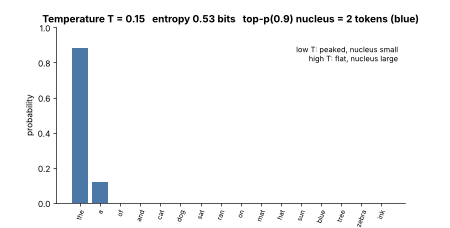
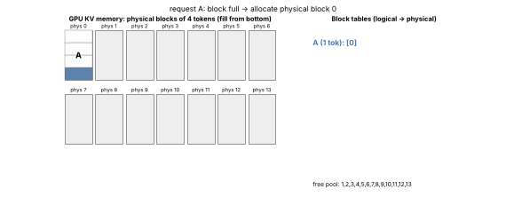
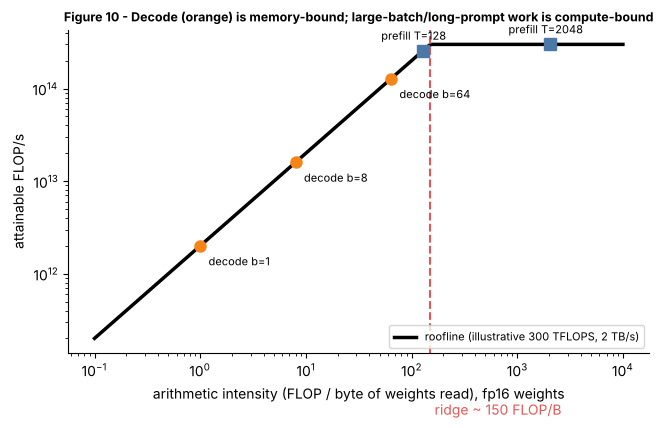

# Tier 11 — LLM Inference & Optimization

> **Phase 2 · Transformers & Foundation Models** · Author: ChatGPT/Claude draft (see `CHAPTER_STATUS.md`) · Status: `AUTHOR_DRAFT` (Critic / Code-review / Final-review pending)
> Prerequisites: Tier 7 (attention, owns the attention math), Tier 8 (transformer blocks, owns GQA/MQA mechanics and the block diagram), Tier 9 (how the model was pretrained). Leads to: Tier 12 (modern architectures), Tier 17+ (prompting/serving applications), Tier 36 (cost & observability platforms).

**Tier goal.** After this tier you can explain, with numbers, what happens between "user presses enter" and "last token streams back": how logits become a token (decoding), why the first token and later tokens have different costs (prefill vs decode), why the KV cache exists and how big it is, how serving engines keep a GPU busy (continuous batching, PagedAttention, speculative decoding), how quantization trades accuracy for bandwidth, and how to budget GPUs, latency and cost. You also build a tiny GPT and a benchmark that measures these effects yourself.

---

## 0 · How to use this tier (theory → see → play → code)

| Step | What | Where |
|---|---|---|
| 1. Read | Intuition + mechanics | this file |
| 2. **See** | 7 labelled static figures + 4 animated GIFs (all regenerated by one script) | [`figures/`](figures) — embedded below |
| 3. **Play** | Five interactive pages with sliders (open in a browser, no network) | [`interactive/`](interactive) |
| 4. **Build** | Tiny GPT with KV cache + decoding + quantization + scheduler simulator + benchmark + 43 tests | [`lab/`](lab) |
| 5. **Regenerate** | `python scripts/make_figures.py` | [`scripts/make_figures.py`](scripts/make_figures.py) |

**Interactive explorers** (double-click the HTML file; self-contained, light/dark aware, phone-friendly):

| Explorer | Adjustable controls | Teaches |
|---|---|---|
| [`decoding_explorer.html`](interactive/decoding_explorer.html) | logit shape, temperature, top-k, top-p, min-p, repetition penalty, "draw 1000 samples" | 11.2-11.8 |
| [`kv_cache_calculator.html`](interactive/kv_cache_calculator.html) | layers, query/KV heads, head_dim, context, batch, dtype, GPU & weight GB; PagedAttention block size / max context / #sequences | 11.16, 11.17, 11.21, 11.44 |
| [`batching_gantt.html`](interactive/batching_gantt.html) | batch slots, #requests, length spread, arrival gap, seed, time scrubber + play | 11.19, 11.20, 11.22 |
| [`quantization_explorer.html`](interactive/quantization_explorer.html) | bits, group size, outlier magnitude, #weights, seed | 11.26-11.28 |
| [`roofline_latency.html`](interactive/roofline_latency.html) | hardware preset, peak TFLOPS, bandwidth, params, bytes/param, batch, prompt & output length | 11.11-11.15, 11.39-11.41, 11.43 |

> **Note on animation tooling.** GIFs are rendered with Matplotlib (`FuncAnimation` + `PillowWriter`); no Manim. All hardware numbers shown in figures/pages are **illustrative round numbers marked `REVIEW_REQUIRED`**, not vendor specifications.

---

## 1 · The big picture

```
 prompt tokens ──► PREFILL (one parallel pass, builds KV cache) ──► first token  ◄── TTFT
                                   │
                                   ▼
                 DECODE loop:  [last token] ─► forward (reads weights + KV cache) ─► logits ─► decoding rule ─► next token
                                   ▲                                                                              │
                                   └────────────────────── append K,V of the new token to the cache ◄────────────┘   ◄── ITL per iteration
 Serving layer: queue ─► admission control ─► scheduler (continuous batching) ─► KV allocator (paged) ─► GPU(s) ─► stream tokens
```

Training is compute-hungry and parallel across the whole sequence. **Inference is sequential**: token *t+1* needs token *t*. That single fact drives everything in this tier: memory bandwidth (not FLOPs) is the usual bottleneck during decode, the KV cache is needed to avoid redoing work, and serving systems exist to batch many users' sequential loops onto one GPU.


*Figure 1 — Same 16 logits through four transforms. Look at the hollow outlines (the raw softmax) versus the blue bars (what survives and is renormalized): temperature changes shape, top-k keeps a fixed count, top-p keeps a probability mass.*

---

## 2 · Concept map (every roadmap item → where it is taught)

| Roadmap | Section | Roadmap | Section |
|---|---|---|---|
| 11.1 Autoregressive inference | §3 | 11.25 Speculative decoding | §8 |
| 11.2 Logits | §3 | 11.26 Quantization | §9 |
| 11.3 Decoding overview | §4 | 11.27 INT8 inference | §9.2 |
| 11.4 Greedy decoding | §4.1 | 11.28 INT4 inference | §9.3 |
| 11.5 Temperature | §4.2 | 11.29 GGUF | §10.1 |
| 11.6 Top-k sampling | §4.3 | 11.30 llama.cpp | §10.2 |
| 11.7 Top-p sampling | §4.4 | 11.31 Ollama | §10.3 |
| 11.8 Repetition/frequency penalties | §4.5 | 11.32 vLLM | §10.4 |
| 11.9 Beam search | §4.6 | 11.33 Local vs hosted inference | §11.1 |
| 11.10 Stop sequences | §4.7 | 11.34 Model replicas | §11.2 |
| 11.11 Prefill phase | §5.1 | 11.35 Tensor-parallel inference | §11.3 |
| 11.12 Decode phase | §5.2 | 11.36 Pipeline-parallel inference | §11.3 |
| 11.13 Time to first token | §5.3 | 11.37 Serving autoscaling | §11.4 |
| 11.14 Inter-token latency | §5.3 | 11.38 Cold starts | §11.4 |
| 11.15 Tokens per second | §5.3 | 11.39 Memory bandwidth | §12.1 |
| 11.16 KV cache | §6.1 | 11.40 Compute- vs memory-bound inference | §12.1 |
| 11.17 KV-cache memory calculation | §6.2 | 11.41 Prefill vs decode bottlenecks | §12.2 |
| 11.18 Prefix caching | §6.4 | 11.42 Concurrency | §13.1 |
| 11.19 Batching | §7.1 | 11.43 Throughput | §13.1 |
| 11.20 Continuous batching | §7.2 | 11.44 GPU-memory budgeting | §13.2 |
| 11.21 PagedAttention | §6.3 | 11.45 Inference cost | §13.3 |
| 11.22 Request scheduling | §7.3 | 11.46 Serving reliability | §14.1 |
| 11.23 Backpressure | §7.4 | 11.47 Inference observability | §14.2 |
| 11.24 Admission control | §7.4 | | |

Concepts owned elsewhere (referenced, not re-taught): attention math and causal masks (Tier 7), GQA/MQA mechanics and transformer blocks (Tier 8), RoPE/long-context architecture changes (Tier 12), chat templates (Tier 10).

---

## 3 · Autoregressive inference and logits (11.1, 11.2)

**What.** A decoder-only LLM models `P(x_t | x_<t)`. To generate text it runs the network, reads the **logits** (one real number per vocabulary entry) at the last position, converts them to a token with a *decoding rule*, appends that token and repeats until a stop condition.

**Why it matters.** Output length N means N sequential forward passes; latency is roughly `TTFT + (N−1) × ITL` (§5). You cannot parallelize across the tokens of one answer.

**How.** `logits ∈ R^V` → `softmax` → probabilities. Logits are *unnormalized log-probabilities*: adding a constant to every logit changes nothing; the differences matter.

```python
logits, caches = model(prompt_ids)            # prefill: logits for every prompt position
nxt = int(logits[0, -1].argmax())             # greedy decode rule on the LAST position only
logits, caches = model(torch.tensor([[nxt]]), caches)   # decode: feed ONE token plus the cache
```

**Enterprise use case.** A support-bot team logs logits-derived confidence (top-1 probability, entropy) to route low-confidence answers to a human.
**AI-engineering connection.** Structured-output / grammar-constrained decoding (Tier 17+) works by masking logits before the decoding rule; log-probs (when an API exposes them) power classifiers and evals.
**Trade-offs.** Sequential generation is simple and flexible, but slow per token; non-autoregressive alternatives exist but are not mainstream for LLMs (`REVIEW_REQUIRED`).
**Common mistakes.** Applying temperature to probabilities instead of logits; forgetting that prefill produces logits for *all* positions but only the last is used for generation.
**Cost/security.** Exposing full logits/log-probs through an API leaks information about the model (model-extraction risk); many providers limit them.
**Interview (30-60s).** *"Why is LLM generation slow?"* → Each token needs a full forward pass that depends on the previous token; weights must be streamed from memory every step; batching amortizes this across users but not across tokens of one answer.
**Rapid-fire.** Q: Are logits probabilities? A: No; softmax(logits) is. Q: Does adding 5 to all logits change the output distribution? A: No.
**Memory hook.** *"One token out, one pass in."*

---

## 4 · Decoding strategies (11.3 – 11.10)

**Overview (11.3).** A decoding rule maps the logit vector to the next token. Three families: **deterministic** (greedy, beam), **stochastic** (temperature, top-k, top-p, min-p sampling) and **constrained** (grammar/JSON masks, stop rules). In the lab (`lab/decoding.py`) the order is: *repetition penalty → temperature → top-k → top-p → (min-p) → renormalize → sample*. Orders differ between libraries; always check yours (`REVIEW_REQUIRED` per library).



*Figure 2 — As temperature rises the distribution flattens (entropy up) and the top-p(0.9) nucleus (blue) grows from one token to many. Watch the title: nucleus size and entropy move together. Play with it in [`decoding_explorer.html`](interactive/decoding_explorer.html) (controls: temperature, top-k, top-p, min-p, penalty).*

### 4.1 Greedy (11.4)
Pick `argmax`. Deterministic (barring GPU non-determinism in floating point), cheapest, good for extraction/classification/code with tests; tends toward repetition and blandness in open-ended text. Equivalent to temperature → 0.

### 4.2 Temperature (11.5)
`p_i = softmax(z_i / T)`. `T<1` sharpens, `T>1` flattens, `T→0` is greedy, `T→∞` is uniform. It rescales *all* tokens, including the junk tail, so high T alone can produce incoherent text — pair with top-p/min-p.

### 4.3 Top-k (11.6)
Keep the *k* highest logits, set the rest to `−∞`, renormalize. Fixed count regardless of confidence: k=40 is too loose when the model is sure (admits junk) and too tight when it is uncertain.

### 4.4 Top-p / nucleus (11.7)
Sort by probability, keep the smallest prefix whose cumulative probability is ≥ p, renormalize. The kept-set size **adapts**: 1-2 tokens when confident, dozens when not. Property proven in tests: kept mass ≥ p, minimal, always ≥ 1 token. **min-p** (keep tokens with `p ≥ min_p × p_max`) is a related, newer rule with the same adaptive spirit (`REVIEW_REQUIRED` for support in specific APIs).

```python
from decoding import sample_next
sample_next(logits, temperature=0.8, top_p=0.9)         # typical chat setting (illustrative)
sample_next(logits, temperature=0)                      # greedy
```

### 4.5 Repetition / frequency / presence penalties (11.8)
Discourage loops. *Repetition penalty* (CTRL-style) divides positive / multiplies negative logits of already-seen tokens by a factor > 1. *Frequency penalty* subtracts `α × count`; *presence penalty* subtracts a flat `β` once seen (the additive forms follow the OpenAI-style definitions — `REVIEW_REQUIRED` per provider). Too strong ⇒ the model avoids legitimately repeated tokens (names, code identifiers, JSON keys).

### 4.6 Beam search (11.9)
Keep the `B` best partial sequences by cumulative log-prob; expand each with its top candidates; prune to `B`. Finds higher-probability *sequences* than greedy, which can be trapped by a locally best first token.


*Figure 3 — Illustrative probabilities. Greedy picks A (0.5) then x for joint 0.175; beam width 2 keeps B too and finds Bx at 0.36. Beam search favours short, generic, high-probability text, so open-ended chat generally uses sampling instead; it remains common in translation/summarization-style tasks. Cost: B× the compute and KV memory (beams may share a prefix).*

### 4.7 Stop sequences (11.10)
Strings or token-ID sequences that end generation: EOS token, `"\n\nUser:"`, `"```"`. Implementation gotchas: match on **tokens or decoded text across token boundaries** (a stop string may span two tokens); stream consumers must hold back text that could be the start of a stop string; always also cap `max_new_tokens`.

**Enterprise use case.** A JSON-extraction pipeline uses greedy + a max-token cap + a stop on the closing brace; a marketing-copy tool uses T≈0.8-1.0, top-p≈0.9 for variety (starting points, not rules).
**AI-engineering connection.** Evals (Tier 28+) must pin decoding settings or results are not comparable; self-consistency and best-of-N rely on sampling.
**Trade-offs.** Determinism ↔ diversity; quality ↔ cost (beam, best-of-N).
**Common mistakes.** Temperature 0 and expecting bit-identical outputs across hardware/batch sizes; top-k and top-p both set without knowing the order; stop sequence that never fires so the model rambles until the token cap (cost!).
**Security.** User-controlled stop strings or system prompts leaking through streaming "hold-back" bugs; never rely on decoding settings as a safety control.
**Interview (30-60s).** *"Temperature vs top-p?"* → Temperature reshapes the whole distribution; top-p truncates the tail adaptively. Use top-p (or min-p) to remove junk, temperature to set diversity; changing both at once makes behaviour hard to reason about.
**Rapid-fire.** Q: top-k=1? A: greedy. Q: top-p=1.0? A: no truncation. Q: why can beam search be worse for chat? A: it maximizes likelihood, which favours generic/repetitive text.
**Exercise.** In the explorer, choose "flat" logits, set top-k=3 and top-p=0.9: which one keeps more tokens, and why does it flip for "peaked"?
**Memory hook.** *"Temperature bends, top-k counts, top-p weighs."*

---

## 5 · Prefill, decode and the latency metrics (11.11 – 11.15)


*Figure 4 — Look at how one wide prefill block (all prompt tokens at once) precedes many narrow decode steps (one token each). The width of the first orange block is ITL; TTFT ends where it starts. Numbers in the caption are from the illustrative roofline model (REVIEW_REQUIRED hardware).*

### 5.1 Prefill (11.11)
Process the whole prompt in **one parallel pass**: every prompt token is a row in a big matrix multiply, so the GPU is busy with FLOPs (**compute-bound** once the prompt is long enough). Output: the KV cache for the prompt and the logits for the first generated token. Cost grows roughly linearly with prompt length plus a quadratic attention term (Tier 7).

### 5.2 Decode (11.12)
One token per iteration per sequence. Each step streams **all weights** (and that sequence's KV cache) from memory to compute only ~2 FLOPs per weight per token, so decode is **memory-bandwidth-bound** at small batch (§12).

### 5.3 TTFT, ITL, TPS (11.13 – 11.15)

| Metric | Definition | Dominated by | User feel |
|---|---|---|---|
| **TTFT** time to first token | request arrival → first token received = queueing + prefill (+ network) | prompt length, queue depth, prefix-cache hits | "is it thinking?" |
| **ITL** inter-token latency (a.k.a. TPOT) | time between consecutive output tokens | memory bandwidth, batch size, KV size | streaming smoothness |
| **TPS** tokens/s | per-user `1/ITL`; or *system* throughput = tokens/s summed over users | batching | cost & capacity |

End-to-end latency ≈ `TTFT + (N_out − 1) × ITL`. A chat UI wants low TTFT and ITL below reading speed; a batch summarizer only cares about system throughput. Define metrics in the product's SLO using **percentiles (p50/p95/p99)**, not means.

**Interactive:** [`roofline_latency.html`](interactive/roofline_latency.html) — slide prompt length (watch TTFT) and batch size (watch ITL and server throughput).
**Enterprise use case.** An internal copilot sets SLOs: p95 TTFT < 1 s at 4k-token prompts, p95 ITL < 50 ms (illustrative targets, not recommendations).
**AI-engineering connection.** RAG (Tier 20) inflates prompt length ⇒ TTFT; reasoning models inflate output length ⇒ total latency and cost.
**Trade-offs.** Larger batches raise system throughput but also ITL; chunked prefill (splitting long prompts so decode steps are not starved — `REVIEW_REQUIRED` per engine) trades TTFT against ITL jitter.
**Common mistakes.** Quoting average latency; measuring TTFT without queue time; comparing TPS across different prompt/output lengths.
**Interview (30-60s).** *"Users complain it's slow. What do you check?"* → Split into TTFT vs ITL vs total output tokens; queue depth; prompt length; batch/concurrency; then hardware.
**Memory hook.** *"Prefill pays once, decode pays per token."*

---

## 6 · KV cache, its memory, PagedAttention and prefix caching (11.16, 11.17, 11.21, 11.18)

### 6.1 KV cache (11.16) — *major concept*

**What.** In attention (Tier 7) each token produces a key and value vector per layer; later tokens attend to them. Because earlier tokens' K/V never change in a causal model, we **store** them and compute only the new token's Q/K/V each step.

**Why.** Without the cache every step recomputes K/V for the whole prefix: work per step grows with context length, total work O(T²) in tokens processed. With it, each step processes one token and attends over cached K/V.

**How (code).** `lab/tiny_gpt.py` keeps `(K, V)` per layer shaped `(batch, kv_heads, seq, head_dim)` and concatenates the new K/V each step. The test `test_kv_cache_logits_equal_full_recompute` proves cached incremental logits equal the full forward pass (atol 1e-5).


*Figure 5 — Left: measured on the lab's tiny GPT (CPU, 2 threads, noisy, relative only): the gap between recompute and cache widens as more tokens are generated. Right: the KV cache is the other side of the bargain; it grows linearly with context and shrinks with fewer KV heads (GQA/MQA, Tier 8). Shape numbers are illustrative.*

**Input → process → output.** `token + cache(S tokens)` → `Q·Kᵀ over S+1 keys, append K/V` → `logits + cache(S+1)`.
**Enterprise use case.** Long-document Q&A: KV memory, not weights, caps how many concurrent users one GPU serves.
**Trade-offs.** Cache turns compute into memory; at long context and big batch, **reading the KV cache** becomes the decode bottleneck alongside the weights.
**Common mistakes.** Forgetting the cache is per sequence (per beam too); using wrong position ids on the incremental step (a classic bug — the lab test catches it); causal mask offset errors with a non-empty cache.
**Security.** KV memory must be isolated between tenants and zeroed/reused safely; a bug that serves another user's cache leaks their prompt.
**Interview (30-60s).** *"What is the KV cache and what does it cost?"* → Stored per-layer K and V of all previous tokens so each step is O(context) not O(context²) total; memory = 2·layers·kv_heads·head_dim·tokens·bytes per sequence, which usually limits concurrency.
**Memory hook.** *"Cache the past, compute the present."*

### 6.2 KV-cache memory calculation (11.17)

```
bytes = 2 (K and V) × layers × kv_heads × head_dim × seq_len × batch × bytes_per_element
```

Worked example (illustrative 7B-class shape, `REVIEW_REQUIRED` for any real model): 32 layers, 8 KV heads (GQA), head_dim 128, fp16 (2 B).
Per token = 2·32·8·128·2 = **131,072 B = 128 KiB**. A 4,096-token sequence = **512 MiB**; 8 such sequences = 4 GiB. With full multi-head attention (32 KV heads) the same context costs **4×** more (2 GiB per sequence). Verified against the real tensor sizes of the lab model by `lab/benchmark.py` and `test_kv_formula`.

**Interactive:** [`kv_cache_calculator.html`](interactive/kv_cache_calculator.html) — move *KV heads*, *context* and *dtype* and watch the MHA / GQA / MQA bars and the "max concurrent sequences" figure change.
**Common mistakes.** Using query heads instead of KV heads; forgetting the factor 2; ignoring that real engines also need activation memory, CUDA graphs/workspace and fragmentation headroom.
**Memory hook.** *"Two tensors, every layer, every token."*

### 6.3 PagedAttention (11.21)

**What.** Instead of reserving one contiguous max-length KV buffer per request (wasteful: you rarely use the max), store KV in fixed-size **blocks** (e.g., 16 tokens) allocated on demand from a pool; a per-request **block table** maps logical block index → physical block, like virtual memory paging (idea from the vLLM paper, Kwon et al. 2023 — `REVIEW_REQUIRED` for exact claims).



*Figure 6 — Left: physical blocks (4 tokens each) filling from the bottom; the colour is the owning request. Right: the block tables and free pool. Watch (a) a new block allocated only when the last one is full, (b) request B finishing and its blocks returning to the pool, (c) request D reusing them in non-contiguous order.*

Benefits: near-zero **external** fragmentation, only the *last block* of each sequence is partly empty (internal fragmentation), cheap sharing of a common prefix (copy-on-write blocks), and room for more concurrent sequences. Cost: an extra indirection in the attention kernel and engine complexity. Try block size and max-context sliders in [`kv_cache_calculator.html`](interactive/kv_cache_calculator.html): utilization of the contiguous scheme collapses, paged stays near 100%.
**Common mistakes.** Thinking paging speeds up one request (it raises *capacity/throughput*); choosing huge blocks (more internal waste) or tiny blocks (more table overhead / worse kernel efficiency).
**Memory hook.** *"Virtual memory for the KV cache."*

### 6.4 Prefix caching (11.18)
If many requests share the same token **prefix** (system prompt, few-shot examples, a long document asked many questions) their prefill KV is identical, so store it keyed by (hash of) the prefix blocks and reuse it: prefill cost and TTFT for the shared part drop to ≈ 0. Requirements: the prefix must match **exactly token for token** and from the start; put static content first and per-user content last. Providers' "prompt caching" features are the hosted version (pricing/behaviour `REVIEW_REQUIRED`).
**Security.** Shared prefix caches can leak "was this prefix seen?" through TTFT timing; scope caches per tenant when prompts are confidential.
**Common mistakes.** Putting a timestamp or user name at the top of the prompt, defeating the cache.
**Interview.** *"How do you cut TTFT for a 10k-token system prompt?"* → prefix caching + ordering the prompt static-first.

---

## 7 · Batching, scheduling, backpressure and admission control (11.19, 11.20, 11.22 – 11.24)

### 7.1 Batching (11.19)
Decode reads all weights once per step whatever the batch, so running *B* sequences together costs far less than *B* times as much: **throughput scales ~linearly with B while memory-bound**, until compute, KV memory or latency SLOs bite. **Static batching** groups requests, runs them to completion together, and wastes slots whenever outputs finish at different lengths (padding / idle lanes).

### 7.2 Continuous (in-flight) batching (11.20) — *major concept*
Schedule at **iteration** granularity: after every decode step, finished sequences leave and waiting requests join immediately (their prefill runs, then they decode with everyone else). The GPU's batch stays full; short requests are not held hostage by long ones.


*Figure 7 — Same ten requests, four slots (from the lab scheduler). Top: static; bottom: continuous. Watch the empty gaps at the right of the static batches (waiting for the longest request) versus slots being refilled at once in the continuous plot; compare the makespan in each title.*

Lab numbers (24 requests, capacity 600 KV tokens, 8 slots; machine-independent because it is a simulation): static makespan 269 ticks / mean TTFT 87 vs continuous 152 / 18 (`python lab/benchmark.py`; seed-dependent).

**Interactive:** [`batching_gantt.html`](interactive/batching_gantt.html) — change slots, request count, length spread, arrival gap, seed; scrub or play time.

### 7.3 Request scheduling (11.22)
The scheduler decides *who runs next*: FCFS (simple, fair, head-of-line blocking), shortest-job-first / priority (needs output-length estimates — unknown a priori), per-tenant fair queues, preemption (evict a running request's KV and recompute or swap it later). Policies trade **fairness, tail latency and throughput**. The lab scheduler admits by **reserving `prompt + max_output` KV tokens** (safe, no preemption, but conservative) or optionally only the prompt (`reserve_full=False`, which would need preemption in a real engine).

### 7.4 Backpressure and admission control (11.23, 11.24)
*Admission control* = deciding whether to accept a new request at all (queue length, estimated KV need, per-tenant quota, priority); *backpressure* = signalling upstream to slow down when you are saturated (HTTP 429/503 + `Retry-After`, bounded queues, client-side retry with jitter, load shedding of low priority traffic). Without them an overloaded server's queue grows unbounded, TTFT explodes for **everyone**, and clients time out while the server still computes answers nobody will read.

**Enterprise use case.** A shared internal LLM gateway gives each team a token-per-minute quota, reserves capacity for interactive traffic, and queues batch jobs at low priority.
**AI-engineering connection.** Agent loops (Tier 18+) multiply request rates; gateways (Tier 36) apply quotas and caching across providers.
**Trade-offs.** Bounded queues reject some work (good) vs unbounded queues accept everything and fail slowly (bad).
**Common mistakes.** Retrying immediately on 429 (retry storm); counting requests instead of *tokens* for quotas; no cancellation when the client disconnects (GPU keeps generating).
**Security.** Quotas and per-tenant limits are also abuse and denial-of-wallet controls; cap `max_tokens` server-side.
**Interview (30-60s).** *"Why continuous batching?"* → Requests finish at different times; refilling slots per iteration keeps GPU utilization high and cuts queue wait vs waiting for the whole batch.
**Rapid-fire.** Q: unit of scheduling in continuous batching? A: one decode iteration. Q: what does admission control protect? A: the latency of already-admitted work and KV memory.
**Test evidence.** `test_scheduler_never_exceeds_capacity_and_finishes` (20 randomized runs: KV never above capacity, batch never above slots, every request finishes or is rejected), `test_continuous_beats_static`, `test_admission_control_sheds_load`.
**Memory hook.** *"Refill every step; reject before you drown."*

---

## 8 · Speculative decoding (11.25)

**What.** A small, fast **draft** model proposes *k* tokens; the large **target** model verifies all *k* in a **single parallel pass** (like a short prefill) and accepts the longest agreeing prefix, plus one token of its own. Using the rejection-sampling rule from the speculative-decoding papers (Leviathan et al.; Chen et al., 2023 — `REVIEW_REQUIRED` for exact citations), the **output distribution is identical** to sampling from the target alone.

**Why it helps.** Decode is memory-bound: verifying *k+1* positions costs about the same weight reads as one position, so each target pass can emit several tokens.


*Figure 8 — Round 1: the draft proposes 4 tokens, the target accepts three and replaces the fourth with its own token ("on"); Round 2: all 4 accepted plus a bonus token. Nine tokens in two target passes. Green = accepted, red = rejected; everything after the first rejection is discarded.*


*Figure 9 — Expected tokens per target pass `(1 − α^(k+1)) / (1 − α)` assuming each draft token is accepted independently with probability α. Real speedup is lower because the draft model also costs time; the curve flattens, so large k pays off only at high α.*

**Enterprise use case.** Interactive code completion where a small model of the same family drafts and a large one verifies.
**Trade-offs.** Needs a good, cheap draft (same tokenizer; acceptance depends on domain); more memory (two models); little help at large batch sizes where the target is already compute-bound; variants (draft-free/self-speculation, tree verification) exist (`REVIEW_REQUIRED`).
**Common mistakes.** Quoting the ideal formula as the speedup; mismatched tokenizers; assuming it changes quality (it does not, when implemented with the correct acceptance rule).
**Interview (30-60s).** *"Why doesn't speculative decoding change the output?"* → Each draft token is accepted with probability min(1, p_target/p_draft) and on rejection a token is resampled from the corrected residual distribution, which provably yields the target's distribution.
**Rapid-fire.** Q: when does it help least? A: large batch / low acceptance. Q: is the target forward pass for verification sequential? A: no, parallel over the k positions.
**Memory hook.** *"Draft cheap, verify in parallel, keep what agrees."*

---

## 9 · Quantization (11.26 – 11.28)

### 9.1 Quantization (11.26)
Store/compute with fewer bits. **Weight-only** quantization (this lab) keeps activations in float and compresses weights; **weight+activation** schemes also quantize activations/KV cache and need integer kernels. Why in inference: decode is memory-bound, so **fewer bytes per weight ⇒ proportionally faster decode and more KV room** (accuracy permitting).

Symmetric scheme: `s = max|w| / (2^(b−1) − 1)`, `q = round(w/s)`, `ŵ = q·s`. **Rounding error ≤ s/2** for in-range values (tested). The scale `s` is stored in float (per tensor, per row/channel, or per **group** of e.g. 32-128 weights).

### 9.2 INT8 (11.27)
256 levels. Typically near-lossless for weights when done per channel/group (our tiny random model: top-1 agreement 0.97 on 32 positions, max logit change 0.009 — `lab/benchmark.py`; a toy, not evidence about real LLMs). Activations/outliers are the harder part for W8A8 (`REVIEW_REQUIRED` techniques such as SmoothQuant).

### 9.3 INT4 (11.28)
16 levels: step is ~17× coarser than INT8 over the same range, so **group-wise scales** matter and accuracy loss becomes measurable (toy: top-1 agreement 0.84). Production recipes (GPTQ, AWQ, GGUF "K-quants") use calibration or smarter rounding (`REVIEW_REQUIRED`; verify the current state of each). Effective bits per weight = `b + 16/group` when each group has an fp16 scale (e.g., 4 + 16/32 = 4.5).


*Figure 11 — Left: RMSE vs bits for per-tensor, per-row and group-32 scales on random weights with one outlier column — finer scales help; each removed bit roughly doubles the error. Right: the staircase map from original to dequantized values; INT4's steps are visibly coarser.*

**Interactive:** [`quantization_explorer.html`](interactive/quantization_explorer.html) — raise *outlier magnitude* with per-tensor scale and watch every other weight's error balloon, then shrink the group size.
**Enterprise use case.** Fitting a 70B-class model on fewer GPUs (or an 8B model on a laptop) by cutting weights to 4-8 bits, validated on the company's own eval set.
**Trade-offs.** Memory/speed/cost ↔ accuracy; dequantize-on-the-fly kernels can erase gains if poorly implemented; quality loss is task-dependent (long-context, reasoning, non-English often degrade first — `REVIEW_REQUIRED`).
**Common mistakes.** Judging quantization by perplexity alone; using per-tensor scales on weights with outliers; assuming 4× smaller always means 4× faster.
**Security.** Quantized weights from untrusted sources are still untrusted pickles/binaries; verify checksums and prefer safe formats. Quantization can change safety behaviour; re-run safety evals.
**Interview (30-60s).** *"Why does INT4 speed up decode?"* → Decode is bound by bytes read per token; 4-bit weights cut weight traffic ~4× (plus scales), so ITL can fall nearly proportionally if kernels are efficient — at some accuracy cost.
**Rapid-fire.** Q: max rounding error? A: half a step. Q: what is group quantization? A: one scale per small group of weights.
**Memory hook.** *"Fewer bits, fewer bytes, faster tokens — if you can afford the rounding."*

---

## 10 · The local-inference and serving ecosystem (11.29 – 11.32)

> This ecosystem moves quickly. Everything here is a *concept-level* description; check current docs before relying on specifics (`REVIEW_REQUIRED` for all four).

| Item | What it is | Why you would use it | Watch out for |
|---|---|---|---|
| **GGUF** (11.29) | single-file binary model format used by the llama.cpp ecosystem: tensors (often quantized) + metadata (architecture, tokenizer, hyperparameters) | portable, memory-mappable, ships quantized models as one artifact | quant type names vs quality; tokenizer/metadata must match the model |
| **llama.cpp** (11.30) | C/C++ inference engine (CPU-first, with several GPU backends) that loads GGUF | run LLMs on laptops/edge/CPU, offline, simple deployment | not designed as a many-user server first; throughput tuning differs from GPU servers |
| **Ollama** (11.31) | local model manager with a local HTTP API and a model registry, built for ease of use | developer laptops, prototypes, privacy-first demos | defaults (context length, quantization) may differ from what you assume; check them |
| **vLLM** (11.32) | GPU serving engine built around PagedAttention + continuous batching with an OpenAI-compatible server | multi-user, high-throughput hosting of open-weight models | GPU memory tuning (`max` context/batch), version churn |

**Interview.** *"Ollama vs vLLM?"* → Ollama optimizes developer convenience for one user's machine; vLLM optimizes throughput and latency for many concurrent users on GPUs.
**Common mistakes.** Benchmarking a laptop runner and extrapolating to production concurrency; comparing quantized and unquantized models as if equal.
**Security.** Local servers bound to `0.0.0.0` without auth expose your model (and data) to the network; bind to localhost or add auth/TLS.

---

## 11 · Deployment topologies: local vs hosted, replicas, parallelism, autoscaling, cold starts (11.33 – 11.38)

### 11.1 Local vs hosted (11.33)

| | Local / self-hosted | Hosted API |
|---|---|---|
| Data control | full | provider terms apply |
| Cost shape | fixed GPUs (capex or reserved) — cheap at high steady utilization | pay per token — cheap at low/spiky volume |
| Latency control | you tune it | provider's variability |
| Ops burden | you own scaling, upgrades, reliability | provider |
| Model choice | open-weight models only | proprietary frontier models |

Decide with **utilization × volume × data constraints**, not ideology. Break-even analysis in §13.3.

### 11.2 Model replicas (11.34)
Run multiple identical copies behind a load balancer: scales **throughput and availability**, not single-request latency. Use KV-/prefix-aware routing (send a conversation back to the replica holding its cache) when possible (`REVIEW_REQUIRED` per gateway).

### 11.3 Tensor-parallel (11.35) and pipeline-parallel (11.36) inference
- **Tensor parallel (TP):** shard each layer's weight matrices across GPUs; every layer ends with an **all-reduce**. Cuts per-GPU weights *and* lowers per-token latency (each GPU reads less), but needs fast interconnect (communication every layer).
- **Pipeline parallel (PP):** assign contiguous *groups of layers* to different GPUs; activations flow stage to stage. Little communication (one hop per stage), so works across slower links/nodes, but a single request still traverses every stage serially (latency does not drop) and you need micro-batches in flight to hide bubbles.
Use TP within a node, PP across nodes, replicas for more throughput (typical pattern; `REVIEW_REQUIRED` per hardware). Parallelism choices are *forced by memory* first: if the weights + KV do not fit one GPU, you shard.

### 11.4 Serving autoscaling (11.37) and cold starts (11.38)
Autoscale replicas on **queue depth / time-in-queue / tokens-in-flight** rather than CPU%; GPU utilization is a misleading signal for LLMs. A **cold start** = scheduling a GPU node, pulling container + weights (tens of GB), loading into GPU memory, warming kernels / compiling graphs — often minutes. Mitigations: keep a warm minimum, pre-pull images, load from local NVMe/shared cache, smaller/quantized weights, scale *before* the peak, route spillover to a hosted API.

**Enterprise use case.** A bank self-hosts one TP=4 replica pair for the daytime chat load, scales batch jobs overnight, and spills to a hosted model during incidents (subject to data policy).
**Trade-offs.** Warm capacity costs money 24/7; scaling to zero saves money but cold start breaks interactive SLOs.
**Common mistakes.** Autoscaling on CPU; scaling on requests instead of tokens; ignoring cold-start time in the scaling policy; using TP across slow links.
**Security.** Model weights are crown-jewel assets: encrypt at rest, restrict registry access, pin digests.
**Interview (30-60s).** *"Model doesn't fit on one GPU. Options?"* → quantize; tensor-parallel within a node; pipeline-parallel across nodes; offload (slow); smaller model. Replicas do not help fitting; they help throughput.
**Memory hook.** *"Shard to fit, replicate to scale, warm to be fast."*

---

## 12 · Memory bandwidth, compute-bound vs memory-bound, prefill vs decode bottlenecks (11.39 – 11.41)

### 12.1 The roofline view (11.39, 11.40)
Attainable throughput = `min(peak FLOP/s, memory bandwidth × arithmetic intensity)` where *arithmetic intensity* = FLOPs per byte moved. The **ridge point** = peak ÷ bandwidth. Left of it a kernel is **memory-bound**, right of it **compute-bound**.

For a dense model with P parameters at `w` bytes each, one decode step of batch *B*: FLOPs ≈ `2·P·B`, bytes ≈ `P·w` (weights read once) ⇒ intensity ≈ `2B/w` FLOP/byte (fp16: `B`). With a ridge in the low hundreds, decode at B=1 is two orders of magnitude left of it. **Lower bound for ITL = weight bytes ÷ bandwidth** (e.g., 16 GB ÷ 2 TB/s = 8 ms ⇒ ≤ 125 tok/s per user, illustrative).



*Figure 10 — Illustrative accelerator (300 TFLOPS, 2 TB/s; REVIEW_REQUIRED). Orange squares: decode at batch 1, 8, 64 — all far left of the dashed ridge, so adding users is nearly free until the ridge is approached. Blue: prefill of 128 vs 2048 tokens climbs the slope and, once long enough, reaches the compute roof.*

### 12.2 Prefill vs decode bottlenecks (11.41)

| | Prefill | Decode |
|---|---|---|
| Parallelism | all prompt tokens at once | one token per sequence per step |
| Typical bound | compute (FLOPs) | memory bandwidth (weights + KV reads) |
| Metric it drives | TTFT | ITL / TPS |
| Helped by | faster FLOPs, prefix caching, shorter prompts, tensor-parallel | quantization, more bandwidth, larger batch, GQA/KV quantization, speculative decoding |
| Interference | long prefills stall decode steps for other users (chunked prefill mitigates; some systems disaggregate prefill and decode onto different machines — `REVIEW_REQUIRED`) | |

**Interactive:** [`roofline_latency.html`](interactive/roofline_latency.html) — pick a preset, set batch=1 and the decode dot sits on the slope; raise batch until it reaches the ridge; try `int4` to see ITL drop.
**Caveat.** The model ignores KV reads, attention FLOPs, kernel overheads and communication; real latency is higher. Hardware presets are round numbers, not specs (`REVIEW_REQUIRED`).
**Common mistakes.** "Buy more FLOPs" for a decode-bound workload; reading GPU "utilization" as efficiency (it reports kernel activity, not whether FLOPs or bandwidth are saturated).
**Interview (30-60s).** *"Why is decode memory-bound?"* → each step reads every weight to do ~2 FLOPs per weight per sequence; intensity is far below the ridge point, so time ≈ bytes/bandwidth; batching raises intensity.
**Memory hook.** *"Decode is a library trip for one book; batch the readers."*

---

## 13 · Concurrency, throughput, GPU-memory budgeting and cost (11.42 – 11.45)

### 13.1 Concurrency and throughput (11.42, 11.43)
**Concurrency** = requests being served at once (Little's law: `in-flight = arrival rate × time in system`). **Throughput** = tokens/s (or requests/s) completed. Raising concurrency raises throughput until a limit — KV memory, compute ridge, or an ITL SLO — and then raises latency. Plot **throughput vs p95 latency** at several concurrency levels (the lab benchmark pattern) and pick the knee that meets your SLO.

### 13.2 GPU-memory budgeting (11.44)

```
free for KV = GPU_memory × usable_fraction − weights − activations/workspace
max concurrent tokens ≈ free_for_KV / kv_bytes_per_token ;   max sequences = that / avg context
```
Example (illustrative): 80 GB GPU, 90% usable = 72 GB; 8B-class fp16 weights ≈ 16 GB ⇒ ≈ 56 GB for KV; at 128 KiB/token ⇒ ≈ 430k cached tokens ⇒ ~104 sequences of 4k tokens. Quantizing weights to int4 (~4 GB) frees ~12 GB more; KV quantization or GQA multiplies capacity. Reserve headroom for activations and fragmentation (paging reduces the latter). The [`kv_cache_calculator.html`](interactive/kv_cache_calculator.html) does this arithmetic.

### 13.3 Inference cost (11.45)
`cost per 1M output tokens ≈ GPU_$/hour ÷ (system tokens/s × 3600) × 10⁶`. Example with an **assumed** $2.00/GPU-hour (not a quote): 1,000 tok/s system throughput ⇒ $0.56 per 1M tokens; at 20% utilization it is 5× that. Hosted APIs price *input and output tokens separately* (output costs more because decode is the bottleneck; prices `REVIEW_REQUIRED` and change frequently). Levers: quantization, batching/utilization, prefix caching, shorter prompts, smaller/routed models, caching responses, output caps.

**Enterprise use case.** A finance team compares "hosted at $X per 1M tokens" against "2 reserved GPUs at 60% utilization" using this formula, then re-checks quarterly.
**Trade-offs.** Utilization is *the* cost lever for self-hosting; peak-provisioned GPUs idle at night.
**Common mistakes.** Costing only input tokens; ignoring idle time; comparing list price per token without quality/latency parity.
**Interview (30-60s).** *"How would you cut inference cost 3×?"* → measure first (tokens in/out, utilization); then quantize, raise batch/continuous batching, prefix-cache, route easy requests to a smaller model, cap output.
**Memory hook.** *"Cost = dollars per hour ÷ tokens per hour."*

---

## 14 · Serving reliability and observability (11.46, 11.47)

### 14.1 Reliability (11.46)
Failure modes: GPU OOM from a long-context request, node loss mid-stream, slow/straggler replicas, overload, bad deployment, cold starts. Practices: **timeouts at every hop**; request-level `max_tokens` and max-context limits; health checks that actually run a tiny generation (not just "process is up"); retries with exponential backoff **and idempotency** awareness (streaming responses cannot be blindly retried); circuit breakers and fallback models/providers; graceful drain on deploys; canary rollouts compared on quality *and* latency; cancel generation when the client disconnects.

### 14.2 Observability (11.47)
Instrument per request: queue time, TTFT, ITL distribution, input/output tokens, finish reason (stop / length / error / cancelled), prefix-cache hit, model/version, tenant. Per server: batch size, KV-cache utilization, queue depth, preemptions, tokens/s, GPU memory/utilization, error rates. Alert on **p95/p99** TTFT/ITL and on KV-cache saturation; sample prompts/outputs for quality review *subject to privacy policy*.

**Enterprise use case.** A dashboard showing p95 TTFT rising together with KV utilization at 100% points to memory pressure and preemptions, not "the model is slow".
**Common mistakes.** Only monitoring averages; no finish-reason metric (silent truncation at `max_tokens`); logging raw prompts with PII.
**Security.** Logs and traces of prompts/outputs are sensitive data: redact, restrict, set retention.
**Interview (30-60s).** *"What do you monitor for an LLM service?"* → latency split (queue/TTFT/ITL), tokens, finish reasons, KV/GPU saturation, error and cancel rates, plus quality signals; alert on percentiles.
**Memory hook.** *"Percentiles, tokens and finish reasons."*

---

## 15 · Build: inference benchmark (tiny GPT, decoding, KV cache, quantization, scheduler)

| File | What it is |
|---|---|
| [`lab/tiny_gpt.py`](lab/tiny_gpt.py) | ~90-line GPT (pre-LN, learned positions, **GQA**) with an optional per-layer KV cache; self-contained (no cross-tier imports) |
| [`lab/decoding.py`](lab/decoding.py) | temperature, top-k, top-p, min-p, repetition/frequency/presence penalties, stop sequences, greedy/sampling `generate` (cache on/off), beam search |
| [`lab/quant.py`](lab/quant.py) | symmetric INT8/INT4 (per-tensor, per-row, group-wise), error metrics, `QLinear`, `quantize_model` |
| [`lab/scheduler.py`](lab/scheduler.py) | toy static vs continuous batching simulator with KV-token capacity, max batch, reservation policy, bounded queue (admission control) |
| [`lab/kv_memory.py`](lab/kv_memory.py) | KV-cache bytes formula and max-concurrency calculator |
| [`lab/benchmark.py`](lab/benchmark.py) | prints all the comparisons below (≈ 8 s on 2 CPU threads) |
| [`lab/test_tier11.py`](lab/test_tier11.py) | 43 tests |

```bash
cd lab && python -m pytest -q      # 43 passed
python benchmark.py                # the measurements below
python ../scripts/make_figures.py  # regenerates figures/
```

**What the tests prove.** KV-cache incremental logits equal full-recompute logits (atol 1e-5) and cached/uncached greedy generation is identical; the cache tensors use `n_kv_head` (GQA) not `n_head`; top-k keeps exactly the k largest; top-p: kept mass ≥ p, minimal, always ≥ 1 token, kept tokens are the most probable; sampled tokens always lie inside the nucleus; temperature limits; repetition penalty direction; beam score ≥ greedy score and equals the recomputed log-prob; INT8 rounding error ≤ s/2 and values in int8 range; per-channel beats per-tensor with an outlier row; INT4 worse than INT8 and group scales help; quantized model logits close to float; the KV formula (incl. 4× GQA saving); scheduler never exceeds capacity or batch slots, finishes or rejects every request (static & continuous, both reservation modes, 5 seeds); continuous beats static; admission control sheds load.

**Example benchmark output** (this sandbox, CPU with 2 threads while other jobs ran; **relative values only, noisy, not representative of GPUs**):

| Experiment | Result |
|---|---|
| KV cache vs recompute, 32-token prompt + 128 new tokens | 146 ms vs 724 ms (≈ 4.9×); 1.7× at 16 new tokens, 2.4× at 64 |
| Beam search (3 beams, no cache) | ≈ 100 steps/s: slow by design (clarity over speed) |
| INT8 per-channel weights (toy model) | max logit change 0.009, top-1 agreement 0.97 |
| INT4 group-32 weights (toy model) | max logit change 0.158, top-1 agreement 0.84 |
| KV bytes, measured vs formula (4 layers, 2 KV heads, head_dim 16, 32 tokens, fp32) | 32,768 B = 32,768 B |
| Scheduler, 24 requests, 600 KV tokens, 8 slots | static makespan 269 / continuous 152 ticks; mean TTFT 87 vs 18 |

Decoding-strategy tokens/s in the same run (greedy 725, T=0.8 604, top-k 269, top-p 400 tok/s) vary by run because filtering overhead is tiny relative to noise and Python overhead here; do not read them as a ranking. The simulated "int8" model dequantizes weights on the fly, so it demonstrates *accuracy* effects, **not speedups** (real speedups need fused low-precision kernels).

**Exercises**

1. In `benchmark.py` raise `N` to 200 new tokens and plot time vs N for cache/no-cache. Fit a line and a parabola; which fits which?
2. Add a **repetition penalty** to a degenerate prompt and show the repeated n-gram rate drops (count repeated 3-grams).
3. Implement **prefix caching** in `generate`: accept a precomputed cache for a shared prompt prefix and test that logits match a cold run.
4. Extend `scheduler.py` with **preemption** (evict the newest request when `reserve_full=False` overflows) and write a test that capacity is never exceeded.
5. Add a **speculative decoding** loop using a 1-layer draft `TinyGPT` and the acceptance rule; test that with draft = target all tokens are accepted. *(stretch)*
6. In `kv_cache_calculator.html`, find the context length at which an 80 GB GPU can host exactly 8 sequences for the 70B-class preset; verify with `lab/kv_memory.py`.

---

## 16 · Interview kit (whole tier)

**Basic.** What are logits? What is temperature? What is the KV cache? What is TTFT?
**Intermediate.** Top-k vs top-p? Prefill vs decode? How big is the KV cache for a given model and context? Why does batching raise throughput?
**Advanced.** Why is decode memory-bound and how does that explain quantization and speculative decoding gains? How does PagedAttention improve utilization? Compare TP and PP. Why is speculative decoding lossless?
**Scenario 1.** *p95 latency doubled after launch but GPU utilization looks fine.* (Split queue/TTFT/ITL; check batch size, KV saturation and preemptions, prompt-length drift, noisy neighbour requests; add admission control.)
**Scenario 2.** *Design serving for 500 concurrent chat users on an 8B model.* (KV budget math per user, quantization choice, continuous batching engine, replicas/TP decision, autoscaling on queue time, SLOs, observability, fallback.)
**Scenario 3.** *Finance asks why the bill tripled.* (tokens in/out per feature, long system prompts without prefix caching, agent loops, retries, missing `max_tokens`.)

**60-second tier summary.** *"Generation is sequential: prefill processes the prompt in one compute-heavy pass and builds the KV cache; decode then emits one token per step by streaming all weights from memory, so it is memory-bandwidth-bound. Decoding rules (greedy, temperature, top-k/top-p, penalties, beam) turn logits into tokens. The KV cache avoids recomputation but its size — 2·layers·kv_heads·head_dim·tokens·bytes — limits concurrency, which is why GQA, PagedAttention, KV/weight quantization and prefix caching matter. Continuous batching keeps the GPU full, speculative decoding spends spare compute to emit multiple tokens per pass, and parallelism/replicas/autoscaling plus admission control, observability and cost math turn a model into a reliable service."*

## 17 · Revision questions

1. Show that adding a constant to all logits does not change the softmax.
2. What does `T→0` do? `T→∞`? Why can high T alone produce nonsense?
3. Why does the kept-token count under top-p change with confidence while top-k's does not?
4. Write the KV-cache formula and compute it for 80 layers, 8 KV heads, head_dim 128, fp16, 8k tokens.
5. Why are K and V cached but not Q?
6. Why does continuous batching beat static batching when output lengths vary?
7. Why does PagedAttention raise throughput but not single-request speed?
8. Why does quantizing weights lower ITL for decode but help prefill less?
9. When does speculative decoding give little or no speedup?
10. Give two reasons autoscaling on GPU utilization is a poor policy.

## 18 · Related concepts & forward references

Attention math and masks → Tier 7. GQA/MQA mechanics, transformer block anatomy → Tier 8. Pretraining data/compute → Tier 9. Chat templates, alignment → Tier 10. Long-context architectures, MoE inference, SSMs → Tier 12. RAG prompt-length effects → Tier 20. Agent request multiplication, tool-call loops → later agent tiers. Gateways, cost dashboards, tracing → Tier 36. Distributed-systems patterns (queues, backpressure, retries) → systems tiers.

## 19 · Review status

| Item | State |
|---|---|
| Code (`lab/`) | **TESTED** — `pytest`: 43 passed (Python 3.13, PyTorch CPU, 2 threads) |
| Benchmark | run once in the sandbox; timing numbers are noisy and machine-specific (not for citation) |
| Interactive pages | **TESTED** with `tools/check_interactive.py` in headless Chromium: no JS errors, sliders exercised; screenshots reviewed |
| Figures | regenerated by `scripts/make_figures.py`; visually spot-checked; GIFs < 600 KB |
| Hardware numbers, example model shapes, prices, tool/ecosystem descriptions (GGUF, llama.cpp, Ollama, vLLM), library-specific decoding orders, paper citations | `REVIEW_REQUIRED` (marked inline) |
| Critic / Code-review / Final-review | pending per `CHAPTER_STATUS.md` |
