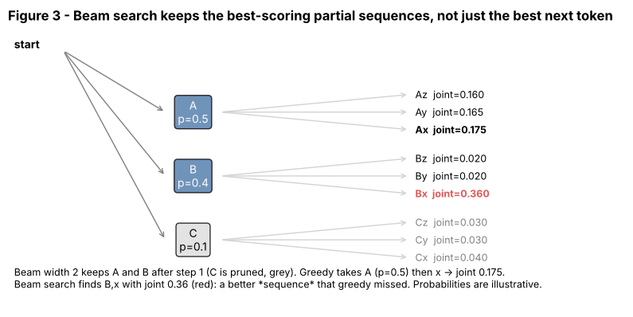

## 11.9 Beam search

Metadata:

- Tier: 11 — LLM Inference & Optimization
- Phase: 2 — Transformers & Foundation Models
- Priority: P1
- Difficulty: Intermediate
- Interview Importance: High
- Hands-on Importance: Medium
- Prerequisites: [11.2 Logits](11.02-logits.md), [11.3 Decoding overview](11.03-decoding-overview.md), [11.4 Greedy decoding](11.04-greedy-decoding.md)
- Leads To: [11.10 Stop sequences](11.10-stop-sequences.md)

---

### 1. WHAT IS IT?

**Beam search** keeps the `B` best partial sequences (by cumulative log-probability), expands each with its top candidates and prunes back to `B` at every step.

### 2. WHY DOES IT EXIST?

Greedy can be trapped by a locally best first token. Beam search looks wider and finds higher-probability *sequences*.

### 3. DETAILED EXPLANATION

- Beam score is the sum of log-probs; longer sequences get lower scores, so a **length penalty** is often used.
- It finds higher-likelihood text than greedy but favours short, generic, repetitive text, so open-ended chat generally uses sampling; it remains common in translation and summarisation (REVIEW_REQUIRED).
- Cost: `B` times the compute and KV memory (beams can share a prefix).



*Figure 3 — Illustrative probabilities: greedy picks A (0.5) then x for joint 0.175, while beam width 2 keeps B too and finds Bx at 0.36.*

### 4. HOW DOES IT WORK?

1. Start with one beam (the prompt, score 0).
2. For each beam, take its top-`B` next tokens and add their log-probs to the beam score.
3. Sort all candidates and keep the best `B`.
4. Repeat for `max_new` steps (or until beams end) and return the best.

### 5. SIMPLE EXAMPLE

Exploring `B` routes on a map in parallel instead of committing to the nearest turn.

### 6. TECHNICAL EXAMPLE

Machine translation systems often use beam widths of a few; the lab confirms the best beam score is >= greedy's score.

### 7. CODE

```python
import torch
from tiny_gpt import TinyGPT
from decoding import beam_search, generate

torch.manual_seed(0)
m = TinyGPT().eval()
best = beam_search(m, [1, 2, 3], max_new=6, beams=3)[0]
print(best)                                   # (ids, log-prob score)
print(generate(m, [1, 2, 3], 6, temperature=0))
```

See [`../lab/decoding.py`](../lab/decoding.py) (`beam_search`; re-runs the model per beam, no cache, clarity over speed).

### 8. INPUT → PROCESS → OUTPUT

```
beams(B) --expand top-B each--> B*B candidates --sort by score--> keep B --> repeat
```

### 9. ENTERPRISE USE CASE

Used in translation, speech recognition and some summarisation pipelines; rarely for chat.

### 10. AI ENGINEERING CONNECTION

Serving engines support it but it multiplies KV memory and reduces batching capacity ([11.16 KV cache](11.16-kv-cache.md)).

### 11. ADVANTAGES

Higher-likelihood outputs than greedy; deterministic.

### 12. LIMITATIONS

`B`x cost; generic/repetitive text; sensitive to length handling; not suited to open-ended generation.

### 13. TRADE-OFFS

Quality (likelihood) vs compute and diversity.

### 14. COMMON MISTAKES

Forgetting length normalisation; treating likelihood as quality; ignoring per-beam KV memory.

### 15. PERFORMANCE / COST CONSIDERATIONS

Roughly `B` times the compute and KV cache of greedy (less with prefix sharing).

### 16. SECURITY CONSIDERATIONS

No special security role.

### 17. INTERVIEW EXPLANATION

"Beam search keeps the top B partial sequences by cumulative log-probability instead of committing to one token at a time. It finds more likely whole sequences than greedy but costs B times as much and tends to produce bland text, so I use it for translation-like tasks and sampling for chat."

### 18. RAPID-FIRE ANSWER

Track the B best partial sequences by summed log-prob, expand and prune; B x cost.

### 19. INTERVIEW QUESTIONS

**Basic.** What does beam width control? **Intermediate.** Why add a length penalty? **Advanced.** Why can beam output be worse for chat? **Scenario.** A translation tool is too slow with beam 8; options?

### 20. HANDS-ON EXERCISE

Compare `beam_search` best score with the greedy sequence's recomputed log-prob on the lab model.

### 21. REVISION QUESTIONS

1. Cost of beam width B?
2. Why does greedy miss Bx in Figure 3?
3. Why do beams bias to short text?

### 22. RELATED CONCEPTS

[11.4 Greedy decoding](11.04-greedy-decoding.md), [11.3 Decoding overview](11.03-decoding-overview.md), [11.16 KV cache](11.16-kv-cache.md).

### 23. ONE-LINE MEMORY HOOK

*Beam: keep several roads open.*
