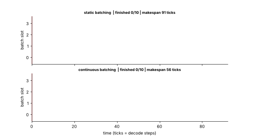

## 11.19 Batching

Metadata:

- Tier: 11 — LLM Inference & Optimization
- Phase: 2 — Transformers & Foundation Models
- Priority: P0
- Difficulty: Intermediate
- Interview Importance: Very high
- Hands-on Importance: Medium
- Prerequisites: [11.12 Decode phase](11.12-decode-phase.md), [11.15 Tokens per second](11.15-tokens-per-second.md)
- Leads To: [11.20 Continuous batching](11.20-continuous-batching.md), [11.22 Request scheduling](11.22-request-scheduling.md), [11.43 Throughput](11.43-throughput.md)

---

### 1. WHAT IS IT?

**Batching** runs several sequences through the model together, so one read of the weights serves many users. **Static batching** forms a batch and runs it to completion before starting another.

### 2. WHY DOES IT EXIST?

Decode reads all weights once per step whatever the batch size, so running *B* sequences costs far less than *B* times as much: GPU FLOPs would otherwise sit idle.

### 3. DETAILED EXPLANATION

- **Throughput scales roughly linearly with B while memory-bound**, until compute, KV memory or latency SLOs limit it.
- Per-step latency (ITL) rises with batch size, because attention reads grow with the number of sequences and eventually compute saturates.
- **Static batching** wastes slots when outputs finish at different lengths: finished sequences idle (padding) until the longest one ends, and arriving requests wait for the whole batch.



*Figure 7 — Top row: static batches show empty gaps at the right while waiting for the longest request. Compare with the continuous schedule in [11.20 Continuous batching](11.20-continuous-batching.md).*

[Explore in the batching Gantt page](../interactive/batching_gantt.html).

### 4. HOW DOES IT WORK?

1. Collect up to `B` requests (and prompts of similar size if padding).
2. Prefill them; then decode all together, one token per sequence per step.
3. Sequences that finish wait for the rest; the batch is freed when the last finishes.

### 5. SIMPLE EXAMPLE

A bus that waits to fill before leaving and does not let anyone off until the final stop.

### 6. TECHNICAL EXAMPLE

Lab (24 requests, capacity 600 KV tokens, 8 slots): static makespan 269 ticks vs continuous 152 (see `benchmark.py`; simulation, machine-independent, seed-dependent).

### 7. CODE

```python
import random
from scheduler import Req, simulate, metrics

random.seed(1)
reqs = [Req(rid=i, arrival=0, prompt=20, out=random.choice([5, 10, 40, 80])) for i in range(16)]
f, r, log = simulate(reqs, 10_000, max_batch=4, mode="static")
print(metrics(f, log))   # makespan 296 ticks, throughput about 2.45 tokens/tick for this seed
```

See [`../lab/scheduler.py`](../lab/scheduler.py).

### 8. INPUT → PROCESS → OUTPUT

```
requests -> [wait to fill batch] -> prefill -> decode together -> wait for slowest -> release all
```

### 9. ENTERPRISE USE CASE

Offline jobs (bulk summarisation, embedding generation) batch heavily for cost; interactive paths use smaller batches or continuous batching.

### 10. AI ENGINEERING CONNECTION

Dynamic/continuous batching in serving engines ([11.20 Continuous batching](11.20-continuous-batching.md)); batch APIs from providers.

### 11. ADVANTAGES

Much higher throughput per GPU; lower cost per token.

### 12. LIMITATIONS

Higher per-request latency; padding waste; KV memory scales with batch.

### 13. TRADE-OFFS

Throughput vs latency; batch size vs KV memory.

### 14. COMMON MISTAKES

Increasing batch without checking p95 ITL; mixing very different lengths in one static batch.

### 15. PERFORMANCE / COST CONSIDERATIONS

Cost per token falls with batch until saturation ([11.45 Inference cost](11.45-inference-cost.md)).

### 16. SECURITY CONSIDERATIONS

Batching mixes tenants on one GPU; ensure per-request isolation of cache and outputs.

### 17. INTERVIEW EXPLANATION

"Batching processes many sequences per forward pass. Since decode is memory-bound, the weights are read once and used for everyone, so throughput rises almost linearly with batch size until compute, KV memory or latency limits. Static batching wastes slots when requests finish at different times, which continuous batching fixes."

### 18. RAPID-FIRE ANSWER

Run multiple sequences per pass to amortise weight reads; static batching idles slots as requests finish.

### 19. INTERVIEW QUESTIONS

**Basic.** Why does batching help? **Intermediate.** What limits batch size? **Advanced.** Static vs continuous? **Scenario.** p95 ITL violates SLO after enabling larger batches; what next?

### 20. HANDS-ON EXERCISE

In the Gantt page, set 4 slots and a wide length spread and read the static makespan; then compare with continuous.

### 21. REVISION QUESTIONS

1. Why is decode throughput nearly linear in B at first?
2. What wastes slots in static batching?
3. What caps B?

### 22. RELATED CONCEPTS

[11.12 Decode phase](11.12-decode-phase.md), [11.20 Continuous batching](11.20-continuous-batching.md), [11.22 Request scheduling](11.22-request-scheduling.md), [11.43 Throughput](11.43-throughput.md).

### 23. ONE-LINE MEMORY HOOK

*One weight read, many readers.*
