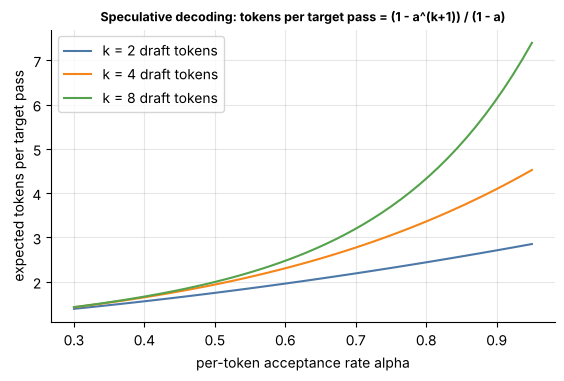

## 11.25 Speculative decoding

Metadata:

- Tier: 11 — LLM Inference & Optimization
- Phase: 2 — Transformers & Foundation Models
- Priority: High
- Difficulty: Advanced
- Interview Importance: High
- Hands-on Importance: Medium
- Prerequisites: [11.12 Decode phase](11.12-decode-phase.md), [11.16 KV cache](11.16-kv-cache.md), [11.40 Compute-bound vs memory-bound inference](11.40-compute-bound-vs-memory-bound-inference.md), [11.5 Temperature](11.05-temperature.md)
- Leads To: [11.32 vLLM](11.32-vllm.md), [11.41 Prefill vs decode bottlenecks](11.41-prefill-vs-decode-bottlenecks.md), [11.43 Throughput](11.43-throughput.md)

### 1. WHAT IS IT?

**Speculative decoding** is an inference-acceleration technique in which a small, fast **draft** model proposes *k* tokens ahead and the large **target** model checks all *k* in a single parallel forward pass. The longest agreeing prefix is kept, plus one token from the target itself. With the correct acceptance rule the output distribution is **identical** to sampling from the target alone (Leviathan et al. 2023; Chen et al. 2023 — `REVIEW_REQUIRED` for exact citations).

### 2. WHY DOES IT EXIST?

Decode ([11.12 Decode phase](11.12-decode-phase.md)) is memory-bound: producing one token costs a full read of the weights, yet uses a tiny fraction of the GPU's FLOPs. Verifying *k+1* positions in one pass reads the weights once, so the same bandwidth bill can yield several tokens. Speculation converts idle compute into lower latency without changing output quality.

### 3. DETAILED EXPLANATION

- **Draft model:** same tokenizer/vocabulary as the target, typically 10-50x smaller (a small sibling model, a distilled model, or an n-gram/prompt-lookup "draft"). Variants that need no separate draft (self-speculation, extra decoding heads, tree-based verification) exist — `REVIEW_REQUIRED`; check the engine docs.
- **Acceptance rate α:** probability that a draft token is accepted. It depends on domain (code and boilerplate are easy to predict; open-ended creative text is not), on the temperature, and on how well the draft imitates the target.
- **Expected tokens per target pass**, if each draft token is accepted independently with probability α: `E = (1 − α^(k+1)) / (1 − α)`. With α = 0.8, k = 4: E = (1 − 0.328)/0.2 = 3.36 tokens per target pass.
- **Real speedup** = E / (1 + c·k) where c is the cost of one draft step relative to one target step (c = 0.05 → 3.36/1.2 ≈ 2.8x). It is always lower than the ideal E. The independence assumption is itself a simplification.
- **Exactness:** greedy decoding accepts a token iff the target's argmax equals it; for sampling, the rejection-sampling rule below preserves the target distribution.
[Explore the batch/roofline effects](../interactive/roofline_latency.html): at large batch the target is already compute-bound and speculation helps less.

### 4. HOW DOES IT WORK?

1. Draft model autoregressively proposes tokens `x1..xk` (cheap, sequential), recording its probabilities `q(x_i)`.
2. Target runs **one** forward pass over the context plus `x1..xk`, producing target probabilities `p` at all k+1 positions (like a short prefill, [11.11 Prefill phase](11.11-prefill-phase.md)).
3. For i = 1..k: accept `x_i` with probability `min(1, p_i(x_i) / q_i(x_i))`. On the first rejection, sample a replacement from the residual distribution `norm(max(p_i − q_i, 0))` and stop.
4. If all k are accepted, sample one **bonus** token from the target's distribution at position k+1.
5. Roll back the KV cache ([11.16 KV cache](11.16-kv-cache.md)) of both models to the accepted length and repeat.


*Figure 8 — Round 1: the draft proposes 4 tokens, the target accepts three and substitutes its own fourth; Round 2: all 4 accepted plus a bonus token. Nine tokens in two target passes. Green = accepted, red = rejected; everything after the first rejection is discarded.*



*Figure 9 — Expected tokens per target pass vs acceptance rate α for several k. Look at the flattening: a large k only pays off at high α, and the draft's own cost eats into the ideal curve.*

### 5. SIMPLE EXAMPLE

A junior writer drafts the next four words of a sentence; the senior editor reads the whole line at once, keeps the words up to the first one they disagree with, and corrects that one. Reading a line is as fast as reading a word, so the pair finishes faster than the editor writing alone — and the final text is exactly what the editor would have written.

### 6. TECHNICAL EXAMPLE

A 70B-class target (illustrative) runs at ITL ≈ 30 ms/token; a 1B-class draft step costs ≈ 2 ms. With k = 4 and α = 0.8 the cycle costs ≈ 30 + 4·2 = 38 ms and emits ≈ 3.36 tokens, i.e. ≈ 11 ms/token, about 2.7x faster. If traffic is batched heavily, the verification pass is no longer "free", and the gain shrinks. All numbers are `REVIEW_REQUIRED` illustrations.

### 7. CODE

Minimal exact speculative sampling for one position, verified empirically (numpy only):

```python
import numpy as np

def speculative_step(p, q, rng):
    """One draft token: sample x~q, accept w.p. min(1, p[x]/q[x]); else resample from norm(max(p-q, 0))."""
    x = rng.choice(len(q), p=q)
    if rng.random() < min(1.0, p[x] / q[x]):
        return int(x), True
    resid = np.maximum(p - q, 0.0)
    resid /= resid.sum()
    return int(rng.choice(len(p), p=resid)), False

def expected_tokens(alpha, k):
    """Ideal tokens emitted per target pass for iid acceptance probability alpha."""
    return (1 - alpha ** (k + 1)) / (1 - alpha) if alpha < 1 else k + 1

rng = np.random.default_rng(0)
p = np.array([0.5, 0.3, 0.2])      # target distribution
q = np.array([0.2, 0.5, 0.3])      # (poor) draft distribution
draws = [speculative_step(p, q, rng) for _ in range(100_000)]
freq = np.bincount([x for x, _ in draws], minlength=3) / len(draws)
print("empirical:", freq.round(3), "target:", p)           # matches p despite the poor draft
print("accept rate:", np.mean([a for _, a in draws]).round(3))  # equals sum(min(p, q)) = 0.7
print("E[tokens], alpha=0.8, k=4:", round(expected_tokens(0.8, 4), 2))  # 3.36
```

Lab link: exercise 5 of the tier build asks you to add a full draft-and-verify loop on top of [`../lab/tiny_gpt.py`](../lab/tiny_gpt.py) and [`../lab/decoding.py`](../lab/decoding.py).

### 8. INPUT → PROCESS → OUTPUT

```
context ──► DRAFT (k cheap sequential steps) ──► x1..xk + q
                                   │
context + x1..xk ──► TARGET (1 parallel pass) ──► p at k+1 positions
                                   │
               accept/reject loop (min(1,p/q)) ──► n accepted + 1 corrected/bonus token
                                   │
                   roll back KV caches ──► stream n+1 tokens
```

### 9. ENTERPRISE USE CASE

Interactive code completion: a small same-family model drafts, a large model verifies, so users see 2-3x faster streaming for boilerplate-heavy code. Teams measure the acceptance rate per workload before enabling it (`REVIEW_REQUIRED` for real-world speedups).

### 10. AI ENGINEERING CONNECTION

Latency lever for chat and code assistants that does not touch quality. Serving engines such as [11.32 vLLM](11.32-vllm.md) expose it as a configuration option (`REVIEW_REQUIRED` for current options). Agent loops with long structured outputs (JSON, code) tend to have high acceptance.

### 11. ADVANTAGES

- Output distribution unchanged (no accuracy trade).
- Lowers per-user latency, the one thing batching cannot do.
- Works with any target model if a compatible draft exists.

### 12. LIMITATIONS

- Requires a compatible draft (same tokenizer) or special architecture.
- Extra memory for the draft and its KV cache.
- Little or no gain at large batch sizes, where the target is compute-bound.
- Acceptance rate drops at high temperature and on unpredictable text.

### 13. TRADE-OFFS

Latency vs memory and engineering complexity; larger k vs wasted draft work on rejection; throughput-oriented servers (large batch) vs latency-oriented ones (small batch).

### 14. COMMON MISTAKES

- Quoting the ideal formula as the real speedup (ignores draft cost and α variation).
- Mismatched tokenizers between draft and target.
- Believing it changes quality — only a *wrong* acceptance rule does.
- Benchmarking on easy prompts, then deploying on hard ones.
- Forgetting to roll back both KV caches after rejection.

### 15. PERFORMANCE / COST CONSIDERATIONS

Speedup ≈ E / (1 + c·k). Measure α per traffic slice, tune k (typically small, 2-8; `REVIEW_REQUIRED`), and disable it when the batch is large. The draft consumes GPU memory that would otherwise hold KV cache ([11.44 GPU-memory budgeting](11.44-gpu-memory-budgeting.md)).

### 16. SECURITY CONSIDERATIONS

No new attack surface beyond running two models; supply-chain care for the draft model weights. Since outputs are distributionally identical, safety behavior of the target is preserved, but test the full pipeline.

### 17. INTERVIEW EXPLANATION

"Decode is memory-bound, so verifying several tokens costs about the same as generating one. A small draft model guesses k tokens, the big model checks them all in one pass and keeps the prefix it agrees with, resampling at the first disagreement using min(1, p/q) and a residual distribution. That keeps the output exactly equal in distribution to the big model. Gains depend on the acceptance rate and fade at large batch sizes."

### 18. RAPID-FIRE ANSWER

Draft k tokens cheaply, verify them in one target pass, keep what agrees; output distribution is unchanged. Helps least at large batch or low acceptance.

### 19. INTERVIEW QUESTIONS

**Basic:** What problem does speculative decoding solve? (Per-token latency in memory-bound decode.) Does it change outputs? (No, with the right rule.)
**Intermediate:** Derive the expected tokens per pass for acceptance α and k. Why does it not help at large batch?
**Advanced:** Prove the rejection-sampling rule yields the target distribution. How would tree verification differ?
**Scenario:** Your chat service shows 1.1x speedup after enabling a draft. List what you would measure (α by traffic slice, batch size, draft cost, memory pressure).

### 20. HANDS-ON EXERCISE

Run the code in section 7, change `q` closer to `p` and watch the accept rate rise. Then extend `lab/decoding.py` with a draft-and-verify loop (greedy case first: draft = target must accept everything).

### 21. REVISION QUESTIONS

1. Why can verification be parallel while generation is sequential?
2. What happens to the KV cache on rejection?
3. For α = 0.5, k = 8, what is E?
4. Why does the speedup vanish at big batch?

### 22. RELATED CONCEPTS

[11.12 Decode phase](11.12-decode-phase.md), [11.16 KV cache](11.16-kv-cache.md), [11.19 Batching](11.19-batching.md), [11.40 Compute-bound vs memory-bound inference](11.40-compute-bound-vs-memory-bound-inference.md), [11.41 Prefill vs decode bottlenecks](11.41-prefill-vs-decode-bottlenecks.md), [11.32 vLLM](11.32-vllm.md).

### 23. ONE-LINE MEMORY HOOK

"Draft cheap, verify in parallel, keep what agrees."
