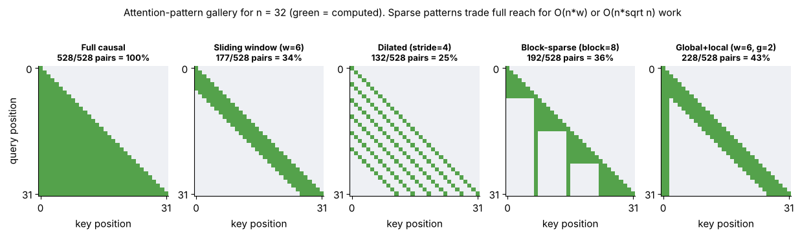
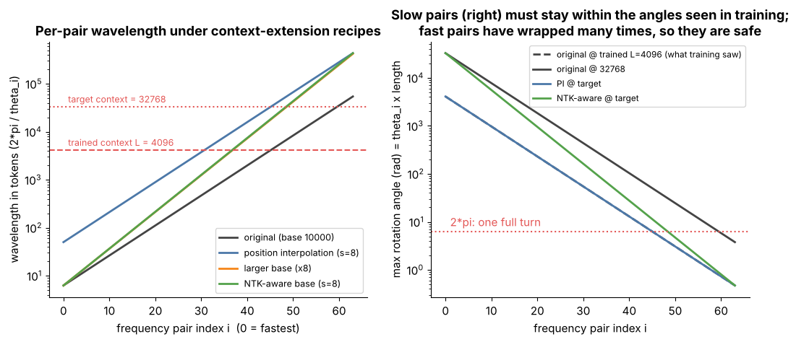
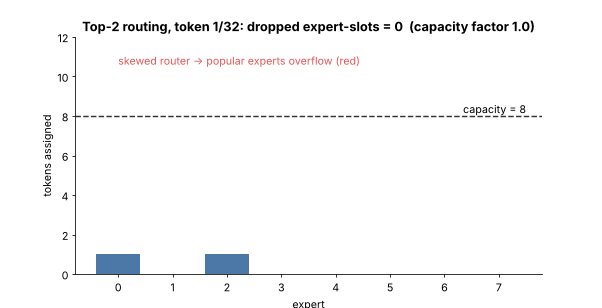
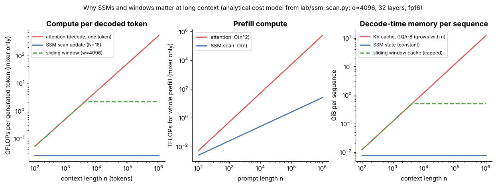
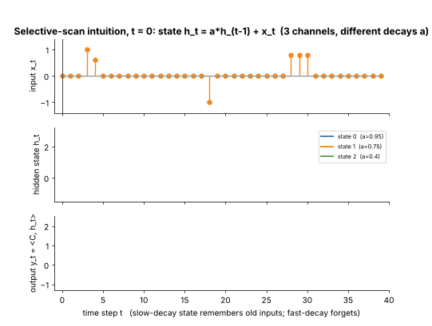
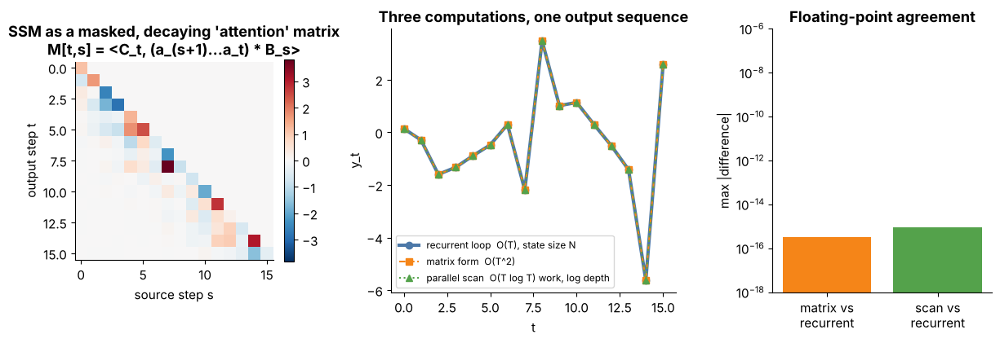

# Tier 12 — Modern Foundation-Model Architectures

> **Phase 2 · Transformers & Foundation Models** · Author: Claude draft (see `CHAPTER_STATUS.md`) · Status: `AUTHOR_DRAFT` (Critic / Code-review / Final-review pending)
> Prerequisites: Tier 6 (RoPE), Tier 7 (attention, MQA/GQA, sliding window intro), Tier 8 (block, parameter counting), Tier 9 (MoE training, objectives). Leads to: Tier 13 (vision), Tier 20 (RAG), Tier 11-style serving decisions.

**Tier goal.** After this tier you can read a model config and predict its parameters, KV-cache memory, FLOPs per token and context behaviour; explain MQA/GQA, RoPE extension, windows, sparse attention, MoE routing, SSMs/Mamba and hybrids at the architecture level; and defend an architecture choice with numbers. **Rule of this tier:** named model families (BERT, GPT, T5/BART, Llama, Qwen, Gemma) are *case studies*; durable architectural ideas are authoritative. All case-study numbers are `REVIEW_REQUIRED`, and nothing depends on a vendor API.

**Scope.** This README is the overview only. Every roadmap concept has its own file in [`concepts/`](concepts) following the 23-section standard. Concepts introduced earlier (MQA/GQA mechanics Tier 7, RoPE definition Tier 6, sliding-window intro Tier 7, MoE training Tier 9) are referenced, not re-taught.

---

## 0 · How to use this tier

| Step | What | Where |
|---|---|---|
| 1. Read | one file per concept | [`concepts/`](concepts) (index below) |
| 2. **See** | 9 figures + 2 animated GIFs | [`figures/`](figures), gallery below |
| 3. **Play** | 5 interactive explorers with sliders | [`interactive/`](interactive) |
| 4. **Build** | architecture comparison matrix + SSM-vs-attention demo, with tests | [`lab/`](lab) |
| 5. **Regenerate** | all figures and the HTML matrix | `python scripts/make_figures.py` |

### Interactive explorers (self-contained, no network)

| Explorer | Adjustable controls | Teaches |
|---|---|---|
| [`attention_patterns.html`](interactive/attention_patterns.html) | pattern, n, window, stride, block size, global tokens, layers | 12.9-12.12 |
| [`rope_scaling.html`](interactive/rope_scaling.html) | scheme (PI/base/NTK/by-parts), head dim, base, trained L, scale | 12.8, 12.9 |
| [`moe_explorer.html`](interactive/moe_explorer.html) | d_model, d_ff, layers, experts, top-k, tokens, capacity factor, skew, seed | 12.13-12.16 |
| [`ssm_hybrid.html`](interactive/ssm_hybrid.html) | state channels, decay, input pattern, d, N, window, A/L/S layer builder, context | 12.17-12.19 |
| [`arch_selector.html`](interactive/arch_selector.html) | task, context, GPU memory, concurrency, latency priority, recall, multi-GPU | 12.23, 12.30 |

---

## 1 · The big picture

```
 original Transformer (enc-dec)
   ├─ encoder-only  (12.3) ── BERT-style understanding models
   ├─ decoder-only  (12.4) ── dense LLMs ── GQA/MQA (12.6-7) ── RoPE + scaling (12.8-9) ── windows/sparse (12.10-12)
   │                          └─ sparse MoE (12.13-16)      └─ SSM / Mamba (12.17-18) ─ hybrids (12.19)
   └─ encoder-decoder (12.5) ── T5/BART-style transformation models
 add-ons: multimodal (12.20) · retrieval (12.21) · reasoning patterns (12.22)
 decision: selection (12.23) · case studies (12.24-29) · vendor-neutral comparison (12.30)
```

Three costs explain almost every design: **KV-cache memory** (GQA, windows, SSM), **FLOPs per token** (MoE active parameters, SSM scan) and **context reach** (RoPE scaling, global layers).

## 2 · Visual gallery


*Figure 1 — Family tree / timeline of architectures (lanes = families; years approximate, REVIEW_REQUIRED).*


*Figure 2 — Encoder-only, decoder-only and enc-dec attention masks. Look at which cells are green.*



*Figure 3 — Five sparse attention patterns with computed-pair fractions in each title.*



*Figure 4 — RoPE context-extension recipes: wavelength per frequency pair and the angles reached at the target length.*


*Figure 5 — MoE: total vs active parameters and memory vs compute as experts grow.*



*Figure 6 — Animation: top-2 routing to 8 experts; red bars exceed capacity and overflow.*



*Figure 7 — Compute per token, prefill compute and decode memory vs context for attention, window and SSM.*



*Figure 8 — Animation: three SSM state channels with different decays reading the same input.*



*Figure 9 — The same SSM as recurrence, masked-attention matrix and parallel scan: identical outputs.*


*Figure 10 — Per-sequence KV/state memory vs context for MHA, GQA, MQA, window, hybrid, SSM.*


*Figure 11 — Generated architecture comparison matrix (also `figures/comparison_matrix.html`).*

---

## 3 · Concept index (every roadmap item → its file)

| # | Concept |
|---|---|
| 12.1 | [Architectural evolution after the original Transformer](concepts/12.01-architectural-evolution-after-the-original-transformer.md) |
| 12.2 | [Dense Transformers](concepts/12.02-dense-transformers.md) |
| 12.3 | [Encoder-only models as an architectural family](concepts/12.03-encoder-only-models-as-an-architectural-family.md) |
| 12.4 | [Decoder-only models as an architectural family](concepts/12.04-decoder-only-models-as-an-architectural-family.md) |
| 12.5 | [Encoder-decoder models as an architectural family](concepts/12.05-encoder-decoder-models-as-an-architectural-family.md) |
| 12.6 | [Multi-Query Attention (MQA) in modern models](concepts/12.06-multi-query-attention-mqa-in-modern-models.md) |
| 12.7 | [Grouped-Query Attention (GQA) in modern models](concepts/12.07-grouped-query-attention-gqa-in-modern-models.md) |
| 12.8 | [RoPE variants and extensions](concepts/12.08-rope-variants-and-extensions.md) |
| 12.9 | [Long-context architectures](concepts/12.09-long-context-architectures.md) |
| 12.10 | [Sliding-window attention](concepts/12.10-sliding-window-attention.md) |
| 12.11 | [Sparse attention](concepts/12.11-sparse-attention.md) |
| 12.12 | [Efficient-attention architecture patterns](concepts/12.12-efficient-attention-architecture-patterns.md) |
| 12.13 | [Mixture of Experts (MoE)](concepts/12.13-mixture-of-experts-moe.md) |
| 12.14 | [Sparse MoE](concepts/12.14-sparse-moe.md) |
| 12.15 | [Expert routing](concepts/12.15-expert-routing.md) |
| 12.16 | [Expert load balancing](concepts/12.16-expert-load-balancing.md) |
| 12.17 | [State Space Models (SSMs)](concepts/12.17-state-space-models-ssms.md) |
| 12.18 | [Mamba](concepts/12.18-mamba.md) |
| 12.19 | [Transformer-SSM hybrid architectures](concepts/12.19-transformer-ssm-hybrid-architectures.md) |
| 12.20 | [Multimodal foundation-model architectures](concepts/12.20-multimodal-foundation-model-architectures.md) |
| 12.21 | [Retrieval-enhanced model architectures](concepts/12.21-retrieval-enhanced-model-architectures.md) |
| 12.22 | [Reasoning-oriented training/inference patterns](concepts/12.22-reasoning-oriented-training-inference-patterns.md) |
| 12.23 | [Architecture selection trade-offs](concepts/12.23-architecture-selection-trade-offs.md) |
| 12.24 | [Architecture case study: BERT family](concepts/12.24-architecture-case-study-bert-family.md) |
| 12.25 | [Architecture case study: GPT family](concepts/12.25-architecture-case-study-gpt-family.md) |
| 12.26 | [Architecture case study: T5/BART family](concepts/12.26-architecture-case-study-t5-bart-family.md) |
| 12.27 | [Architecture case study: Llama family](concepts/12.27-architecture-case-study-llama-family.md) |
| 12.28 | [Architecture case study: Qwen family](concepts/12.28-architecture-case-study-qwen-family.md) |
| 12.29 | [Architecture case study: Gemma family](concepts/12.29-architecture-case-study-gemma-family.md) |
| 12.30 | [Comparing modern model families without depending on vendor-specific APIs](concepts/12.30-comparing-modern-model-families-without-depending-on-vendor-.md) |

## 4 · Build: architecture comparison matrix + SSM-vs-attention scan

| File | What it is |
|---|---|
| [`lab/arch_matrix.py`](lab/arch_matrix.py) | `ArchSpec` + formulas: total/active params (dense, GQA, MoE, SSM, hybrid), KV bytes/token, capped window cache, constant SSM state, FLOPs/token, concurrent sequences per GPU, Markdown/HTML matrix, presets (case studies = REVIEW_REQUIRED; illustrative archetypes) |
| [`lab/ssm_scan.py`](lab/ssm_scan.py) | selective diagonal SSM computed 4 ways (recurrence, masked matrix, parallel scan, convolution) + linear-attention equivalence, cost model |
| [`lab/test_tier12.py`](lab/test_tier12.py) | 29 pytest tests: hand-computed parameter/cache/FLOP values on a toy config, MoE active vs total, window cap, SSM constant state, four-way equivalence, error cases |
| [`scripts/make_figures.py`](scripts/make_figures.py) | regenerates figures, GIFs and `figures/comparison_matrix.html` |

```bash
cd lab && python -m pytest -q      # 29 passed
python arch_matrix.py              # prints the matrix
python ssm_scan.py                 # prints agreement errors (~1e-15)
```

**Exercises.** (1) Add a preset for a config you use and compute max sequences on your GPU. (2) Make a 3:1 local:global pattern and find the context where it beats GQA-8 dense on cache. (3) Break `conv_form` with selective parameters. (4) Compare PI and NTK in the RoPE explorer.

## 5 · Tier-level interview kit

**Basic.** Encoder vs decoder vs enc-dec? What does GQA share? What is an expert?
**Intermediate.** Compute KV cache for a config. Total vs active parameters of an MoE. Why can't a pure SSM do exact recall as well as attention?
**Advanced.** Compare PI and NTK-aware RoPE scaling. Derive the SSM-as-masked-matrix view. Design a hybrid layer pattern for 128k context.
**Scenario.** *You must serve 64 concurrent 32k-token chats on one 80 GB GPU.* (Compute weights + cache; prefer GQA with few KV heads, windows or hybrids; test recall on your data.)

**60-second tier summary.** *"The Transformer block stayed; the details changed to cut three costs: KV memory (GQA, windows, SSM state), FLOPs per token (MoE active parameters) and context cost (RoPE scaling, sparse/linear mixers, hybrids). I choose by computing weights, cache and FLOPs for candidates at my context and concurrency, then evaluating on my own task; named model families are just case studies."*

## 6 · Revision questions

1. Which three costs motivate most post-2017 changes? 2. Give the KV-bytes formula. 3. Why total ≠ active for MoE? 4. What does the capacity factor trade? 5. Why does selectivity break the convolution form? 6. Which layers of a hybrid keep a growing cache?

## 7 · Related concepts & forward references

Attention math → Tier 7. Blocks, parameter counting → Tier 8. MoE training, scaling laws → Tier 9. Alignment/reasoning training → Tier 10. Serving, paged KV, quantization → Tier 11. Vision/audio encoders → Tiers 13-14. RAG → Tier 20.

## 8 · Review status

| Item | State |
|---|---|
| Code (`lab/`) | **TESTED** — `pytest`: 29 passed (Python 3.13, NumPy) |
| Code snippets in concept files | **TESTED** — every `python` block executed without error |
| Interactive pages | **TESTED** in headless Chromium via `tools/check_interactive.py`: no JS errors, sliders exercised |
| Figures | regenerated by script; spot-checked visually |
| Case-study numbers (parameters, KV heads, vocab, context, years) | `REVIEW_REQUIRED` |
| Heuristic selector rules, YaRN/NTK details, MoE/SSM paper details | `REVIEW_REQUIRED` |
| Critic / Code-review / Final-review | pending per `CHAPTER_STATUS.md` |
