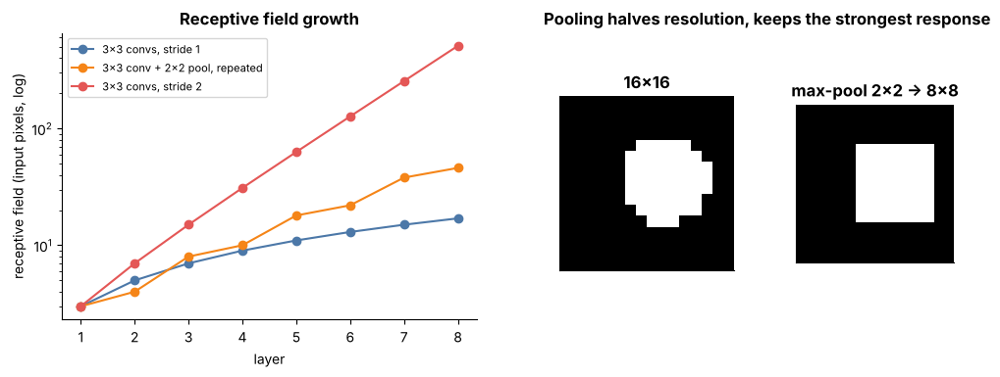

## 13.10 Receptive fields

Metadata:

Tier: 13 — Vision AI
Phase: 2 — Transformers & Foundation Models
Priority: High
Difficulty: Intermediate
Interview Importance: High
Hands-on Importance: Medium

Prerequisites: [13.5 Convolution](13.05-convolution.md), [13.7 Stride](13.07-stride.md), [13.9 Pooling](13.09-pooling.md)
Leads To: [13.12 Residual vision networks](13.12-residual-vision-networks.md), [13.15 Vision Transformer (ViT)](13.15-vision-transformer-vit.md)

---

### 1. WHAT IS IT?

The receptive field of a unit is the region of the input image that can influence it.

### 2. WHY DOES IT EXIST?

A unit can only recognise patterns that fit inside its receptive field; to recognise a whole face the field must cover it.

### 3. DETAILED EXPLANATION

**Recurrence.** Track `rf` and `jump`: `rf_l = rf_{l-1} + (k-1)*jump_{l-1}`, `jump_l = jump_{l-1}*s_l`, starting at rf=1, jump=1.

**Examples.** Three 3x3/1 convs: rf=7. conv3, pool2/2, conv3: rf=3, 4, 8.

**Effective receptive field.** The theoretical field is a bound; influence is concentrated near the centre (Gaussian-like) in trained nets, so the *effective* field is smaller (a known empirical finding).

**Transformers.** One self-attention layer has a global receptive field ([Tier 7 Attention](../../tier-07-attention/)); ViT trades locality for global context from layer 1.



*Look at: left panel (log scale) - strides/pooling make receptive fields grow exponentially; plain 3x3 convs grow only linearly.*

Play: the stack table at the bottom of [`conv_explorer.html`](../interactive/conv_explorer.html).

### 4. HOW DOES IT WORK?

Walk layers from input to output applying the recurrence, or trace the unit's dependencies backwards.

### 5. SIMPLE EXAMPLE

One 3x3 conv: each output sees 3x3 pixels. Two stacked: 5x5. Three: 7x7.

### 6. TECHNICAL EXAMPLE

`receptive_field([(3,1),(2,2),(3,1)])` returns rf `[3,4,8]`; test `test_max_pool_and_receptive_field`.

### 7. CODE

```python
import sys; sys.path.insert(0, "../lab")
from vision import receptive_field
print(receptive_field([(3, 1)] * 3))              # [(3,1),(5,1),(7,1)]
print(receptive_field([(3, 1), (2, 2), (3, 1)]))  # [(3,1),(4,2),(8,2)]
```

### 8. INPUT → PROCESS → OUTPUT

Input: list of (kernel, stride). Process: recurrence. Output: rf and jump per layer.

### 9. ENTERPRISE USE CASE

Architecture reviews check that the final receptive field covers the largest object or document region (e.g. a full-page table) at the deployment resolution.

### 10. AI ENGINEERING CONNECTION

Motivation for dilated convs, attention in vision, and ViTs ([13.15 Vision Transformer (ViT)](13.15-vision-transformer-vit.md)); resolution changes alter whether the field covers the object.

### 11. ADVANTAGES

Simple predictive tool for architecture design.

### 12. LIMITATIONS

Theoretical rf overstates effective rf; ignores skip connections' multiple paths.

### 13. TRADE-OFFS

Depth/stride/dilation: bigger fields vs resolution and compute.

### 14. COMMON MISTAKES

Assuming theoretical rf = what the net actually uses; ignoring that resizing the input changes object size relative to rf.

### 15. PERFORMANCE / COST CONSIDERATIONS

Large kernels or many layers to reach a large field are costly; strides/pooling are the cheap way.

### 16. SECURITY CONSIDERATIONS

Not applicable.

### 17. INTERVIEW EXPLANATION

The receptive field is the input region that can affect a unit; it grows with depth, kernel size, and especially stride/pooling via rf_l = rf_{l-1} + (k-1)*jump. The effective field is smaller than the theoretical one. ViT attention gives a global field in a single layer.

### 18. RAPID-FIRE ANSWER

Input area that can influence a unit; grows with depth, kernel, stride.

### 19. INTERVIEW QUESTIONS

**Basic.** RF of three 3x3 convs?

**Intermediate.** Why do strides grow RF faster?

**Advanced.** What is the effective receptive field?

**Scenario.** Your detector misses large objects only; relate to receptive field and propose fixes.

### 20. HANDS-ON EXERCISE

In the explorer pick 6 layers with pooling every 2; compare to the lab function output.

### 21. REVISION QUESTIONS

1. State the recurrence.
2. RF after conv3 + pool2 + conv3?
3. Why does ViT escape the RF limit?

### 22. RELATED CONCEPTS

[13.5 Convolution](13.05-convolution.md), [13.7 Stride](13.07-stride.md), [13.9 Pooling](13.09-pooling.md), [13.15 Vision Transformer (ViT)](13.15-vision-transformer-vit.md); attention in [Tier 7 Attention](../../tier-07-attention/).

### 23. ONE-LINE MEMORY HOOK

A neuron can only see what its receptive field covers.
