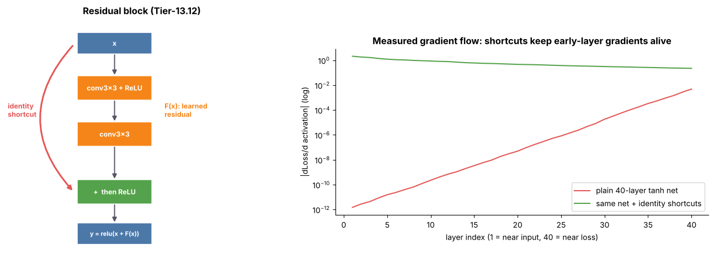

## 13.12 Residual vision networks

Metadata:

Tier: 13 — Vision AI
Phase: 2 — Transformers & Foundation Models
Priority: High
Difficulty: Intermediate
Interview Importance: High
Hands-on Importance: High

Prerequisites: [13.4 Convolutional Neural Networks (CNNs)](13.04-convolutional-neural-networks-cnns.md), [13.11 Feature maps](13.11-feature-maps.md); Tier 4 (backprop, vanishing gradients)
Leads To: [13.13 ResNet](13.13-resnet.md), [13.15 Vision Transformer (ViT)](13.15-vision-transformer-vit.md)

---

### 1. WHAT IS IT?

A residual network layer computes `y = x + F(x)`: the block learns only a *correction* F to its input, and the identity shortcut carries x through unchanged.

### 2. WHY DOES IT EXIST?

Very deep plain networks became *harder to train* (not just overfit) because gradients shrink through many layers; the identity path gives gradients a direct route and makes 'do nothing' easy to learn.

### 3. DETAILED EXPLANATION

**Gradient view.** `dy/dx = I + dF/dx`: the identity term guarantees a gradient path of magnitude ~1 regardless of F's depth.

**Shapes.** x and F(x) must match; when channels/stride change, the shortcut uses a 1x1 (strided) conv to project x.

**Measured demo.** In the figure, a 40-layer tanh network without shortcuts has first-layer gradients around 1e-12 times smaller than the last layer's, while the same network with identity shortcuts keeps gradients near the same order (measured by `scripts/make_figures.py`, seed 0).

**Beyond vision.** The same trick is the residual stream of every Transformer ([Tier 8 Transformer Architecture](../../tier-08-transformer-architecture/)).



*Look at: left - the red identity arc skips the two convs; right - green (shortcuts) stays flat while red (plain) collapses by many orders of magnitude toward the input.*

### 4. HOW DOES IT WORK?

Forward: compute F(x) with two conv layers, add x, apply ReLU. Backward: gradient splits into the shortcut branch (unchanged) and the F branch.

### 5. SIMPLE EXAMPLE

If the best layer is 'do nothing', a plain layer must learn the identity map; a residual layer just learns F=0.

### 6. TECHNICAL EXAMPLE

Test `test_residual_block_identity_when_f_zero`: with all F weights zero, `ResBlock(x) == x` for x>=0. `TinyResNet` stacks 2 blocks of width 16 (10,404 params) and measured 0.957, the same as the plain CNN at 30 epochs, though it was ahead at 6 and 20 epochs (figure 11); on a task this easy the residual benefit is small and seed-dependent.

### 7. CODE

```python
import torch, sys; sys.path.insert(0, "../lab")
from models import ResBlock
blk = ResBlock(4)                       # y = relu(x + c2(relu(c1(x))))
x = torch.rand(1, 4, 5, 5)
print(blk(x).shape)                     # torch.Size([1, 4, 5, 5])
```
Lab: [`../lab/models.py`](../lab/models.py); gradient demo in [`../scripts/make_figures.py`](../scripts/make_figures.py) (`grad_profile`).

### 8. INPUT → PROCESS → OUTPUT

Input x. Process: F(x) + shortcut. Output: x + F(x).

### 9. ENTERPRISE USE CASE

Deeper backbones (more accurate) become trainable with a standard recipe, so teams can scale model depth to their latency budget.

### 10. AI ENGINEERING CONNECTION

Residual connections are universal: ResNets, ViT, GPT. Understanding them here pays off in [Tier 8 Transformer Architecture](../../tier-08-transformer-architecture/).

### 11. ADVANTAGES

Trainable depth, stable gradients, easy identity.

### 12. LIMITATIONS

Adds memory for storing x; requires matching shapes; does not by itself fix overfitting.

### 13. TRADE-OFFS

Depth vs latency; wide-shallow vs narrow-deep.

### 14. COMMON MISTAKES

Adding after the final ReLU incorrectly vs before (variants differ); forgetting projection when shapes differ; assuming residuals remove the need for normalization.

### 15. PERFORMANCE / COST CONSIDERATIONS

Shortcut adds one elementwise add per block - negligible FLOPs.

### 16. SECURITY CONSIDERATIONS

Not applicable.

### 17. INTERVIEW EXPLANATION

A residual block outputs x + F(x). The identity path keeps the gradient from vanishing and makes it easy to learn near-identity layers, which is why networks with hundreds of layers train. The same idea is the residual stream in Transformers.

### 18. RAPID-FIRE ANSWER

y = x + F(x): identity shortcut keeps gradients flowing in deep nets.

### 19. INTERVIEW QUESTIONS

**Basic.** Write the residual block equation.

**Intermediate.** Why do residuals help gradients? Show dy/dx.

**Advanced.** How do shapes work when channels double?

**Scenario.** A 100-layer plain CNN trains worse than a 20-layer one - diagnosis and fix?

### 20. HANDS-ON EXERCISE

Rerun the gradient-profile experiment with ReLU instead of tanh and depth 20/40/80; note what changes.

### 21. REVISION QUESTIONS

1. dy/dx for y=x+F(x)?
2. What if F's weights are zero?
3. Where else are residuals used?

### 22. RELATED CONCEPTS

[13.13 ResNet](13.13-resnet.md), [13.4 Convolutional Neural Networks (CNNs)](13.04-convolutional-neural-networks-cnns.md); [Tier 8 Transformer Architecture](../../tier-08-transformer-architecture/) residual stream.

### 23. ONE-LINE MEMORY HOOK

Learn the change, keep the original.
