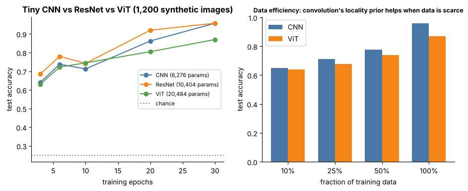

## 13.15 Vision Transformer (ViT)

Metadata:

Tier: 13 — Vision AI
Phase: 2 — Transformers & Foundation Models
Priority: Critical
Difficulty: Intermediate
Interview Importance: Critical
Hands-on Importance: High

Prerequisites: [13.16 Image patches](13.16-image-patches.md), [13.17 Patch embeddings](13.17-patch-embeddings.md); [Tier 7 Attention](../../tier-07-attention/), [Tier 8 Transformer Architecture](../../tier-08-transformer-architecture/)
Leads To: [13.18 Vision encoders](13.18-vision-encoders.md), [13.20 CLIP](13.20-clip.md), [13.22 Vision-language models (VLMs)](13.22-vision-language-models-vlms.md)

---

### 1. WHAT IS IT?

A Vision Transformer (ViT, Dosovitskiy et al., 2020) cuts an image into fixed-size patches, linearly embeds each into a token, adds position information and a [CLS] token, and processes the sequence with a standard Transformer encoder.

### 2. WHY DOES IT EXIST?

Show that the *same* architecture used for text can do vision at scale, with minimal image-specific priors, and unify vision with language models (CLIP, VLMs).

### 3. DETAILED EXPLANATION

**Pipeline.** image -> patches ([13.16 Image patches](13.16-image-patches.md)) -> linear embedding ([13.17 Patch embeddings](13.17-patch-embeddings.md)) -> [CLS] + learned position embeddings -> L Transformer encoder blocks (self-attention + MLP, pre-norm; math in [Tier 7 Attention](../../tier-07-attention/), [Tier 8 Transformer Architecture](../../tier-08-transformer-architecture/)) -> [CLS] (or mean) -> head.

**Inductive bias.** No locality, no translation equivariance built in: it must *learn* them (position embeddings, attention). So ViTs usually need large pretraining data or strong augmentation/regularization; with little data CNNs win (see figure).

**Cost.** Attention is O(N^2) in token count N=(H/p)^2: halving patch size quadruples N and multiplies attention cost ~16x.

**Sizes (REVIEW_REQUIRED).** ViT-B/16 ~86M parameters, 197 tokens at 224 px; ViT-L/16 ~307M; ViT-H/14 ~632M (published figures).



*Look at: right panel - the CNN leads at every training-set size (nearly tied at 10%, 9 points at 100%). The regime where ViTs overtake needs far more data than this toy has; one seed, not a benchmark.*

Play: [`vit_patches.html`](../interactive/vit_patches.html).

### 4. HOW DOES IT WORK?

`tokens = [CLS] + proj(patches) + pos`; `for block: tokens += Attn(LN(tokens)); tokens += MLP(LN(tokens))`; `embedding = out(LN(tokens[:,0]))`.

### 5. SIMPLE EXAMPLE

A 16x16 image with 4x4 patches becomes a 17-word 'sentence' (1 CLS + 16 patches); the Transformer reads it like text.

### 6. TECHNICAL EXAMPLE

Lab `TinyViT`: patch=4, d=32, depth=2, heads=4, 20,484 parameters; 0.87 test accuracy vs CNN 0.96 on 1,200 training images (measured, seeded; `run_lab.py`) - consistent with ViT having weaker priors.

### 7. CODE

```python
import sys; sys.path.insert(0, "../lab")
import torch
from models import TinyViT
m = TinyViT(size=16, patch=4, d=32, depth=2)
x = torch.randn(2, 3, 16, 16)
print(m.patches(x).shape, m.embed(x).shape, m(x).shape)   # (2,16,48) (2,32) (2,4)
```
Lab: [`../lab/models.py`](../lab/models.py) `TinyViT` (uses `nn.TransformerEncoder`, pre-norm).

### 8. INPUT → PROCESS → OUTPUT

Input: (B,3,H,W). Process: patchify, embed, +pos, Transformer, pool. Output: embedding/logits.

### 9. ENTERPRISE USE CASE

Teams pick a pretrained ViT (or CLIP ViT) as a general backbone when they have large pretrained weights and GPUs, and fine-tune a linear head or LoRA adapters ([Tier 10 Fine-tuning & Alignment](../../tier-10-fine-tuning-alignment/)).

### 10. AI ENGINEERING CONNECTION

ViT is the vision tower of CLIP and most VLMs ([13.20 CLIP](13.20-clip.md), [13.22 Vision-language models (VLMs)](13.22-vision-language-models-vlms.md)); its token sequence is what is fed to LLMs after projection.

### 11. ADVANTAGES

Scales well with data/compute; unified architecture; global context from layer 1.

### 12. LIMITATIONS

Data-hungry without pretraining; quadratic attention in tokens; positional-resolution mismatch when input size changes (interpolate position embeddings).

### 13. TRADE-OFFS

Patch size: fine detail vs token count/cost; ViT vs CNN: flexibility vs data efficiency.

### 14. COMMON MISTAKES

Image size not divisible by patch; reusing position embeddings at a different resolution without interpolation; training from scratch on small data; forgetting the [CLS] token in the count.

### 15. PERFORMANCE / COST CONSIDERATIONS

Tokens N=(H/p)^2; attention memory and FLOPs ~N^2; FlashAttention-style kernels ([Tier 11 Inference & Optimization](../../tier-11-llm-inference-optimization/)) help.

### 16. SECURITY CONSIDERATIONS

Adversarial patches and prompt-like attacks via visual text exist; treat pretrained ViT weights as untrusted until verified.

### 17. INTERVIEW EXPLANATION

ViT turns an image into a sequence of patch tokens and runs a normal Transformer encoder with a CLS token and position embeddings. It has little vision-specific bias, so it needs lots of pretraining data, but it scales well and unifies vision with language. Cost grows quadratically with the number of patches.

### 18. RAPID-FIRE ANSWER

Patch tokens + Transformer encoder (+CLS, +position embeddings).

### 19. INTERVIEW QUESTIONS

**Basic.** How many tokens for 224x224 with 16x16 patches?

**Intermediate.** Why does ViT need more data than a CNN?

**Advanced.** How does patch size affect cost?

**Scenario.** You must run ViT at 448 px but it was trained at 224: what breaks and how do you fix it?

### 20. HANDS-ON EXERCISE

Train `TinyViT` and `TinyCNN` at 10%, 50%, 100% of the data (see `scripts/make_figures.py::fig_lab`) and explain the crossover.

### 21. REVISION QUESTIONS

1. Tokens for 384x384, p=16?
2. Role of [CLS]?
3. Why interpolate position embeddings?

### 22. RELATED CONCEPTS

[13.16 Image patches](13.16-image-patches.md), [13.17 Patch embeddings](13.17-patch-embeddings.md), [13.18 Vision encoders](13.18-vision-encoders.md), [13.20 CLIP](13.20-clip.md); [Tier 7 Attention](../../tier-07-attention/), [Tier 8 Transformer Architecture](../../tier-08-transformer-architecture/).

### 23. ONE-LINE MEMORY HOOK

An image is worth 16x16 words.
