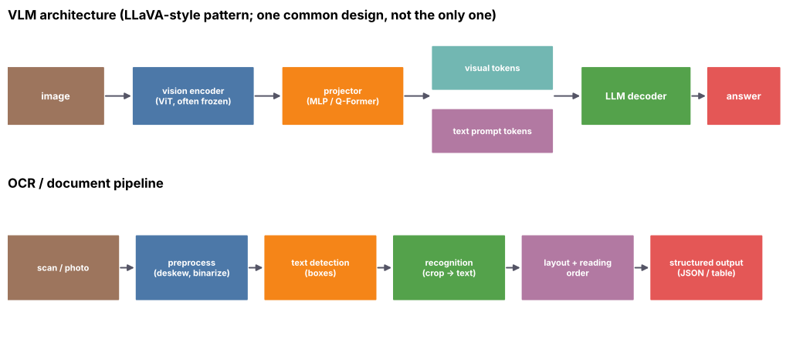

## 13.28 Document-image understanding

Metadata:

Tier: 13 — Vision AI
Phase: 2 — Transformers & Foundation Models
Priority: High
Difficulty: Intermediate
Interview Importance: High
Hands-on Importance: Medium

Prerequisites: [13.22 Vision-language models (VLMs)](13.22-vision-language-models-vlms.md), [13.25 OCR fundamentals](13.25-ocr-fundamentals.md)
Leads To: [13.29 Chart/table visual understanding](13.29-chart-table-visual-understanding.md), [13.31 Vision evaluation](13.31-vision-evaluation.md)

---

### 1. WHAT IS IT?

Document-image understanding extracts meaning and structure from page images (invoices, forms, contracts, reports): text, layout, key-value fields, tables and reading order.

### 2. WHY DOES IT EXIST?

Text alone loses layout cues (a number's meaning depends on its position and label). Documents are the dominant enterprise unstructured data.

### 3. DETAILED EXPLANATION

**Approaches.** (1) OCR + layout-aware language models that consume tokens with 2-D coordinates (LayoutLM-style, REVIEW_REQUIRED); (2) OCR-free image-to-text/JSON models (Donut-style, REVIEW_REQUIRED); (3) general VLMs prompted for extraction ([13.22 Vision-language models (VLMs)](13.22-vision-language-models-vlms.md)); (4) hybrids with deterministic validation.

**Tasks.** Key information extraction, document classification, form understanding, document QA, table structure ([13.29 Chart/table visual understanding](13.29-chart-table-visual-understanding.md)).

**Engineering.** Page splitting/tiling, resolution (small print), schema-constrained outputs (JSON), validation rules (totals add up, dates valid), confidence routing to humans.

**Risks.** Hallucinated values that look plausible; silent layout drift across vendors.



*Look at: the lower row (classic) vs upper row (VLM) are two routes to the same structured output.*

### 4. HOW DOES IT WORK?

Page image -> (OCR tokens + boxes) and/or visual features -> model -> structured output -> validators -> review queue.

### 5. SIMPLE EXAMPLE

Invoice image -> `{vendor, date, total}` with the total checked against line items.

### 6. TECHNICAL EXAMPLE

Validation example: `abs(sum(lines) - total) < 0.01`; failing documents are routed to review. The lab covers the geometric pieces (IoU/NMS, patches) but not a document model.

### 7. CODE

```python
# Deterministic validation wrapped around any extractor (OCR pipeline or VLM)
def validate(doc):
    errs = []
    if abs(sum(doc["lines"]) - doc["total"]) > 0.01: errs.append("total != sum(lines)")
    if not doc["date"].count("-") == 2: errs.append("bad date")
    return errs
print(validate({"lines": [10.0, 13.4], "total": 23.4, "date": "2026-10-13"}))   # []
```

### 8. INPUT → PROCESS → OUTPUT

Input: document images. Process: read + layout + extract + validate. Output: schema-valid JSON or review ticket.

### 9. ENTERPRISE USE CASE

Accounts payable at scale: straight-through-processing rate and exception rate are tracked per vendor; auditors need the source crop for every field.

### 10. AI ENGINEERING CONNECTION

Core application of VLMs and OCR; feeds multimodal RAG and agents.

### 11. ADVANTAGES

High automation value; works across templates with VLMs.

### 12. LIMITATIONS

Hallucination, cost per page, layout drift, PII risk.

### 13. TRADE-OFFS

Template/OCR pipeline (cheap, brittle) vs VLM (flexible, costly); accuracy vs latency.

### 14. COMMON MISTAKES

No validation layer; evaluating on clean samples; ignoring multi-page context; logging raw PII.

### 15. PERFORMANCE / COST CONSIDERATIONS

Cost per page = tiles x visual tokens x price; downscale or crop regions of interest.

### 16. SECURITY CONSIDERATIONS

PII/regulated data; prompt injection via document text; require data-residency and retention controls.

### 17. INTERVIEW EXPLANATION

Document understanding turns page images into structured data using OCR plus layout-aware models or OCR-free/VLM extraction. Production needs schema-constrained output, deterministic validators, confidence-based human review, per-field evaluation and PII controls.

### 18. RAPID-FIRE ANSWER

Extract structured meaning (fields, tables, layout) from page images.

### 19. INTERVIEW QUESTIONS

**Basic.** OCR+LLM vs OCR-free?

**Intermediate.** Why does layout matter?

**Advanced.** How do you control hallucinated numbers?

**Scenario.** Design an invoice pipeline for 100k pages/day with auditability.

### 20. HANDS-ON EXERCISE

Extend `validate` with currency parsing and a tolerance rule; write 5 test documents.

### 21. REVISION QUESTIONS

1. Two extraction approaches?
2. Why validators?
3. What do auditors need?

### 22. RELATED CONCEPTS

[13.22 Vision-language models (VLMs)](13.22-vision-language-models-vlms.md), [13.25 OCR fundamentals](13.25-ocr-fundamentals.md), [13.29 Chart/table visual understanding](13.29-chart-table-visual-understanding.md), [13.31 Vision evaluation](13.31-vision-evaluation.md).

### 23. ONE-LINE MEMORY HOOK

Read the page, not just the words.
