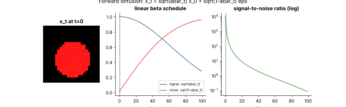

## 13.30 Diffusion-model introduction

Metadata:

Tier: 13 — Vision AI
Phase: 2 — Transformers & Foundation Models
Priority: High
Difficulty: Intermediate
Interview Importance: High
Hands-on Importance: Medium

Prerequisites: [13.4 Convolutional Neural Networks (CNNs)](13.04-convolutional-neural-networks-cnns.md), [13.27 Image segmentation](13.27-image-segmentation.md); Tier 2 (probability, Gaussians)
Leads To: [13.31 Vision evaluation](13.31-vision-evaluation.md)

---

### 1. WHAT IS IT?

Diffusion models generate data by learning to reverse a gradual noising process: forward steps add Gaussian noise until the image is pure noise; a network learns to remove noise step by step.

### 2. WHY DOES IT EXIST?

They give stable training and high-quality, diverse image synthesis, and support text conditioning (via CLIP-like or LLM text encoders).

### 3. DETAILED EXPLANATION

**Forward process.** `x_t = sqrt(abar_t) x_0 + sqrt(1 - abar_t) eps`, `eps ~ N(0,I)`, with `abar_t = prod(1 - beta_s)`. The *noise schedule* beta_t controls how fast signal is destroyed (linear, cosine).

**Training.** Pick random t, noise an image, train a network (U-Net or Transformer, REVIEW_REQUIRED for current practice) to predict eps (or x_0 / v) with an MSE loss.

**Sampling.** Start from noise, iterate: predict noise, take a denoising step; fewer steps via better samplers/distillation (REVIEW_REQUIRED).

**Conditioning.** Text embedding enters via cross-attention; classifier-free guidance blends conditional and unconditional predictions to strengthen prompt adherence.

**Latent diffusion.** Run diffusion in the compressed latent space of an autoencoder to cut cost (the Stable-Diffusion-style recipe).



*Look at: the circle/square image decays into noise as t grows; the curve shows signal weight falling and noise weight rising; right panel: SNR decays on a log scale.*

Play: [`diffusion_noising.html`](../interactive/diffusion_noising.html) - timestep, number of steps, schedule and beta_end sliders.

### 4. HOW DOES IT WORK?

Training: `t ~ U{1..T}`, `eps ~ N`, `x_t = ...`, loss `|eps - eps_theta(x_t, t)|^2`. Sampling: from `x_T ~ N(0,I)` repeatedly apply the learned reverse step down to x_0.

### 5. SIMPLE EXAMPLE

Add a bit of static to a photo repeatedly until it is only static; teach a model to undo one bit of static at a time; then start from static and 'undo' into a new picture.

### 6. TECHNICAL EXAMPLE

`abar_T` should be near 0 so x_T is nearly pure noise (the explorer prints it). Cosine schedules keep more signal at early steps than linear. This lab does not train a diffusion model (CPU/time); the forward process is reproduced exactly in the figure/explorer.

### 7. CODE

```python
import numpy as np
T = 100
betas = np.linspace(1e-4, 0.05, T)
abar = np.cumprod(1 - betas)
x0 = np.ones((8, 8)); eps = np.random.default_rng(0).normal(size=x0.shape)
t = 50
xt = np.sqrt(abar[t]) * x0 + np.sqrt(1 - abar[t]) * eps
print(round(abar[t], 3), round(abar[-1], 4))     # signal left at t=50 and at the end (0.078: not fully noised; raise beta_end or T)
```
Figure code: [`../scripts/make_figures.py`](../scripts/make_figures.py) `gif_diffusion`.

### 8. INPUT → PROCESS → OUTPUT

Input: noise (+ text condition). Process: iterative denoising. Output: generated image.

### 9. ENTERPRISE USE CASE

Marketing teams generate on-brand variations; governance needs provenance metadata (watermarks/content credentials), licensing review of training data, and a policy for generated likenesses.

### 10. AI ENGINEERING CONNECTION

Diffusion also powers image editing, video and audio generation (Tier 14) and synthetic data for vision training.

### 11. ADVANTAGES

High quality, diversity, stable training, flexible conditioning.

### 12. LIMITATIONS

Slow sampling (many steps), compute-heavy training, prompt misalignment, copyright and misuse concerns.

### 13. TRADE-OFFS

Steps vs quality/latency; guidance scale (fidelity vs diversity); latent vs pixel space (cost vs fine detail).

### 14. COMMON MISTAKES

Confusing noise schedule with sampler; wrong normalization of x_0 to [-1,1]; evaluating only on cherry-picked samples.

### 15. PERFORMANCE / COST CONSIDERATIONS

Cost = steps x network forward cost; distillation and few-step samplers reduce it (REVIEW_REQUIRED).

### 16. SECURITY CONSIDERATIONS

Deepfakes and non-consensual imagery, training-data memorization, prompt injection into text-conditioned pipelines; apply safety filters and provenance.

### 17. INTERVIEW EXPLANATION

Diffusion adds Gaussian noise to data over many steps with a schedule and trains a network to predict the noise at a random step; generation starts from noise and denoises iteratively, optionally guided by text. Key knobs are the noise schedule, number of steps, and guidance scale; latent diffusion makes it affordable.

### 18. RAPID-FIRE ANSWER

Learn to reverse gradual noising; generate by iterative denoising from noise.

### 19. INTERVIEW QUESTIONS

**Basic.** What is the forward process?

**Intermediate.** What does the network predict in training?

**Advanced.** What does classifier-free guidance do?

**Scenario.** Latency is 8 s per image: list levers and quality trade-offs.

### 20. HANDS-ON EXERCISE

Run the snippet for linear vs cosine schedules and compare abar at t=T/2.

### 21. REVISION QUESTIONS

1. x_t formula?
2. Why is abar_T ~ 0 important?
3. What is latent diffusion?

### 22. RELATED CONCEPTS

[13.20 CLIP](13.20-clip.md) (text conditioning), [13.27 Image segmentation](13.27-image-segmentation.md); Tier 14 audio/video generation.

### 23. ONE-LINE MEMORY HOOK

Destroy with noise slowly, learn to repair, generate by repairing noise.
