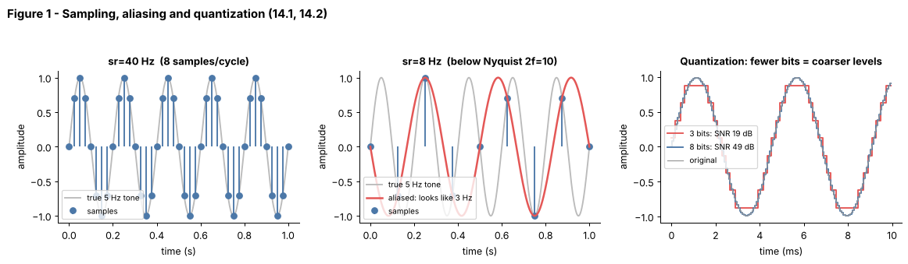

## 14.1 Audio waveforms

Metadata:

- Tier: 14 — Speech, Audio & Video AI
- Phase: 2 — Transformers & Foundation Models
- Priority: Critical
- Difficulty: Beginner
- Interview Importance: Medium
- Hands-on Importance: High
- Prerequisites: 
- Leads To: [14.2 Sampling rate](14.02-sampling-rate.md), [14.3 Amplitude and frequency](14.03-amplitude-and-frequency.md), [14.4 Spectrograms](14.04-spectrograms.md), [14.6 Audio preprocessing](14.06-audio-preprocessing.md)

---

### 1. WHAT IS IT?

An audio waveform is a one-dimensional signal: air-pressure (or microphone voltage) as a function of time. In a computer it is an array of numbers `x[n]`, one per sample, usually floats in [-1, 1] or 16-bit integers.

### 2. WHY DOES IT EXIST?

Neural networks consume tensors, so continuous sound has to become numbers. The waveform is the *rawest* representation; every other audio representation in this tier (spectrogram, mel features, codec tokens) is computed from it.

### 3. DETAILED EXPLANATION

**What the numbers mean.** `x[n]` is the displacement of the microphone diaphragm at time `n / sr`. Positive and negative values are compression and rarefaction. Loudness is related to amplitude; pitch is related to how fast the wave repeats ([14.3 Amplitude and frequency](14.03-amplitude-and-frequency.md)).

**Shape of audio tensors.** Mono audio is `[samples]`; stereo is `[channels, samples]`; a batch is `[B, C, samples]`. At 16 kHz, one second is 16 000 numbers, so a 30 s clip is 480 000 values: very long compared with a text sequence of ~100 tokens. That length is *the* engineering problem of audio AI and the reason for spectrograms, strided convolutions and codecs.

**Why the raw waveform is awkward for models.** Phase makes the same sound look different (shift the wave by a fraction of a period and every sample changes), and a single phoneme spans hundreds of samples. Models therefore learn on time-frequency features ([14.4 Spectrograms](14.04-spectrograms.md)) or use convolutional front-ends to compress the waveform (wav2vec-style encoders, [14.7 Audio embeddings](14.07-audio-embeddings.md)).

**Synthetic signals used throughout this tier** (no downloads): `tone` (sine), `chirp` (frequency sweep), `noise` (Gaussian), and "phoneme" bursts made of two tones, see [`lab/audio_core.py`](../lab/audio_core.py) and [`lab/ctc_asr.py`](../lab/ctc_asr.py).

### 4. HOW DOES IT WORK?

1. A microphone converts pressure to voltage.
2. An analog-to-digital converter measures the voltage `sr` times per second (sampling, [14.2](14.02-sampling-rate.md)).
3. Each measurement is rounded to one of `2^bits` levels (quantization).
4. Result: array `x[0..N-1]`. Duration = `N / sr`.



*Figure 1 - Sampling, aliasing and quantization. Look at the right panel: 3-bit steps are visibly coarse (SNR about 19 dB) while 8 bits are almost invisible.*

Play with it: [explore: `sampling_explorer.html`](../interactive/sampling_explorer.html) (sliders: tone frequency, sample rate, bit depth, amplitude, window).

### 5. SIMPLE EXAMPLE

Think of a flip-book. Each page is one sample of how the sound looked at one instant; flipping at the right speed recreates the motion (sound).

### 6. TECHNICAL EXAMPLE

A speech-recognition front-end reads a 16 kHz mono waveform, 30 s at a time in Whisper-style models (`REVIEW_REQUIRED` for exact window size), turning 480 000 samples into about 3 000 log-mel frames before any neural network sees them.

### 7. CODE

```python
# run inside lab/
import numpy as np
from audio_core import tone, chirp, noise, rms, dominant_freq

sr = 16000
x = tone(440, 1.0, sr, amp=0.5)            # 1 s of A4 at half scale
print(x.shape, round(rms(x), 3))           # (16000,) 0.354  (= 0.5/sqrt(2))
print(round(dominant_freq(x, sr)))         # 440
sweep = chirp(200, 2000, 1.0, sr)          # frequency rises over time
hiss = noise(1.0, sr, 0.1, seed=0)         # broadband noise
print(round(rms(hiss), 2))                 # ~0.1
```
Code: [`lab/audio_core.py`](../lab/audio_core.py) | tests: [`lab/test_tier14.py`](../lab/test_tier14.py)

### 8. INPUT → PROCESS → OUTPUT

```
sound pressure ──mic──► voltage ──ADC (sr, bits)──► x[n] array ──► [B, C, N] tensor
```

### 9. ENTERPRISE USE CASE

Call-centre platforms store 8 kHz telephone audio (narrow band) while meeting products capture 16-48 kHz; the pipeline must know the waveform's sample rate and channel layout before choosing models (`REVIEW_REQUIRED`: typical rates, depends on the product).

### 10. AI ENGINEERING CONNECTION

Raw waveforms are the input to every speech model; length makes them expensive, which drives the design of encoders ([14.7](14.07-audio-embeddings.md)) and codecs ([14.8](14.08-audio-tokenization-and-neural-codecs.md)). Contrast with text tokens in [Tier 6](../../tier-06-tokenization-embeddings/README.md).

### 11. ADVANTAGES

Lossless, simple, no feature-engineering assumptions; end-to-end models can learn their own filters.

### 12. LIMITATIONS

Very long sequences; phase-sensitive; redundant; mixes speaker, content, channel and noise in one array.

### 13. TRADE-OFFS

Raw waveform = maximum information, maximum cost. Features = cheaper, but discard phase and fine detail.

### 14. COMMON MISTAKES

- Assuming all audio is 16 kHz (check the file's sample rate).
- Mixing int16 and float32 scales (divide int16 by 32768).
- Forgetting channels: stereo has two arrays.
- Comparing amplitudes across clips recorded at different gain.

### 15. PERFORMANCE / COST CONSIDERATIONS

Memory is `samples x 4 bytes` in float32: one hour of 16 kHz mono is about 230 MB. Raw 16 kHz 16-bit PCM is 32 KB/s (1.9 MB/min).

### 16. SECURITY CONSIDERATIONS

Audio is personal data: voices are biometric identifiers in many jurisdictions (`REVIEW_REQUIRED` legal). Treat raw recordings as sensitive, encrypt at rest and minimise retention. Malformed audio files are an input-validation surface; decode in a sandbox with size and duration limits.

### 17. INTERVIEW EXPLANATION

*"A waveform is just pressure over time stored as an array of numbers, one per sample. At 16 kHz that is 16 000 numbers per second, which is far longer than text, so models almost never read it raw: they convert it to spectrogram or mel features, or compress it with a strided encoder. The trade-off is information versus sequence length."*

### 18. RAPID-FIRE ANSWER

Pressure-versus-time stored as an array of samples; the rawest and longest audio representation.

### 19. INTERVIEW QUESTIONS

- **Basic:** What does one sample in a waveform represent?
- **Intermediate:** Why is raw audio hard to feed directly to a transformer?
- **Advanced:** Why might two recordings of the same word have very different waveforms but similar spectrograms?
- **Scenario:** A pipeline crashes on one customer's files only; the files are 8 kHz stereo and the model expects 16 kHz mono. What do you check and fix?

### 20. HANDS-ON EXERCISE

Generate 0.5 s of a 300 Hz tone and 0.5 s of noise at the same RMS. Plot both. Which is easier to tell apart in the waveform and which in the spectrum?

### 21. REVISION QUESTIONS

1. How many numbers are in 30 s of 16 kHz mono audio?
2. What is the shape of a batch of stereo audio?
3. Why does phase make waveforms awkward for learning?

### 22. RELATED CONCEPTS

[14.2 Sampling rate](14.02-sampling-rate.md), [14.3 Amplitude and frequency](14.03-amplitude-and-frequency.md), [14.4 Spectrograms](14.04-spectrograms.md), [Tier 6 Tokenization & Embeddings](../../tier-06-tokenization-embeddings/README.md)

### 23. ONE-LINE MEMORY HOOK

*A waveform is a very long list of tiny pressure readings.*
