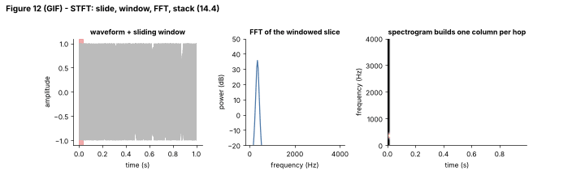

## 14.4 Spectrograms

Metadata:

- Tier: 14 — Speech, Audio & Video AI
- Phase: 2 — Transformers & Foundation Models
- Priority: Critical
- Difficulty: Intermediate
- Interview Importance: High
- Hands-on Importance: Very high
- Prerequisites: [14.3 Amplitude and frequency](14.03-amplitude-and-frequency.md)
- Leads To: [14.5 Mel spectrograms](14.05-mel-spectrograms.md), [14.7 Audio embeddings](14.07-audio-embeddings.md), [14.9 Automatic Speech Recognition (ASR)](14.09-automatic-speech-recognition-asr.md), [14.13 Speech segmentation](14.13-speech-segmentation.md), [14.17 Vocoders](14.17-vocoders.md)

---

### 1. WHAT IS IT?

A spectrogram is a time-frequency image: slide a short window along the waveform, take an FFT of each windowed slice (the short-time Fourier transform, STFT), and stack the magnitudes (or powers) as columns. Rows are frequency, columns are time, brightness is energy.

### 2. WHY DOES IT EXIST?

A single FFT over a whole utterance says which frequencies occurred but not when. Speech is a sequence of changing sounds, so we need frequency content *per moment*. The spectrogram also turns audio into an image-like 2-D array that convolutional and transformer models handle well.

### 3. DETAILED EXPLANATION

**STFT recipe.** Choose a window length `W` (for example 256 samples = 32 ms at 8 kHz) and hop `H` (80 samples = 10 ms). For frame `t`: multiply `x[tH : tH+W]` by a Hann window, compute the real FFT, and take `|.|^2` (power). Output shape `[n_frames, W/2 + 1]`.

**Resolution trade-off.** Frequency resolution is `sr / W`; time resolution is about `W / sr`. A long window separates close frequencies but smears events in time; a short window localises events but blurs frequencies (Figure 3: compare the two spectrogram panels). You cannot have both: this is the Fourier uncertainty principle. Speech systems typically use 20-25 ms windows with 10 ms hops (`REVIEW_REQUIRED`: common convention, not a law).

**Window function.** A rectangular window causes spectral leakage (a pure tone smears across many bins). Hann or Hamming windows taper the edges to reduce it.

**Overlap.** `hop < window` gives overlapping frames so no event falls entirely at a frame edge. Hop sets the frame rate (10 ms hop = 100 frames/s), which in turn sets the sequence length your model must process.

**Log compression.** Power spans many orders of magnitude, and perception is logarithmic, so features are `log(power + eps)` or dB.

**Phase.** Magnitude spectrograms discard phase; reconstructing a waveform requires estimating it (Griffin-Lim, or a neural vocoder, [14.17](14.17-vocoders.md)). The lab's `istft` inverts an STFT only when phase is kept.

### 4. HOW DOES IT WORK?


*Figure 3 - Left: waveform. Middle: 8 ms window, the rising chirp is crisp in time but each line is thick in frequency. Right: 128 ms window, frequencies are razor-thin but the chirp end and the tone onset smear in time.*



*Figure 12 (GIF) - Left: the red band is the current window. Middle: its FFT. Right: the spectrogram gains one column per hop; watch the peak climb as the chirp rises.*

Try it with your own settings: [explore: `spectrogram_mel_explorer.html`](../interactive/spectrogram_mel_explorer.html) (window, hop, noise, signal type; the FFT runs in JavaScript).

### 5. SIMPLE EXAMPLE

Sheet music is a spectrogram of a song: time runs left to right, pitch runs up and down, and the marks tell you which notes sound when.

### 6. TECHNICAL EXAMPLE

Speech recognisers compute 100 frames/s of STFT features. For a 30 s clip that is 3 000 frames; a 1.2 s toy utterance with hop 80 at 8 kHz gives 121 frames.

### 7. CODE

```python
# run inside lab/
import numpy as np
from audio_core import tone, chirp, stft, power_spectrogram, istft

sr = 8000
x = np.concatenate([chirp(300, 3000, 1.0, sr), tone(1000, 0.5, sr)])
S = stft(x, win=256, hop=64)                 # complex [frames, 129]
P = power_spectrogram(x, 256, 64)            # [frames, 129]
print(S.shape, S.shape[1] == 256 // 2 + 1)   # (frames, 129) True
# the 1 kHz tone should peak near bin 1000 / (8000/256) = 32
tone_frame = P[-10]
print(int(tone_frame.argmax()))              # 32
y = istft(S, 256, 64)                        # complex STFT keeps phase -> invertible
print(np.allclose(x[256:4000], y[256:4000], atol=1e-6))   # True
```
Code: [`lab/audio_core.py`](../lab/audio_core.py) (`frame_signal`, `stft`, `istft`) | tests: [`lab/test_tier14.py`](../lab/test_tier14.py)

### 8. INPUT → PROCESS → OUTPUT

```
x[n] ─► frame (W, hop H) ─► window (Hann) ─► rFFT per frame ─► |.|^2 ─► [T, W/2+1] ─► log
```

### 9. ENTERPRISE USE CASE

Industrial predictive maintenance uses spectrograms of machine vibration/audio so engineers (and models) can see a bearing's growing harmonic before it fails; the same STFT code serves speech, music and machines.

### 10. AI ENGINEERING CONNECTION

Spectrograms (usually mel-scaled, [14.5](14.05-mel-spectrograms.md)) are the input of Whisper-style ASR encoders and many audio classifiers; treating them as images links audio to [Tier 13 Vision AI](../../tier-13-vision-ai/README.md) (ViT-style patching, e.g. Audio Spectrogram Transformer, `REVIEW_REQUIRED`).

### 11. ADVANTAGES

Shows time and frequency together; cheap (`O(N log N)`); interpretable; lets vision-style architectures work on audio.

### 12. LIMITATIONS

Fixed resolution trade-off; magnitude loses phase; hand-chosen window/hop; features differ across libraries.

### 13. TRADE-OFFS

Longer windows: better pitch/harmonics, worse timing. Smaller hops: more frames, better temporal detail, more compute.

### 14. COMMON MISTAKES

- Using no window (leakage).
- Mismatched window/hop between training and inference.
- Plotting linear power instead of dB (everything looks black).
- Forgetting that frame count = `1 + ceil((N - W)/H)` and padding tails inconsistently.

### 15. PERFORMANCE / COST CONSIDERATIONS

Frames per second = `sr / hop`. Halving hop doubles the sequence length (and quadratic attention cost, see [Tier 7](../../tier-07-attention/README.md)). FFT is cheap compared with the neural network.

### 16. SECURITY CONSIDERATIONS

Spectrograms can be turned back into intelligible audio (voice reconstruction), so they are not an anonymisation technique; treat stored features as personal data.

### 17. INTERVIEW EXPLANATION

*"A spectrogram is built by sliding a short window over the waveform and taking an FFT of each slice, giving energy by frequency over time. Window length trades time resolution against frequency resolution, hop sets the frame rate, and we use a log scale because hearing is logarithmic. It is the standard input to speech models, usually in a mel-warped form."*

### 18. RAPID-FIRE ANSWER

STFT magnitude as a time-frequency image; window length trades time vs frequency resolution.

### 19. INTERVIEW QUESTIONS

- **Basic:** What are the axes and values of a spectrogram?
- **Intermediate:** What happens to time and frequency resolution when you double the window?
- **Advanced:** Why use a Hann window?
- **Scenario:** Your ASR is 2x slower after someone changed hop from 10 ms to 5 ms. Why, and when is it worth it?

### 20. HANDS-ON EXERCISE

Using `stft`, plot the spectrogram of the lab's chirp for windows 64, 256 and 1024. Measure the apparent thickness of the chirp line in Hz for each and compare with `sr / W`.

### 21. REVISION QUESTIONS

1. Give the output shape of an STFT with window W and N samples.
2. Why overlap frames?
3. Why is the magnitude spectrogram not invertible by itself?

### 22. RELATED CONCEPTS

[14.3 Amplitude and frequency](14.03-amplitude-and-frequency.md), [14.5 Mel spectrograms](14.05-mel-spectrograms.md), [14.6 Audio preprocessing](14.06-audio-preprocessing.md), [14.7 Audio embeddings](14.07-audio-embeddings.md), [14.17 Vocoders](14.17-vocoders.md), [Tier 13 Vision AI](../../tier-13-vision-ai/README.md)

### 23. ONE-LINE MEMORY HOOK

*A spectrogram is the song's sheet music, drawn by an FFT sliding along the wave.*
