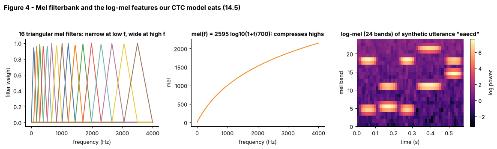

## 14.5 Mel spectrograms

Metadata:

- Tier: 14 — Speech, Audio & Video AI
- Phase: 2 — Transformers & Foundation Models
- Priority: Critical
- Difficulty: Intermediate
- Interview Importance: High
- Hands-on Importance: Very high
- Prerequisites: [14.4 Spectrograms](14.04-spectrograms.md)
- Leads To: [14.6 Audio preprocessing](14.06-audio-preprocessing.md), [14.7 Audio embeddings](14.07-audio-embeddings.md), [14.9 Automatic Speech Recognition (ASR)](14.09-automatic-speech-recognition-asr.md), [14.12 Whisper as an ASR case study](14.12-whisper-as-an-asr-case-study.md), [14.17 Vocoders](14.17-vocoders.md)

---

### 1. WHAT IS IT?

A mel spectrogram applies a bank of overlapping triangular filters, spaced evenly on the *mel* (perceptual pitch) scale, to each STFT power frame, then usually takes a log. It compresses hundreds of linear frequency bins into 20-128 perceptually motivated bands.

### 2. WHY DOES IT EXIST?

Humans resolve low frequencies finely and high frequencies coarsely. A linear spectrogram wastes resolution up high and has too many bins. The mel scale gives a smaller, more informative feature that works better for speech and is the de-facto input for ASR and TTS.

### 3. DETAILED EXPLANATION

**Mel scale.** One common formula is `mel(f) = 2595 log10(1 + f / 700)`; roughly linear below ~1 kHz and logarithmic above (other variants exist, e.g. Slaney, `REVIEW_REQUIRED`). Filter centres are equally spaced in mel, so they get wider in Hz as frequency grows (Figure 4, left).

**Filterbank matrix.** Build `FB` of shape `[n_mels, n_fft/2+1]`; mel power = `P @ FB.T`. Then `log(mel + eps)`. The result `[frames, n_mels]` is the log-mel spectrogram. For our toy ASR: 8 kHz, window 256, hop 80, 24 mel bands.

**Choosing `n_mels`.** 80 is a common choice for 16 kHz speech models (some newer ones use 128, `REVIEW_REQUIRED`). Too many mel bands for a short FFT creates empty filters because there are not enough FFT bins at low frequencies; the explorer page makes this visible.

**Normalisation.** Per-utterance or global mean/variance normalisation ([14.6](14.06-audio-preprocessing.md)) follows; models are sensitive to the exact recipe, so reproduce the training front-end exactly.

**Inversion.** Mel features lose both phase and fine frequency detail; going back to audio needs a vocoder ([14.17](14.17-vocoders.md)). MFCCs are a further step (DCT of log-mel), common in classical ASR (`REVIEW_REQUIRED` for current usage).

### 4. HOW DOES IT WORK?



*Figure 4 - Left: 16 triangular filters, narrow near 0 and wide near 4 kHz. Middle: the mel curve flattens at high frequencies. Right: log-mel of a synthetic 6-symbol utterance: each bright horizontal pair of bands is one 'phoneme' (two tones), exactly what the CTC model of [14.10](14.10-ctc.md) reads.*

Explore: [explore: `spectrogram_mel_explorer.html`](../interactive/spectrogram_mel_explorer.html). Raise `n_mels` and shrink the window until bottom filters collapse; compare the linear and mel panels.

```
STFT power [T, 129] ──@ FB.T [129, n_mels]──► [T, n_mels] ──log──► log-mel
```

### 5. SIMPLE EXAMPLE

A piano keyboard: keys near the middle are close in pitch step but the *musical* distance between octaves is equal. The mel scale spaces frequency bands the way our ears space pitch steps, not the way a ruler spaces Hz.

### 6. TECHNICAL EXAMPLE

A Whisper-style front-end uses 16 kHz audio, 25 ms windows, 10 ms hop and 80 (or 128) mel bins; 30 s of audio becomes an `[80, 3000]` feature matrix (`REVIEW_REQUIRED` for exact model recipes). Our lab: `[121, 24]` for a 1.2 s clip.

### 7. CODE

```python
# run inside lab/
import numpy as np
from audio_core import tone, mel_filterbank, log_mel, hz_to_mel, mel_to_hz

fb = mel_filterbank(n_mels=20, n_fft=256, sr=8000)
print(fb.shape, bool((fb >= 0).all()))                    # (20, 129) True
print(np.allclose(mel_to_hz(hz_to_mel(1000.0)), 1000.0))  # True
lo = log_mel(tone(500, 0.5, 8000), 8000, n_mels=24).mean(0).argmax()
hi = log_mel(tone(3000, 0.5, 8000), 8000, n_mels=24).mean(0).argmax()
print(lo < hi)                                            # True: tone location -> band index
```
Code: [`lab/audio_core.py`](../lab/audio_core.py) | tests: `test_mel_*` in [`lab/test_tier14.py`](../lab/test_tier14.py)

### 8. INPUT → PROCESS → OUTPUT

```
waveform ─► STFT power ─► mel filterbank (n_mels triangles) ─► log ─► [T, n_mels] ─► encoder
```

### 9. ENTERPRISE USE CASE

Speech-to-text and voice-biometric vendors standardise a single log-mel front-end library so training and serving features match exactly; a version bump of that library is treated like a model change and regression-tested.

### 10. AI ENGINEERING CONNECTION

The default input of ASR encoders ([14.9](14.09-automatic-speech-recognition-asr.md), [14.12](14.12-whisper-as-an-asr-case-study.md)) and the intermediate representation predicted by many TTS acoustic models ([14.16](14.16-text-to-speech-tts.md)); mel loss is a common vocoder training term.

### 11. ADVANTAGES

Compact (80 numbers instead of 257+), perceptually motivated, robust, standard across toolkits.

### 12. LIMITATIONS

Hand-designed; discards phase; fixed resolution; implementation variants (mel formula, normalisation, log base) are not interchangeable.

### 13. TRADE-OFFS

More mel bands: more detail, more memory, risk of empty filters. Fewer: cheaper but blurrier.

### 14. COMMON MISTAKES

- Mixing mel variants between training and inference.
- Taking log of zero (add eps).
- Using the wrong `fmax` for the sample rate.
- Treating mel spectrograms as invertible.

### 15. PERFORMANCE / COST CONSIDERATIONS

Mel projection is one matrix multiply, negligible next to the model. Sequence length is set by hop, not by `n_mels`.

### 16. SECURITY CONSIDERATIONS

As with other features, mel spectrograms can often be vocoded back into speech; protect them like audio. Adversarial perturbations on audio propagate through the mel front-end (adversarial examples against ASR, `REVIEW_REQUIRED`).

### 17. INTERVIEW EXPLANATION

*"A mel spectrogram runs the STFT power through triangular filters spaced on the perceptual mel scale, then takes a log. That gives a compact, ear-like feature with fine resolution at low frequencies. It is the standard front-end for speech models, but you have to reproduce the exact recipe at serving time, and it throws away phase."*

### 18. RAPID-FIRE ANSWER

STFT power pooled by perceptually spaced triangular filters and log-compressed: the standard speech feature.

### 19. INTERVIEW QUESTIONS

- **Basic:** What is the mel scale for?
- **Intermediate:** Why are mel filters wider at high frequencies?
- **Advanced:** Why can too many mel bands with a small FFT give empty filters?
- **Scenario:** Production WER jumps after a library upgrade though weights are unchanged. What front-end differences do you check?

### 20. HANDS-ON EXERCISE

Compute log-mel with n_mels in {8, 24, 80} for the same utterance (use `synth_utterance`). Count filters with zero total weight for win=128 and n_mels=80.

### 21. REVISION QUESTIONS

1. Write the mel formula.
2. What shape is a filterbank matrix?
3. What information does log-mel discard?

### 22. RELATED CONCEPTS

[14.4 Spectrograms](14.04-spectrograms.md), [14.6 Audio preprocessing](14.06-audio-preprocessing.md), [14.7 Audio embeddings](14.07-audio-embeddings.md), [14.9 Automatic Speech Recognition (ASR)](14.09-automatic-speech-recognition-asr.md), [14.17 Vocoders](14.17-vocoders.md)

### 23. ONE-LINE MEMORY HOOK

*Mel features listen like an ear: sharp on the bass, blurry on the treble.*
