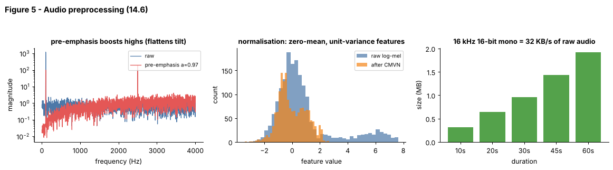

## 14.6 Audio preprocessing

Metadata:

- Tier: 14 — Speech, Audio & Video AI
- Phase: 2 — Transformers & Foundation Models
- Priority: High
- Difficulty: Beginner
- Interview Importance: Medium
- Hands-on Importance: Very high
- Prerequisites: [14.2 Sampling rate](14.02-sampling-rate.md), [14.4 Spectrograms](14.04-spectrograms.md), [14.5 Mel spectrograms](14.05-mel-spectrograms.md)
- Leads To: [14.9 Automatic Speech Recognition (ASR)](14.09-automatic-speech-recognition-asr.md), [14.13 Speech segmentation](14.13-speech-segmentation.md), [14.18 Streaming speech](14.18-streaming-speech.md)

---

### 1. WHAT IS IT?

Audio preprocessing is everything done to raw audio before the model: decode, mono mix, resample, trim/pad, normalise level, optional pre-emphasis, framing and feature extraction, feature normalisation (CMVN), and augmentation.

### 2. WHY DOES IT EXIST?

Models are trained on a specific input recipe. Differences in sample rate, level, noise or padding change features and hurt accuracy; careful preprocessing makes data consistent, cheaper and more robust.

### 3. DETAILED EXPLANATION

**Typical pipeline.** decode file -> convert to mono -> resample to the model rate ([14.2](14.02-sampling-rate.md)) -> peak or loudness normalise -> (optional) trim leading/trailing silence with VAD ([14.13](14.13-speech-segmentation.md)) -> pad or trim to fixed length / chunk -> STFT/log-mel ([14.5](14.05-mel-spectrograms.md)) -> mean-variance normalise.

**Pre-emphasis.** `y[n] = x[n] - a x[n-1]` with `a` about 0.97 boosts high frequencies to counter the spectral tilt of speech (Figure 5, left; classical ASR habit, optional today).

**CMVN.** Cepstral/feature mean and variance normalisation subtracts the per-utterance mean and divides by the standard deviation for each feature dimension over time, removing constant channel/microphone effects and scale (Figure 5, middle).

**Padding and trimming.** Batches need equal length; Whisper-style models pad/trim to 30 s windows (`REVIEW_REQUIRED`). Padding must be masked in the model or it looks like silence.

**Augmentation (training only).** Add noise at random SNR, change speed, add reverberation, SpecAugment (mask time/frequency stripes of the spectrogram) (`REVIEW_REQUIRED` for exact recipes). Augmentation must never be applied at evaluation.

**Train/serve parity.** Put the whole preprocessing recipe in one function used by both training and serving.

### 4. HOW DOES IT WORK?



*Figure 5 - Left: pre-emphasis lifts the high-frequency tone relative to the strong low tone. Middle: raw log-mel values spread over a wide, shifted range; after CMVN they are centred and unit-scaled. Right: raw 16 kHz 16-bit audio is 32 KB/s.*

### 5. SIMPLE EXAMPLE

Washing and cutting vegetables before cooking: same size pieces, no dirt, so the recipe (the model) behaves predictably.

### 6. TECHNICAL EXAMPLE

The lab's `make_dataset` builds waveform -> `log_mel(..., hop=80)` -> `cmvn`, producing `[T, 24]` features with zero mean and unit variance per band, which stabilises CTC training.

### 7. CODE

```python
# run inside lab/
import numpy as np
from audio_core import pre_emphasis, peak_normalize, cmvn, pad_or_trim, log_mel, tone, noise

x = tone(300, 0.5, 8000, amp=0.2) + noise(0.5, 8000, 0.01, seed=0)
x = peak_normalize(x)                       # level normalisation
x = pad_or_trim(x, 8000)                    # fixed 1 s window
f = cmvn(log_mel(pre_emphasis(x), 8000, n_mels=24))
print(f.shape, np.allclose(f.mean(0), 0, atol=1e-6), np.allclose(f.std(0), 1, atol=1e-3))
```
Code: [`lab/audio_core.py`](../lab/audio_core.py)

### 8. INPUT → PROCESS → OUTPUT

```
file ─► decode ─► mono ─► resample ─► level-norm ─► trim/pad ─► log-mel ─► CMVN ─► model
```

### 9. ENTERPRISE USE CASE

A transcription service defines one versioned preprocessing spec (sample rate, loudness target, chunk size) in its model card; changing it triggers revalidation on a golden audio set.

### 10. AI ENGINEERING CONNECTION

Preprocessing mismatch is one of the most common silent causes of speech-model degradation; it is the audio analogue of tokenizer mismatch in [Tier 6](../../tier-06-tokenization-embeddings/README.md).

### 11. ADVANTAGES

Cheap robustness gains; consistent inputs; smaller data.

### 12. LIMITATIONS

Hand-tuned choices can discard signal (aggressive trimming, noise gating); augmentation realism is limited.

### 13. TRADE-OFFS

More normalisation: stability but possible loss of loudness cues. More augmentation: robustness but slower training and risk of unrealistic data.

### 14. COMMON MISTAKES

- Different preprocessing in training and serving.
- Normalising with statistics from the *test* set.
- Padding without a mask.
- Applying augmentation in evaluation.
- Clipping after gain normalisation.

### 15. PERFORMANCE / COST CONSIDERATIONS

Decode + resample can dominate CPU for short clips at high volume; cache resampled audio, use vectorised libraries, avoid per-sample Python loops.

### 16. SECURITY CONSIDERATIONS

Decoders (ffmpeg-class libraries) parse untrusted binary formats: restrict formats, enforce size/duration limits, run in a sandbox and keep them patched. Loudness normalisation can amplify hidden low-level adversarial signals.

### 17. INTERVIEW EXPLANATION

*"Preprocessing turns arbitrary uploaded audio into the exact format the model was trained on: mono, right sample rate, normalised level, fixed windows, log-mel features, normalised. The key is that training and serving share the same code, because mismatched preprocessing silently hurts accuracy. Augmentation is applied only in training."*

### 18. RAPID-FIRE ANSWER

Make every clip look like the training data: mono, resampled, normalised, padded, featurised.

### 19. INTERVIEW QUESTIONS

- **Basic:** Name four preprocessing steps for ASR.
- **Intermediate:** What does CMVN do?
- **Advanced:** Why must padding be masked?
- **Scenario:** Accuracy drops only for audio from one mobile app. How do you find out whether preprocessing is at fault?

### 20. HANDS-ON EXERCISE

Build a function `prepare(path_or_array, sr_in)` returning log-mel `[T, 24]` and test that it gives identical features for the same clip passed at two different input sample rates.

### 21. REVISION QUESTIONS

1. What is pre-emphasis for?
2. Why per-utterance CMVN?
3. Which preprocessing steps are applied only in training?

### 22. RELATED CONCEPTS

[14.2 Sampling rate](14.02-sampling-rate.md), [14.4 Spectrograms](14.04-spectrograms.md), [14.5 Mel spectrograms](14.05-mel-spectrograms.md), [14.13 Speech segmentation](14.13-speech-segmentation.md), [14.18 Streaming speech](14.18-streaming-speech.md)

### 23. ONE-LINE MEMORY HOOK

*Garbage in, garbage out; make the audio look like what the model grew up on.*
