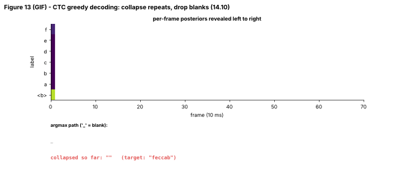

## 14.10 CTC

Metadata:

- Tier: 14 — Speech, Audio & Video AI
- Phase: 2 — Transformers & Foundation Models
- Priority: Critical
- Difficulty: Advanced
- Interview Importance: Very high
- Hands-on Importance: Very high
- Prerequisites: [14.9 Automatic Speech Recognition (ASR)](14.09-automatic-speech-recognition-asr.md), [14.5 Mel spectrograms](14.05-mel-spectrograms.md)
- Leads To: [14.11 Encoder-decoder ASR](14.11-encoder-decoder-asr.md), [14.15 Timestamps/alignment](14.15-timestamps-alignment.md), [14.18 Streaming speech](14.18-streaming-speech.md)

---

### 1. WHAT IS IT?

Connectionist Temporal Classification (CTC) is a loss and decoding scheme that trains a sequence model to map `T` input frames to a shorter label sequence without frame-level alignments. It adds a blank symbol and defines a many-to-one collapse: merge repeated labels, then remove blanks.

### 2. WHY DOES IT EXIST?

Labeling every 10 ms frame by hand is impractical, and we usually only have transcripts. CTC marginalises over *all* alignments consistent with the transcript, so the network learns where labels occur by itself.

### 3. DETAILED EXPLANATION

**The collapse map B.** Frame path `_ h h _ e e _ l l _ l _ o o _` -> merge repeats -> `_ h _ e _ l _ l _ o _` -> drop blanks -> `hello`. The blank between the two `l` groups is what lets 'll' survive. A path `l l` with no blank collapses to a single `l` (Figure 13 shows this live; the explorer lets you type paths).

**Training.** For target `y` the probability is `P(y|x) = sum over paths pi with B(pi)=y of prod_t p_t(pi_t)`. The number of paths is exponential in `T`, but a dynamic-programming forward-backward algorithm over the *extended sequence* (blank, y1, blank, y2, ..., blank) computes the sum in `O(T x |y|)`. Loss = `-log P(y|x)`; in PyTorch: `F.ctc_loss(log_probs[T,B,V], targets, input_lengths, target_lengths, blank=0)`.

**Properties.** Frame outputs are conditionally independent given the input (so there is no built-in language model), alignment is monotonic, outputs are *peaky* (a spike of a label for one or a few frames, blank elsewhere; Figure 7), and the model must emit at most one label per frame so `T >= |y|` (plus extra frames for repeated labels).

**Decoding.**
- *Greedy:* take argmax per frame, collapse. Fast; ignores that many paths map to the same text.
- *Prefix beam search:* track, for each text prefix, the summed probability of ending in blank vs non-blank; merges paths that collapse to the same text. The lab's `prefix_beam_search` implements this; a test builds a 2-frame case where greedy gives `''` (blank 0.55 per frame) while the beam gives `'a'` because the total mass of all paths collapsing to `a` is `1 - 0.55^2 = 0.70` > 0.30.
- *With an LM:* shallow fusion or rescoring (`REVIEW_REQUIRED` for current toolkits).

**Forced alignment** (known text) uses the same trellis with Viterbi: see [14.15](14.15-timestamps-alignment.md).

### 4. HOW DOES IT WORK?



*Figure 13 (GIF) - The posteriors are revealed left to right. Bottom: the argmax path (`_` is blank) and the collapsed text so far, converging to the target.*


*Figure 7 - Peaky label posteriors, blanks between them, white bands = forced alignment, bottom left = training loss (log scale, plateau then sudden drop typical of CTC).*

Type your own frame paths in [explore: `ctc_wer_lab.html`](../interactive/ctc_wer_lab.html).

```
frame posteriors [T,V] ─► argmax ─► path ─► merge repeats ─► drop blank ─► text
loss: -log SUM_{paths that collapse to target} PROD_t p_t(path_t)   (forward-backward DP)
```

### 5. SIMPLE EXAMPLE

You tap a metronome while someone spells a word: some taps land on a letter, some on a pause. To read the word you write down each new letter and ignore pauses; a double letter needs a pause in between so you know it was said twice.

### 6. TECHNICAL EXAMPLE

The lab's `FramewiseCTC` outputs `[T, 7]` log-probabilities (blank + 6 symbols). `train` calls `F.ctc_loss`; `greedy_decode` and `prefix_beam_search` decode; the model typically sits on an 'all blank' plateau for several epochs before alignments emerge.

### 7. CODE

```python
# run inside lab/ -- collapse, greedy vs beam on hand-made posteriors
import numpy as np
from ctc_asr import ctc_collapse, greedy_decode, prefix_beam_search, VOCAB

a = VOCAB.index("a")
print(repr(ctc_collapse([0, a, a, 0, a, 0])))      # 'aa'   (blank separates the repeats)
print(repr(ctc_collapse([a, a, a])))               # 'a'

V = len(VOCAB)
p = np.full((2, V), 1e-6); p[:, 0] = 0.55; p[:, 1] = 0.45 - 1e-6 * (V - 2)
lp = np.log(p / p.sum(1, keepdims=True))
print(repr(greedy_decode(lp)), repr(prefix_beam_search(lp)))   # '' vs 'a'
```
```python
# the training loss (PyTorch): log_probs must be [T, B, V] log-softmax
import torch, torch.nn.functional as F
lp = torch.randn(50, 2, 7).log_softmax(-1)
targets = torch.tensor([1, 2, 3, 4, 2, 2]); tl = torch.tensor([4, 2])   # flattened targets + lengths
loss = F.ctc_loss(lp, targets, input_lengths=torch.tensor([50, 50]), target_lengths=tl, blank=0)
print(float(loss) > 0)
```
Code: [`lab/ctc_asr.py`](../lab/ctc_asr.py) | tests: `test_ctc_collapse`, `test_beam_beats_greedy_on_ambiguous_case`, `test_torch_ctc_loss_matches_perfect_alignment_ordering`.

### 8. INPUT → PROCESS → OUTPUT

```
audio ─► encoder ─► [T,V] log-probs ─┬─ train: CTC loss vs transcript (no alignment needed)
                                     └─ infer: greedy / beam search ─► collapse ─► text
```

### 9. ENTERPRISE USE CASE

Streaming dictation and on-device keyword/command recognition favour CTC-style models because they are small, non-autoregressive and low-latency; they are often paired with an n-gram LM for domain vocabulary.

### 10. AI ENGINEERING CONNECTION

CTC is the canonical example of marginalising over latent alignments; the same ideas appear in OCR and handwriting recognition. CTC heads are also added to encoder-decoder ASR as an auxiliary loss to stabilise alignment (hybrid CTC/attention, `REVIEW_REQUIRED`).

### 11. ADVANTAGES

No alignment labels; fast parallel decoding; streaming-friendly; simple.

### 12. LIMITATIONS

Conditional independence between frames (no built-in LM, so spelling errors), monotonic only, peaky timing, needs `T >= |y|`, plateaus early in training.

### 13. TRADE-OFFS

CTC: speed and streaming vs accuracy of attention models. Greedy vs beam: speed vs a small accuracy gain; beams plus LMs cost more.

### 14. COMMON MISTAKES

- Passing probabilities instead of log-probabilities to `ctc_loss`.
- Wrong tensor layout (`[T,B,V]`, not `[B,T,V]`).
- Using the blank id inside targets.
- Making `T` smaller than the label length after downsampling.
- Applying softmax over the wrong dimension.

### 15. PERFORMANCE / COST CONSIDERATIONS

Loss is `O(T x |y|)` per sample. Encoder downsampling (stride 4-8 frames) cuts T, speeding training and decoding, but must stay above the label rate. Greedy decode is nearly free; prefix beam search cost is `O(T x V x beam)` in this simple implementation.

### 16. SECURITY CONSIDERATIONS

CTC models are vulnerable to targeted adversarial perturbations that steer the output transcript (`REVIEW_REQUIRED`); in command-and-control settings add confirmation steps.

### 17. INTERVIEW EXPLANATION

*"CTC lets you train speech models without frame alignments. It adds a blank token and defines a collapse: merge repeats, drop blanks. The loss sums the probability of every frame path that collapses to the transcript, computed with dynamic programming. It is fast and streams well, but frames are independent so it lacks a language model unless you add one."*

### 18. RAPID-FIRE ANSWER

Blank-augmented per-frame labels trained by summing over all alignments that collapse to the transcript.

### 19. INTERVIEW QUESTIONS

- **Basic:** What does CTC collapse do to `_ a a _ a _ b`?
- **Intermediate:** Why is the blank needed?
- **Advanced:** Why can greedy decoding differ from the most probable text?
- **Scenario:** Your CTC model outputs only blanks after 3 epochs. Is it broken, and what do you try (more epochs, learning rate, feature normalisation, shorter targets)?

### 20. HANDS-ON EXERCISE

Using `prefix_beam_search`, construct a posterior where greedy and beam disagree. Then compute by brute force the probability of each distinct collapsed text over all paths for T=3 and verify the beam picks the best.

### 21. REVISION QUESTIONS

1. State the collapse rule.
2. Why is the exact sum over alignments tractable?
3. Why does CTC need `T >= |y|`?

### 22. RELATED CONCEPTS

[14.9 Automatic Speech Recognition (ASR)](14.09-automatic-speech-recognition-asr.md), [14.11 Encoder-decoder ASR](14.11-encoder-decoder-asr.md), [14.15 Timestamps/alignment](14.15-timestamps-alignment.md), [14.18 Streaming speech](14.18-streaming-speech.md), [14.20 Audio evaluation](14.20-audio-evaluation.md)

### 23. ONE-LINE MEMORY HOOK

*CTC: say a letter once, then let the pause tell you when a repeat is new.*
