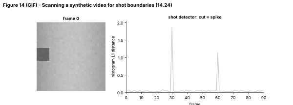

## 14.24 Scene/shot segmentation

Metadata:

- Tier: 14 — Speech, Audio & Video AI
- Phase: 2 — Transformers & Foundation Models
- Priority: High
- Difficulty: Intermediate
- Interview Importance: Medium
- Hands-on Importance: High
- Prerequisites: [14.22 Video frames](14.22-video-frames.md), [14.23 Frame sampling](14.23-frame-sampling.md)
- Leads To: [14.25 Temporal representation](14.25-temporal-representation.md), [14.28 Video-language models](14.28-video-language-models.md), [14.29 Audio-video-text alignment](14.29-audio-video-text-alignment.md), [14.32 Video evaluation](14.32-video-evaluation.md)

---

### 1. WHAT IS IT?

Shot segmentation finds *shot boundaries* (hard cuts, fades, dissolves) where the camera view changes; scene segmentation groups consecutive shots into semantically coherent scenes (same place/time/action).

### 2. WHY DOES IT EXIST?

Shots are natural units for summarising, indexing, thumbnails and sampling (one or more frames per shot). Models see better-conditioned input when clips do not span cuts, and editing tools need cut points.

### 3. DETAILED EXPLANATION

**Hard cut detection (implemented).** For each frame compute an intensity histogram; the L1 distance between consecutive histograms spikes at a hard cut (Figure 10, bottom; `hist_distance`). A threshold decides cuts: `median + 6 x MAD + 0.2` adaptively, with a minimum gap between cuts to avoid duplicates (`detect_shots`). On the synthetic video it finds cuts at exactly frames 30 and 60 and finds none in a single-shot clip (tests).

**Gradual transitions.** Fades and dissolves change slowly, so frame-to-frame differences stay small: compare frames `k` apart, use a twin-threshold or learned detectors (`REVIEW_REQUIRED` for common methods).

**Robustness issues.** Flashes, fast camera motion and large moving objects cause false positives; histogram distance ignores spatial layout (two different scenes with the same colour distribution look similar), so edge or feature-based and learned detectors (e.g. TransNet-style networks, `REVIEW_REQUIRED`) improve accuracy.

**From shots to scenes.** Cluster shot embeddings ([14.27](14.27-video-embeddings.md)) and merge adjacent similar shots, optionally using the audio track (speech continuity, music) and transcript ([14.29](14.29-audio-video-text-alignment.md)).

**Evaluation.** Precision/recall/F1 of detected boundaries within a tolerance of N frames ([14.32](14.32-video-evaluation.md)).

### 4. HOW DOES IT WORK?



*Figure 14 (GIF) - Left: the current frame. Right: histogram distance so far; each spike marks a cut and a dashed red line is drawn once the detector passes it.*


*Figure 10 - Bottom panel: distance 1.8 at the first cut and 1.1 at the second against a baseline near 0.05.*

```
frames ─► histograms ─► L1 distance(t-1,t) ─► adaptive threshold ─► min-gap filter ─► cut indices
```

### 5. SIMPLE EXAMPLE

Watching TV with the sound off: you know a new shot started because the picture suddenly looks different.

### 6. TECHNICAL EXAMPLE

The lab detector returns `[30, 60]` for the 3-shot synthetic clip; a deployed system would run on downscaled frames (e.g. 64x64) for speed and produce keyframes (middle frame of each shot) for indexing.

### 7. CODE

```python
# run inside lab/
from video_core import synth_video, hist_distance, detect_shots
import numpy as np

v = synth_video(90, 32, shots=(30, 60))
d = hist_distance(v)
print(detect_shots(v))                         # [30, 60]
print(round(float(d[29]), 2), round(float(np.median(d)), 3))   # spike vs baseline
print(detect_shots(synth_video(60, 32, shots=())))             # [] no false positives on one shot
```
Code: [`lab/video_core.py`](../lab/video_core.py) | tests: `test_shot_detector_finds_cuts`, `test_shot_detector_no_false_positive_single_shot`.

### 8. INPUT → PROCESS → OUTPUT

```
video ─► frame features ─► boundary scores ─► cuts ─► shots (start,end) ─► keyframes / embeddings ─► scenes
```

### 9. ENTERPRISE USE CASE

Broadcasters auto-generate chapter markers and thumbnails; video-editing software splits footage by shot; search indexes store one embedding per shot.

### 10. AI ENGINEERING CONNECTION

Shot boundaries define retrieval and sampling units for video-language systems ([14.28](14.28-video-language-models.md)) and chunk boundaries for audio-video-text alignment ([14.29](14.29-audio-video-text-alignment.md)).

### 11. ADVANTAGES

Cheap and effective for hard cuts; produces meaningful units.

### 12. LIMITATIONS

Gradual transitions, flashes and motion cause errors; histogram methods ignore layout; scene boundaries are subjective.

### 13. TRADE-OFFS

Simple threshold methods are fast but brittle; learned detectors are robust but heavier.

### 14. COMMON MISTAKES

- A fixed threshold across all content types.
- No minimum gap (double detections).
- Detecting at full resolution (slow).
- Treating shot boundaries as scene boundaries.

### 15. PERFORMANCE / COST CONSIDERATIONS

Histogram detection is O(pixels) per frame, usually negligible next to decode; run on downscaled frames.

### 16. SECURITY CONSIDERATIONS

Not a major security surface, but cut detection can be evaded by injecting adversarial flashes to fragment content for moderation systems; combine with other signals.

### 17. INTERVIEW EXPLANATION

*"I detect hard cuts by comparing histograms of consecutive frames and flagging spikes above an adaptive threshold with a minimum gap. Gradual transitions need multi-frame comparisons or learned detectors. Shots then become units for sampling and indexing, and scenes are made by merging similar adjacent shots."*

### 18. RAPID-FIRE ANSWER

Detect spikes in frame-to-frame difference to find cuts; group shots into scenes by similarity.

### 19. INTERVIEW QUESTIONS

- **Basic:** What signal does a hard-cut detector use?
- **Intermediate:** Why does a fixed threshold fail across videos?
- **Advanced:** How would you detect a dissolve?
- **Scenario:** A detector produces dozens of false cuts on a concert video with strobe lights. What changes?

### 20. HANDS-ON EXERCISE

Add a 10-frame linear fade between shots to `synth_video` (or blend two shots) and show that frame-to-frame detection fails but a k=10 comparison succeeds.

### 21. REVISION QUESTIONS

1. What does MAD stand for here and why use it?
2. Why enforce a minimum gap?
3. Difference between shot and scene.

### 22. RELATED CONCEPTS

[14.22 Video frames](14.22-video-frames.md), [14.23 Frame sampling](14.23-frame-sampling.md), [14.27 Video embeddings](14.27-video-embeddings.md), [14.28 Video-language models](14.28-video-language-models.md), [14.29 Audio-video-text alignment](14.29-audio-video-text-alignment.md), [14.32 Video evaluation](14.32-video-evaluation.md)

### 23. ONE-LINE MEMORY HOOK

*A cut is a spike in how different this frame is from the last.*
