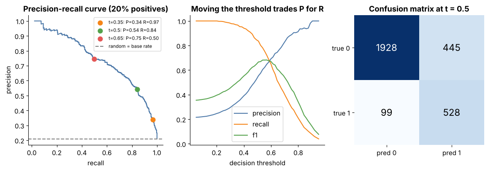

## 15.9 Accuracy

Metadata:

- Tier: 15 — Foundation-Model Evaluation & Safety
- Phase: 2 — Transformers & Foundation Models
- Priority: Critical
- Difficulty: Beginner
- Interview Importance: Very high
- Hands-on Importance: High
- Prerequisites: [15.8 Task-specific evaluation](15.08-task-specific-evaluation.md)
- Leads To: [15.10 Precision/recall/F1 in model evaluation](15.10-precision-recall-f1-in-model-evaluation.md), [15.11 Calibration](15.11-calibration.md), [15.6 Benchmark design](15.06-benchmark-design.md)

---

### 1. WHAT IS IT?

Accuracy is the fraction of predictions that match the reference: (TP+TN)/N for binary tasks.

### 2. WHY DOES IT EXIST?

It is the simplest summary of correctness and the natural first metric for balanced classification and multiple-choice tasks.

### 3. DETAILED EXPLANATION

Accuracy = correct / total. Hand check: predictions [1,0,0,1] against labels [1,0,1,1] give 3/4 = 0.75.

Pitfalls:
- **Class imbalance**: with 1% positives, always predicting 'negative' scores 99% accuracy while finding nothing ([15.10 Precision/recall/F1 in model evaluation](15.10-precision-recall-f1-in-model-evaluation.md)).
- **Chance level**: 4-option multiple choice has chance 25%; report accuracy relative to chance and to a trivial baseline.
- **Uncertainty**: n=100 gives roughly +/-9 points near 50% ([15.6 Benchmark design](15.06-benchmark-design.md)).
- **Ignores confidence**: a 51% and a 99% correct answer count equally ([15.11 Calibration](15.11-calibration.md)).
- **Ignores error cost**: false negatives and positives may cost very differently.

### 4. HOW DOES IT WORK?

Compare each prediction to its label; average the matches; attach an interval.



*Figure 2 - Precision/recall/F1 against decision threshold, the PR curve and a confusion matrix for a 20%-positive problem. Look for: accuracy would hide the precision/recall trade-off this figure shows.*

Play with it: [explore `prf_threshold.html`](../interactive/prf_threshold.html) (controls: threshold, class separation, positive base rate).

### 5. SIMPLE EXAMPLE

A teacher's test score: 8 of 10 correct = 80%.

### 6. TECHNICAL EXAMPLE

Spam filter with 1% spam: predicting 'not spam' always yields accuracy 0.99 and recall 0. See Figure 2 and the explorer; raise 'positive base rate' down to 0.02 to see accuracy mislead.

### 7. CODE

```python
# run inside lab/
from metrics import accuracy, prf1
y = [0] * 99 + [1]
pred = [0] * 100
print("accuracy", accuracy(y, pred), "recall", prf1(y, pred)["recall"])   # 0.99 vs 0.0
```

Lab code: [`lab/metrics.py`](../lab/metrics.py).

### 8. INPUT → PROCESS → OUTPUT

```
predictions + labels -> match 1/0 -> mean -> accuracy (+ CI)
```

### 9. ENTERPRISE USE CASE

Used as a headline metric only when classes are balanced and costs symmetric; otherwise per-class recall and cost-weighted metrics are used.

### 10. AI ENGINEERING CONNECTION

Multiple-choice benchmarks report accuracy; generative tasks need other scorers ([15.8 Task-specific evaluation](15.08-task-specific-evaluation.md)).

### 11. ADVANTAGES

- Simple, universal, interpretable.

### 12. LIMITATIONS

- Misleading under imbalance; ignores confidence and cost.

### 13. TRADE-OFFS

- Simplicity vs informativeness.

### 14. COMMON MISTAKES

- Reporting accuracy on imbalanced data alone.
- No baseline or interval.

### 15. PERFORMANCE / COST CONSIDERATIONS

Trivial to compute.

### 16. SECURITY CONSIDERATIONS

Attackers can target the minority class where accuracy hides failure.

### 17. INTERVIEW EXPLANATION

Accuracy is the share of correct predictions. It is fine for balanced problems but misleads under imbalance and ignores confidence and error cost, so I pair it with precision/recall, a baseline and a confidence interval.

### 18. RAPID-FIRE ANSWER

Correct/total; beware imbalance.

### 19. INTERVIEW QUESTIONS

- **Basic:** Define accuracy.
- **Intermediate:** Why is 99% accuracy not necessarily good?
- **Advanced:** Compute the baseline accuracy for a 5%-positive set.
- **Scenario:** Fraud model has 98% accuracy; what do you ask?

### 20. HANDS-ON EXERCISE

Use the explorer to find a base rate where a threshold of 1.0 (predict nothing) beats the real model on accuracy.

### 21. REVISION QUESTIONS

- Chance-level accuracy for 5 options?
- Why attach an interval?

### 22. RELATED CONCEPTS

[15.10 Precision/recall/F1 in model evaluation](15.10-precision-recall-f1-in-model-evaluation.md), [15.11 Calibration](15.11-calibration.md), [15.6 Benchmark design](15.06-benchmark-design.md).

### 23. ONE-LINE MEMORY HOOK

Accuracy is an average that can hide the one case you care about.
