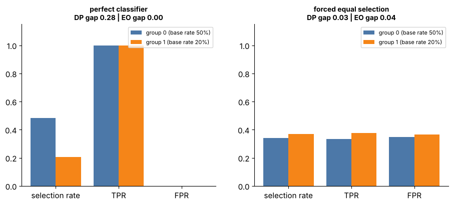

## 15.19 Fairness considerations

Metadata:

- Tier: 15 — Foundation-Model Evaluation & Safety
- Phase: 2 — Transformers & Foundation Models
- Priority: High
- Difficulty: Intermediate
- Interview Importance: High
- Hands-on Importance: Medium
- Prerequisites: [15.18 Bias evaluation](15.18-bias-evaluation.md)
- Leads To: [15.34 Release/readiness criteria](15.34-release-readiness-criteria.md)

---

### 1. WHAT IS IT?

Fairness considerations are the normative and legal choices about which notion of fair treatment applies to a system, how to trade fairness criteria against each other and against accuracy, and who decides.

### 2. WHY DOES IT EXIST?

Measuring gaps ([15.18 Bias evaluation](15.18-bias-evaluation.md)) does not say which gap matters. Different fairness criteria encode different values and can be mathematically incompatible.

### 3. DETAILED EXPLANATION

Common criteria:
- **Demographic parity**: equal selection rates across groups.
- **Equalized odds**: equal TPR and FPR across groups. **Equal opportunity**: equal TPR only.
- **Predictive parity / calibration within groups**: equal precision (or calibration) per group.
- **Individual fairness**: similar individuals receive similar outcomes.
- **Counterfactual fairness**: outcome unchanged if the protected attribute were different.

When base rates differ between groups, a non-trivial classifier cannot satisfy demographic parity, equalized odds and predictive parity simultaneously (known impossibility-style results; REVIEW_REQUIRED for exact conditions). Figure 7: the perfect classifier meets equalized odds but not parity; forcing parity breaks equalized odds. So the choice must be made explicitly, with legal and domain input, documented and revisited.

Other considerations: removing the sensitive feature does not remove proxies; fairness over time and across intersections; transparency and recourse; process fairness (who is in the room).

### 4. HOW DOES IT WORK?

Identify affected groups and harms -> choose criteria with stakeholders -> measure ([15.18 Bias evaluation](15.18-bias-evaluation.md)) -> choose mitigation (data, thresholds per group where lawful, review) -> document -> monitor.



*Figure 7 - A perfect classifier satisfies equalized odds yet violates demographic parity when base rates differ; forcing parity breaks equalized odds. Both cannot hold at once here.*

Play with it: [explore `fairness_metrics.html`](../interactive/fairness_metrics.html) (controls: per-group base rate, TPR and FPR).

### 5. SIMPLE EXAMPLE

Two referees can both be 'fair': one gives each team the same number of penalties, another penalises the same fouls equally. Which is fairer depends on what you value.

### 6. TECHNICAL EXAMPLE

Loan model: equal opportunity (equal TPR for creditworthy applicants) is chosen; the team documents the accepted precision gap and the legal review.

### 7. CODE

```python
# run inside lab/ -- the tension in numbers: perfect predictor, different base rates
import numpy as np
from metrics import demographic_parity_diff, equalized_odds_diff
y = np.array([1]*50 + [0]*50 + [1]*10 + [0]*90); g = np.array(["a"]*100 + ["b"]*100)
print("perfect predictor: DP gap", round(demographic_parity_diff(y, g), 2), " EO gap", equalized_odds_diff(y, y, g))
```

Lab code: [`lab/metrics.py`](../lab/metrics.py).

### 8. INPUT → PROCESS → OUTPUT

```
harms + stakeholders -> criterion choice (documented) -> measurement -> mitigation -> monitoring
```

### 9. ENTERPRISE USE CASE

Fairness review boards sign off criteria; engineering implements measurement; legal checks applicable law (varies by jurisdiction, REVIEW_REQUIRED).

### 10. AI ENGINEERING CONNECTION

LLM applications that rank, screen or advise inherit these choices; generative outputs add representational harms.

### 11. ADVANTAGES

- Forces explicit, auditable choices.

### 12. LIMITATIONS

- No universal criterion; legal rules differ; measurement needs sensitive data.

### 13. TRADE-OFFS

- Fairness criteria vs each other vs accuracy.

### 14. COMMON MISTAKES

- Believing one metric settles fairness.
- Dropping the attribute and calling it done.
- Ignoring intersections.

### 15. PERFORMANCE / COST CONSIDERATIONS

Mitigation may cost accuracy; review costs time.

### 16. SECURITY CONSIDERATIONS

Sensitive attributes need strict access control and purpose limitation.

### 17. INTERVIEW EXPLANATION

Fairness has several incompatible formal definitions: parity, equalized odds, predictive parity, individual and counterfactual fairness. When base rates differ they cannot all hold, so the criterion is a documented normative and legal decision; I measure the chosen one, track the others and monitor over time.

### 18. RAPID-FIRE ANSWER

Choose the fairness criterion deliberately; they conflict when base rates differ.

### 19. INTERVIEW QUESTIONS

- **Basic:** Name three fairness criteria.
- **Intermediate:** Why can't demographic parity and equalized odds both hold?
- **Advanced:** Why isn't dropping the sensitive feature enough?
- **Scenario:** Legal wants parity, the product owner wants equal opportunity; how do you proceed?

### 20. HANDS-ON EXERCISE

Use the explorer to find group rates where parity gap is 0 but the equalized-odds gap is large.

### 21. REVISION QUESTIONS

- Define equal opportunity.
- What are proxies?

### 22. RELATED CONCEPTS

[15.18 Bias evaluation](15.18-bias-evaluation.md), [15.34 Release/readiness criteria](15.34-release-readiness-criteria.md).

### 23. ONE-LINE MEMORY HOOK

Fairness is a choice among competing definitions, not a number you find.
