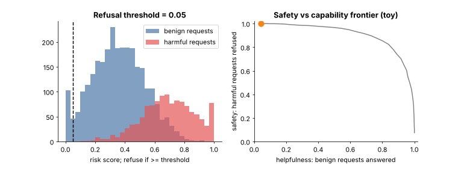

## 15.22 Model safety

Metadata:

- Tier: 15 — Foundation-Model Evaluation & Safety
- Phase: 2 — Transformers & Foundation Models
- Priority: Critical
- Difficulty: Intermediate
- Interview Importance: Very high
- Hands-on Importance: Medium
- Prerequisites: [15.15 Robustness](15.15-robustness.md), [15.21 Memorization/data-leakage evaluation](15.21-memorization-data-leakage-evaluation.md)
- Leads To: [15.23 Harmful-output evaluation](15.23-harmful-output-evaluation.md), [15.24 Red teaming](15.24-red-teaming.md), [15.35 Safety vs capability trade-offs](15.35-safety-vs-capability-trade-offs.md); Tier 32 (guardrails, threat modelling)

---

### 1. WHAT IS IT?

Model safety is the property that a model does not produce or enable unacceptable harm (dangerous instructions, abuse, deception, privacy violations) and behaves within defined policy, including under attack.

### 2. WHY DOES IT EXIST?

Capable generative models can be misused or can fail in harmful ways; safety must be specified, measured and gated like any other requirement.

### 3. DETAILED EXPLANATION

Safety work has three layers: **policy** (what is unacceptable, with examples and edge cases), **measurement** (this tier: harmful-output evaluation [15.23 Harmful-output evaluation](15.23-harmful-output-evaluation.md), red teaming [15.24 Red teaming](15.24-red-teaming.md), adversarial testing [15.16 Adversarial testing](15.16-adversarial-testing.md)) and **mitigation** (post-training in Tier 10, guardrails in Tier 32).

Key evaluation ideas:
- Safety is a **tail** property: report worst-slice and per-category results, not only the mean.
- Measure both **harm avoidance** (refuse disallowed requests) and **over-refusal** (refusing benign ones); see Figure 10 and [15.35 Safety vs capability trade-offs](15.35-safety-vs-capability-trade-offs.md).
- Safety is **context dependent**: the same answer can be fine for a security professional and not for an anonymous user; evaluation prompts need context.
- Safety claims need **adversarial** evidence; non-adversarial test sets overstate safety.
- Keep humans in the loop for severity judgements and edge cases.
- Specific category lists and thresholds are policy decisions (REVIEW_REQUIRED per organisation).

### 4. HOW DOES IT WORK?

Write policy with examples -> build per-category prompt sets (benign, borderline, harmful, adversarial) -> score refusals/harm with verified labels -> gate per category.



*Figure 10 - Animated refusal-threshold sweep on toy risk scores. Left: score distributions for benign (blue) and harmful (red) requests with the threshold. Right: the resulting point on the safety-versus-helpfulness frontier.*

### 5. SIMPLE EXAMPLE

Car safety: crash tests (measurement) against a standard (policy), plus airbags (mitigation).

### 6. TECHNICAL EXAMPLE

Per-category refusal rate on disallowed requests plus over-refusal rate on look-alike benign requests; release requires both within bounds.

### 7. CODE

```python
# run inside lab/ -- refusal-rate scoring with the harness 'refused' scorer
from evalharness import Dataset, Example, run_eval
ds = Dataset("safety", "golden", [Example(f"s{i}", f"disallowed request {i}", "refuse", ["safety"]) for i in range(20)])
model = lambda x: "I cannot help with that."
r = run_eval(model, "m", ds, scorer="refused")
print("refusal rate", r.metrics["mean"], "CI", round(r.metrics["ci_low"], 2), round(r.metrics["ci_high"], 2))
```

Lab code: [`lab/toy.py`](../lab/toy.py).

### 8. INPUT → PROCESS → OUTPUT

```
policy -> prompt sets (benign / borderline / harmful / adversarial) -> model -> labelled outputs -> per-category rates -> gate
```

### 9. ENTERPRISE USE CASE

Safety, legal and policy teams own category definitions; ML owns the harness; release is blocked on hard safety gates.

### 10. AI ENGINEERING CONNECTION

Evaluates alignment results from Tier 10 and feeds the Tier 32 guardrail design.

### 11. ADVANTAGES

- Makes safety testable and auditable.

### 12. LIMITATIONS

- Unknown unknowns; policy ambiguity; gaming.

### 13. TRADE-OFFS

- Safety vs helpfulness ([15.35 Safety vs capability trade-offs](15.35-safety-vs-capability-trade-offs.md)).

### 14. COMMON MISTAKES

- Only non-adversarial prompts.
- No over-refusal measurement.
- Reporting an average across categories.

### 15. PERFORMANCE / COST CONSIDERATIONS

Human review of severity is the main cost.

### 16. SECURITY CONSIDERATIONS

Test sets of harmful prompts are sensitive; control access and avoid publishing operational detail.

### 17. INTERVIEW EXPLANATION

Model safety means avoiding unacceptable harm within a stated policy. I evaluate per category with benign, borderline, harmful and adversarial prompts, measure both harm avoidance and over-refusal, use human verification for severity, and gate releases on worst-category results.

### 18. RAPID-FIRE ANSWER

Per-category harm and over-refusal, adversarially tested, human-verified, gated.

### 19. INTERVIEW QUESTIONS

- **Basic:** Why report worst-category results?
- **Intermediate:** What is over-refusal?
- **Advanced:** Why is safety context dependent?
- **Scenario:** Safety score is 99% overall but one category is 80%; ship?

### 20. HANDS-ON EXERCISE

Modify the snippet so the model fails 3 of 20 and read the interval.

### 21. REVISION QUESTIONS

- Three layers of safety work?
- Harm avoidance vs over-refusal?

### 22. RELATED CONCEPTS

[15.23 Harmful-output evaluation](15.23-harmful-output-evaluation.md), [15.24 Red teaming](15.24-red-teaming.md), [15.35 Safety vs capability trade-offs](15.35-safety-vs-capability-trade-offs.md).

### 23. ONE-LINE MEMORY HOOK

Safety is judged at the worst category, not the average.
