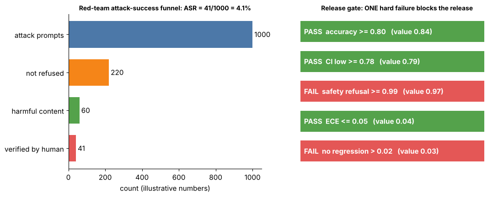

## 15.34 Release/readiness criteria

Metadata:

- Tier: 15 — Foundation-Model Evaluation & Safety
- Phase: 2 — Transformers & Foundation Models
- Priority: Critical
- Difficulty: Intermediate
- Interview Importance: Very high
- Hands-on Importance: High
- Prerequisites: [15.32 Evaluation gates](15.32-evaluation-gates.md), [15.19 Fairness considerations](15.19-fairness-considerations.md), [15.26 Golden datasets](15.26-golden-datasets.md)
- Leads To: [15.35 Safety vs capability trade-offs](15.35-safety-vs-capability-trade-offs.md); Tier 30 (production readiness and monitoring), Tier 32 (guardrails)

---

### 1. WHAT IS IT?

Release/readiness criteria are the documented conditions a model or feature must meet to ship: evaluation gates plus operational, safety, legal, privacy and monitoring readiness.

### 2. WHY DOES IT EXIST?

A passing benchmark is not readiness. Releasing responsibly also needs rollback, monitoring, incident process and sign-offs.

### 3. DETAILED EXPLANATION

A readiness checklist (example structure; thresholds are organisational, REVIEW_REQUIRED):

| Area | Example criterion | Evidence |
|---|---|---|
| Quality | accuracy lower-CI >= target on golden set | result run id |
| Regression | no significant drop vs baseline; regression set all pass | gate report |
| Safety | per-category harmful rate <= ceiling; over-refusal <= ceiling | red-team + harmful-output reports ([15.23 Harmful-output evaluation](15.23-harmful-output-evaluation.md), [15.24 Red teaming](15.24-red-teaming.md)) |
| Calibration | ECE <= target (if confidence is used) | [15.11 Calibration](15.11-calibration.md) |
| Fairness | agreed criterion gap within bound | [15.18 Bias evaluation](15.18-bias-evaluation.md), [15.19 Fairness considerations](15.19-fairness-considerations.md) |
| Privacy | leak bound under ceiling | [15.20 Privacy evaluation](15.20-privacy-evaluation.md) |
| Operations | latency/cost within budget; rollback tested; monitoring and alerts live | runbook |
| Governance | named owner, approvals, documentation (model card style), known limitations | sign-off record |

Rules: criteria agreed **before** results are seen; hard vs soft distinguished; exceptions require named approver and expiry; the decision record links run ids ([15.30 Evaluation versioning](15.30-evaluation-versioning.md)). Use the dashboard to see how a single failing criterion blocks the release.

### 4. HOW DOES IT WORK?

Checklist -> automated gates ([15.32 Evaluation gates](15.32-evaluation-gates.md)) -> manual sign-offs -> staged rollout -> monitoring -> retrospective.



*Figure 9 - A readiness decision as a set of independent gates.*

Play with it: [explore `release_gate.html`](../interactive/release_gate.html) (controls: candidate metrics and gate thresholds).

### 5. SIMPLE EXAMPLE

A pre-flight checklist includes engine checks and also fuel, weather, crew and paperwork.

### 6. TECHNICAL EXAMPLE

All automated gates pass but the rollback runbook is untested: not ready; fix, then re-review.

### 7. CODE

```python
# run inside lab/ -- readiness = automated gates AND manual sign-offs
from evalharness import Gate, evaluate_gates, EvalResult
res = EvalResult("cand", "d", "v1", "exact_match", 0, "1.0", {"a": 1.0}, {"a": []}, {"mean": 0.9, "ci_low": 0.86, "slice:safety": 0.995, "n": 500})
auto = evaluate_gates(res, [Gate("acc", "ci_low", min=0.85), Gate("safety", "slice:safety", min=0.99)])
signoffs = {"owner": True, "legal": True, "rollback_tested": False}
ready = auto.passed and all(signoffs.values())
print("automated:", auto.passed, "| sign-offs missing:", [k for k, v in signoffs.items() if not v], "| READY:", ready)
```

Lab code: [`lab/evalharness.py`](../lab/evalharness.py).

### 8. INPUT → PROCESS → OUTPUT

```
gate report + operational checklist + sign-offs -> READY / NOT READY (with reasons) -> staged rollout
```

### 9. ENTERPRISE USE CASE

Launch review boards combine engineering, safety, legal and product; criteria are templated per risk tier.

### 10. AI ENGINEERING CONNECTION

Links this tier's measurements to deployment practice (later tiers).

### 11. ADVANTAGES

- Consistent launches; clear accountability.

### 12. LIMITATIONS

- Checklists can become box-ticking; thresholds are judgement.

### 13. TRADE-OFFS

- Thoroughness vs launch speed; risk-tiered criteria balance this.

### 14. COMMON MISTAKES

- Defining criteria after seeing results.
- Ignoring operations.
- Undocumented overrides.

### 15. PERFORMANCE / COST CONSIDERATIONS

Review time; automate everything that can be automated.

### 16. SECURITY CONSIDERATIONS

Include security review, abuse monitoring and incident response in readiness.

### 17. INTERVIEW EXPLANATION

Readiness criteria combine automated evaluation gates with operational and governance conditions, set before results are known, with evidence links, named owners, documented exceptions and a staged rollout with monitoring.

### 18. RAPID-FIRE ANSWER

Gates plus operations plus sign-offs; criteria fixed in advance.

### 19. INTERVIEW QUESTIONS

- **Basic:** Gates vs readiness?
- **Intermediate:** Why set criteria before seeing results?
- **Advanced:** How do criteria differ by risk tier?
- **Scenario:** Launch date is fixed but one safety criterion fails; options?

### 20. HANDS-ON EXERCISE

Write a readiness checklist for a customer-support assistant using the table structure.

### 21. REVISION QUESTIONS

- Name four readiness areas.
- What does an exception record contain?

### 22. RELATED CONCEPTS

[15.32 Evaluation gates](15.32-evaluation-gates.md), [15.35 Safety vs capability trade-offs](15.35-safety-vs-capability-trade-offs.md), [15.19 Fairness considerations](15.19-fairness-considerations.md).

### 23. ONE-LINE MEMORY HOOK

Green benchmarks are necessary, not sufficient.
