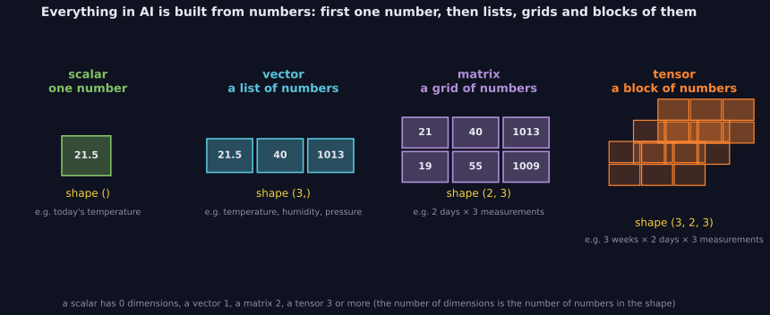
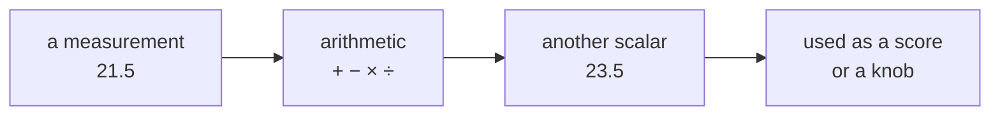

> Tier 1 · Mathematics for AI · **Level: absolute beginner** · Reading time: about 6 minutes

# 1.1 Scalars

**Metadata** — Tier: 1 · Phase: 1 · Priority: P0 · Difficulty: 1/5 · Interview: Low · Hands-on: Medium
Prerequisites: none · Leads to: 1.2 Vectors

> **In plain words**
> A **scalar** is just **one number**. Your age, today's temperature, the price of a coffee: each is a scalar.
> AI works with huge piles of numbers, but it all starts here, with one number on its own.

**You need first:** nothing. If you can add and multiply, you are ready.

> **Figure 1.1-1 — from one number to blocks of numbers**
>
> 
>
> *How to read it:* start at the left. A scalar is a single box. Put a few boxes in a row and you get a **vector**; stack rows and you get a **matrix**; stack matrices and you get a **tensor**. The label under each is its *shape*, a way of saying "how many numbers along each direction". A scalar has no directions at all, so its shape is empty: `()`. Concepts 1.2–1.4 climb this ladder one step at a time.
>
> *Generated by* `tier-01-mathematics/figures/src/fig_1_01_dimension_ladder.py`.

**Words you'll meet on this page**

| Word | What it means here |
|---|---|
| scalar | a single number |
| vector, matrix, tensor | a list, a grid, a block of numbers (coming in 1.2–1.4) |
| array | the container NumPy (a Python maths library) uses to hold numbers |
| shape | how many numbers there are along each direction of an array; for a scalar: none, written `()` |
| dimension | one direction of an array; a scalar has 0 of them |
| integer / float | a whole number such as `3` / a number with a decimal point such as `21.5` |

### 1. What is it?
A scalar is a **single number**: `3`, `-0.5`, `21.5`. It tells you *how much* of something, and that is all. It has no direction and no list of positions inside it.

Mathematicians call it "0-dimensional": you cannot move along it in any direction, because it is just a point.

### 2. Why does it exist?
To describe the world we measure things, and every single measurement is a number. A scalar is the **smallest building block**: lists, tables and blocks of numbers are all made of scalars. If one number is clear, the bigger objects are easier.

### 3. Detailed explanation
Think about it in three layers:

1. **Idea.** A scalar answers "how much?" with one number. You can mark it on a number line.
2. **Arithmetic.** You can add, subtract, multiply and divide scalars, and the result is again a scalar: `21.5 + 1 = 22.5`, `21.5 × 2 = 43`.
3. **In a computer.** A computer stores a number with a **type**. Whole numbers are *integers* (`3`). Numbers with decimals are *floats* (`21.5`). You do not need to worry about types yet; just know that the same number can be stored in different ways (concept 1.40 explains why).

### 4. How does it work?
1. Measure something, or compute something. You get one number.
2. Do ordinary arithmetic with it. You get another single number.
3. Later, a scalar can **scale** a list: multiplying every entry of `[1, 2, 3]` by `2` gives `[2, 4, 6]` (concept 1.9).

### 5. Simple example
**A thermostat.** Follow one number from start to finish.

| Step | What happens | The number |
|---|---|---|
| 1 | The sensor reads the room | `21.5` (°C) |
| 2 | You want it 2 degrees warmer | `21.5 + 2` = `23.5` |
| 3 | Heat only half of that gap this minute | `2 × 0.5` = `1.0` |
| 4 | Room temperature after one minute | `21.5 + 1.0` = `22.5` |

Every value in this table is a scalar, and every step turns scalars into another scalar. Nothing here is a list or a grid.

### 6. Technical example
A machine-learning model gets a **score** that says how wrong it is (the *loss*; Tier 2 explains it). The score is **one number**. During training it goes down, for example `0.90 → 0.42 → 0.31`. Before training we also choose a few **knobs**, again single numbers, such as how big each learning step is (`0.001`). The two things you will hear about most in AI, the score and the knobs, are scalars.

### 7. Code
The same idea three ways, from plain Python to the library used for deep learning.

**① By hand (plain Python, no libraries).** A scalar is just a number.

```python
temperature = 21.5            # one measurement
warmer = temperature + 2      # arithmetic gives another single number
print(temperature, warmer, type(temperature).__name__)
```

```text
21.5 23.5 float
```

**② With NumPy.** NumPy holds numbers in *arrays*. A scalar is an array with zero dimensions.

```python
import numpy as np

x = np.array(21.5)            # a 0-dimensional array
print("dimensions:", x.ndim)
print("shape:", x.shape)      # () means: no directions
y = np.array([21.5])          # NOT a scalar: a list that happens to hold one number
print("one-element list has shape:", y.shape)
```

```text
dimensions: 0
shape: ()
one-element list has shape: (1,)
```

**③ With PyTorch.** The deep-learning library used in the rest of the book. It calls its arrays *tensors*.

```python
import torch

x = torch.tensor(21.5)
print("dimensions:", x.ndim, "shape:", tuple(x.shape))
print("as an ordinary Python number:", x.item())
```

```text
dimensions: 0 shape: ()
as an ordinary Python number: 21.5
```

*Notice:* `21.5` and `[21.5]` look alike but have different shapes, `()` versus `(1,)`. That small difference causes real bugs later.

### 8. Input → Process → Output



<details>
<summary><b>Beyond the basics (sections 9–16)</b> — real-world use, limits, mistakes. Skip on a first read.</summary>

### 9. Enterprise use case
Dashboards that watch a service track scalars over time: response time, cost per request, an accuracy score.

### 10. AI engineering connection
Training tries to make one scalar, the loss, smaller. Settings of AI services (how random the answers are, the maximum length) are scalars too.

### 11. Advantages
The simplest possible object: easy to store, plot and compare.

### 12. Limitations
One number cannot describe a complicated thing. A single score hides *why* something is good or bad.

### 13. Trade-offs
One summary number is easy to track, but it can hide problems in one group of users.

### 14. Common mistakes
Mixing up shape `()` with shape `(1,)`; assuming a whole number and a decimal number behave identically when stored in a computer.

### 15. Performance / cost
Reading a number back from a graphics card into Python (`.item()`) makes the card pause. Doing it on every training step is slow; log every N steps instead.

### 16. Security
If a user can supply a number (for example the maximum answer length), check and cap it so one request cannot become very expensive.

</details>

### 17. Interview explanation
"A scalar is a single number with no axes. In machine learning the most important one is the loss, the score we train a model to make smaller; the other scalars are the settings we choose before training."

### 18. Rapid-fire answer
A scalar is a 0-dimensional value (one number); the loss is the scalar that training minimizes.

### 19. Interview questions
- **Basic:** What is the shape of a scalar in NumPy?
- **Intermediate:** What is the difference between `np.array(5)` and `np.array([5])`?
- **Advanced:** Why must a training loss be a single number?
- **Scenario:** Your evaluation score improved by 2 points but users complain. What could the single number be hiding?

### 20. Hands-on exercise
**Goal:** see the difference between a scalar and a one-element list.

1. Create `a = np.array(7)` and `b = np.array([7])`.
2. Print `a.shape` and `b.shape`.
3. Print `(a + b).shape`. Predict the answer *before* you run it.

<details>
<summary>Show a solution</summary>

```python
import numpy as np

a = np.array(7)
b = np.array([7])
print(a.shape, b.shape)
print((a + b).shape)
```

```text
() (1,)
(1,)
```

The scalar is stretched to match the list, so the result is a one-element list, not a scalar. (This "stretching" is called broadcasting; concept 1.7 explains it.)
</details>

### 21. Revision questions
1. How many dimensions does a scalar have?
2. Name three scalars you met today.
3. Why is `[21.5]` not a scalar?

### 22. Related concepts
1.2 Vectors · 1.9 Scalar multiplication · 1.40 Floating-point precision

### 23. One-line memory hook
**A scalar is one number with zero directions.**

<details>
<summary><b>For reviewers</b> (not part of the lesson)</summary>

- Status: DRAFT, learner-first pilot layout (Author: Claude).
- Code blocks are executed by `tests/test_md_snippets.py`; output blocks are filled by `tools/md_snippets.py --fill`.
- Inherited from first draft: `.item()` synchronization applies to GPU tensors (REVIEW_REQUIRED: wording); shape vs "vector dimension" terminology is introduced in 1.6 (glossary entry pending approval).
</details>
