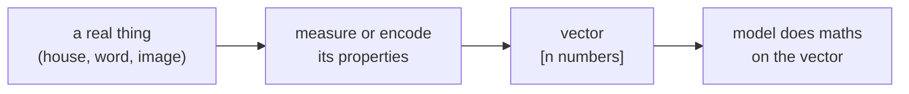

> Tier 1 · Mathematics for AI · **Level: absolute beginner** · Reading time: about 8 minutes

# 1.2 Vectors

**Metadata** — Tier: 1 · Phase: 1 · Priority: P0 · Difficulty: 1/5 · Interview: High · Hands-on: High
Prerequisites: 1.1 Scalars · Leads to: 1.3 Matrices, 1.8–1.10, 1.15–1.17, Tier 6 Embeddings

> **In plain words**
> A **vector** is a **list of numbers in a fixed order**. A house described as `[area, rooms, age] = [120, 3, 15]` is a vector.
> AI turns almost everything (a word, a photo, a customer) into such a list, because computers can only do maths on numbers.

**You need first:** 1.1 Scalars (a scalar is one number). Nothing else.

> **Figure 1.2-1 — one house, written as a vector**
>
> ```mermaid
> flowchart LR
>     H["a house"] --> A["area<br/>120"]
>     H --> R["rooms<br/>3"]
>     H --> Y["age<br/>15"]
>     A --> V["vector<br/>[120, 3, 15]"]
>     R --> V
>     Y --> V
> ```
>
> *How to read it:* each property of the house is one scalar. Lining the scalars up **in a fixed order** gives one object, the vector. The first slot always means area, the second rooms, the third age. If you swapped two slots, you would be describing a different (and strange) house.

**Words you'll meet on this page**

| Word | What it means here |
|---|---|
| vector | an ordered list of numbers |
| component / entry | one number inside the vector |
| dimension (length) | how many numbers the vector holds; `[120, 3, 15]` has dimension 3 |
| feature | one measured property, such as area |
| embedding | a vector that stands for something such as a word (Tier 6) |
| shape `(n,)` | NumPy's way of saying "a list of n numbers" |

### 1. What is it?
A vector is an **ordered list of numbers**: `v = [v₁, v₂, …, vₙ]`. The count `n` is its **dimension**.

Two ways to picture it, and both are useful:

1. **A list of properties.** A house is `[120, 3, 15]`.
2. **An arrow (or a point) in space.** `[3, 2]` means "go 3 steps right and 2 steps up". With three numbers you move in 3-D; with 768 numbers you move in a 768-D space that you cannot draw but can still calculate in.

### 2. Why does it exist?
Real things have **several** measurable properties at once. One scalar cannot describe a house. A vector packs them all into one object so we can do arithmetic on the whole thing in a single step, instead of handling each property separately.

### 3. Detailed explanation
- **Order matters.** `[1, 2]` and `[2, 1]` are different vectors.
- **Length is fixed.** You can only compare or add vectors of the same length.
- **Meaning of a slot.** For a hand-made vector like the house, you know what each slot means. For vectors a model learns (embeddings), the slots have no human-readable meaning on their own; only distances and angles between whole vectors carry meaning.
- **Row or column?** On paper a vector can be written as a row or a column. In NumPy a plain vector has shape `(n,)`, which is neither; shapes `(n, 1)` (column) and `(1, n)` (row) are really matrices (1.3). Mixing them up is a classic bug.

### 4. How does it work?
Vectors support two basic operations: **addition** (1.8) and **scaling** by a scalar (1.9). Add the **dot product** (1.10) and you can measure lengths, angles and similarity. Almost everything in this tier builds on those.

### 5. Simple example
**Colours.** Screens describe every colour with three numbers: how much red, green and blue, each from 0 to 255.

| Colour | Red | Green | Blue | As a vector |
|---|---|---|---|---|
| orange | 255 | 128 | 0 | `[255, 128, 0]` |
| white | 255 | 255 | 255 | `[255, 255, 255]` |
| black | 0 | 0 | 0 | `[0, 0, 0]` |

Each row is a vector of dimension 3. The order (R, G, B) is part of the agreement. `[0, 128, 255]` (blue-ish) is a very different colour from `[255, 128, 0]` (orange), though both use the same numbers.

### 6. Technical example
Every word a language model reads is turned into a vector of, say, 768 numbers (a **token embedding**). Words with similar meanings end up with vectors that are close together. A row of a dataset (one customer, one transaction) is also a vector, called a **feature vector**.

### 7. Code
Same idea three ways.

**① By hand (plain Python).** A vector is a list; you can read entries by position.

```python
house = [120, 3, 15]                     # area, rooms, age
print("length:", len(house))
print("rooms:", house[1])                # counting starts at 0
print("order matters:", [1, 2] == [2, 1])
```

```text
length: 3
rooms: 3
order matters: False
```

**② With NumPy.** An array knows its shape and lets you do maths on all entries at once.

```python
import numpy as np

v = np.array([2.0, -1.0, 0.5])
print("shape:", v.shape, " dimensions:", v.ndim, " length:", len(v))
print("doubled:", v * 2)
col = v.reshape(3, 1)                    # same numbers, now a (3, 1) matrix
print("as a column, shape:", col.shape)
```

```text
shape: (3,)  dimensions: 1  length: 3
doubled: [ 4. -2.  1.]
as a column, shape: (3, 1)
```

**③ With PyTorch.**

```python
import torch

v = torch.tensor([2.0, -1.0, 0.5])
print("shape:", tuple(v.shape), " dtype:", v.dtype)
print("first entry as a Python number:", v[0].item())
```

```text
shape: (3,)  dtype: torch.float32
first entry as a Python number: 2.0
```

### 8. Input → Process → Output



<details>
<summary><b>Beyond the basics (sections 9–16)</b> — real-world use, limits, mistakes. Skip on a first read.</summary>

### 9. Enterprise use case
Vector databases store millions of embedding vectors so that a search can return documents by meaning, not just by matching words.

### 10. AI engineering connection
Embeddings, the hidden states inside a network, and the queries, keys and values of attention are all vectors. Retrieval (Tier 20) is nearest-neighbour search over vectors.

### 11. Advantages
One uniform way to represent anything; modern hardware does vector maths very fast.

### 12. Limitations
Fixed length; learned vectors are not human-readable.

### 13. Trade-offs
More dimensions can describe things more precisely but cost more memory and time, and distances become less informative in very high dimensions (1.16).

### 14. Common mistakes
Confusing row and column vectors; treating shape `(n,)` as `(n, 1)`; comparing vectors made by two different embedding models (their slots mean different things).

### 15. Performance / cost
Memory = number of entries × bytes per entry. One million vectors of 1,536 numbers in float32 take about 6.1 GB.

### 16. Security
Embeddings can leak information about the text they came from. Treat a vector store as sensitive data.

</details>

### 17. Interview explanation
"A vector is just an ordered list of numbers. In AI we use vectors to represent things like words or images so that 'similar' becomes 'close', and then similarity is something we can compute."

### 18. Rapid-fire answer
A vector is a 1-D ordered list of numbers, a point or direction in n-dimensional space.

### 19. Interview questions
- **Basic:** What is a vector? What is its dimension?
- **Intermediate:** What is the difference between shapes `(n,)`, `(n, 1)` and `(1, n)`?
- **Advanced:** Why can't you compare embeddings from two different models?
- **Scenario:** Estimate the storage for 50 million 1,024-dimensional float16 vectors.

### 20. Hands-on exercise
**Goal:** work out how much memory vectors take.

1. One vector has 768 numbers. How many bytes is that in float32 (4 bytes per number)? In float16 (2 bytes)?
2. Multiply by 1,000,000 vectors and give the answer in megabytes (1 MB = 1,000,000 bytes).
3. Check your numbers with NumPy's `.nbytes`.

<details>
<summary>Show a solution</summary>

```python
import numpy as np

one32 = np.zeros(768, dtype=np.float32)
one16 = np.zeros(768, dtype=np.float16)
print("one vector:", one32.nbytes, "bytes (float32),", one16.nbytes, "bytes (float16)")
print("one million:", one32.nbytes * 1_000_000 / 1e6, "MB (float32),", one16.nbytes * 1_000_000 / 1e6, "MB (float16)")
```

```text
one vector: 3072 bytes (float32), 1536 bytes (float16)
one million: 3072.0 MB (float32), 1536.0 MB (float16)
```

Halving the number size halves the memory.
</details>

### 21. Revision questions
1. Does the order of the numbers in a vector matter?
2. What does "dimension" mean for a vector?
3. Why is `[255, 128, 0]` not the same as `[0, 128, 255]`?

### 22. Related concepts
1.3 Matrices · 1.15 Norms · Tier 6 Embeddings

### 23. One-line memory hook
**A vector is a list of numbers where each position has its own meaning.**

<details>
<summary><b>For reviewers</b> (not part of the lesson)</summary>

- Status: DRAFT, learner-first layout (Author: Claude).
- Code blocks are executed by `tests/test_md_snippets.py`.
- The first draft's storage example (1M × 1536 float32 ≈ 6.1 GB) is kept in section 15.
- Figure 1.2-1 is a Mermaid diagram (rendered by GitHub); a plotted arrow figure may be added in a later figure pass.
</details>
