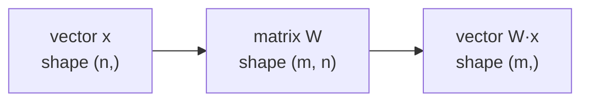

> Tier 1 · Mathematics for AI · **Level: beginner** · Reading time: about 8 minutes

# 1.3 Matrices

**Metadata** — Tier: 1 · Phase: 1 · Priority: P0 · Difficulty: 2/5 · Interview: High · Hands-on: High
Prerequisites: 1.2 Vectors · Leads to: 1.4 Tensors, 1.11–1.14, 1.18–1.19, Tier 3

> **In plain words**
> A **matrix** is a **grid of numbers** with rows and columns, like a spreadsheet.
> It is used in two ways: as a **table of data** (each row is one example) and as a **machine that turns one vector into another vector**. Neural networks are, to a large extent, piles of such machines.

**You need first:** 1.2 Vectors.

> **Figure 1.3-1 — a matrix is rows of vectors**
>
> ```mermaid
> flowchart TB
>     M["matrix, shape (3 rows, 2 columns)"]
>     M --> R1["row 0: [120, 3]   house A"]
>     M --> R2["row 1: [ 80, 2]   house B"]
>     M --> R3["row 2: [200, 5]   house C"]
> ```
>
> *How to read it:* each **row** is one house (a vector of two properties: area and rooms). Stacking three rows gives a matrix of shape `(3, 2)`: 3 rows, 2 columns. To find one number you give its row and then its column: row 1, column 0 is `80`.

**Words you'll meet on this page**

| Word | What it means here |
|---|---|
| matrix | a 2-D grid of numbers |
| row / column | a horizontal / vertical line of entries |
| shape `(m, n)` | `m` rows and `n` columns |
| transpose | flip the grid so rows become columns (1.12) |
| weights | the numbers inside a matrix that a model learns |
| linear map | a rule that turns a vector into another vector by a matrix |

### 1. What is it?
A grid of numbers with `m` rows and `n` columns. Its shape is `(m, n)`. The entry in row `i`, column `j` is written `A[i, j]`.

### 2. Why does it exist?
Two jobs:

1. **Store many vectors at once**: a whole dataset, one example per row.
2. **Represent a transformation**: a matrix can take a vector in and give a new vector out (matrix times vector, 1.11). That is how a neural-network layer works.

### 3. Detailed explanation
**Reading 1: data.** Rows are examples, columns are features. A table of 1,000 customers with 20 properties each is a `(1000, 20)` matrix.

**Reading 2: transformation.** A matrix `W` of shape `(m, n)` takes a vector `x` of length `n` and gives a vector of length `m`. So `W` changes the size and the meaning of the vector. A network layer is exactly this, plus a bias and a non-linearity (Tier 3).

Counting starts at 0 in Python: the first row is row 0.

### 4. How does it work?
- **Indexing:** `A[1, 0]` is row 1, column 0.
- **Whole row or column:** `A[1]` is row 1; `A[:, 0]` is column 0.
- **Matrix–vector and matrix–matrix products** (1.11) apply the transformation.

### 5. Simple example
A spreadsheet of three houses:

| | area | rooms |
|---|---|---|
| house A | 120 | 3 |
| house B | 80 | 2 |
| house C | 200 | 5 |

The six numbers form a `(3, 2)` matrix. A greyscale photo is the same idea: rows × columns of brightness values.

### 6. Technical example
A linear layer computes `y = x Wᵀ + b`. With `W` of shape `(out_features, in_features)`, it turns an `in_features`-long vector into an `out_features`-long one. An **embedding table** is a matrix of shape `(vocabulary size, embedding size)`: row `i` is the vector of word number `i`.

### 7. Code
**① By hand (plain Python).** A matrix is a list of rows.

```python
A = [[120, 3],
     [80, 2],
     [200, 5]]
print("rows:", len(A), " columns:", len(A[0]))
print("row 1, column 0:", A[1][0])
print("column 0:", [row[0] for row in A])
```

```text
rows: 3  columns: 2
row 1, column 0: 80
column 0: [120, 80, 200]
```

**② With NumPy.**

```python
import numpy as np

A = np.array([[120, 3], [80, 2], [200, 5]])
print("shape:", A.shape)
print("A[1, 0] =", A[1, 0])
print("transpose shape:", A.T.shape)
print("column 0:", A[:, 0])
```

```text
shape: (3, 2)
A[1, 0] = 80
transpose shape: (2, 3)
column 0: [120  80 200]
```

**③ With PyTorch.** A tiny "layer": a matrix `W` turning a 3-number vector into a 2-number vector.

```python
import torch

W = torch.tensor([[1., 0., 2.],
                  [0., 1., -1.]])      # shape (2, 3): maps 3 numbers to 2 numbers
x = torch.tensor([3., 4., 5.])
print("W @ x =", (W @ x).tolist(), " output shape:", tuple((W @ x).shape))
```

```text
W @ x = [13.0, -1.0]  output shape: (2,)
```

### 8. Input → Process → Output



<details>
<summary><b>Beyond the basics (sections 9–16)</b> — real-world use, limits, mistakes. Skip on a first read.</summary>

### 9. Enterprise use case
Tabular data feeding fraud-detection models; feature matrices in batch-scoring pipelines.

### 10. AI engineering connection
Weights, attention score tables and embedding tables are matrices. Most of the arithmetic in a Transformer is matrix multiplication.

### 11. Advantages
Maps directly onto GPU hardware, which is built for matrix multiplication.

### 12. Limitations
Only two axes. A batch of sequences needs three axes, so you need tensors (1.4).

### 13. Trade-offs
Dense matrices are simple and fast; sparse formats save memory only when most entries are zero.

### 14. Common mistakes
Swapping rows and columns (PyTorch's `Linear.weight` has shape `(out, in)`); forgetting that memory layout affects speed.

### 15. Performance / cost
A `(m, n)` float32 matrix needs `4·m·n` bytes. A 4096 × 4096 matrix is 64 MiB.

### 16. Security
Model-weight files are valuable matrices. Verify their integrity (checksums) and use safe file formats.

</details>

### 17. Interview explanation
"A matrix is a grid of numbers. I think of it in two ways: as a table of data, or as a function that turns one vector into another. Neural-network weights are matrices."

### 18. Rapid-fire answer
A matrix is a 2-D array; it stores data or represents a linear map.

### 19. Interview questions
- **Basic:** What does shape `(m, n)` mean?
- **Intermediate:** Why is `Linear.weight` shaped `(out, in)` in PyTorch?
- **Advanced:** How many weights does a 4096 → 11008 layer have?
- **Scenario:** Each layer's weights take 64 MiB; how many fit on a 24 GB GPU if 8 GB is reserved?

### 20. Hands-on exercise
**Goal:** predict an output shape before running the code.

1. Build `W` with shape `(3, 4)` and `x` with shape `(4,)`.
2. Write down the shape you expect for `W @ x`.
3. Run it and compare.

<details>
<summary>Show a solution</summary>

```python
import numpy as np

W = np.arange(12.0).reshape(3, 4)
x = np.array([1.0, 0.0, 2.0, -1.0])
print((W @ x).shape, W @ x)
```

```text
(3,) [ 1.  9. 17.]
```

A `(3, 4)` matrix takes 4 numbers in and gives 3 numbers out: the inner sizes (4 and 4) must match and disappear; the outer one (3) remains.
</details>

### 21. Revision questions
1. What does a matrix of shape `(m, n)` map from and to?
2. In a dataset matrix, what do rows and columns stand for?
3. What is `A[1, 0]`?

### 22. Related concepts
1.11 Matrix multiplication · 1.12 Transpose · Tier 3 Neural networks

### 23. One-line memory hook
**A matrix is either a table of data or a machine that turns vectors into vectors.**

<details>
<summary><b>For reviewers</b> (not part of the lesson)</summary>

- Status: DRAFT, learner-first layout (Author: Claude). Code is executed by `tests/test_md_snippets.py`.
- Figure 1.3-1 is a Mermaid diagram; a plotted/3-D picture may be added in a later figure pass.
- 4096 × 4096 float32 = 64 MiB is kept in section 15; the 4096 → 11008 parameter question has answer 45,088,768 (REVIEW: not shown in lesson body).
</details>
