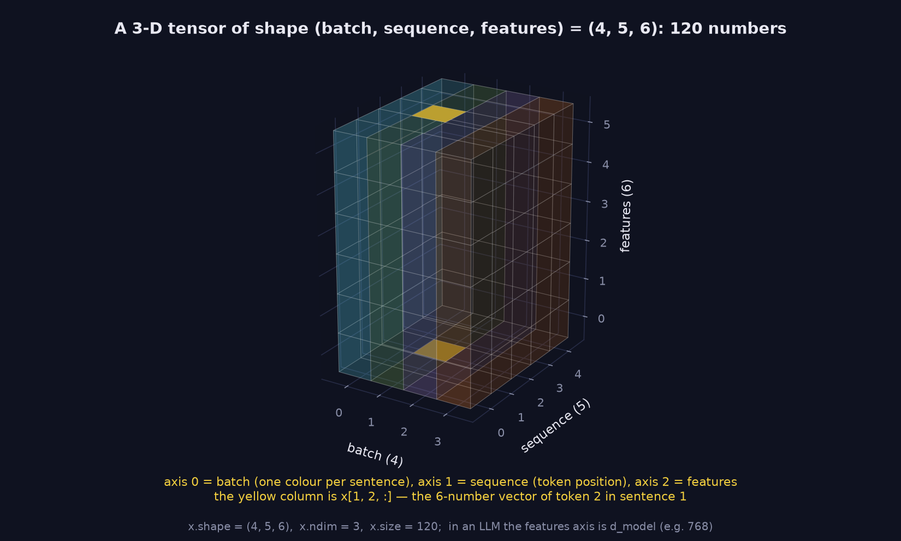
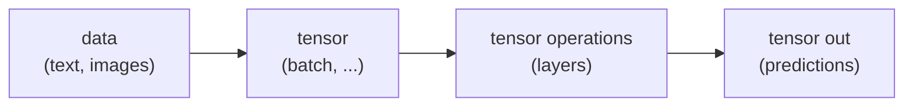

> Tier 1 · Mathematics for AI · **Level: beginner** · Reading time: about 8 minutes

# 1.4 Tensors

**Metadata** — Tier: 1 · Phase: 1 · Priority: P0 · Difficulty: 2/5 · Interview: High · Hands-on: Very high
Prerequisites: 1.1–1.3 · Leads to: 1.5–1.7, Tier 3, Tier 8

> **In plain words**
> A **tensor** is a **block of numbers with any number of directions**. One number is a scalar, a list is a vector, a grid is a matrix, a stack of grids is a 3-D tensor, and so on.
> In deep learning, **all data lives in tensors**: text, images, weights, everything.

**You need first:** 1.1 Scalars, 1.2 Vectors, 1.3 Matrices.

> **Figure 1.4-1 — a batch of sequences is a 3-D tensor**
>
> 
>
> *How to read it:* the block has three directions (axes): **batch** (4 sentences, one colour each), **sequence** (5 word positions) and **features** (6 numbers per word). The yellow column is `x[1, 2, :]`: the 6 numbers describing word 2 of sentence 1. Count the cells: 4 × 5 × 6 = 120 numbers, which is `x.size`. In a real language model the same picture has hundreds or thousands of numbers along the feature axis.
>
> *Generated by* `tier-01-mathematics/figures/src/t1_tensors.py`.

**Words you'll meet on this page**

| Word | What it means here |
|---|---|
| tensor | an n-dimensional block of numbers |
| axis (dimension) | one direction of the block |
| shape | the size along each axis, e.g. `(4, 5, 6)` |
| dtype | how each number is stored, e.g. float32 |
| batch | a group of examples processed together |
| device | where the numbers live: CPU or GPU |

### 1. What is it?
An n-dimensional array of numbers that all share one data type. A scalar is a 0-D tensor, a vector 1-D, a matrix 2-D, and there is no limit on going higher.

### 2. Why does it exist?
Real data has more than two directions. Processing 32 sentences, each with 128 words, each word described by 768 numbers needs three: `(32, 128, 768)`. A colour photo batch needs four: batch × channels × height × width.

### 3. Detailed explanation
- In machine learning "tensor" simply means **multi-dimensional array**, as in NumPy or PyTorch. (Physicists use the word with stricter rules; ignore those here.)
- A tensor has three key properties: **shape**, **dtype** and **device**.
- Deep-learning libraries add two things on top: running on a GPU, and **tracking gradients** so a model can learn (Tier 3).
- "Tensor" does not mean "on the GPU". A tensor can live on the CPU.

### 4. How does it work?
Operations act on all numbers at once ("vectorised"): adding two tensors adds every pair of entries; the library handles the loops far faster than Python could.

### 5. Simple example
A **stack of spreadsheets**: sheets × rows × columns. Pick a sheet, a row and a column, and you land on one number. Three choices means three axes.

| Sheet (batch) | Row (position) | Column (feature) | Value |
|---|---|---|---|
| 1 | 2 | 0 | `x[1, 2, 0]` |

### 6. Technical example
Inside a language model the activations have shape `(batch, sequence length, model width)`, e.g. `(32, 128, 768)`. That is 3,145,728 numbers; in float32 (4 bytes each) about 12 MiB.

### 7. Code
**① By hand (plain Python).** Nested lists make a tensor, but you must count the sizes yourself.

```python
x = [[[0] * 3 for _ in range(2)] for _ in range(4)]       # 4 sheets, 2 rows, 3 columns
print("sheets:", len(x), "rows:", len(x[0]), "columns:", len(x[0][0]))
print("numbers in total:", len(x) * len(x[0]) * len(x[0][0]))
```

```text
sheets: 4 rows: 2 columns: 3
numbers in total: 24
```

**② With NumPy.** The array reports its shape, number of axes, element count and memory.

```python
import numpy as np

x = np.zeros((32, 128, 768), dtype=np.float32)
print("axes:", x.ndim, " elements:", x.size, " memory (MiB):", x.nbytes / 2**20)
```

```text
axes: 3  elements: 3145728  memory (MiB): 12.0
```

**③ With PyTorch.** Same object; the library also knows the device.

```python
import torch

x = torch.zeros(32, 128, 768, dtype=torch.float32, device="cpu")
print("shape:", tuple(x.shape), " dtype:", x.dtype, " device:", x.device)
```

```text
shape: (32, 128, 768)  dtype: torch.float32  device: cpu
```

### 8. Input → Process → Output



<details>
<summary><b>Beyond the basics (sections 9–16)</b> — real-world use, limits, mistakes. Skip on a first read.</summary>

### 9. Enterprise use case
Batch inference services stack many requests into one tensor to keep the GPU busy.

### 10. AI engineering connection
Every input, weight, activation and gradient in deep learning is a tensor. The attention "KV cache" is a tensor whose size drives serving cost (Tier 11).

### 11. Advantages
One abstraction for all data; very fast vectorised arithmetic.

### 12. Limitations
Tensors must be rectangular. Sentences of different lengths need padding and masking.

### 13. Trade-offs
A bigger batch gives better throughput but uses more memory.

### 14. Common mistakes
Wrong axis order (`NCHW` vs `NHWC`); mixing dtypes or devices; thinking a tensor must be on a GPU.

### 15. Performance / cost
Memory = `product(shape) × bytes per number`. Halving the number size halves the memory.

### 16. Security
Loading an untrusted pickle-based checkpoint can run attacker code. Prefer safe formats such as safetensors. (Tested on torch 2.14.1: plain tensors load with `weights_only=True` and an arbitrary pickled object is rejected; defaults have changed between releases, so re-check when upgrading.)

</details>

### 17. Interview explanation
"A tensor is an n-dimensional array. Scalars, vectors and matrices are its 0, 1 and 2-D cases. In deep learning everything flows through the network as tensors, usually shaped batch, sequence, features."

### 18. Rapid-fire answer
A tensor is an n-D array with a dtype (and device): the universal data container of deep learning.

### 19. Interview questions
- **Basic:** What is the difference between a tensor and a matrix?
- **Intermediate:** What is the shape of a batch of 32 RGB 224×224 images in NCHW layout?
- **Advanced:** How would you compute the KV-cache memory for given layers, heads and sequence length?
- **Scenario:** Training runs out of memory at batch size 64. Which tensors dominate, and what can you do?

### 20. Hands-on exercise
**Goal:** compute memory for a tensor before allocating it.

1. A tensor has shape `(8, 1024, 4096)`. How many numbers is that?
2. Work out the memory in float32 (4 bytes) and float16 (2 bytes).
3. Check with NumPy.

<details>
<summary>Show a solution</summary>

```python
import numpy as np

n = 8 * 1024 * 4096
print("elements:", n)
print("float32 MiB:", n * 4 / 2**20, " float16 MiB:", n * 2 / 2**20)
print("check:", np.zeros((8, 1024, 4096), dtype=np.float32).nbytes / 2**20)
```

```text
elements: 33554432
float32 MiB: 128.0  float16 MiB: 64.0
check: 128.0
```

</details>

### 21. Revision questions
1. How many axes does a vector, a matrix and a batch of images have?
2. Which three properties define a tensor in a framework?
3. Does "tensor" mean "on the GPU"?

### 22. Related concepts
1.5 Tensor shapes · 1.6 Dimensions and axes · 1.7 Broadcasting

### 23. One-line memory hook
**A tensor is the n-dimensional box that all deep-learning data lives in.**

<details>
<summary><b>For reviewers</b> (not part of the lesson)</summary>

- Status: DRAFT, learner-first layout (Author: Claude). Code is executed by `tests/test_md_snippets.py`.
- TESTED earlier with torch 2.14.1: `lab/lab_04_pytorch.py::t_1_4_tensor_basics` and `t_1_4_safe_load` (the claim in section 16).
</details>
