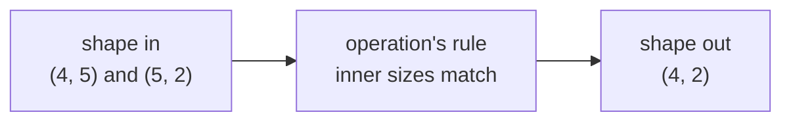

> Tier 1 · Mathematics for AI · **Level: beginner** · Reading time: about 8 minutes

# 1.5 Tensor shapes

**Metadata** — Tier: 1 · Phase: 1 · Priority: P0 · Difficulty: 2/5 · Interview: High · Hands-on: Very high
Prerequisites: 1.4 Tensors · Leads to: 1.6, 1.7, 1.11

> **In plain words**
> The **shape** of a tensor is the list of sizes along each direction, for example `(5, 20)` for "5 shelves with 20 books each".
> Most bugs in deep-learning code are shape bugs, so the habit to build is: **write down the shape you expect before you run the code.**

**You need first:** 1.4 Tensors.

> **Figure 1.5-1 — the same 24 numbers in three different shapes**
>
> ```mermaid
> flowchart LR
>     A["24 numbers<br/>shape (2, 3, 4)"] -->|reshape| B["shape (6, 4)<br/>same order, regrouped"]
>     A -->|transpose axes 1 and 2| C["shape (2, 4, 3)<br/>axes swapped"]
>     A -->|flatten| D["shape (24,)<br/>one long list"]
> ```
>
> *How to read it:* the amount of data never changes: 2 × 3 × 4 = 6 × 4 = 2 × 4 × 3 = 24. **Reshape** regroups the same numbers in the same order. **Transpose** swaps axes, which really moves entries around. Flattening is just a reshape to one axis.

**Words you'll meet on this page**

| Word | What it means here |
|---|---|
| shape | sizes along each axis, written as a tuple: `(2, 3, 4)` |
| size | total number of entries = product of the shape |
| reshape | give the same numbers a different shape |
| transpose / permute | swap or reorder axes |
| squeeze / unsqueeze | remove / add an axis of size 1 |
| contiguous | stored in memory in the usual order |

### 1. What is it?
The shape is the tuple listing the size of each axis, for example `(32, 128, 768)`.

### 2. Why does it exist?
Shape is the **contract between operations**. A layer expecting 768 numbers per word fails, or worse silently misbehaves, if given 512.

### 3. Detailed explanation
- **Size** = product of the shape: `(2, 3, 4)` holds 2 × 3 × 4 = 24 numbers.
- **`reshape`** changes the grouping, not the numbers or their order. You can reshape only if the totals match.
- **`transpose` / `permute`** change which axis is which, so entries really change position.
- **`squeeze` / `unsqueeze`** remove or add an axis of length 1 (e.g. `(3,)` ↔ `(3, 1)`).
- **`-1` in `reshape`** means "work this size out for me".

### 4. How does it work? The two rules you will use most
1. **Matrix product:** inner sizes must match and disappear: `(m, n) @ (n, p) → (m, p)`.
2. **Element-wise operations** (add, multiply) need equal shapes, or shapes that can be stretched to match (broadcasting, 1.7).

### 5. Simple example
A bookshelf with 5 shelves and 20 books on each: shape `(5, 20)`, size 100.

| You do | New shape | Meaning |
|---|---|---|
| flatten | `(100,)` | all books in one line |
| reshape to 10 × 10 | `(10, 10)` | regroup to 10 shelves of 10 |
| transpose | `(20, 5)` | "shelves" are now positions, and vice versa |

### 6. Technical example
Multi-head attention reshapes `(B, T, D)` (batch, tokens, width) into `(B, H, T, D/H)` (batch, heads, tokens, width per head). With `B=2, T=4, D=8, H=2` that is `(2, 4, 8) → (2, 2, 4, 4)`.

### 7. Code
**① By hand (plain Python).** Count shape and size using nested lists.

```python
x = [[[a * 12 + b * 4 + c for c in range(4)] for b in range(3)] for a in range(2)]
print("shape:", (len(x), len(x[0]), len(x[0][0])))
print("size:", len(x) * len(x[0]) * len(x[0][0]))
```

```text
shape: (2, 3, 4)
size: 24
```

**② With NumPy.** Predict each printed shape first.

```python
import numpy as np

x = np.arange(24).reshape(2, 3, 4)
print("x:", x.shape, " size:", x.size)
print("reshape(6, 4):", x.reshape(6, 4).shape)
print("transpose(0, 2, 1):", x.transpose(0, 2, 1).shape)
print("reshape(2, -1):", x.reshape(2, -1).shape)
print("first sheet, x[0]:", x[0].shape)
```

```text
x: (2, 3, 4)  size: 24
reshape(6, 4): (6, 4)
transpose(0, 2, 1): (2, 4, 3)
reshape(2, -1): (2, 12)
first sheet, x[0]: (3, 4)
```

**③ With PyTorch.** Same operations; note that `view` needs memory in the usual order.

```python
import torch

x = torch.arange(24).reshape(2, 3, 4)
print("permute:", tuple(x.permute(0, 2, 1).shape))
try:
    x.permute(0, 2, 1).view(2, 12)
except RuntimeError:
    print("view after permute fails; use reshape or .contiguous()")
print("reshape works:", tuple(x.permute(0, 2, 1).reshape(2, 12).shape))
```

```text
permute: (2, 4, 3)
view after permute fails; use reshape or .contiguous()
reshape works: (2, 12)
```

### 8. Input → Process → Output



<details>
<summary><b>Beyond the basics (sections 9–16)</b> — real-world use, limits, mistakes. Skip on a first read.</summary>

### 9. Enterprise use case
Model-serving systems reject payloads with the wrong shape before they reach the GPU.

### 10. AI engineering connection
Transformer code is read and debugged by following shapes line by line.

### 11. Advantages
Predictable, checkable rules.

### 12. Limitations
Variable shapes (different sentence lengths) complicate batching and compilation.

### 13. Trade-offs
Padding everything to one shape is simple but wastes compute.

### 14. Common mistakes
Using `reshape` when you needed `transpose` (reshape does not move the data in a meaningful way); silent broadcasting that hides a shape bug.

### 15. Performance / cost
After a transpose, tensors may be non-contiguous, so some operations copy the data first.

### 16. Security
Validate shapes and dtypes of untrusted inputs, otherwise a request can force a huge allocation.

</details>

### 17. Interview explanation
"Shape is the list of axis sizes. I write the expected shape next to every tensor operation, because most deep-learning bugs are shape mismatches."

### 18. Rapid-fire answer
Shape is the per-axis sizes; matmul needs matching inner sizes; reshape keeps the element count.

### 19. Interview questions
- **Basic:** What is the shape of `x[0]` for `x` of shape `(2, 3, 4)`?
- **Intermediate:** What is the difference between `reshape` and `transpose`?
- **Advanced:** Why does `view` after `transpose` fail in PyTorch?
- **Scenario:** You see "mat1 and mat2 shapes cannot be multiplied". How do you debug it?

### 20. Hands-on exercise
**Goal:** predict, then verify, the shapes in a mini attention step.

1. `q` has shape `(2, 4, 8)` (batch 2, 4 tokens, width 8) and `k` has the same shape.
2. To compare every token with every token we need `q @ kᵀ` per batch item. Write the expected result shape.
3. Verify with NumPy using `k.transpose(0, 2, 1)`.

<details>
<summary>Show a solution</summary>

```python
import numpy as np

q = np.ones((2, 4, 8))
k = np.ones((2, 4, 8))
scores = q @ k.transpose(0, 2, 1)       # (2,4,8) @ (2,8,4) -> (2,4,4)
print(scores.shape)
```

```text
(2, 4, 4)
```

Each of the 2 batch items gets a 4 × 4 table: one score for every pair of tokens.
</details>

### 21. Revision questions
1. How do you get the size of a tensor from its shape?
2. What is the output shape of `(4, 5) @ (5, 2)`?
3. Does `reshape` reorder the data?

### 22. Related concepts
1.6 Dimensions and axes · 1.7 Broadcasting · 1.11 Matrix multiplication

### 23. One-line memory hook
**Write the shape first; the code follows.**

<details>
<summary><b>For reviewers</b> (not part of the lesson)</summary>

- Status: DRAFT, learner-first layout (Author: Claude). Code is executed by `tests/test_md_snippets.py`.
- The PyTorch `view`-after-`permute` error is shown with a try/except; wording of the exact exception is not asserted.
</details>
