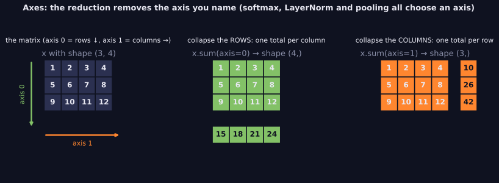
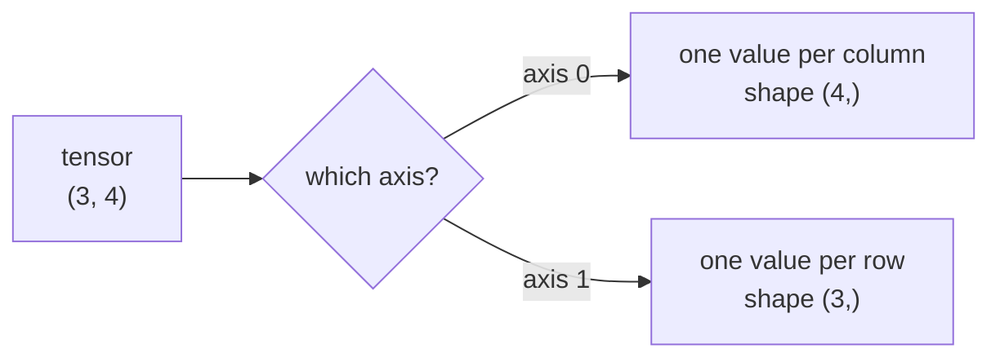

> Tier 1 · Mathematics for AI · **Level: beginner** · Reading time: about 8 minutes

# 1.6 Dimensions and axes

**Metadata** — Tier: 1 · Phase: 1 · Priority: P0 · Difficulty: 2/5 · Interview: Medium · Hands-on: Very high
Prerequisites: 1.5 Tensor shapes · Leads to: 1.7, Tier 3, Tier 7

> **In plain words**
> An **axis** is one direction of a table or block of numbers. A table has two: **axis 0 runs down** (across the rows) and **axis 1 runs across** (across the columns).
> Many operations (sum, average, softmax) need you to say **along which axis**. Pick the wrong one and the code still runs, but the answer is wrong.

**You need first:** 1.5 Tensor shapes.

> **Figure 1.6-1 — which axis does a reduction remove?**
>
> 
>
> *How to read it:* axis 0 runs down the rows and axis 1 runs across the columns. `sum(axis=0)` collapses the rows, leaving one total per column (15, 18, 21, 24). `sum(axis=1)` collapses the columns, leaving one total per row (10, 26, 42). The named axis **disappears** from the shape: `(3, 4)` becomes `(4,)` or `(3,)`. Softmax, LayerNorm and pooling are exactly this choice of axis.
>
> *Generated by* `tier-01-mathematics/figures/src/t1_tensors.py`.

**Words you'll meet on this page**

| Word | What it means here |
|---|---|
| axis | one direction of a tensor, numbered from 0 |
| ndim | the number of axes |
| reduce | combine all entries along an axis into one (sum, mean, max) |
| `keepdims` | keep the reduced axis with size 1 instead of dropping it |
| `axis=-1` | the last axis, whatever the number of axes is |

### 1. What is it?
An **axis** is one direction of a tensor. `ndim` is how many axes it has. Operations like `sum(axis=0)` **collapse** the chosen axis.

### 2. Why does it exist?
A table of scores can be averaged over students or over subjects, and those are different questions. You must say which axis the operation works along.

### 3. Detailed explanation
**Word warning.** "Dimension" is used for two different things:
- *number of axes* of a tensor (a matrix has 2),
- *length of a vector* (a 768-dimensional embedding has 768 numbers).

This book says **"number of axes"** for the first and **"vector dimension"** for the second.

**Rule of thumb.** Reducing over axis `k` removes axis `k` from the shape. `keepdims=True` leaves it as size 1, which is handy for broadcasting afterwards (1.7).

### 4. How does it work?
1. Pick the axis.
2. For every combination of the *other* indices, combine the entries along that axis.
3. The result has the shape with that axis deleted (or set to 1).

### 5. Simple example
A score table: three students (rows) and four subjects (columns).

| | maths | physics | art | music |
|---|---|---|---|---|
| Ann | 1 | 2 | 3 | 4 |
| Bo | 5 | 6 | 7 | 8 |
| Cy | 9 | 10 | 11 | 12 |

- `sum(axis=0)`: add **down** each column: totals per subject: 15, 18, 21, 24.
- `sum(axis=1)`: add **across** each row: totals per student: 10, 26, 42.

### 6. Technical example
Softmax over the last axis (the keys) makes each query's attention weights add to 1. LayerNorm normalises over the feature axis, one token at a time.

### 7. Code
**① By hand (plain Python).**

```python
table = [[1, 2, 3, 4], [5, 6, 7, 8], [9, 10, 11, 12]]
per_subject = [sum(row[j] for row in table) for j in range(4)]      # along axis 0
per_student = [sum(row) for row in table]                           # along axis 1
print("per subject:", per_subject)
print("per student:", per_student)
```

```text
per subject: [15, 18, 21, 24]
per student: [10, 26, 42]
```

**② With NumPy.**

```python
import numpy as np

x = np.arange(1.0, 13.0).reshape(3, 4)
print("axis=0:", x.sum(axis=0), x.sum(axis=0).shape)
print("axis=1:", x.sum(axis=1), x.sum(axis=1).shape)
print("axis=-1, keepdims:", x.sum(axis=-1, keepdims=True).shape)
```

```text
axis=0: [15. 18. 21. 24.] (4,)
axis=1: [10. 26. 42.] (3,)
axis=-1, keepdims: (3, 1)
```

**③ With PyTorch** (`dim` is PyTorch's name for `axis`).

```python
import torch

x = torch.arange(1.0, 13.0).reshape(3, 4)
print("dim=0:", x.sum(dim=0).tolist())
print("softmax over dim=1 sums to:", [round(v, 4) for v in torch.softmax(x, dim=1).sum(dim=1).tolist()])
```

```text
dim=0: [15.0, 18.0, 21.0, 24.0]
softmax over dim=1 sums to: [1.0, 1.0, 1.0]
```

### 8. Input → Process → Output



<details>
<summary><b>Beyond the basics (sections 9–16)</b> — real-world use, limits, mistakes. Skip on a first read.</summary>

### 9. Enterprise use case
Metrics are aggregated over request, time and model-version axes in analytics pipelines.

### 10. AI engineering connection
Softmax, normalisation and pooling are defined by their axis. A wrong axis gives a silently wrong model.

### 11. Advantages
Precise control of how data is combined.

### 12. Limitations
Easy to pick the wrong axis without any error message.

### 13. Trade-offs
`keepdims=True` keeps results broadcast-friendly at the cost of an extra size-1 axis.

### 14. Common mistakes
Softmax over the batch axis; mean over the wrong axis; mixing the two meanings of "dimension".

### 15. Performance / cost
Reductions along the contiguous (last) axis are usually faster.

### 16. Security
Nothing specific beyond validating shapes.

</details>

### 17. Interview explanation
"An axis is a direction in the tensor. Every reduction or normalisation needs its axis stated; for example, softmax goes over the key axis so that each query's weights add up to one."

### 18. Rapid-fire answer
An axis is a tensor direction; a reduction removes it; the axis choice for softmax and normalisation is critical.

### 19. Interview questions
- **Basic:** What does `sum(axis=0)` do to a `(3, 4)` array?
- **Intermediate:** Why use `keepdims=True`?
- **Advanced:** Over which axis does LayerNorm normalise, and over which does BatchNorm?
- **Scenario:** An item's attention output changes when other items in the batch change. Where is the bug?

### 20. Hands-on exercise
**Goal:** prove that softmax rows add to 1 along the right axis, and not along the wrong one.

1. Make a `(3, 4)` array of any numbers and apply softmax along `axis=1`.
2. Sum the result along `axis=1` and along `axis=0`.
3. Which sums are all 1?

<details>
<summary>Show a solution</summary>

```python
import numpy as np

x = np.arange(1.0, 13.0).reshape(3, 4)
e = np.exp(x - x.max(axis=1, keepdims=True))
p = e / e.sum(axis=1, keepdims=True)
print("sums along axis 1:", p.sum(axis=1).round(6))
print("sums along axis 0:", p.sum(axis=0).round(3))
```

```text
sums along axis 1: [1. 1. 1.]
sums along axis 0: [0.096 0.261 0.711 1.932]
```

Only the sums along the axis we normalised are 1.
</details>

### 21. Revision questions
1. What is the shape after `mean(axis=1)` on shape `(5, 6, 7)`?
2. What are the two meanings of "dimension"?
3. What does `axis=-1` mean?

### 22. Related concepts
1.5 Tensor shapes · 1.7 Broadcasting · Tier 7 Attention

### 23. One-line memory hook
**Name the axis, or the axis picks you.**

<details>
<summary><b>For reviewers</b> (not part of the lesson)</summary>

- Status: DRAFT, learner-first layout (Author: Claude). Code is executed by `tests/test_md_snippets.py`.
- Terminology: this page introduces "number of axes" vs "vector dimension" (inherited from the first draft); glossary entry pending approval.
- Subtracting the row maximum before `exp` in the solution is the stable-softmax trick (1.39, 1.43).
</details>
