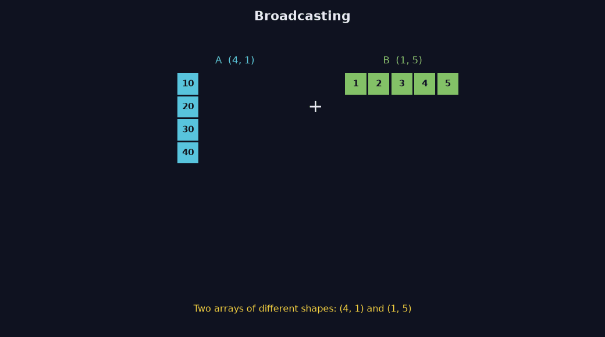
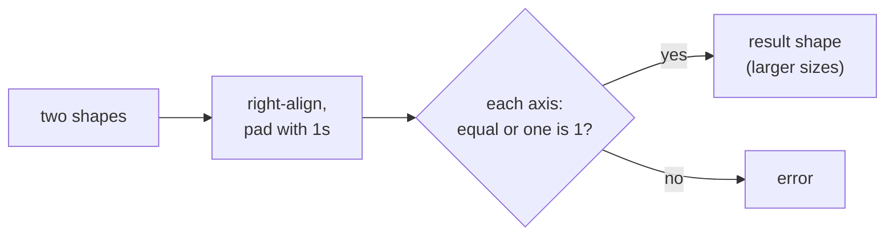

> Tier 1 · Mathematics for AI · **Level: beginner** · Reading time: about 10 minutes

# 1.7 Broadcasting

**Metadata** — Tier: 1 · Phase: 1 · Priority: P0 · Difficulty: 3/5 · Interview: High · Hands-on: Very high
Prerequisites: 1.5, 1.6 · Leads to: 1.8, 1.9, Tier 3, Tier 7

> **In plain words**
> **Broadcasting** lets you combine two arrays of different shapes by **stretching the smaller one** to fit, without writing a loop.
> Example: add the same tax to every price in a list, or add one bias vector to every row of a table.
> It is handy, but when shapes line up by accident it can silently give a wrong (and huge) result.

**You need first:** 1.5 Tensor shapes and 1.6 Axes.

> **Figure 1.7-1 — broadcasting (4, 1) + (1, 5), animated**
>
> 
>
> *How to read it:* shapes are compared from the right. The column A (shape `(4, 1)`) is repeated across the columns, the row B (shape `(1, 5)`) is repeated down the rows, and the two stretched arrays are added entry by entry. The stretching is *virtual*: NumPy does not copy the data. The result has shape `(4, 5)` and entry `A[i] + B[j]`.
>
> *Generated by* `tier-01-mathematics/figures/src/t1_tensors.py`. The result shape is asserted equal to `broadcast_shape((4, 1), (1, 5))` and to the NumPy sum.

**Words you'll meet on this page**

| Word | What it means here |
|---|---|
| broadcasting | automatic stretching of size-1 axes so shapes match |
| element-wise | the operation is done entry by entry |
| right-aligned | shapes are compared starting from the last axis |
| compatible | two sizes are equal, or one of them is 1 (or missing) |

### 1. What is it?
A rule that lets element-wise operations work on tensors of different shapes by virtually stretching axes of size 1 (or missing axes).

### 2. Why does it exist?
To avoid two things: writing loops, and copying data. Adding a bias to every row of a table should be one line, and it should not duplicate the bias a million times in memory.

### 3. Detailed explanation
**The rule, in three steps.**
1. Write both shapes, **aligned on the right**. Pad the shorter one with 1s on the left.
2. For each axis, the two sizes must be **equal**, or **one of them is 1**. Otherwise: error.
3. The result size on each axis is the larger of the two.

**Examples.**

| Shape A | Shape B | Result | Why |
|---|---|---|---|
| `(3,)` | `(4, 3)` | `(4, 3)` | A becomes `(1, 3)`, stretched down 4 rows |
| `(4, 1)` | `(1, 5)` | `(4, 5)` | each stretches along the other's axis |
| `(3, 4)` | `(3,)` | error | right-aligned: 4 vs 3 do not match |
| `(5,)` | `(5, 1)` | `(5, 5)` | **surprise**: an outer table, not an error |

### 4. How does it work?
Take `(32, 1, 768) + (128, 1)`. Right-align: `(32, 1, 768)` and `(1, 128, 1)`. Axis by axis the larger size wins: `(32, 128, 768)`.

### 5. Simple example
**Adding a tax of 5 to every price.** The price list has shape `(4,)`, the tax is a single number (shape `()`), so it is stretched to every entry:

`[10, 20, 30, 40] + 5 = [15, 25, 35, 45]`

Now a table: three shops (rows), two items (columns), and one price adjustment per item.

| | item 1 | item 2 |
|---|---|---|
| shop 1 | 10 | 20 |
| shop 2 | 30 | 40 |
| shop 3 | 50 | 60 |

Adding the adjustment `[1, 2]` (shape `(2,)`) adds 1 to the first column and 2 to the second, in all three rows: shape `(3, 2) + (2,) → (3, 2)`.

### 6. Technical example
Adding a bias `(d,)` to activations `(B, T, d)`; adding a causal mask `(T, T)` to attention scores `(B, H, T, T)`; subtracting a per-feature mean from a whole dataset.

### 7. Code
**① By hand (plain Python).** The rule itself, as a function that predicts the result shape.

```python
def broadcast_shape(s1, s2):
    n = max(len(s1), len(s2))
    a = (1,) * (n - len(s1)) + tuple(s1)        # pad with 1s on the left
    b = (1,) * (n - len(s2)) + tuple(s2)
    out = []
    for d1, d2 in zip(a, b):
        if d1 == d2 or d2 == 1:
            out.append(d1)
        elif d1 == 1:
            out.append(d2)
        else:
            raise ValueError(f"cannot broadcast {s1} with {s2}")
    return tuple(out)

print(broadcast_shape((4, 1), (1, 5)))
print(broadcast_shape((3,), (4, 3)))
print(broadcast_shape((5,), (5, 1)))
try:
    broadcast_shape((3, 4), (3,))
except ValueError as e:
    print("error:", e)
```

```text
(4, 5)
(4, 3)
(5, 5)
error: cannot broadcast (3, 4) with (3,)
```

**② With NumPy.** NumPy applies the same rule, and has its own checker.

```python
import numpy as np

prices = np.array([[10, 20], [30, 40], [50, 60]])
adjust = np.array([1, 2])
print(prices + adjust)
print("shape:", (prices + adjust).shape)
print("same as my rule:", np.broadcast_shapes((4, 1), (1, 5)))
```

```text
[[11 22]
 [31 42]
 [51 62]]
shape: (3, 2)
same as my rule: (4, 5)
```

**③ With PyTorch.** The classic silent bug: `(5,)` minus `(5, 1)`.

```python
import torch

pred = torch.zeros(5)           # shape (5,)
target = torch.ones(5, 1)       # shape (5, 1)  <- looks harmless
print("pred - target has shape:", tuple((pred - target).shape))   # (5, 5), not (5,)!
print("fixed with target.squeeze(1):", tuple((pred - target.squeeze(1)).shape))
```

```text
pred - target has shape: (5, 5)
fixed with target.squeeze(1): (5,)
```

### 8. Input → Process → Output



<details>
<summary><b>Beyond the basics (sections 9–16)</b> — real-world use, limits, mistakes. Skip on a first read.</summary>

### 9. Enterprise use case
Scaling features (subtract each column's mean) over millions of rows without Python loops.

### 10. AI engineering connection
Bias addition, masking, normalisation, attention scaling and temperature all rely on broadcasting.

### 11. Advantages
Short, fast, and memory-light.

### 12. Limitations
Silent bugs: `(n,)` against `(n, 1)` gives `(n, n)`, not an error.

### 13. Trade-offs
Brevity versus readability: sometimes an explicit `reshape` or `unsqueeze` plus a shape `assert` is clearer.

### 14. Common mistakes
`(n,) - (n, 1)` creating an accidental outer table; a loss with predictions `(B,)` and targets `(B, 1)` producing `(B, B)`, which trains but trains wrongly.

### 15. Performance / cost
The stretched inputs are not copied, but the **result** is full size. `(32, 128, 768)` float32 is 12 MiB; a careless `(N,) with (N, 1)` for N = 100,000 would need about 40 GB.

### 16. Security
Untrusted shapes plus accidental broadcasting can trigger huge allocations (a denial-of-service risk). Validate shapes.

</details>

### 17. Interview explanation
"Broadcasting lets tensors of different shapes combine element-wise. Shapes are aligned from the right, and each axis must match or be 1. It is how we add a bias to a whole batch without a loop, and also a classic source of silent bugs."

### 18. Rapid-fire answer
Right-align shapes; each axis equal or 1; size-1 axes stretch virtually.

### 19. Interview questions
- **Basic:** Does `(3,) + (4, 3)` work? What is the result shape?
- **Intermediate:** What is the shape of `(5,) - (5, 1)`?
- **Advanced:** Why can a `(B, 1)` vs `(B,)` loss mismatch train wrongly without any error?
- **Scenario:** Memory spikes after a harmless-looking subtraction. How do you diagnose it?

### 20. Hands-on exercise
**Goal:** see the `(B, B)` bug, then guard against it.

1. Create `pred` of shape `(4,)` and `target` of shape `(4, 1)`.
2. Compute the mean squared difference with and without fixing the shape.
3. Add an `assert pred.shape == target.shape`.

<details>
<summary>Show a solution</summary>

```python
import numpy as np

pred = np.array([1.0, 2.0, 3.0, 4.0])
target = np.array([[1.0], [2.0], [3.0], [4.0]])        # shape (4, 1)

print("buggy mean squared error:", np.mean((pred - target) ** 2))   # 4x4 table!
fixed = target.ravel()
assert pred.shape == fixed.shape
print("correct mean squared error:", np.mean((pred - fixed) ** 2))
```

```text
buggy mean squared error: 2.5
correct mean squared error: 0.0
```

The perfect predictions should give error 0, but the bug reports a positive error because it compares every prediction with every target.
</details>

### 21. Revision questions
1. What is the result shape of `(4, 1)` with `(1, 5)`?
2. Is data copied when broadcasting?
3. What does `(5,)` minus `(5, 1)` produce?

### 22. Related concepts
1.5 Tensor shapes · 1.6 Axes · 1.8 Vector addition · Tier 7 Attention

### 23. One-line memory hook
**Right-align, match or 1, else error, and watch for the accidental table.**

<details>
<summary><b>For reviewers</b> (not part of the lesson)</summary>

- Status: DRAFT, learner-first layout (Author: Claude). Code is executed by `tests/test_md_snippets.py`.
- The by-hand `broadcast_shape` on this page is a simplified single-file version of `code/linalg_basics.py::broadcast_shape`, which is TESTED against `np.broadcast_shapes` with parametrised cases.
- Figure 1.7-1's result shape is asserted in its generating script.
</details>
