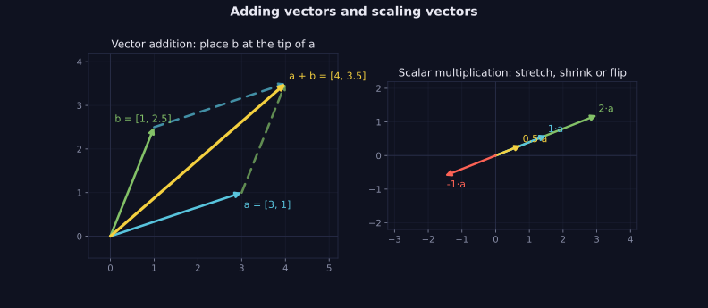
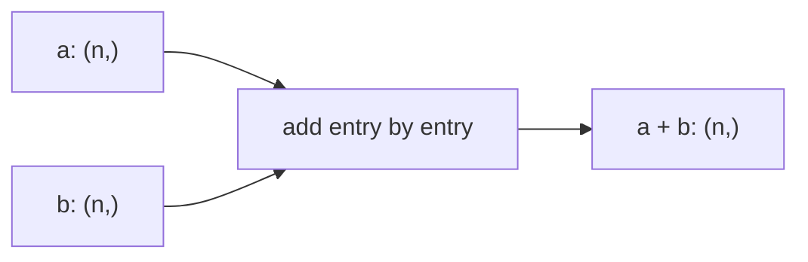

> Tier 1 · Mathematics for AI · **Level: absolute beginner** · Reading time: about 6 minutes

# 1.8 Vector addition

**Metadata** — Tier: 1 · Phase: 1 · Priority: P0 · Difficulty: 1/5 · Interview: Medium · Hands-on: High
Prerequisites: 1.2 Vectors · Leads to: Tier 8 residual connections

> **In plain words**
> To **add two vectors**, add them **entry by entry**: first with first, second with second. `[1, 2] + [3, 4] = [4, 6]`.
> Picture two walks: walk 3 steps east and then 4 steps north, and you end up where the combined walk `[3, 4]` would take you.

**You need first:** 1.2 Vectors.

> **Figure 1.8-1 — adding and scaling vectors**
>
> 
>
> *How to read it:* **left** — place arrow `b` at the tip of arrow `a`. The arrow from the start to the final tip is `a + b = [4, 3.5]`; the dashed copies show the parallelogram. **Right** — multiplying by a scalar keeps the line and changes the length (`2·a` stretches, `0.5·a` shrinks) or flips the direction (`−1·a`). Scaling is the next concept (1.9).
>
> *Generated by* `tier-01-mathematics/figures/src/t1_geometry.py`.

**Words you'll meet on this page**

| Word | What it means here |
|---|---|
| element-wise | done entry by entry |
| tip-to-tail | draw the second arrow starting where the first ends |
| zero vector | all entries 0; adding it changes nothing |
| residual connection | adding a layer's input back to its output (Tier 8) |

### 1. What is it?
The **element-wise sum** of two vectors of the same length: `(a + b)ᵢ = aᵢ + bᵢ`.

### 2. Why does it exist?
To combine effects or information: two movements, two signals, a word's meaning plus its position.

### 3. Detailed explanation
- **Geometry:** place the arrows tip to tail; the sum is the arrow from the start to the end.
- **Properties:** `a + b = b + a` (order does not matter), `(a + b) + c = a + (b + c)`, and adding the zero vector changes nothing.
- **Same length required.** Adding a 3-number vector to a 4-number vector makes no sense. (Libraries may "broadcast" instead, so always check shapes; see 1.7.)

### 4. How does it work?
Line the vectors up and add each pair of entries. The cost is one addition per entry.

### 5. Simple example
You walk 3 steps east and 4 steps north. In vectors, `[3, 0] + [0, 4] = [3, 4]`.

| Step | east | north |
|---|---|---|
| walk 1 | 3 | 0 |
| walk 2 | 0 | 4 |
| **total** | **3** | **4** |

### 6. Technical example
A Transformer's **residual connection** computes `y = x + F(x)`: the layer's output `F(x)` is added back to its input `x`. A token's **position vector** is added to its embedding so the model knows where the word sits.

### 7. Code
**① By hand (plain Python).**

```python
def add(a, b):
    if len(a) != len(b):
        raise ValueError("vectors must have the same length")
    return [x + y for x, y in zip(a, b)]

print(add([1, 2, 3], [4, 5, 6]))
print(add([3, 0], [0, 4]))
```

```text
[5, 7, 9]
[3, 4]
```

**② With NumPy.**

```python
import numpy as np

a = np.array([1, 2, 3])
b = np.array([4, 5, 6])
print(a + b)
print("commutative:", np.array_equal(a + b, b + a))
```

```text
[5 7 9]
commutative: True
```

**③ With PyTorch** — a mini residual connection.

```python
import torch

x = torch.tensor([1.0, 2.0, 3.0])
layer_output = torch.tensor([0.1, -0.2, 0.3])      # pretend this came from a layer
print("residual:", [round(v, 2) for v in (x + layer_output).tolist()])
```

```text
residual: [1.1, 1.8, 3.3]
```

### 8. Input → Process → Output



<details>
<summary><b>Beyond the basics (sections 9–16)</b> — real-world use, limits, mistakes. Skip on a first read.</summary>

### 9. Enterprise use case
Combining feature vectors from different sources in a feature-store pipeline.

### 10. AI engineering connection
Residual streams in Transformers. The famous "king − man + woman ≈ queen" is only approximate and is not guaranteed for modern embeddings.

### 11. Advantages
Linear time, easy to parallelise.

### 12. Limitations
Only meaningful if the entries mean the same thing; adding unrelated spaces is meaningless.

### 13. Trade-offs
Adding mixes information irreversibly; concatenating keeps it separate but makes the vector longer.

### 14. Common mistakes
Adding vectors from different embedding spaces; relying on silent broadcasting.

### 15. Performance / cost
`O(n)` and limited by memory speed; fused kernels avoid extra passes over memory.

### 16. Security
Nothing specific.

</details>

### 17. Interview explanation
"Vector addition is element-wise. In Transformers it appears as the residual connection: the layer output is added to its input, so information and gradients have a direct path through the network."

### 18. Rapid-fire answer
Element-wise sum of equal-length vectors; the basis of residual connections.

### 19. Interview questions
- **Basic:** Compute `[1, 2] + [3, 4]`.
- **Intermediate:** What is the difference between adding and concatenating vectors?
- **Advanced:** Why do residual connections help deep networks train?
- **Scenario:** Positional encodings are added to token embeddings. What must match?

### 20. Hands-on exercise
**Goal:** check the rules with random numbers.

1. Make three random vectors `a`, `b`, `c` of length 5.
2. Check `a + b == b + a` and `(a + b) + c == a + (b + c)` with `np.allclose`.

<details>
<summary>Show a solution</summary>

```python
import numpy as np

rng = np.random.default_rng(0)
a, b, c = rng.standard_normal((3, 5))
print("commutative:", np.allclose(a + b, b + a))
print("associative:", np.allclose((a + b) + c, a + (b + c)))
```

```text
commutative: True
associative: True
```

(`allclose`, not `==`, because computers store decimals approximately; see 1.40.)
</details>

### 21. Revision questions
1. What is the zero vector's effect when added?
2. What happens if the lengths differ?
3. Where does vector addition appear in a Transformer?

### 22. Related concepts
1.9 Scalar multiplication · 1.7 Broadcasting · Tier 8 Residual connections

### 23. One-line memory hook
**Add vectors entry by entry; same length or stop.**

<details>
<summary><b>For reviewers</b> (not part of the lesson)</summary>

- Status: DRAFT, learner-first layout (Author: Claude). Code is executed by `tests/test_md_snippets.py`.
- TESTED earlier: `test_add_and_scale_match_numpy`, `test_add_length_mismatch_raises` (code/linalg_basics.py).
</details>
