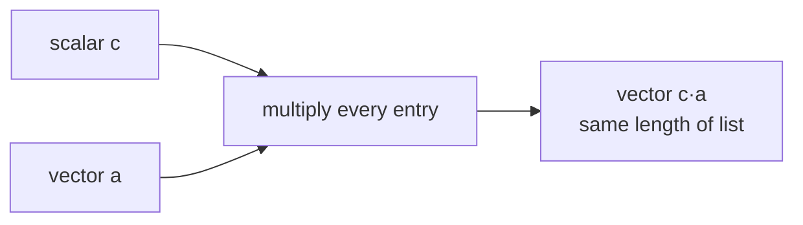

> Tier 1 · Mathematics for AI · **Level: absolute beginner** · Reading time: about 6 minutes

# 1.9 Scalar multiplication

**Metadata** — Tier: 1 · Phase: 1 · Priority: P0 · Difficulty: 1/5 · Interview: Medium · Hands-on: High
Prerequisites: 1.1 Scalars, 1.2 Vectors · Leads to: 1.15 Norms, gradient descent

> **In plain words**
> **Scalar multiplication** means multiplying **every number in a vector by the same single number**. `2 × [1, 2, 3] = [2, 4, 6]`.
> It is like a **volume knob**: a bigger number makes the vector longer, a number between 0 and 1 makes it shorter, and a negative number flips it around.

**You need first:** 1.1 Scalars and 1.2 Vectors. Figure 1.8-1 (right panel) already shows this picture.

> **Figure 1.9-1 — scaling a vector**
>
> ```mermaid
> flowchart LR
>     A["a = [1, 2]"] -->|"× 2"| B["[2, 4]<br/>twice as long"]
>     A -->|"× 0.5"| C["[0.5, 1]<br/>half as long"]
>     A -->|"× −1"| D["[−1, −2]<br/>same line, flipped"]
>     A -->|"× 0"| E["[0, 0]<br/>the zero vector"]
> ```
>
> *How to read it:* the starting vector `a` points along one line. Multiplying never turns it onto a different line; it only stretches, shrinks or flips it. See the arrow picture in Figure 1.8-1 (right panel).

**Words you'll meet on this page**

| Word | What it means here |
|---|---|
| scalar | the single number you multiply by |
| scaling | stretching or shrinking by a scalar |
| learning rate (`η`) | the scalar that sets how big a training step is |
| temperature (`T`) | a scalar that makes a model's choices more or less random |

### 1. What is it?
Multiplying every entry of a vector (or tensor) by one scalar: `(c·a)ᵢ = c·aᵢ`.

### 2. Why does it exist?
To change the **size** of a vector (and flip it if `c` is negative) while keeping it on the same line. It is the simplest way to turn a quantity up or down.

### 3. Detailed explanation

| Scalar `c` | Effect on the vector |
|---|---|
| `c > 1` | stretches |
| `0 < c < 1` | shrinks |
| `c = 1` | unchanged |
| `c = 0` | becomes the zero vector |
| `c < 0` | flips direction (and stretches or shrinks) |

It also **distributes** over addition: `c(a + b) = ca + cb`. (Scale the sum, or sum the scaled ones: same answer.)

### 4. How does it work?
Each entry is multiplied independently by `c`. One multiplication per entry.

### 5. Simple example
**Doubling a recipe.** The recipe is the vector `[2 eggs, 100 g flour, 200 ml milk]`. For a party twice as big, multiply by 2:

| | eggs | flour (g) | milk (ml) |
|---|---|---|---|
| one batch | 2 | 100 | 200 |
| × 2 | 4 | 200 | 400 |
| × 0.5 | 1 | 50 | 100 |

### 6. Technical example
- **Gradient descent:** `w ← w − η·∇L`. The learning rate `η` scales the gradient (the direction to improve) so each step is small and safe.
- **Temperature:** a language model divides its scores (logits) by `T` before choosing the next word. Small `T` makes it confident; large `T` makes it adventurous.
- **Attention** divides its scores by `√dₖ` to keep them from growing too large.

### 7. Code
**① By hand (plain Python).**

```python
def scale(c, a):
    return [c * x for x in a]

print(scale(3, [1, -2]))
print(scale(-2, [1, 2, 3]))
print(scale(0.5, [2, 100, 200]))
```

```text
[3, -6]
[-2, -4, -6]
[1.0, 50.0, 100.0]
```

**② With NumPy.**

```python
import numpy as np

a = np.array([1.0, 2.0])
for c in (2, 0.5, -1, 0):
    print(f"{c:>4} * a = {c * a}")
b = np.array([3.0, -1.0])
print("distributes:", np.allclose(2 * (a + b), 2 * a + 2 * b))
```

```text
   2 * a = [2. 4.]
 0.5 * a = [0.5 1. ]
  -1 * a = [-1. -2.]
   0 * a = [0. 0.]
distributes: True
```

**③ With PyTorch** — one gradient-descent step, which is just scalar multiplication.

```python
import torch

w = torch.tensor([1.0, -2.0, 0.5])
gradient = torch.tensor([0.4, -0.2, 0.1])
learning_rate = 0.1
w_new = w - learning_rate * gradient
print("old:", w.tolist())
print("new:", [round(v, 3) for v in w_new.tolist()])
```

```text
old: [1.0, -2.0, 0.5]
new: [0.96, -1.98, 0.49]
```

### 8. Input → Process → Output



<details>
<summary><b>Beyond the basics (sections 9–16)</b> — real-world use, limits, mistakes. Skip on a first read.</summary>

### 9. Enterprise use case
Scaling features to a standard range before training a model.

### 10. AI engineering connection
Learning rate, temperature scaling of logits (`logits / T`) and attention scaling are all scalar multiplications.

### 11. Advantages
Cheap, and a clear control knob.

### 12. Limitations
It cannot rotate a vector, only stretch, shrink or flip it. A poor global scale hurts numerical precision.

### 13. Trade-offs
A large scale risks overflow (1.44); a very small one risks underflow.

### 14. Common mistakes
Dividing logits by `T = 0`; applying the temperature after softmax instead of before it.

### 15. Performance / cost
Limited by memory speed; compilers fuse it with neighbouring operations.

### 16. Security
Clamp user-supplied scale factors and temperatures to a safe range.

</details>

### 17. Interview explanation
"Scalar multiplication stretches or shrinks a vector. The learning rate in gradient descent and the temperature on logits are both scalar multiplications: one scales the update, the other the sharpness of the output distribution."

### 18. Rapid-fire answer
Multiply every entry by a scalar; it changes length, not direction (unless the scalar is negative).

### 19. Interview questions
- **Basic:** What is `3·[1, −2]`?
- **Intermediate:** What does a temperature below 1 do to a softmax?
- **Advanced:** Why are attention scores divided by `√dₖ`?
- **Scenario:** Training diverges after you raise the learning rate. Explain it using scaling of the update.

### 20. Hands-on exercise
**Goal:** see temperature at work.

1. Take the scores `[2.0, 1.0, 0.1]`.
2. Divide by `T` = 0.5, 1 and 4, then apply softmax.
3. Which `T` gives the most "peaked" result, and which the flattest?

<details>
<summary>Show a solution</summary>

```python
import numpy as np

def softmax(z):
    e = np.exp(z - z.max())
    return e / e.sum()

scores = np.array([2.0, 1.0, 0.1])
for T in (0.5, 1, 4):
    print("T =", T, softmax(scores / T).round(3))
```

```text
T = 0.5 [0.864 0.117 0.019]
T = 1 [0.659 0.242 0.099]
T = 4 [0.417 0.324 0.259]
```

Small `T` concentrates the probability on the top score; large `T` spreads it out.
</details>

### 21. Revision questions
1. What does `c = −1` do?
2. Does `c(a + b) = ca + cb` hold?
3. Name two scalars that appear in AI training or inference.

### 22. Related concepts
1.8 Vector addition · 1.15 Norms · 1.23 Gradients

### 23. One-line memory hook
**A scalar is a volume knob for a vector.**

<details>
<summary><b>For reviewers</b> (not part of the lesson)</summary>

- Status: DRAFT, learner-first layout (Author: Claude). Code is executed by `tests/test_md_snippets.py`.
- TESTED earlier: `vec_scale_manual` against NumPy (`test_add_and_scale_match_numpy`).
- The picture is a Mermaid diagram plus a pointer to Figure 1.8-1; a dedicated plotted figure may be added in a later figure pass.
</details>
