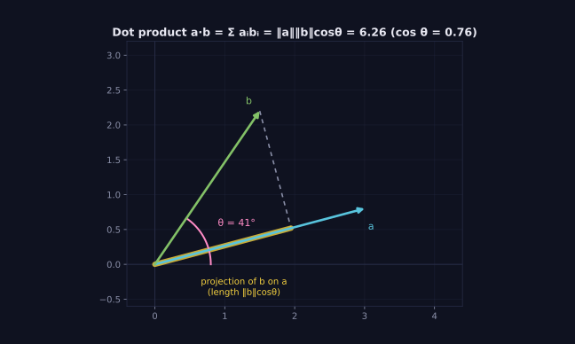
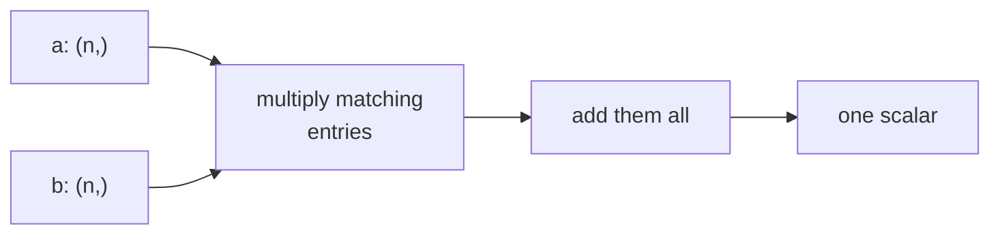

> Tier 1 · Mathematics for AI · **Level: beginner** · Reading time: about 9 minutes

# 1.10 Dot product

**Metadata** — Tier: 1 · Phase: 1 · Priority: P0 · Difficulty: 2/5 · Interview: Very high · Hands-on: Very high
Prerequisites: 1.2, 1.8, 1.9 · Leads to: 1.11, 1.15, 1.17, Tier 7 Attention

> **In plain words**
> The **dot product** takes two lists of the same length, **multiplies the matching pairs, and adds everything up** into one number.
> That number tells you **how much the two lists agree**: large and positive if they point the same way, zero if they are unrelated, negative if they oppose each other.
> A shopping bill is a dot product: quantities times prices, added up.

**You need first:** 1.2 Vectors, 1.8 Vector addition, 1.9 Scalar multiplication.

> **Figure 1.10-1 — the dot product as projection and angle**
>
> 
>
> *How to read it:* `a·b` equals the length of `a` times the length of the **shadow** (projection) that `b` casts onto `a`; written out, `‖a‖‖b‖cos θ`. Here θ = 41°, cos θ = 0.76 and `a·b = 6.26`. If `b` were perpendicular to `a` the shadow would vanish and the dot product would be 0; if `b` pointed away from `a` it would be negative.
>
> *Generated by* `tier-01-mathematics/figures/src/t1_geometry.py`.

**Words you'll meet on this page**

| Word | What it means here |
|---|---|
| dot product | multiply matching entries, then add: `a·b = Σ aᵢbᵢ` |
| orthogonal | at a right angle; dot product 0 |
| norm `‖a‖` | the length of a vector (1.15) |
| projection | the "shadow" of one vector on another |
| cosine similarity | the dot product after both vectors are scaled to length 1 (1.17) |
| `@` | Python's operator for dot / matrix products |

### 1. What is it?
For two vectors of equal length, `a·b = a₁b₁ + a₂b₂ + … + aₙbₙ`. The result is **one scalar**.

### 2. Why does it exist?
It measures **alignment**. It is the basic operation behind matrix multiplication, similarity search and attention: a model asks "how well does this match that?" thousands of times, and each answer is a dot product.

### 3. Detailed explanation
- **Geometric form:** `a·b = ‖a‖ ‖b‖ cos θ`, with θ the angle between the vectors.
- **Sign tells the story:** positive → roughly the same direction; zero → at right angles (orthogonal); negative → roughly opposite.
- **It depends on lengths too.** Doubling `a` doubles the result. To compare *direction only*, scale both vectors to length 1 first; that gives cosine similarity (1.17).
- **Properties:** commutative (`a·b = b·a`), distributes over addition, and `a·a = ‖a‖²` (the squared length).

### 4. How does it work?
1. Multiply the first entries together, the second entries together, and so on.
2. Add up all those products.

### 5. Simple example
**A shopping bill.** You buy 2 apples and 3 loaves of bread.

| Item | Quantity | Price | Quantity × price |
|---|---|---|---|
| apples | 2 | 1.5 | 3.0 |
| bread | 3 | 2.0 | 6.0 |
| **Total** | | | **9.0** |

That is the dot product `[2, 3] · [1.5, 2.0] = 2·1.5 + 3·2.0 = 9.0`.

**A similarity check.** `[1, 0]` and `[0, 1]` point in completely different directions: `1·0 + 0·1 = 0`. `[1, 1]` and `[2, 2]` point the same way: `1·2 + 1·2 = 4 > 0`.

### 6. Technical example
- **Attention** scores a query `q` against a key `k` with `q·k / √dₖ`.
- **A linear neuron** computes `w·x + b`: the dot product of its weights with the input, plus a bias.
- **Search** ranks documents by the dot product (or cosine) between query and document embeddings.

### 7. Code
**① By hand (plain Python).**

```python
def dot(a, b):
    if len(a) != len(b):
        raise ValueError("vectors must have the same length")
    return sum(x * y for x, y in zip(a, b))

print("bill:", dot([2, 3], [1.5, 2.0]))
print("orthogonal:", dot([1, 0], [0, 1]))
print("same direction:", dot([1, 1], [2, 2]))
```

```text
bill: 9.0
orthogonal: 0
same direction: 4
```

**② With NumPy.** Three equal ways to write it.

```python
import numpy as np

a = np.array([1.0, 2.0, 3.0])
b = np.array([4.0, 5.0, 6.0])
print(np.dot(a, b), a @ b, (a * b).sum())      # all 32.0
cos = a @ b / (np.linalg.norm(a) * np.linalg.norm(b))
print("cosine of the angle:", round(float(cos), 4))
```

```text
32.0 32.0 32.0
cosine of the angle: 0.9746
```

**③ With PyTorch.** One query against several keys at once, as in attention.

```python
import torch

q = torch.tensor([1.0, 0.0])
keys = torch.tensor([[1.0, 0.0], [0.0, 1.0], [-1.0, 0.0]])    # 3 keys
print("scores:", (keys @ q).tolist())     # similar, unrelated, opposite
```

```text
scores: [1.0, 0.0, -1.0]
```

### 8. Input → Process → Output



<details>
<summary><b>Beyond the basics (sections 9–16)</b> — real-world use, limits, mistakes. Skip on a first read.</summary>

### 9. Enterprise use case
Semantic search ranks documents by the dot product (or cosine) between query and document embeddings; many vector databases offer an inner-product mode.

### 10. AI engineering connection
Attention scores, embedding similarity and every neuron are dot products. `QKᵀ` is simply all pairwise dot products at once.

### 11. Advantages
Cheap, differentiable and hardware-optimised.

### 12. Limitations
Sensitive to vector length; it captures only linear (aligned) relationships.

### 13. Trade-offs
Dot product (magnitude-aware) versus cosine (direction only) versus L2 distance: use the metric the embedding model was trained for.

### 14. Common mistakes
Assuming the result lies in [−1, 1] (that is cosine); using it on unnormalised embeddings of varying length; mixing up the dot product (one scalar) with the element-wise product (a vector).

### 15. Performance / cost
`O(n)`. Brute-force search over `N` vectors costs `O(N·n)`; approximate indexes trade a little recall for speed.

### 16. Security
Similarity scores can leak information about stored vectors. Enforce access control at the vector-store layer, not only in the app.

</details>

### 17. Interview explanation
"The dot product multiplies matching entries and sums them into one number that says how aligned two vectors are. Attention uses it to score a query against keys, and retrieval uses it to compare embeddings. If I want direction only, I normalise first, which gives cosine similarity."

### 18. Rapid-fire answer
`a·b = Σ aᵢbᵢ = ‖a‖‖b‖ cos θ`: a scalar alignment score.

### 19. Interview questions
- **Basic:** Compute `[1, 2, 3]·[4, 5, 6]`.
- **Intermediate:** What does a dot product of zero mean, and how does it relate to cosine?
- **Advanced:** Why divide attention scores by `√dₖ`? (Their variance grows with `dₖ`, which saturates the softmax.)
- **Scenario:** Retrieval favours chunks from long documents. Relate that to embedding norms and the metric choice.

### 20. Hands-on exercise
**Goal:** see why attention divides by `√d`.

1. For `d` in 16, 256, 4096: draw many random vector pairs from a standard normal distribution.
2. Compute `q·k` for each pair and measure its variance.
3. Divide by `√d` and measure again.

<details>
<summary>Show a solution</summary>

```python
import numpy as np

rng = np.random.default_rng(0)
for d in (16, 256, 4096):
    q = rng.standard_normal((2000, d))
    k = rng.standard_normal((2000, d))
    s = (q * k).sum(axis=1)
    print(f"d={d:>4}  variance of q.k = {s.var():8.1f}   after dividing by sqrt(d): {(s / np.sqrt(d)).var():.2f}")
```

```text
d=  16  variance of q.k =     15.5   after dividing by sqrt(d): 0.97
d= 256  variance of q.k =    250.2   after dividing by sqrt(d): 0.98
d=4096  variance of q.k =   4256.8   after dividing by sqrt(d): 1.04
```

The variance of `q·k` grows in proportion to `d`; dividing by `√d` keeps it near 1, so the softmax does not saturate.
</details>

### 21. Revision questions
1. What type of result does a dot product give?
2. What is the geometric meaning of the dot product?
3. What is the difference between the dot product and the element-wise product?

### 22. Related concepts
1.11 Matrix multiplication · 1.15 Norms · 1.17 Cosine similarity · Tier 7 Attention

### 23. One-line memory hook
**Dot product: multiply pairs, add up, and see how much two vectors agree.**

<details>
<summary><b>For reviewers</b> (not part of the lesson)</summary>

- Status: DRAFT, learner-first layout (Author: Claude). Code is executed by `tests/test_md_snippets.py`.
- TESTED earlier: `dot_manual` (value, orthogonality, length-mismatch error) in `code/linalg_basics.py`.
- Figure values (θ = 41°, cos θ = 0.76, a·b = 6.26) come from the figure script.
</details>
