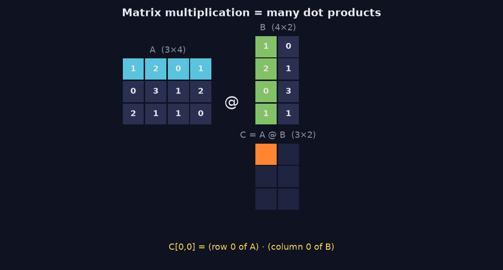
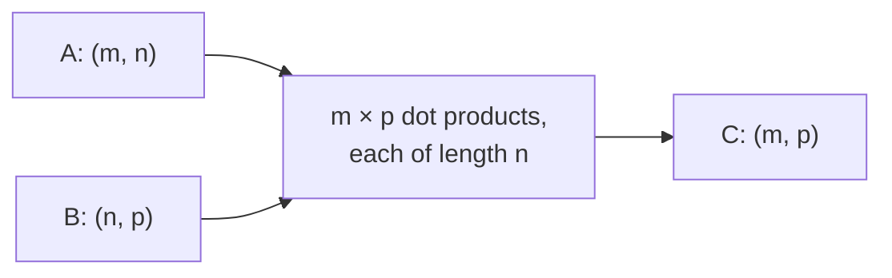

> Tier 1 · Mathematics for AI · **Level: beginner** · Reading time: about 12 minutes

# 1.11 Matrix multiplication

**Metadata** — Tier: 1 · Phase: 1 · Priority: P0 · Difficulty: 3/5 · Interview: Very high · Hands-on: Very high
Prerequisites: 1.3, 1.5, 1.10 · Leads to: 1.12–1.14, 1.19, Tier 3 (layers), Tier 7 (attention), Tier 11 (inference cost)

> **In plain words**
> To multiply two matrices, take **every row of the first and every column of the second**, and compute their **dot product**. Each answer fills one cell of the result.
> It looks like a lot of arithmetic, and it is: matrix multiplication is **the main thing an AI model's hardware does all day**.

**You need first:** 1.3 Matrices, 1.5 Shapes, 1.10 Dot product.

> **Figure 1.11-1 — matrix multiplication as many dot products (animated)**
>
> 
>
> *How to read it:* each entry `C[i, j]` is the dot product of row `i` of `A` with column `j` of `B`. For `C[0,0] = 1·1 + 2·2 + 0·0 + 1·1 = 6`. The inner sizes (both 4) must match and vanish; the result has the outer sizes `(3, 2)`. The animation visits all six cells.
>
> *Generated by* `tier-01-mathematics/figures/src/t1_tensors.py`. The result is asserted equal to `A @ B` and to the manual implementation.

**Words you'll meet on this page**

| Word | What it means here |
|---|---|
| matrix product `AB` | rows of `A` dotted with columns of `B` |
| inner dimension | the size shared by `A`'s columns and `B`'s rows; must match |
| `@` | Python's matrix-multiplication operator |
| FLOPs | floating-point operations: a count of arithmetic work |
| commutative | order does not matter; matrix products are **not** |

### 1. What is it?
If `A` has shape `(m, n)` and `B` has shape `(n, p)`, then `C = AB` has shape `(m, p)` and

`C[i, j] = A[i, 0]·B[0, j] + A[i, 1]·B[1, j] + … + A[i, n−1]·B[n−1, j]`

which is the dot product of row `i` of `A` with column `j` of `B`.

### 2. Why does it exist?
Two reasons:
1. It **combines transformations**: applying `B` and then `A` to a vector equals applying the single matrix `AB`.
2. It computes **many dot products at once**, which is exactly what GPUs are built for.

### 3. Detailed explanation
Three equivalent ways to see it:
1. **Entry view:** each output cell is one dot product.
2. **Column view:** each column of `C` is `A` applied to the matching column of `B`.
3. **Sum-of-layers view:** `AB` is the sum over `k` of (column `k` of `A`) times (row `k` of `B`).

Rules to remember:
- **Inner sizes must match:** `(m, n) @ (n, p)`.
- **Not commutative:** `AB ≠ BA` in general, and `BA` may not even exist.
- **Associative:** `(AB)C = A(BC)`: same result, possibly very different cost.
- **Distributive:** `A(B + C) = AB + AC`.
- **Transpose reverses order:** `(AB)ᵀ = BᵀAᵀ` (1.12).
- `*` (element-wise) and `@` (matrix product) are different operations.

### 4. How does it work?
For each row `i` of `A`, and each column `j` of `B`, multiply along `k` and add. That is `m·n·p` multiply-adds, about `2mnp` FLOPs. Libraries cut the work into tiles that fit in fast memory, so `A @ B` can be thousands of times faster than a plain Python triple loop.

### 5. Simple example
**Two small matrices, by hand.**

`A = [[1, 2], [3, 4]]`, `B = [[5, 6], [7, 8]]`

| Cell | Row of A · column of B | Value |
|---|---|---|
| `C[0,0]` | `[1, 2] · [5, 7] = 5 + 14` | 19 |
| `C[0,1]` | `[1, 2] · [6, 8] = 6 + 16` | 22 |
| `C[1,0]` | `[3, 4] · [5, 7] = 15 + 28` | 43 |
| `C[1,1]` | `[3, 4] · [6, 8] = 18 + 32` | 50 |

So `AB = [[19, 22], [43, 50]]`. And `BA = [[23, 34], [31, 46]]`: different. Order matters.

**A real-life reading.** Rows of `A` are dishes, columns are ingredients (how much of each); `B` lists the price of each ingredient in two shops. `AB` is the cost of every dish in every shop.

### 6. Technical example
- **Linear layer:** `Y = XWᵀ + b`, with `X` of shape `(B·T, d_in)` and `W` of shape `(d_out, d_in)`.
- **Attention scores:** `S = QKᵀ/√dₖ`, with `Q` of shape `(T, d)` and `Kᵀ` of shape `(d, T)`, giving a `(T, T)` table; then `S·V`.
- The forward pass of a dense Transformer is dominated by such products.

### 7. Code
**① By hand (plain Python).** The triple loop, exactly as the definition.

```python
def matmul(A, B):
    m, n, p = len(A), len(B), len(B[0])
    if len(A[0]) != n:
        raise ValueError("inner sizes must match")
    return [[sum(A[i][k] * B[k][j] for k in range(n)) for j in range(p)] for i in range(m)]

A = [[1, 2], [3, 4]]
B = [[5, 6], [7, 8]]
print("AB =", matmul(A, B))
print("BA =", matmul(B, A))
```

```text
AB = [[19, 22], [43, 50]]
BA = [[23, 34], [31, 46]]
```

**② With NumPy.** Same answers, far faster.

```python
import numpy as np

A = np.array([[1, 2], [3, 4]])
B = np.array([[5, 6], [7, 8]])
print(A @ B)
print("AB equals BA?", np.array_equal(A @ B, B @ A))
print("element-wise A * B:\n", A * B)
```

```text
[[19 22]
 [43 50]]
AB equals BA? False
element-wise A * B:
 [[ 5 12]
 [21 32]]
```

**③ With PyTorch.** Batch of matrices and an order-of-operations cost check.

```python
import torch

x = torch.ones(1, 1000)
W1 = torch.ones(1000, 1000)
W2 = torch.ones(1000, 1000)
y = (x @ W1) @ W2          # two cheap vector-matrix products (about 2 million multiplies)
z = x @ (W1 @ W2)          # one huge matrix-matrix product first (about 1 billion multiplies)
print("same answer:", torch.allclose(y, z))
print("multiplies, (x W1) W2:", 2 * 1000 * 1000, "  x (W1 W2):", 1000**3 + 1000 * 1000)
```

```text
same answer: True
multiplies, (x W1) W2: 2000000   x (W1 W2): 1001000000
```

### 8. Input → Process → Output



<details>
<summary><b>Beyond the basics (sections 9–16)</b> — real-world use, limits, mistakes. Skip on a first read.</summary>

### 9. Enterprise use case
Batch-scoring services stack requests into one matrix so a single large product replaces many small ones, raising GPU use and lowering cost per request.

### 10. AI engineering connection
Training and inference are mostly matrix products. The rule of thumb "FLOPs per token ≈ 2 × parameters" for a dense forward pass comes from this. LoRA fine-tuning (Tier 10) replaces a big update with a product of two thin matrices.

### 11. Advantages
Highly optimised hardware paths (BLAS, tensor cores); composes linear maps neatly.

### 12. Limitations
Cost grows with the product of the three sizes. Attention's `(T, T)` score table makes cost and memory quadratic in sequence length.

### 13. Trade-offs
Lower precision (bf16, fp16, int8) speeds things up and saves memory but costs accuracy (1.40). Bigger batches raise throughput but also latency and memory.

### 14. Common mistakes
Using `*` instead of `@`; wrong operand order; forgetting `(AB)ᵀ = BᵀAᵀ`; a poor order in a chain; forgetting the batch axis (`@` works over leading axes in NumPy and PyTorch).

### 15. Performance / cost
About `2mnp` FLOPs. A `(4096×4096) @ (4096×4096)` product is about 1.4 × 10¹¹ FLOPs. Small matrices are limited by memory and launch overhead, not arithmetic, so batching matters.

### 16. Security
Bound the size of user-controlled operands to avoid resource exhaustion. Reduced-precision accumulation can change outputs slightly between hardware, so do not rely on bit-exact results across devices.

</details>

### 17. Interview explanation
"Matrix multiplication takes the dot product of every row of the first matrix with every column of the second, so the inner sizes must match. It composes linear transformations, and neural-network layers and attention are made of it, which is why GPUs and tensor cores are tuned for it."

### 18. Rapid-fire answer
`(m,n)@(n,p) → (m,p)`; each entry is a row–column dot product; associative, not commutative; about `2mnp` FLOPs.

### 19. Interview questions
- **Basic:** What is the shape of `(3,4)@(4,5)`? Is `AB = BA`?
- **Intermediate:** What is the difference between `@`, `*` and `np.dot` for 2-D arrays?
- **Advanced:** Why is `(AB)ᵀ = BᵀAᵀ`? Why does the order in a chain `ABC` matter for cost?
- **Scenario:** A batch of 64 is slower per sample than a batch of 8 on a small GPU. What could limit you (memory, compute, padding)?

### 20. Hands-on exercise
**Goal:** multiply by hand, then check.

1. Compute `[[1, 0], [2, 1]] @ [[3, 4], [5, 6]]` by hand (row · column).
2. Compute the product in the other order.
3. Check both with NumPy.

<details>
<summary>Show a solution</summary>

```python
import numpy as np

A = np.array([[1, 0], [2, 1]])
B = np.array([[3, 4], [5, 6]])
print("AB =\n", A @ B)
print("BA =\n", B @ A)
```

```text
AB =
 [[ 3  4]
 [11 14]]
BA =
 [[11  4]
 [17  6]]
```

By hand: row 0 of `A` is `[1, 0]`, so row 0 of `AB` is just row 0 of `B`, `[3, 4]`. Row 1: `2·[3, 4] + 1·[5, 6] = [11, 14]`. The two orders differ.
</details>

### 21. Revision questions
1. How many FLOPs does `(m, n) @ (n, p)` need, roughly?
2. Which holds: commutative, associative, distributive?
3. What does `QKᵀ` compute?

### 22. Related concepts
1.10 Dot product · 1.12 Transpose · 1.19 SVD · Tier 7 Attention · Tier 10 LoRA

### 23. One-line memory hook
**Row meets column, dot product, repeat; inner sizes must agree.**

<details>
<summary><b>For reviewers</b> (not part of the lesson)</summary>

- Status: DRAFT, learner-first layout (Author: Claude). Code is executed by `tests/test_md_snippets.py`.
- TESTED earlier: rectangular match vs NumPy, inner-dimension error, non-commutativity, associativity, FLOP formula (`test_linalg_core.py`, `test_linalg_basics.py`). The earlier timing exercise (manual vs `@`) is covered by the tier's lab tests and is not repeated here because timings are machine-dependent.
- The multiply counts in the PyTorch example are arithmetic, not measurements.
</details>
