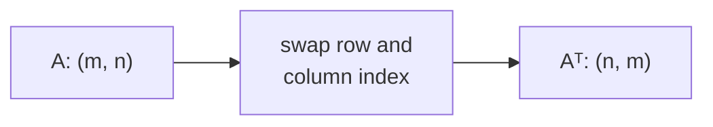

> Tier 1 · Mathematics for AI · **Level: beginner** · Reading time: about 7 minutes

# 1.12 Matrix transpose

**Metadata** — Tier: 1 · Phase: 1 · Priority: P0 · Difficulty: 1/5 · Interview: Medium · Hands-on: Very high
Prerequisites: 1.3, 1.11 · Leads to: 1.14, 1.18, 1.19, Tier 7 (`QKᵀ`)

> **In plain words**
> The **transpose** of a matrix **flips it over its diagonal**: rows become columns and columns become rows. A `(2, 3)` grid becomes a `(3, 2)` grid.
> It is mainly used to **make shapes fit** before a multiplication.

**You need first:** 1.3 Matrices, 1.11 Matrix multiplication.

> **Figure 1.12-1 — flipping a matrix over its diagonal**
>
> ```mermaid
> flowchart LR
>     subgraph A["A, shape (2, 3)"]
>         direction TB
>         a1["1  2  3"]
>         a2["4  5  6"]
>     end
>     subgraph T["Aᵀ, shape (3, 2)"]
>         direction TB
>         t1["1  4"]
>         t2["2  5"]
>         t3["3  6"]
>     end
>     A -->|"swap rows and columns"| T
> ```
>
> *How to read it:* the first **row** of `A` (`1 2 3`) becomes the first **column** of `Aᵀ`. The entry in row `i`, column `j` of `A` moves to row `j`, column `i`. The shape `(2, 3)` becomes `(3, 2)`.

**Words you'll meet on this page**

| Word | What it means here |
|---|---|
| transpose `Aᵀ` | `A` flipped over its diagonal |
| symmetric | a matrix equal to its own transpose |
| view | a different way of looking at the same data, without copying it |
| contiguous | stored in memory in the usual row-by-row order |

### 1. What is it?
`Aᵀ` is the matrix with `(Aᵀ)[i, j] = A[j, i]`. Shape `(m, n)` becomes `(n, m)`.

### 2. Why does it exist?
To make the shapes of a product line up, and to switch between "rows" and "columns". For example, to take the dot product of every row of one matrix with every row of another, you transpose one of them.

### 3. Detailed explanation
Rules:
- `(Aᵀ)ᵀ = A`: flipping twice gives the original.
- `(A + B)ᵀ = Aᵀ + Bᵀ`.
- `(AB)ᵀ = BᵀAᵀ`: **the order reverses**. (A common mistake is `AᵀBᵀ`.)
- A matrix with `A = Aᵀ` is **symmetric**. Covariance matrices (1.32) are symmetric, and so is `AᵀA` for any real `A`.

### 4. How does it work?
Swap the row and column index of every entry. In NumPy and PyTorch, `.T` does not copy any data; it returns a **view** that just reads the same memory in a different order. The result may therefore be *non-contiguous*.

### 5. Simple example
A table with students in rows and subjects in columns:

| | maths | art |
|---|---|---|
| Ann | 90 | 70 |
| Bo | 60 | 85 |
| Cy | 75 | 80 |

Its transpose has subjects in rows and students in columns:

| | Ann | Bo | Cy |
|---|---|---|---|
| maths | 90 | 60 | 75 |
| art | 70 | 85 | 80 |

Same numbers, different view: shape `(3, 2)` became `(2, 3)`.

### 6. Technical example
Attention scores `S = Q Kᵀ`: with `Q` of shape `(T, d)` and `K` of shape `(T, d)`, the transpose `Kᵀ` has shape `(d, T)`, so `S` has shape `(T, T)`: the dot product of every query with every key. PyTorch's `Linear` stores `W` as `(out, in)` and computes `x Wᵀ`.

### 7. Code
**① By hand (plain Python).**

```python
def transpose(A):
    return [[A[i][j] for i in range(len(A))] for j in range(len(A[0]))]

A = [[1, 2, 3], [4, 5, 6]]
print("A  :", A)
print("Aᵀ :", transpose(A))
print("twice gives A back:", transpose(transpose(A)) == A)
```

```text
A  : [[1, 2, 3], [4, 5, 6]]
Aᵀ : [[1, 4], [2, 5], [3, 6]]
twice gives A back: True
```

**② With NumPy.**

```python
import numpy as np

A = np.arange(6.0).reshape(2, 3)
B = np.arange(12.0).reshape(3, 4)
print("shapes:", A.shape, "->", A.T.shape)
print("(AB)ᵀ == BᵀAᵀ :", np.allclose((A @ B).T, B.T @ A.T))
print("A.T is contiguous:", A.T.flags["C_CONTIGUOUS"], "(it is a view)")
print("1-D array transposed:", np.arange(3).T.shape)
```

```text
shapes: (2, 3) -> (3, 2)
(AB)ᵀ == BᵀAᵀ : True
A.T is contiguous: False (it is a view)
1-D array transposed: (3,)
```

**③ With PyTorch.** All query–key scores in one line.

```python
import torch

Q = torch.tensor([[1., 0.], [0., 1.], [1., 1.]])     # 3 queries of size 2
K = torch.tensor([[1., 0.], [0., 2.], [1., 1.]])     # 3 keys of size 2
S = Q @ K.T                                           # (3,2) @ (2,3) -> (3,3)
print(S)
```

```text
tensor([[1., 0., 1.],
        [0., 2., 1.],
        [1., 2., 2.]])
```

### 8. Input → Process → Output



<details>
<summary><b>Beyond the basics (sections 9–16)</b> — real-world use, limits, mistakes. Skip on a first read.</summary>

### 9. Enterprise use case
Converting between row-major and column-major feature layouts expected by different libraries and serving formats.

### 10. AI engineering connection
Attention scores, the normal equations (`XᵀX`), covariance and backpropagation all use transposes: the gradient of `Y = XW` with respect to `W` is `Xᵀ·dY`.

### 11. Advantages
Almost free: it is a view in most libraries.

### 12. Limitations
Views can be non-contiguous, so some operations (like `view`) then fail or must copy.

### 13. Trade-offs
Calling `.contiguous()` costs memory and time but can make later operations faster.

### 14. Common mistakes
Believing `(AB)ᵀ = AᵀBᵀ`; transposing a 1-D array (it does nothing: `(n,)` stays `(n,)`); using `.T` on tensors with more than 2 axes (use `permute` and name the axes).

### 15. Performance / cost
`O(1)` as a view; `O(mn)` if the data is actually moved.

### 16. Security
Nothing specific.

</details>

### 17. Interview explanation
"Transpose swaps rows and columns. It is how we line up dimensions; for example attention computes Q times K-transpose to get every query–key dot product. And transposing a product reverses the order."

### 18. Rapid-fire answer
Swap rows and columns; `(AB)ᵀ = BᵀAᵀ`; `.T` is a view.

### 19. Interview questions
- **Basic:** What is the shape of the transpose of a `(2, 3)` matrix?
- **Intermediate:** What does `.T` do to a 1-D array?
- **Advanced:** What is the gradient of `L` with respect to `W` in `Y = XW`? (Hint: it contains `Xᵀ`.)
- **Scenario:** `view` fails after `transpose`. Why, and how do you fix it?

### 20. Hands-on exercise
**Goal:** see that a transposed array is a view.

1. Make `A = np.arange(6).reshape(2, 3)` and `T = A.T`.
2. Change `A[0, 0]` to 100.
3. Look at `T[0, 0]`. What do you see, and why?

<details>
<summary>Show a solution</summary>

```python
import numpy as np

A = np.arange(6).reshape(2, 3)
T = A.T
A[0, 0] = 100
print("T[0, 0] =", T[0, 0])
print("shares memory:", np.shares_memory(A, T))
```

```text
T[0, 0] = 100
shares memory: True
```

`T` is not a copy: it reads the same memory as `A`, so a change in one shows in the other.
</details>

### 21. Revision questions
1. What is `(AB)ᵀ`?
2. What is a symmetric matrix?
3. Is transposing a 1-D array useful?

### 22. Related concepts
1.11 Matrix multiplication · 1.18 Eigenvalues · 1.19 SVD

### 23. One-line memory hook
**Flip over the diagonal; products flip their order.**

<details>
<summary><b>For reviewers</b> (not part of the lesson)</summary>

- Status: DRAFT, learner-first layout (Author: Claude). Code is executed by `tests/test_md_snippets.py`.
- TESTED earlier: `transpose_manual` and `test_transpose_properties` in `code/linalg_core.py`.
- Figure 1.12-1 is a Mermaid diagram.
</details>
