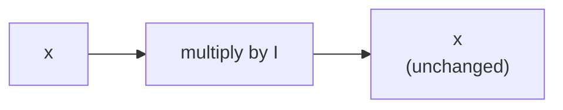

> Tier 1 · Mathematics for AI · **Level: beginner** · Reading time: about 6 minutes

# 1.13 Identity matrices

**Metadata** — Tier: 1 · Phase: 1 · Priority: P1 · Difficulty: 1/5 · Interview: Low · Hands-on: Medium
Prerequisites: 1.3, 1.11 · Leads to: 1.14 Inverse, ridge regularisation, residual connections

> **In plain words**
> The **identity matrix** is the matrix that **does nothing**: multiply any vector by it and you get the same vector back.
> It is the matrix version of the number **1**. It matters because the idea of an "undo" matrix (the inverse, 1.14) is defined with it.

**You need first:** 1.3 Matrices and 1.11 Matrix multiplication.

> **Figure 1.13-1 — the identity matrix leaves everything unchanged**
>
> ```mermaid
> flowchart LR
>     X["x = [3, 5]"] --> I["I = [[1, 0],<br/>[0, 1]]"]
>     I --> Y["I·x = [3, 5]"]
> ```
>
> *How to read it:* the identity has **ones on the diagonal and zeros elsewhere**. Multiplying: first output = `1·3 + 0·5 = 3`; second output = `0·3 + 1·5 = 5`. Nothing changed.

**Words you'll meet on this page**

| Word | What it means here |
|---|---|
| identity matrix `I` | square matrix with 1 on the diagonal, 0 elsewhere |
| diagonal | the entries from top-left to bottom-right |
| neutral element | a thing that changes nothing when combined (0 for adding, 1 for multiplying) |
| ridge / `λI` | adding a small multiple of `I` to stabilise a calculation |

### 1. What is it?
The square matrix `I` with 1s on the diagonal and 0s everywhere else. `Iₙ` is the `n × n` version.

### 2. Why does it exist?
Every kind of arithmetic needs a "do nothing" element. For multiplication of numbers it is 1; for multiplication of matrices it is `I`. Without it we could not even define the inverse.

### 3. Detailed explanation
- `AI = IA = A` and `Ix = x`, for matching sizes.
- `Iᵀ = I`, and `I⁻¹ = I`.
- All eigenvalues of `I` are 1 (1.18).
- The inverse of `A` is the matrix `A⁻¹` with `AA⁻¹ = I` (1.14).

### 4. How does it work?
`I[i, j] = 1` if `i = j`, otherwise `0`. The size matters: for a `(3, 2)` matrix `A`, `IA` uses a `3 × 3` identity but `AI` uses a `2 × 2` one.

### 5. Simple example
Multiplying a number by 1; a photo filter set to "no change".

Checking with numbers: `[[1, 0], [0, 1]] · [[2, 7], [4, 9]]`:

| Cell | Row of I · column | Value |
|---|---|---|
| (0,0) | `1·2 + 0·4` | 2 |
| (0,1) | `1·7 + 0·9` | 7 |
| (1,0) | `0·2 + 1·4` | 4 |
| (1,1) | `0·7 + 1·9` | 9 |

The result is the original matrix.

### 6. Technical example
- **Ridge regression** solves `(XᵀX + λI) w = Xᵀy`. Adding `λI` makes a nearly-singular matrix safely invertible and calms the answer.
- A **residual block** computes `x + F(x)`. In the linear case that is `(I + F) x`: the identity is the "skip" path.

### 7. Code
**① By hand (plain Python).**

```python
def identity(n):
    return [[1 if i == j else 0 for j in range(n)] for i in range(n)]

print(identity(3))
```

```text
[[1, 0, 0], [0, 1, 0], [0, 0, 1]]
```

**② With NumPy.** `np.eye` is the library version.

```python
import numpy as np

A = np.array([[2.0, 7.0], [4.0, 9.0]])
I = np.eye(2)
print("A @ I equals A:", np.allclose(A @ I, A))
print("I @ A equals A:", np.allclose(I @ A, A))
x = np.array([3.0, 5.0])
print("I @ x =", I @ x)
```

```text
A @ I equals A: True
I @ A equals A: True
I @ x = [3. 5.]
```

**③ With PyTorch.** Ridge: adding `λI` rescues a matrix that cannot be inverted.

```python
import torch

X = torch.tensor([[1., 2.], [2., 4.], [3., 6.]])          # second column = 2 x first: duplicated information
G = X.T @ X                                                # singular (cannot be inverted)
print("determinant of XᵀX:", abs(round(torch.linalg.det(G).item(), 6)), "(zero: cannot be inverted)")
G_ridge = G + 0.1 * torch.eye(2)
print("determinant after + 0.1·I:", round(torch.linalg.det(G_ridge).item(), 4))
```

```text
determinant of XᵀX: 0.0 (zero: cannot be inverted)
determinant after + 0.1·I: 7.01
```

### 8. Input → Process → Output



<details>
<summary><b>Beyond the basics (sections 9–16)</b> — real-world use, limits, mistakes. Skip on a first read.</summary>

### 9. Enterprise use case
Adding `λI` is a standard fix in regression pipelines when features are collinear.

### 10. AI engineering connection
Residual connections, identity initialisation, and `λI` damping in optimisers (for example Levenberg–Marquardt and other second-order methods).

### 11. Advantages
Simple, exactly representable, always invertible.

### 12. Limitations
Square only. A large `λ` biases the solution.

### 13. Trade-offs
Larger `λ` gives more stability and more bias.

### 14. Common mistakes
Using `np.ones` instead of `np.eye`; mismatched sizes (`I` must be `n × n` for the dimension it acts on).

### 15. Performance / cost
Never build `I` just to multiply by it; that is a no-op. A dense `n × n` identity costs `O(n²)` memory.

### 16. Security
Nothing specific.

</details>

### 17. Interview explanation
"The identity matrix leaves any vector unchanged. It matters because it defines the inverse, and because adding a small multiple of it to a nearly singular matrix, as in ridge regression, makes the problem solvable."

### 18. Rapid-fire answer
Ones on the diagonal; `AI = IA = A`; defines inverses; `+λI` stabilises.

### 19. Interview questions
- **Basic:** What is `I·x`?
- **Intermediate:** Why does ridge regression add `λI`?
- **Advanced:** What are the eigenvalues of `XᵀX + λI` in terms of those of `XᵀX`?
- **Scenario:** `XᵀX` is singular because of duplicated features. What do you do?

### 20. Hands-on exercise
**Goal:** check the identity rules.

1. Build `A = [[1, 2], [3, 4]]`.
2. Check `A @ I` and `I @ A` both give `A`.
3. Compute `A @ I @ I @ I`. What do you expect?

<details>
<summary>Show a solution</summary>

```python
import numpy as np

A = np.array([[1, 2], [3, 4]])
I = np.eye(2, dtype=int)
print(A @ I)
print(np.array_equal(A @ I @ I @ I, A))
```

```text
[[1 2]
 [3 4]]
True
```

Multiplying by `I` any number of times changes nothing.
</details>

### 21. Revision questions
1. What is `AI`?
2. What is `I⁻¹`?
3. Why add `λI` in ridge regression?

### 22. Related concepts
1.14 Inverse · 1.18 Eigenvalues · Tier 8 Residual connections

### 23. One-line memory hook
**Identity: the matrix that changes nothing.**

<details>
<summary><b>For reviewers</b> (not part of the lesson)</summary>

- Status: DRAFT, learner-first layout (Author: Claude). Code is executed by `tests/test_md_snippets.py`.
- TESTED earlier: `test_identity_neutral` in `code/linalg_core.py`.
</details>
