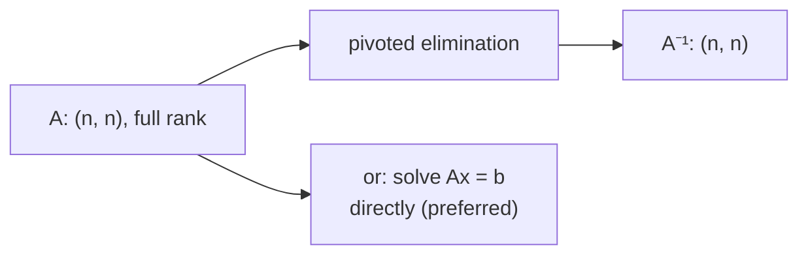

> Tier 1 · Mathematics for AI · **Level: beginner–intermediate** · Reading time: about 10 minutes

# 1.14 Matrix inverse

**Metadata** — Tier: 1 · Phase: 1 · Priority: P1 · Difficulty: 3/5 · Interview: Medium · Hands-on: High
Prerequisites: 1.11, 1.13 · Leads to: linear regression (Tier 2), 1.19 SVD, pseudo-inverse

> **In plain words**
> The **inverse** of a matrix is its **"undo" button**. If a matrix `A` turns `x` into `y`, then `A⁻¹` turns `y` back into `x`.
> It exists only if `A` did not squash information away (and for square matrices). In practice you almost never compute it explicitly; you **solve** the equation instead.

**You need first:** 1.11 Matrix multiplication and 1.13 Identity matrices.

> **Figure 1.14-1 — an inverse undoes the matrix**
>
> ```mermaid
> flowchart LR
>     X["x = [1, 2]"] -->|"A = [[4, 1],[2, 3]]"| Y["y = A·x = [6, 8]"]
>     Y -->|"A⁻¹ = [[0.3, −0.1],[−0.2, 0.4]]"| Z["A⁻¹·y = [1, 2]"]
> ```
>
> *How to read it:* `A` sends `[1, 2]` to `[6, 8]`. The inverse `A⁻¹` sends `[6, 8]` straight back to `[1, 2]`. Together they do nothing: `A⁻¹A = I` (1.13).

**Words you'll meet on this page**

| Word | What it means here |
|---|---|
| inverse `A⁻¹` | the matrix with `AA⁻¹ = A⁻¹A = I` |
| singular | has no inverse; it squashes some direction to nothing |
| full rank | no column is a combination of the others; no information is lost |
| determinant | one number; zero means singular |
| condition number `κ` | how much an inverse amplifies small errors |
| `solve` | computing `x` in `Ax = b` without forming `A⁻¹` |

### 1. What is it?
For a **square** matrix `A`, the inverse `A⁻¹` satisfies `AA⁻¹ = A⁻¹A = I`. It reverses what `A` did.

### 2. Why does it exist?
To solve `Ax = b` (find the `x` that `A` turns into `b`) as `x = A⁻¹b`, and to reverse linear transformations.

### 3. Detailed explanation
**When does it exist?** Only if `A` is square and **full rank** (its determinant is not 0; its columns are independent). Otherwise `A` is **singular**: it collapses some direction to nothing, and no matrix could bring that lost information back.

**Rules:** `(AB)⁻¹ = B⁻¹A⁻¹` (order reverses) and `(Aᵀ)⁻¹ = (A⁻¹)ᵀ`.

**"Invertible" is not a yes/no in a computer.** The **condition number** `κ(A) = σ_max / σ_min` (1.19) says how much errors get blown up when you invert. A huge `κ` means the answer is meaningless even though the matrix is technically invertible. Example: `[[1, 1.0000001], [1, 1]]` has `κ` in the tens of millions.

### 4. How does it work?
**Gauss–Jordan elimination.** Write `[A | I]` side by side and apply row operations (with pivoting for stability) until the left half becomes `I`; the right half is then `A⁻¹`. Cost: `O(n³)`.

### 5. Simple example
Undo "multiply by 2" with "multiply by ½". Undo a rotation by rotating back.

**By hand, a 2 × 2 inverse.** For `A = [[a, b], [c, d]]` with determinant `D = ad − bc`:

`A⁻¹ = (1/D) · [[d, −b], [−c, a]]`

For `A = [[4, 1], [2, 3]]`: `D = 4·3 − 1·2 = 10`, so `A⁻¹ = (1/10)·[[3, −1], [−2, 4]] = [[0.3, −0.1], [−0.2, 0.4]]`.

Check: `A⁻¹ · [6, 8] = [0.3·6 − 0.1·8, −0.2·6 + 0.4·8] = [1.0, 2.0]`. ✓

### 6. Technical example
Linear regression's normal equations give `w = (XᵀX)⁻¹ Xᵀ y`. In practice you **solve** the system with a factorisation (QR, SVD or `solve`) rather than forming the inverse.

### 7. Code
**① By hand (plain Python).** The 2 × 2 formula.

```python
def inverse_2x2(A):
    (a, b), (c, d) = A
    det = a * d - b * c
    if det == 0:
        raise ValueError("singular matrix: no inverse")
    return [[d / det, -b / det], [-c / det, a / det]]

print(inverse_2x2([[4, 1], [2, 3]]))
try:
    inverse_2x2([[1, 2], [2, 4]])          # second row = 2 x first row
except ValueError as e:
    print("error:", e)
```

```text
[[0.3, -0.1], [-0.2, 0.4]]
error: singular matrix: no inverse
```

**② With NumPy.** Prefer `solve` to `inv`.

```python
import numpy as np

A = np.array([[4.0, 1.0], [2.0, 3.0]])
b = np.array([6.0, 8.0])
print("inverse:\n", np.linalg.inv(A))
print("A @ inverse is I:", np.allclose(A @ np.linalg.inv(A), np.eye(2)))
print("solve(A, b)  :", np.linalg.solve(A, b))        # preferred
B = np.array([[1.0, 1.0000001], [1.0, 1.0]])
print("condition number of a nearly singular matrix: %.2e" % np.linalg.cond(B))
```

```text
inverse:
 [[ 0.3 -0.1]
 [-0.2  0.4]]
A @ inverse is I: True
solve(A, b)  : [1. 2.]
condition number of a nearly singular matrix: 4.00e+07
```

**③ With PyTorch.**

```python
import torch

A = torch.tensor([[4.0, 1.0], [2.0, 3.0]])
b = torch.tensor([6.0, 8.0])
print("solve:", torch.linalg.solve(A, b).tolist())
print("A @ A⁻¹ ≈ I:", torch.allclose(A @ torch.linalg.inv(A), torch.eye(2), atol=1e-6))
```

```text
solve: [1.0, 2.0]
A @ A⁻¹ ≈ I: True
```

### 8. Input → Process → Output



<details>
<summary><b>Beyond the basics (sections 9–16)</b> — real-world use, limits, mistakes. Skip on a first read.</summary>

### 9. Enterprise use case
Analytic and regression models in risk or forecasting pipelines solve the normal equations; monitoring `κ` flags unstable feature sets.

### 10. AI engineering connection
Closed-form linear models, Gaussian processes, whitening and second-order methods. Deep learning almost never inverts large matrices; it uses gradient methods instead.

### 11. Advantages
Exact for small, well-conditioned systems; conceptually clean.

### 12. Limitations
`O(n³)` time and `O(n²)` memory; unstable when ill-conditioned; undefined for singular or non-square matrices.

### 13. Trade-offs
Factorisation-based `solve` (LU, Cholesky, QR) is faster and more accurate than forming `A⁻¹`. Form the inverse only when you need it many times, or need the inverse itself.

### 14. Common mistakes
Writing `inv(A) @ b` instead of `solve(A, b)`; ignoring the condition number; inverting `XᵀX` with collinear features; trusting a "small determinant" test (the determinant depends on units).

### 15. Performance / cost
About `2n³` FLOPs. A 10,000 × 10,000 float64 matrix is 800 MB and not something to invert casually.

### 16. Security
Limit the size of user-supplied matrices, and do not expose raw solver errors.

</details>

### 17. Interview explanation
"The inverse undoes a matrix, but it only exists for square, full-rank matrices. In practice I almost never form it: I solve the linear system with a factorisation and check the condition number, because an ill-conditioned matrix gives garbage even when it is technically invertible."

### 18. Rapid-fire answer
`AA⁻¹ = I`; needs square and full rank; prefer `solve`; watch the condition number.

### 19. Interview questions
- **Basic:** When does an inverse exist?
- **Intermediate:** Why prefer `np.linalg.solve` to `inv`?
- **Advanced:** What is the condition number and how does it relate to singular values?
- **Scenario:** Regression coefficients explode after you add a duplicated feature. Why, and how do you fix it (drop it, ridge `+λI`, pseudo-inverse)?

### 20. Hands-on exercise
**Goal:** see a singular matrix fail and a tiny change rescue it.

1. Make `A = [[1, 2], [2, 4]]` (second row is twice the first). Compute its determinant.
2. Try `np.linalg.inv(A)` and catch the error.
3. Add `0.01·I` to `A` and invert again.

<details>
<summary>Show a solution</summary>

```python
import numpy as np

A = np.array([[1.0, 2.0], [2.0, 4.0]])
print("determinant:", np.linalg.det(A))
try:
    np.linalg.inv(A)
except np.linalg.LinAlgError as e:
    print("inverse failed:", e)
print("after adding 0.01·I, the inverse exists:\n", np.linalg.inv(A + 0.01 * np.eye(2)).round(2))
```

```text
determinant: 0.0
inverse failed: Singular matrix
after adding 0.01·I, the inverse exists:
 [[ 80.04 -39.92]
 [-39.92  20.16]]
```

The nudged matrix is invertible, but notice the huge entries: it is badly conditioned. Ridge trades a little accuracy for stability.
</details>

### 21. Revision questions
1. What are the conditions for a matrix to be invertible?
2. What is `(AB)⁻¹`?
3. Why avoid forming explicit inverses?

### 22. Related concepts
1.13 Identity · 1.19 SVD · Tier 2 Linear regression

### 23. One-line memory hook
**An undo button for a matrix: it exists only if nothing was squashed. Use `solve`, not `inv`.**

<details>
<summary><b>For reviewers</b> (not part of the lesson)</summary>

- Status: DRAFT, learner-first layout (Author: Claude). Code is executed by `tests/test_md_snippets.py`.
- TESTED earlier: `inverse_manual` matches `np.linalg.inv`, round-trip to `I`, singular and non-square inputs raise, `solve` residual (`test_linalg_core.py`).
- The "tens of millions" condition number is printed by the code on this page.
</details>
