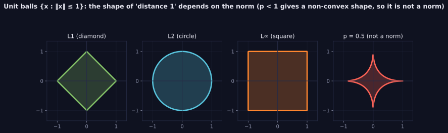

> Tier 1 — Mathematics for AI · Status: DRAFT (Author: Claude) · Code: `code/linalg_core.py` — TESTED

# 1.15 Norms

**Metadata** — Tier: 1 · Phase: 1 · Priority: P0 · Difficulty: 2/5 · Interview: High · Hands-on: High
Prerequisites: 1.2, 1.9, 1.10 · Leads to: 1.16, 1.17, weight decay, gradient clipping

### 1. What is it?
A norm `‖x‖` assigns a vector a non-negative "size". Common ones:
- **L2 (Euclidean):** `‖x‖₂ = √Σxᵢ²`
- **L1 (Manhattan):** `‖x‖₁ = Σ|xᵢ|`
- **L∞ (max):** `‖x‖∞ = maxᵢ|xᵢ|`
- **Lp:** `(Σ|xᵢ|ᵖ)^(1/p)`, `p ≥ 1`
- **Frobenius (matrices):** `‖A‖_F = √Σ Aᵢⱼ²`

### 2. Why does it exist?
We need to measure magnitude: error size, weight size, gradient size, vector length. Norms also define distance (1.16).

### 3. Detailed explanation
A function is a norm iff it satisfies: (1) `‖x‖ ≥ 0`, and `=0` only for `x=0`; (2) homogeneity `‖cx‖ = |c|‖x‖`; (3) triangle inequality `‖x+y‖ ≤ ‖x‖+‖y‖`. For `p<1` the triangle inequality fails, so it is *not* a norm (the "L0 norm", the count of nonzeros, is also not a norm). Geometrically, the unit ball is a diamond for L1, a circle for L2, a square for L∞. L1's corners are why L1 penalties push weights to exact zero (sparsity); L2 shrinks them smoothly.

### 4. How does it work?
Take absolute values, raise to `p`, sum, take the `p`-th root. `‖x‖₂² = x·x` links norms to the dot product (1.10), and `a·b = ‖a‖‖b‖cosθ`.

> **Figure 1.15-1 — unit balls of different norms**



*How to read it:* Each shape is the set of points whose norm is at most 1. L1 is a diamond, L2 a circle, L∞ a square. The corners of the L1 diamond are why L1 penalties push weights to exactly zero. For p < 1 the shape is not convex (it bends inward), so the triangle inequality fails and it is not a norm.

*Generated by* `tier-01-mathematics/figures/src/t1_geometry.py` *from this chapter's code, so the numbers are computed, not typed in.*

### 5. Simple example
Walking from (0,0) to (3,4): straight-line 5 (L2), city-block 7 (L1), longest single leg 4 (L∞).

### 6. Technical example
- Weight decay / L2 regularization: `L + λ‖w‖₂²`.
- Lasso: `L + λ‖w‖₁` for sparse weights.
- Gradient clipping: if `‖g‖₂ > c`, replace `g ← g · c/‖g‖₂` (global norm over all parameters).
- Embedding normalization: `x/‖x‖₂`.

### 7. Code
```python
import numpy as np
from linalg_core import norm_p
x = np.array([3.0, -4.0])
print(norm_p(x, 1), norm_p(x, 2), norm_p(x, np.inf))   # 7.0 5.0 4.0
g = np.array([30.0, 40.0]); c = 5.0
g_clipped = g * min(1.0, c / np.linalg.norm(g))        # norm becomes 5
```
TESTED: known values, agreement with `np.linalg.norm`, triangle inequality, homogeneity, `p<1` rejected.

### 8. Input → Process → Output
`vector/matrix → |·|ᵖ, sum, root → non-negative scalar`

### 9. Enterprise use case
Monitoring gradient or embedding norms in training/serving is an early-warning signal for divergence and drift.

### 10. AI engineering connection
Regularization, gradient clipping (stability), normalized embeddings, LayerNorm (uses mean/variance, a related scale control), error metrics (MAE ~ L1, MSE/RMSE ~ L2).

### 11. Advantages
Cheap, well understood, differentiable (L2 everywhere; L1 except at 0).

### 12. Limitations
L2 is sensitive to outliers (squaring); L1 is not smooth at 0; norms ignore direction.

### 13. Trade-offs
L1: sparsity + robustness, harder optimization. L2: smooth, stable, no sparsity. L∞: controls worst case (adversarial robustness).

### 14. Common mistakes
Calling `‖x‖₂²` "the norm"; dividing by a zero norm; clipping per-tensor when global-norm clipping was intended; treating L0 as a norm.

### 15. Performance / cost
`O(n)`; computing global gradient norm needs a reduction across all parameters (and across devices in distributed training).

### 16. Security
Adversarial perturbation budgets are expressed as Lp balls (e.g., `‖δ‖∞ ≤ ε`). Norm-bounded inputs are a defense knob, not a guarantee.

### 17. Interview explanation
"A norm measures the size of a vector. L2 is the usual length, L1 sums absolute values and encourages sparsity, and L∞ is the largest entry. In training I use the L2 norm for weight decay and for clipping gradients so a bad batch can't blow up the update."

### 18. Rapid-fire
Norm = size; L1 sparse, L2 smooth, L∞ worst-case; clip gradients by global L2 norm.

### 19. Interview questions
- Basic: `‖[3,-4]‖₂`?
- Intermediate: Why does L1 give sparse solutions and L2 doesn't?
- Advanced: Why is `p<1` not a norm? What is the Frobenius norm?
- Scenario: Loss spikes to NaN every few thousand steps — what norm-based safeguards do you add?

### 20. Hands-on exercise
Implement global-norm clipping over a list of gradient arrays; test that the clipped global norm equals `c` and that small gradients are unchanged.

### 21. Revision questions
1) Three norm axioms? 2) Unit-ball shapes of L1/L2/L∞? 3) L2 vs squared L2?

### 22. Related concepts
1.16 Distance metrics · 1.17 Cosine similarity · Tier 4 gradient clipping, regularization

### 23. Memory hook
**Norm = ruler for vectors: L1 counts blocks, L2 uses a string, L∞ takes the biggest step.**
