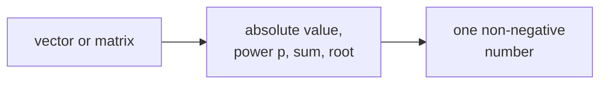

> Tier 1 · Mathematics for AI · **Level: beginner** · Reading time: about 9 minutes

# 1.15 Norms

**Metadata** — Tier: 1 · Phase: 1 · Priority: P0 · Difficulty: 2/5 · Interview: High · Hands-on: High
Prerequisites: 1.2, 1.9, 1.10 · Leads to: 1.16, 1.17, weight decay, gradient clipping

> **In plain words**
> A **norm** is a **ruler for vectors**: it gives a vector one non-negative number saying how "big" it is.
> There is more than one way to measure. **L2** is the straight-line length, **L1** adds up the steps along each direction (like walking city blocks), and **L∞** takes just the biggest single step.

**You need first:** 1.2 Vectors, 1.9 Scalar multiplication, 1.10 Dot product.

> **Figure 1.15-1 — unit balls of different norms**
>
> 
>
> *How to read it:* each shape is the set of points whose norm is at most 1. L1 is a diamond, L2 a circle, L∞ a square. The corners of the L1 diamond are why L1 penalties push weights to exactly zero. For `p < 1` the shape bends inward (not convex), so the triangle inequality fails and it is not a norm.
>
> *Generated by* `tier-01-mathematics/figures/src/t1_geometry.py`.

**Words you'll meet on this page**

| Word | What it means here |
|---|---|
| norm `‖x‖` | a non-negative "size" of a vector |
| L2 (Euclidean) | `√(x₁² + x₂² + …)`: straight-line length |
| L1 (Manhattan) | `|x₁| + |x₂| + …`: sum of absolute values |
| L∞ (max) | the largest absolute entry |
| Frobenius norm | the L2 norm of a matrix, treating it as one long list |
| regularisation | a penalty that discourages large weights |
| gradient clipping | shrinking a gradient whose norm is too large |

### 1. What is it?
A norm `‖x‖` gives a vector a size. The common ones:

- **L2 (Euclidean):** `‖x‖₂ = √(Σ xᵢ²)`
- **L1 (Manhattan):** `‖x‖₁ = Σ |xᵢ|`
- **L∞ (max):** `‖x‖∞ = maxᵢ |xᵢ|`
- **Lp:** `(Σ |xᵢ|ᵖ)^(1/p)` for `p ≥ 1`
- **Frobenius (for matrices):** `‖A‖_F = √(Σ Aᵢⱼ²)`

### 2. Why does it exist?
We constantly need to measure size: the size of an error, of the weights, of a gradient, of a vector. Norms also define distance (1.16): the distance between `a` and `b` is the size of `a − b`.

### 3. Detailed explanation
A function is a norm if it satisfies three rules:
1. **Never negative**, and zero only for the zero vector.
2. **Scaling:** `‖c·x‖ = |c|·‖x‖`.
3. **Triangle inequality:** `‖x + y‖ ≤ ‖x‖ + ‖y‖` (a detour is never shorter than the direct path).

For `p < 1` the triangle inequality fails, so it is not a norm. The "L0 norm" (counting non-zero entries) is not a norm either.

**Why L1 gives zeros and L2 does not.** Look at the unit shapes in the figure. The L1 diamond has sharp corners on the axes. A penalty that prefers the "smallest" point tends to land on a corner, where some entries are exactly 0 (sparsity). The L2 circle is smooth, so it shrinks weights evenly without making them exactly zero.

### 4. How does it work?
Take absolute values, raise to the power `p`, add, and take the `p`-th root. Note `‖x‖₂² = x·x`, which links norms to the dot product (1.10).

### 5. Simple example
You walk from `(0, 0)` to `(3, 4)`.

| Norm | How you measure | Result |
|---|---|---|
| L2 | straight line: `√(3² + 4²)` | 5 |
| L1 | city blocks: `3 + 4` | 7 |
| L∞ | the longer single leg: `max(3, 4)` | 4 |

### 6. Technical example
- **Weight decay** (L2 regularisation): loss `+ λ‖w‖₂²` keeps weights small.
- **Lasso:** loss `+ λ‖w‖₁` pushes many weights to exactly zero.
- **Gradient clipping:** if `‖g‖₂ > c`, replace `g` by `g · c / ‖g‖₂` so a bad batch cannot blow up the update.
- **Normalising embeddings:** `x / ‖x‖₂` gives length 1.

### 7. Code
**① By hand (plain Python).**

```python
import math

def l1(x):  return sum(abs(v) for v in x)
def l2(x):  return math.sqrt(sum(v * v for v in x))
def linf(x): return max(abs(v) for v in x)

x = [3, -4]
print("L1 =", l1(x), " L2 =", l2(x), " Linf =", linf(x))
```

```text
L1 = 7  L2 = 5.0  Linf = 4
```

**② With NumPy.** Including gradient clipping.

```python
import numpy as np

x = np.array([3.0, -4.0])
print(np.linalg.norm(x, 1), np.linalg.norm(x, 2), np.linalg.norm(x, np.inf))

g = np.array([30.0, 40.0])                  # a too-large gradient
c = 5.0                                      # allowed maximum size
g_clipped = g * min(1.0, c / np.linalg.norm(g))
print("clipped:", g_clipped, " new norm:", np.linalg.norm(g_clipped))
```

```text
7.0 5.0 4.0
clipped: [3. 4.]  new norm: 5.0
```

**③ With PyTorch.** The built-in clipping helper that training code uses.

```python
import torch

w = torch.nn.Parameter(torch.tensor([30.0, 40.0]))
w.grad = torch.tensor([30.0, 40.0])
total = torch.nn.utils.clip_grad_norm_([w], max_norm=5.0)
print("norm before clipping:", total.item())
print("gradient after:", [round(v, 3) for v in w.grad.tolist()])
```

```text
norm before clipping: 50.0
gradient after: [3.0, 4.0]
```

### 8. Input → Process → Output



<details>
<summary><b>Beyond the basics (sections 9–16)</b> — real-world use, limits, mistakes. Skip on a first read.</summary>

### 9. Enterprise use case
Watching gradient or embedding norms in training and serving is an early-warning signal for divergence and drift.

### 10. AI engineering connection
Regularisation, gradient clipping, normalised embeddings, and error metrics (MAE is L1-like, MSE/RMSE are L2-like).

### 11. Advantages
Cheap, well understood, differentiable (L2 everywhere; L1 except at 0).

### 12. Limitations
L2 is sensitive to outliers (squaring makes big errors huge); L1 is not smooth at 0; a norm says nothing about direction.

### 13. Trade-offs
L1: sparsity and robustness, but harder optimisation. L2: smooth and stable, no sparsity. L∞: controls the worst case (useful for adversarial robustness).

### 14. Common mistakes
Calling `‖x‖₂²` "the norm"; dividing by a zero norm; clipping each tensor separately when a global norm was intended; treating L0 as a norm.

### 15. Performance / cost
`O(n)`. A global gradient norm needs a reduction over all parameters (and across devices in distributed training).

### 16. Security
Adversarial perturbation budgets are expressed as Lp balls (for example `‖δ‖∞ ≤ ε`). Bounding input norms is a defence knob, not a guarantee.

</details>

### 17. Interview explanation
"A norm measures the size of a vector. L2 is the usual length, L1 sums absolute values and encourages sparsity, and L∞ is the largest entry. In training I use the L2 norm for weight decay and for clipping gradients so one bad batch can't blow up the update."

### 18. Rapid-fire answer
Norm = size; L1 sparse, L2 smooth, L∞ worst case; clip gradients by the global L2 norm.

### 19. Interview questions
- **Basic:** What is `‖[3, −4]‖₂`?
- **Intermediate:** Why does L1 give sparse solutions and L2 does not?
- **Advanced:** Why is `p < 1` not a norm? What is the Frobenius norm?
- **Scenario:** The loss spikes to NaN every few thousand steps. What norm-based safeguards do you add?

### 20. Hands-on exercise
**Goal:** implement global-norm clipping.

1. Write a function that takes a list of gradient arrays and a maximum norm `c`.
2. Compute the combined L2 norm over *all* arrays together.
3. If it is above `c`, multiply every array by `c / norm`.
4. Check that the result has norm exactly `c`, and that small gradients are unchanged.

<details>
<summary>Show a solution</summary>

```python
import numpy as np

def clip_global_norm(grads, c):
    total = np.sqrt(sum((g ** 2).sum() for g in grads))
    scale = min(1.0, c / total)
    return [g * scale for g in grads], total

big = [np.array([30.0, 40.0]), np.array([0.0])]
small = [np.array([0.3, 0.4])]
out_big, n_big = clip_global_norm(big, 5.0)
out_small, n_small = clip_global_norm(small, 5.0)
print("big : norm before", n_big, "after", np.sqrt(sum((g ** 2).sum() for g in out_big)))
print("small: unchanged:", np.allclose(out_small[0], small[0]))
```

```text
big : norm before 50.0 after 5.0
small: unchanged: True
```

</details>

### 21. Revision questions
1. What are the three rules of a norm?
2. What shapes do the unit balls of L1, L2 and L∞ have?
3. What is the difference between L2 and squared L2?

### 22. Related concepts
1.16 Distance metrics · 1.17 Cosine similarity · Tier 4 gradient clipping and regularisation

### 23. One-line memory hook
**Norm = a ruler for vectors: L1 counts blocks, L2 uses a string, L∞ takes the biggest step.**

<details>
<summary><b>For reviewers</b> (not part of the lesson)</summary>

- Status: DRAFT, learner-first layout (Author: Claude). Code is executed by `tests/test_md_snippets.py`.
- TESTED earlier: known values, agreement with `np.linalg.norm`, triangle inequality, homogeneity, `p < 1` rejected (`code/linalg_core.py`).
- The explanation of L1 sparsity via the diamond's corners is a standard intuition, not a proof.
</details>
