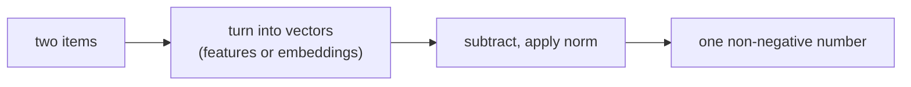

> Tier 1 · Mathematics for AI · **Level: beginner** · Reading time: about 9 minutes

# 1.16 Distance metrics

**Metadata** — Tier: 1 · Phase: 1 · Priority: P0 · Difficulty: 2/5 · Interview: High · Hands-on: High
Prerequisites: 1.15 · Leads to: 1.17, k-NN and clustering (Tier 2), vector search (Tier 20)

> **In plain words**
> A **distance metric** is a rule that says **how far apart two things are**, as one number. Small means similar, large means different.
> "How far" depends on how you measure: a bird flies straight (Euclidean), a taxi follows the street grid (Manhattan). Pick the measure your model was built for and use it everywhere.

**You need first:** 1.15 Norms.

> **Figure 1.16-1 — distance concentration in high dimension**
>
> 
>
> *How to read it:* for 1,000 random points and one query, the y-axis is (farthest − nearest) / nearest distance. In 2 dimensions the farthest point is about 59 times farther than the nearest; at 500 dimensions the contrast is only about 0.19, so "nearest" and "farthest" barely differ. This is why raw distances lose meaning in high dimension.
>
> *Generated by* `tier-01-mathematics/figures/src/t1_geometry.py`.

**Words you'll meet on this page**

| Word | What it means here |
|---|---|
| metric | a distance with four fair-play rules (below) |
| Euclidean | straight-line distance (L2) |
| Manhattan | sum of per-axis differences (L1) |
| Chebyshev | the largest single-axis gap (L∞) |
| Hamming | number of positions that differ |
| cosine distance | `1 − cosine similarity`; compares direction (1.17) |
| curse of dimensionality | in very high dimension all distances look alike |

### 1. What is it?
A function `d(a, b)` giving how far apart `a` and `b` are. A true **metric** obeys four rules:
1. `d ≥ 0`
2. `d(a, b) = 0` only if `a = b`
3. symmetry: `d(a, b) = d(b, a)`
4. triangle inequality: `d(a, c) ≤ d(a, b) + d(b, c)`

### 2. Why does it exist?
"Similar" has to become something a computer can calculate. Nearest neighbours, clustering, retrieval, anomaly detection and many loss functions all rest on a notion of distance.

### 3. Detailed explanation
Distances from norms: `d(a, b) = ‖a − b‖`.
- **Euclidean (L2):** the straight line.
- **Manhattan (L1):** sum of per-axis differences; less sensitive to outliers.
- **Chebyshev (L∞):** the largest single-axis gap.
- **Minkowski:** the general Lp version.
- **Hamming:** number of differing positions (codes, hashes).
- **Cosine distance:** `1 − cos(a, b)`. It compares direction only and is not a true metric (the triangle inequality can fail).
- **Inner-product "distance":** `−a·b`. Also not a metric, but common in retrieval.

**A useful fact for unit vectors:** `‖a − b‖² = 2 − 2·cos(a, b)`. So on normalised embeddings, ranking by L2 distance, by cosine and by dot product gives the **same order**.

**Curse of dimensionality.** In very high dimension the distances between random points bunch together: the nearest and the farthest become almost equally far. Raw distance then discriminates poorly (see the figure). Learned embeddings help because the useful data lies on a much lower-dimensional shape.

### 4. How does it work?
Subtract the two vectors, then apply a norm. If features have different scales (age in years, income in thousands), standardise them first or the large-scale feature dominates.

### 5. Simple example
A taxi in a grid city versus a bird:

| From (0,0) to (3,4) | Distance |
|---|---|
| bird (Euclidean) | 5 |
| taxi (Manhattan) | 7 |
| longest single leg (Chebyshev) | 4 |

**Hamming:** `10110` and `10011` differ in 2 positions, so the distance is 2.

### 6. Technical example
k-NN classification and k-means (Euclidean), semantic search (cosine or inner product), duplicate detection (Hamming distance between hashes such as SimHash).

### 7. Code
**① By hand (plain Python).**

```python
import math

def euclidean(a, b): return math.sqrt(sum((x - y) ** 2 for x, y in zip(a, b)))
def manhattan(a, b): return sum(abs(x - y) for x, y in zip(a, b))
def chebyshev(a, b): return max(abs(x - y) for x, y in zip(a, b))
def hamming(a, b):   return sum(x != y for x, y in zip(a, b))

print(euclidean([0, 0], [3, 4]), manhattan([0, 0], [3, 4]), chebyshev([0, 0], [3, 4]))
print("hamming:", hamming("10110", "10011"))
```

```text
5.0 7 4
hamming: 2
```

**② With NumPy.** Checking the unit-vector identity.

```python
import numpy as np

rng = np.random.default_rng(1)
u, v = rng.standard_normal((2, 8))
u, v = u / np.linalg.norm(u), v / np.linalg.norm(v)       # make both length 1
cos = u @ v
print("L2 squared      :", round(float(np.sum((u - v) ** 2)), 6))
print("2 - 2*cosine    :", round(float(2 - 2 * cos), 6))
```

```text
L2 squared      : 2.350517
2 - 2*cosine    : 2.350517
```

**③ With PyTorch.** Distances between all pairs at once.

```python
import torch

points = torch.tensor([[0., 0.], [3., 4.], [6., 8.]])
print(torch.cdist(points, points))            # table of Euclidean distances
```

```text
tensor([[ 0.,  5., 10.],
        [ 5.,  0.,  5.],
        [10.,  5.,  0.]])
```

### 8. Input → Process → Output



<details>
<summary><b>Beyond the basics (sections 9–16)</b> — real-world use, limits, mistakes. Skip on a first read.</summary>

### 9. Enterprise use case
Fraud and anomaly detection flags points far from cluster centres; product deduplication uses Hamming distance over hashes.

### 10. AI engineering connection
Vector database metrics (`L2`, `cosine`, `inner product`); clustering of embeddings; contrastive learning pulls matching pairs close and pushes others apart; k-NN retrieval (Tier 20).

### 11. Advantages
Simple, model-agnostic, fast with indexes.

### 12. Limitations
Depends on feature scaling; weak in very high dimension; says nothing about meaning unless the embedding is good.

### 13. Trade-offs
Euclidean (length and direction) versus cosine (direction only). Use the metric the embedding model was trained with.

### 14. Common mistakes
Mixing metrics between indexing and querying; not normalising features; using cosine distance where an algorithm needs the triangle inequality; comparing distances across different embedding models.

### 15. Performance / cost
Exact search is `O(N·d)` per query. Approximate indexes (HNSW, IVF, product quantisation) trade recall for speed and memory. Normalising once at ingest turns cosine into a plain dot product.

### 16. Security
Nearest-neighbour results can reveal which items are in a store; enforce access control inside retrieval, not after it.

</details>

### 17. Interview explanation
"A distance metric turns similarity into a number. Euclidean is straight-line, Manhattan sums the per-axis gaps, and cosine compares direction. For normalised embeddings they give the same ranking, so I choose the one my embedding model was trained for and keep it consistent between indexing and querying."

### 18. Rapid-fire answer
Metric = non-negative, symmetric, triangle inequality; on unit vectors L2² = 2 − 2cos.

### 19. Interview questions
- **Basic:** What are the Euclidean and Manhattan distances between (0,0) and (3,4)?
- **Intermediate:** Is cosine distance a metric?
- **Advanced:** Why do distances concentrate in high dimensions?
- **Scenario:** Search quality drops after switching embedding models without re-indexing. Why?

### 20. Hands-on exercise
**Goal:** see distance concentration yourself.

1. For `d` in 2, 20, 500: draw 1,000 random points and one query point (standard normal).
2. Compute the Euclidean distance from the query to each point.
3. Print `(max − min) / min`. What happens as `d` grows?

<details>
<summary>Show a solution</summary>

```python
import numpy as np

rng = np.random.default_rng(0)
for d in (2, 20, 500):
    pts = rng.standard_normal((1000, d))
    q = rng.standard_normal(d)
    dist = np.linalg.norm(pts - q, axis=1)
    print(f"d={d:>3}  (farthest - nearest) / nearest = {(dist.max() - dist.min()) / dist.min():.2f}")
```

```text
d=  2  (farthest - nearest) / nearest = 59.36
d= 20  (farthest - nearest) / nearest = 1.68
d=500  (farthest - nearest) / nearest = 0.19
```

The relative gap shrinks as `d` grows: everything becomes about equally far.
</details>

### 21. Revision questions
1. What are the four rules of a metric?
2. Which measures rank neighbours identically on unit vectors?
3. What does Hamming distance count?

### 22. Related concepts
1.15 Norms · 1.17 Cosine similarity · Tier 20 RAG fundamentals

### 23. One-line memory hook
**Distance = the norm of the difference; keep the same metric end to end.**

<details>
<summary><b>For reviewers</b> (not part of the lesson)</summary>

- Status: DRAFT, learner-first layout (Author: Claude). Code is executed by `tests/test_md_snippets.py`.
- TESTED earlier: `test_distances`, `test_euclidean_on_unit_vectors_relates_to_cosine` (`code/linalg_core.py`).
- The figure's numbers (59× at d = 2, 0.19 at d = 500) come from the figure script; the exercise uses a different seed so its numbers will differ slightly.
</details>
