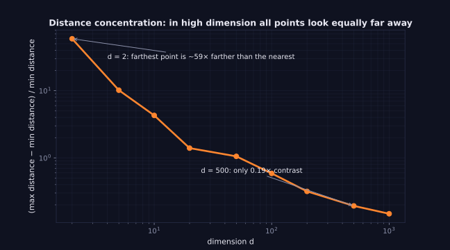

> Tier 1 — Mathematics for AI · Status: DRAFT (Author: Claude) · Code: `code/linalg_core.py` — TESTED

# 1.16 Distance metrics

**Metadata** — Tier: 1 · Phase: 1 · Priority: P0 · Difficulty: 2/5 · Interview: High · Hands-on: High
Prerequisites: 1.15 · Leads to: 1.17, k-NN/clustering (Tier 2), vector search (Tier 20)

### 1. What is it?
A function `d(a, b)` that says how far apart two items are. A true **metric** satisfies: `d ≥ 0`; `d(a,b)=0 ⇔ a=b`; symmetry `d(a,b)=d(b,a)`; triangle inequality `d(a,c) ≤ d(a,b)+d(b,c)`.

### 2. Why does it exist?
"Similar" must become something computable: nearest neighbors, clustering, retrieval, anomaly detection, and loss functions all rest on a notion of distance.

### 3. Detailed explanation
Norm-induced distances are `d(a,b) = ‖a−b‖`:
- **Euclidean (L2):** straight line.
- **Manhattan (L1):** sum of per-axis differences; less outlier-sensitive.
- **Chebyshev (L∞):** largest single-axis gap.
- **Minkowski:** Lp generalization.
- **Hamming:** number of differing positions (binary/categorical codes).
- **Cosine distance:** `1 − cos(a,b)`; compares direction. It is *not* a true metric (triangle inequality can fail), but `√(2−2cos)` on unit vectors is Euclidean.
- **Inner-product "distance":** `−a·b`; not a metric either, but standard in retrieval.

Key relation (unit vectors): `‖a−b‖² = 2 − 2cos(a,b)`. So on normalized embeddings, L2 ranking, cosine ranking and dot-product ranking are identical.

**Curse of dimensionality:** in high dimension, distances between random points concentrate (nearest and farthest become similar), so raw distance discriminates less; learned embeddings sidestep this by living on a low-dimensional structure.

### 4. How does it work?
Subtract, apply the norm. For feature vectors with different scales, standardize first or large-scale features dominate.

> **Figure 1.16-1 — distance concentration in high dimension**



*How to read it:* For 1,000 random points and one query, the y-axis is (farthest − nearest) / nearest distance. In 2 dimensions the farthest point is about 59 times farther than the nearest; at 500 dimensions the contrast is only about 0.19, so 'nearest' and 'farthest' barely differ. This is why raw distances lose meaning in high dimension.

*Generated by* `tier-01-mathematics/figures/src/t1_geometry.py` *from this chapter's code, so the numbers are computed, not typed in.*

### 5. Simple example
Taxi (Manhattan) vs bird (Euclidean) travel in a grid city.

### 6. Technical example
k-NN classification, k-means (Euclidean), semantic search (cosine / inner product), duplicate detection (Hamming on hashes, e.g., SimHash).

### 7. Code
```python
import numpy as np
from linalg_core import euclidean, manhattan, chebyshev, cosine_similarity
a, b = np.array([0.0, 0.0]), np.array([3.0, 4.0])
print(euclidean(a, b), manhattan(a, b), chebyshev(a, b))   # 5.0 7.0 4.0
u, v = (x / np.linalg.norm(x) for x in np.random.default_rng(1).standard_normal((2, 8)))
assert np.isclose(euclidean(u, v) ** 2, 2 - 2 * cosine_similarity(u, v))
```
TESTED (`test_distances`, `test_euclidean_on_unit_vectors_relates_to_cosine`).

### 8. Input → Process → Output
`two items → featurize/embed → subtract & norm → non-negative scalar`

### 9. Enterprise use case
Fraud/anomaly detection flags points far from cluster centroids; product dedup uses Hamming distance over hashes.

### 10. AI engineering connection
Vector database metrics (`L2`, `cosine`, `inner product`); clustering of embeddings; contrastive learning losses pull positives close and push negatives apart; k-NN retrieval (Tier 20).

### 11. Advantages
Simple, model-agnostic, fast with indexes.

### 12. Limitations
Depends on feature scaling; weak in very high dimension; says nothing about meaning unless the embedding is good.

### 13. Trade-offs
Euclidean (magnitude + direction) vs cosine (direction only). Use the metric the embedding model was trained with.

### 14. Common mistakes
Mixing metrics between indexing and querying; not normalizing features; treating cosine distance as a metric in algorithms that require the triangle inequality; comparing distances across different embedding models.

### 15. Performance / cost
Exact search is `O(N·d)` per query. ANN indexes (HNSW, IVF, product quantization) trade recall for speed and memory; normalizing once at ingest turns cosine into a plain dot product.

### 16. Security
Nearest-neighbor results can reveal membership of items in a store; enforce access control inside retrieval, not after.

### 17. Interview explanation
"A distance metric turns similarity into a number. Euclidean is straight-line, Manhattan sums per-axis gaps, and cosine compares direction. For normalized embeddings they give the same ranking, so I pick the one my embedding model was trained for and keep it consistent between indexing and querying."

### 18. Rapid-fire
Metric = non-negative, symmetric, triangle inequality; on unit vectors L2² = 2−2cos.

### 19. Interview questions
- Basic: Euclidean vs Manhattan between (0,0) and (3,4)?
- Intermediate: Is cosine distance a metric?
- Advanced: Why do distances concentrate in high dimensions?
- Scenario: Search quality drops after switching embedding model but not re-indexing — why?

### 20. Hands-on exercise
Generate 1000 random points in d = 2, 20, 500; compute the ratio (max distance − min distance)/min distance to a query and show it shrinks as `d` grows.

### 21. Revision questions
1) Four metric axioms? 2) Which metrics rank identically on unit vectors?

### 22. Related concepts
1.15 Norms · 1.17 Cosine similarity · Tier 20 RAG fundamentals

### 23. Memory hook
**Distance = norm of the difference; keep the metric the same end to end.**
